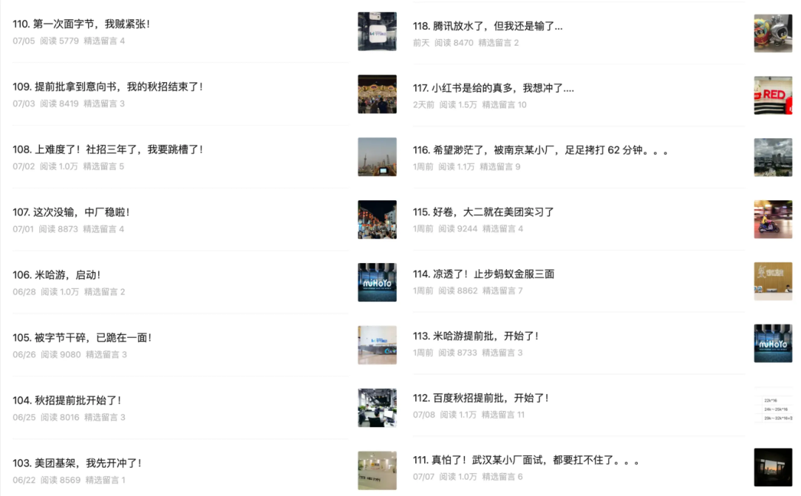
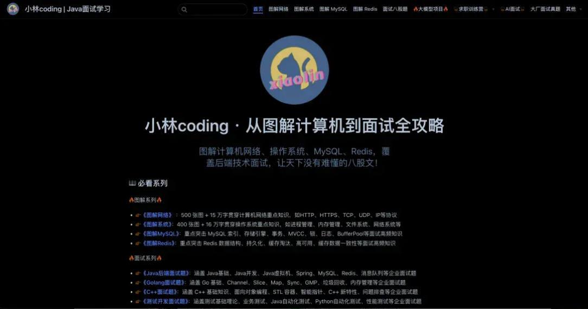

# 小林八股面试题汇总

大家好，我是小林。

我在公众号「小林coding」已经累计发布了 300+ 多篇互联网中大后端开发的面经，涵盖腾讯、字节、阿里、 美团、京东、快手、百度、滴滴、米哈游等互联网公司，也涵盖部分中小厂、银行、国企的面经。

所有的面经都来自于同学们真实面试题库，并且我针对每一篇面经都做了解析。

我想着，既然已经输出这么多面试题了，那么干脆就整理一个 **面试题集合** 了。

说干就干，当时临时有了这个想法，花了 5 个小时翻阅了以前自己发布过的 200 多篇面经，然后针对每一篇的问题进行分类收集。

不整理还不知道，一整理直接吓一跳了，竟然共整理出了 **40 万字的面试题**，具体有多少个面试题，我已经数不过来了，几百个肯定是有的。

再次感概，这就是坚持的力量，当一件小事情坚持做个一年，就有质的变化了。

当初写图解系列文章也是如此，没想着一开始要写一个很完整的系列，只是每周写一篇，按知识点顺序往下写，坚持一年之后，就慢慢形成了一个体系的图解系列文章了。

我们总是高估短期的努力，低估了长期的努力。

粗糙的开始，才是最重要，完美的准备只会让自己懈怠，总感觉自己这没准备好，那没准备好，最终计划就是一直搁置的状态。

虽然这套面试题不是像图解系列这样体系的学习内容，但是非常适合大家面试突击的时候快速复习， **以面试作为驱动力**，高效地复习八股文。

当然，也可以作为大家自己学完后端开发的知识之后，检验自己的学习成果，看一下面对这些问题的时候，是否能回答出来，如果感觉某个面试题不太模糊，就可以针对性的去翻阅书籍和资料加强，如此往复，你不想变强都难。

这套 Java 面试题有什么优势？

- **覆盖面广**：共近 **20 套面试题**，覆盖 **Java 基础、Java 集合、Java 并发、JVM、Spring、C++、Golang、 MySQL、Redis、消息队列、分布式、系统设计、网络、操作系统、数据结构与算法、Linux命令、Git命令**，都是互联网大厂后端开发面试常考的知识内容
- **内容质量高**：全部面试题都由小林亲自整理的，每一套面试题都是万字内容，平均 1.5w+ 字，最高近 3w+ 字， **全套面试题近 40 万字**
- **高命中率**：全部面试题都来自于 **真实面试题**，并且都是 **最近一年出现的题目**，学到的就会被问到，投入产出比高
- **涵盖企业多**：涵盖 **腾讯、字节、阿里、 美团、京东、快手、百度、滴滴、米哈游** 等互联网大厂的面试题，也涵盖部分中小厂、银行、国企的面试题
- **清晰分类**：每一个面试题都针对做好了清晰的分类，便于逐个攻克知识点，还有一些一层一层追问的面试也收录进来了

复习完这一套小林的面试题集合，等于面完了各大互联网公司，你就说值不值得学！

- 有错误怎么办？

小林是个手残党，时常写出错别字。

如果你在学习的过程中， **如果你发现有任何错误或者疑惑的地方，欢迎你通过以下方式给我反馈**：

登记飞书表格：小林图解网站问题反馈登记（推荐）

在线网站阅读

- 八股面试题汇总在线阅读地址是：https://www.xiaolincoding.com/interview/

近 20 套面试题：Java 基础、Java 集合、Java 并发、Java 虚拟机、Spring、C++、Golang、MySQL、Redis、 消息队列、分布式、系统设计、网络、操作系统、数据结构与算法、Linux命令、Git命令

## Java面试篇

|**面试题名称**|**题目数量**|**字数统计**|
|---|---|---|
|Java基础面试题|95题|2.5w字|
|Java集合面试题|55题|1.6w字|
|Java并发编程面试题|72题|2.6w字|
|Java虚拟机面试题|40题|1.6w字|
|Spring面试题|65题|2.3w字|

## C++面试篇

|**面试题名称**|**题目数量**|**字数统计**|
|---|---|---|
|C++面试题|123题|2.8w字|
