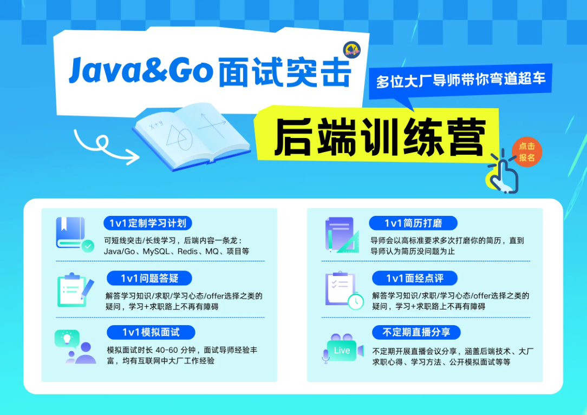
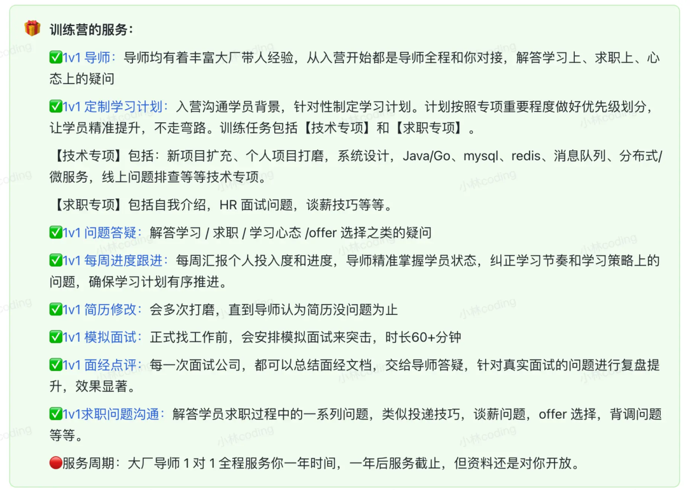
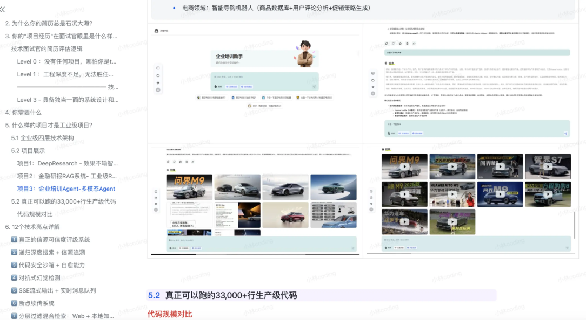
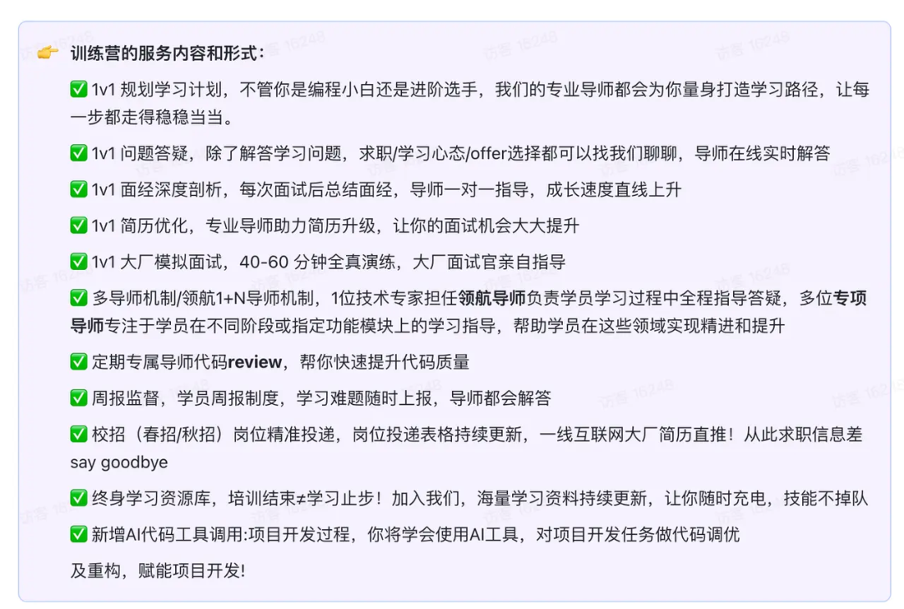

# **<u>💪求职辅导训练营</u>**

# 求职辅导训练营

小林后端开发训练营

- 点击了解小林后端开发训练营：针对面试求职的 Java/Go 后端训练营，由多位大厂导师，帮助校招/ 社招学员从 0 到 1 拿到满意的 offer

小林社招后端1v1私教

- 点击了解小林社招后端1v1私教：针对社招面试跳槽的 Java/Go 后端训练营，由 1 位大厂导师全程跟进辅导，帮助学员后端系统全面的提升

小林大模型开发训练营

- 点击了解小林大模型开发训练营：针对面试求职的大模型AI应用开发训练营，已帮助数百位零基础同学在校招/社招中拿到了满意的 offer

小林C++开发训练营

- 点击了解小林C++开发训练营：针对面试求职的 C++ 开发特训，大厂导师全程带练，帮助学员从语法基础项目实战，冲击高薪offer

## 小林测试开发训练营

- 点击了解小林测试开发训练营：针对面试求职的测试开发训练营，大厂导师 1v1 私教，帮助校招/社招学员从 0 到 1 拿到测开满意的 offer
