番外篇｜小林图解故事

## 我又坚持一年了 ｜2021年度总结

写于：2022-01-03，原文地址：我又坚持一年！

大家好，我是小林，迟来的新年快乐！

前两天陪家里人玩去了，也给自己休息了两天，回顾去年，我大部分节假日都有在更新文章，有时候出去玩的时候，心里总惦记今天要发文章，所以每次都玩的不是很尽兴，总想快点回家写文章。

自从出门到哪都得带上又罩后，我总感觉时间还在 2020 年，结果恍惚间竟然 2022 年了，虽然年份已到这，但是嘴里说年份或者手写年份的时候，总是想到 2020 年，有没有同感的小伙伴。

一年过去了，这是我坚持写图解文章的第二个年头。

虽然去年没有做出什么耀眼的事情，但是还是简单给自己做个年终总结，给自己一个交代，告别过去，迎接新的期许。

去年，我主要输出的主线是「图解网络、图解系统、图解MySQL、图解Redis」类的系列文章。

都是偏向后端技术栈，文章的内容也都是偏向面试中常问的知识，每一篇都自己手绘了很多图，目的也很简单，击破大家对于「八股文」的恐惧。

大概在去年中的时候，我觉得图解网络和图解系统系列文章写的差不多了，有很多读者反馈希望将这些文章做个汇总。

于是，我就将它们汇总了起来，出了图解网络和图解系统两本电子书，每一本电子书基本都是接近 20W 字 + 500 张图：

小林的图解系统，大曝光！

不鸽了，小林的「图解网络 3.0」发布！

出了后反响出奇的好，得到了非常的读者的认可，同时也有很多出版社老师找我出书。甚至，还被微信官方评定为 「互联网精英」都在看的文章，有点好笑，但是侧面证明了，我的读者们都是精英哈哈！

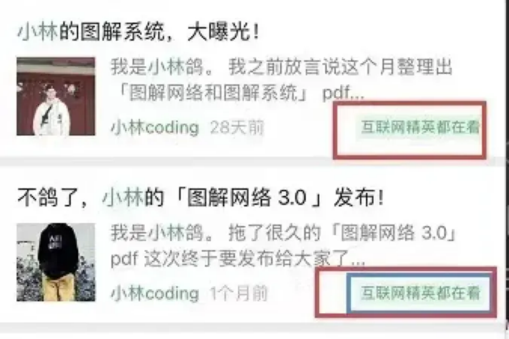

每隔一段时间，都有不少小伙伴跑来私信我说，看完我的图解，面试时再遇到计算机网络和操作系统方面的面试题都没在怕的了，不少小伙伴也因此斩获了多家大厂 offer。

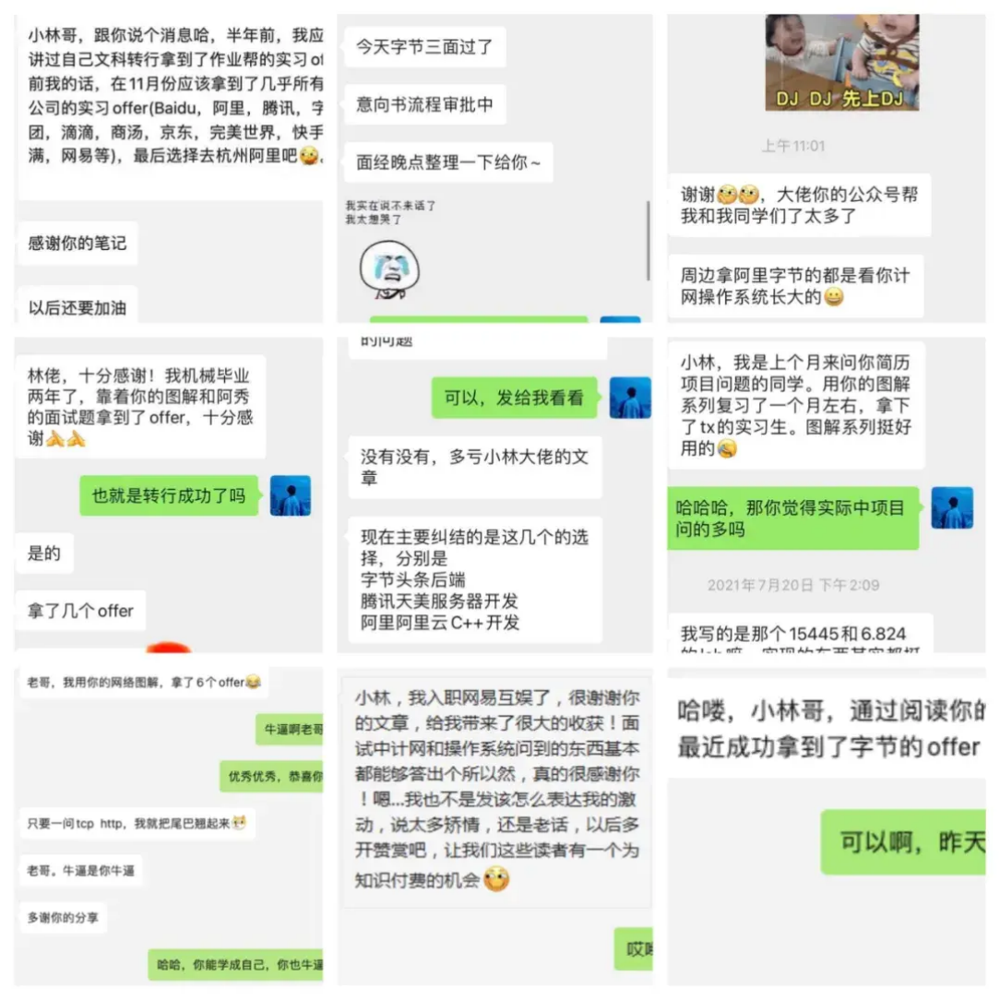

我也把读者们的故事收录在了这里：小林读者们的校招经验。这里面基本都是读者们去去年面试的分享，包含学习经验分享、面试心得分享、转行心得分享、项目经验分享等等。今年要准备春招或者秋招的小伙伴可以去看看前辈们的经验，你会有所帮助的。

年中图解网络 PDF 发布后，我也没有停止这个系列文章的更新，后面我根据 PDF 缺失的内容，以及读者面试时遇到的网络问题又输出了 20 篇文章，来年又可以出一个更完善的图解网络 PDF 了！

比较可惜是，图解MySQL 和图解Redis 还在连载中，内容还没到能整理成 PDF  级别。虽说如此，但是这两个系列文章，每个系列都写了 10 多篇文章，每一篇依然硬核，且饱含大量的图片。

除了图解系列的技术文章，我在去年写了一些其他精彩的文章，我这里汇总下：

我的看书心得，帮助到了很多同学，建议没看过的同学，去看看：看书的一点小建议。

- 用一个案例把计算机原理 + 操作系统 + 数据结构 + 计算机网络融会贯通，带大家感受下感受计算基础之美： 如何将计算机组成、操作系统、计算机网络、数据结构与算法融会贯通？

计算机基础学习路线，包含书籍和视频推荐：计算机基础学习路线

- 回购我写博客以来拿到的礼品：又得奖了！
- 我记笔记和画图工具的分享：最适合程序员的云笔记？ + 最适合程序员的画图工具？

发布图解网络和图解系统的两篇文章的底部我都了赞赏，成了我赞赏最多的两篇文章。

至今，累计收到了近 700 人的赞赏，累计金额大概有 3400 元。

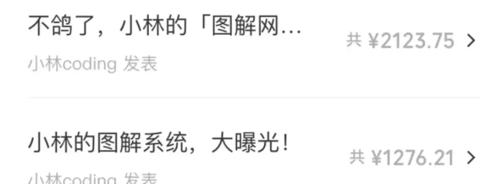

除了微信公众号文章里的赞赏，我因为在 PDF 末尾都放了赞赏码，所以时不时也会收到来自远方读者的打赏的钱。

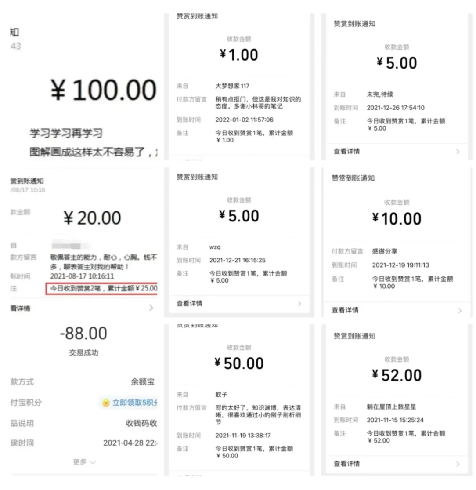

每当打开微信，收到大家因为看了我的 PDF 收获很大，而因此用打赏的行动表示感谢，我都会感到无比的温暖，也很受鼓励，这种感觉很难言语，是一种很棒的感觉。

这些累计的收到打赏的钱，我基本都捐给河南郑州。

因为 21年7月底的时候，郑州发生了有史以来最大的洪水，当时极度缺乏物资，更何况关注我的读者里，有 1000 多位是来自郑州的，于是就抛砖引玉捐了点小钱。

所以，这是我去年做的最有意义的事情，用自己输出文章收获读者们的打赏认可，我又用这笔钱为真正需要的人带去了多一点的温暖。

另外，去年我在公众号和朋友圈累计送出了 200 多本书，下面是我去年在朋友圈点赞送书活动：

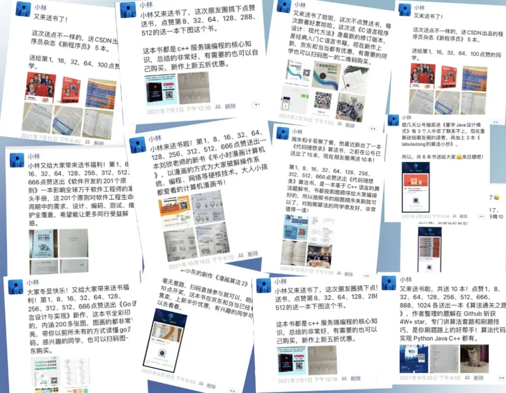

去年我养了两只猫，一个是美短，一个是银渐层。

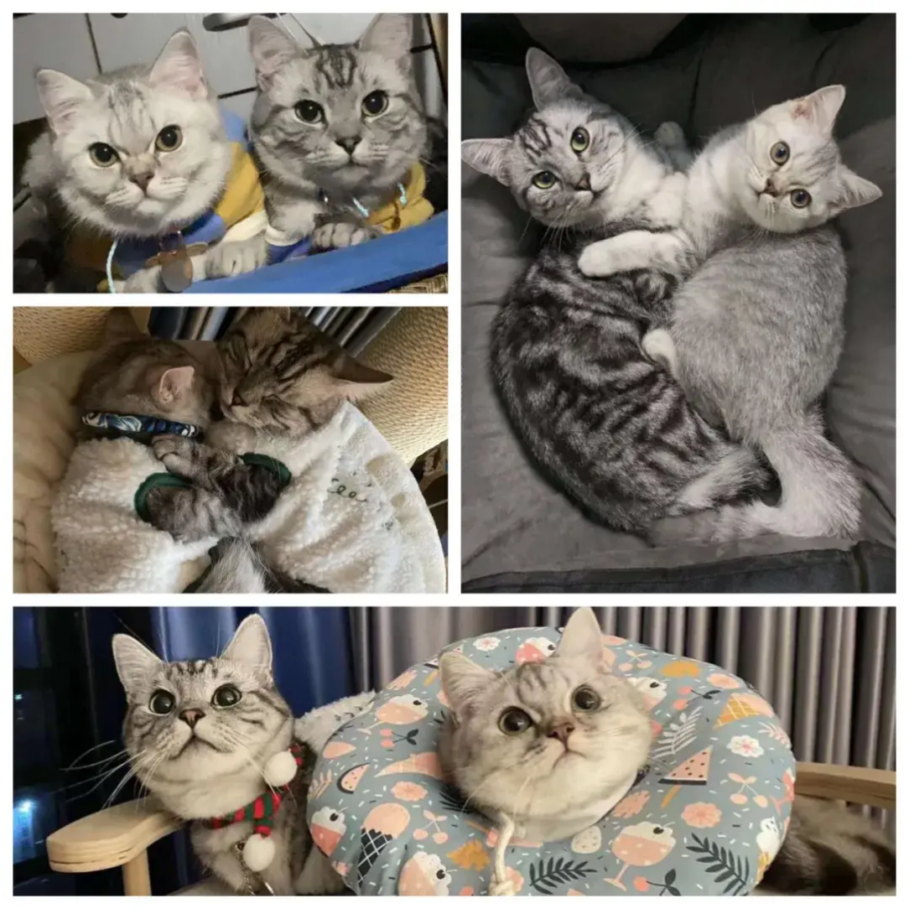

美短已经一岁多了，银渐层也已经 6 个月了。银渐层这只特别爱吃，吃完自己的猫粮，还要抢美短碗里的猫粮，所以现在的体型逐渐往肥美发展，重量已经超过一岁多的美短了。

这两只猫咪性格都比较好，也很乖，没有发生过抓人事件，两只相处的也很和谐。

去年最自豪的事情，自己出钱帮爸妈放置了 5 年的毛坯房子装修了。

房子装修了很久，因为全程都是我们自己设计和布置的，最近终于入住了进来，房子的装修风格是现代风格。

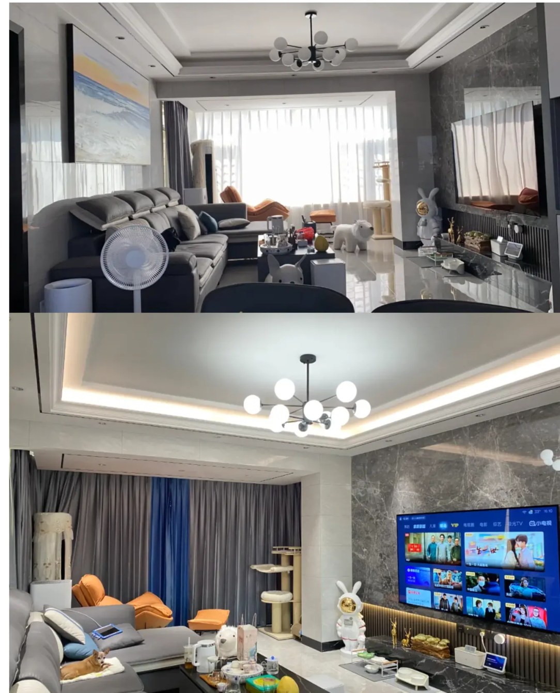

爸妈在惠州开茶叶店，这房子是我爸妈奋斗了大半辈子买的房子，做生意常年被欠款，又追不回来，再加上线下生意越来越惨淡，以至于没有钱去装修这套房子，所以放置了 5 年之久，一直都是租着房子。

然后自己前几年毕业出来工作后，攒了点钱，想着爸妈都 50 多岁了还租着房子，于是干脆就把爸妈的房子装修一波，这样住起来舒服点。

装修完，自己所剩的钱也不多了，继续奋斗，继续攒钱，争取早日买到自己的房子和车子。

#### 05

大家看到这，是不是觉得小林去年好像满满都自律感和正能量？

其实并不是这样的，我也有一段时间过的很颓废，疯狂的摆烂。

刚写公众号的时候，我每个星期真的跟打鸡血的一样，用下班时间不停地输入，然后不停地输出高质量的图解文章，真的是乐此不疲。

但是这种鸡血状态，一旦没了，会觉得做的这些事情又累又无趣。

去年 10 月份的时候，工作上的事情越来越多，做的开发也越来越复杂，一天经历基本都耗在工作上，回到家就只想躺着，以放松为理由，刷 B 站、刷短视频，刷的越爽，文章就越不想写，但是每次刷完，焦虑感就越强。

然后那时候又出了英雄联盟手游，我大学时很常玩英雄联盟，但是工作后就没在玩过。当时看到出了英雄联盟手游，我就想回味一下青春，开始玩起了手游。

这游戏真的很容易上瘾，每次都嘴上说说自己每天只能玩 2 盘游戏，但是打排位上分的时候，一盘输了，就想下一盘扳回来，有了这个想法后，就会一直一直打，那时候我周末，时常打到凌晨 1-2 点。

这种状态持续了 1-2 个月，当时排位是打到了钻石，也算是一个不错的战绩，但是现实中的事情却一塌糊涂，图解文章更新频率严重下降，自己很多计划做的事情，也没有执行到位。

后面，有个夜晚被队友连坑输 5 盘游戏后，于是我就把游戏卸载了，感谢当晚让我顿悟的队友。

卸载了游戏后，我就一顿猛输出。

直接写了一篇今年最长的图解文章：为了拿捏 Redis 数据结构，我画了 40 张图（完整版），这篇文章高达 2 万字 + 40张图。

后面也陆陆续续输出了一些图解文章，但是还是没有完成《图解MySQL》和《图解Redis》PDF，这个遗憾就留着今年来补吧！

#### 6

最后，说下新年的一年，我对自己的期许。

第一，不要通过熬夜透支身体的方式来半夜努力，我时常写图解文章，会写到半夜，但是我觉得这不是一个很好的状态，所以希望新的一年自己作息能保持正常，高效率地做事情。

第二，每周抽时间多多运动。不求打造八块腹肌，但是期望自己有个健康的体魄，去年我基本没怎么运动，时间基本都拿来肝图解文章了。

第三，尽早完成《图解MySQL》和《图解Redis》PDF。这个不停有读者在催，这个必须先拿下。

第四，建一个计算机八股文网站，开源自己的文章。自己输出了那么久，而且都是按照系列知识来输出的，是有一定的系统性的，相比 PDF 这种离线阅读，在线阅读可能会更好，而且这样一些勘误也能及时更新。

第五，能以视频化的方式输出自己的内容。这个时代，图文内容已经没有视频内容香了，再不变化，就要被淘汰啦。

第六，多学习非技术类的书籍或资料。虽说身为程序员我们用技术吃饭，但是我们应该扩宽自己的知识面，增加多一些可能性。

以上就是我新的一年 flag。

flag 立好好了，并不是要我们一定要完成，没完成也不丢脸的，它的意义在于给我们新的一年有一个前进的大方向的。

这样，即使中途走歪了，也能回想起来自己的 flag，摆正回来，继续冲！

## 我又坚持 3 年了 ｜2024年度总结

写于：2025-01-28，原文地址：我坚持 3 年了！！

大家好，我是小林。

今天就是除夕夜啦，时间过的真快，转眼又是一年，又是坚持输出的一年，这次上来跟回顾图解网站那些事。

我的图解网站（`xiaolincoding.com`），在 2022 年正式上线，至今已经苟活快 3 年了，在这期间陪伴了几十万的读者，也很荣幸成为大家面试必刷的内容之一。

最开始图解网站的内容是《图解网络》、《图解系统》、《图解MySQL》、《图解Redis》这四大系列，都是以图文的形式带大家攻破技术难点和重点知识。

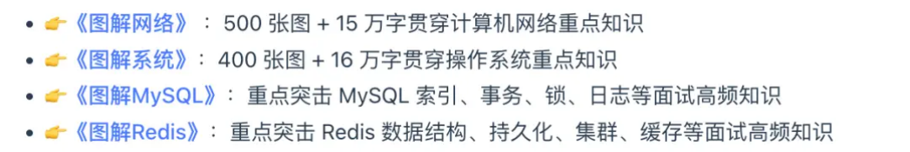

看我网站的大部分都是即将校招求职或者社招跳槽的同学们，之前有很多同学跟我分享了他与图解网站的故事，看到大家的故事，心中都有特别大的成就感！

有备战面试的同学跟我说，他经常拿着 ipad 在实验室楼梯里，安静着看着我图解网站的内容，最高兴的是，这位同学告诉我他最后如愿上岸了大厂。

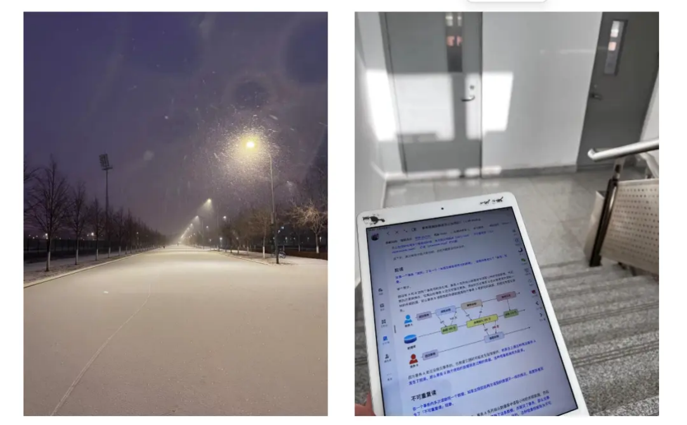

还有好硬核的读者，把我图解网络和图解系统打印出来学习，我只想知道这厚度，不知道会不会把泡面压坏哈哈哈，甚至感觉很适合垫电脑屏幕呢。

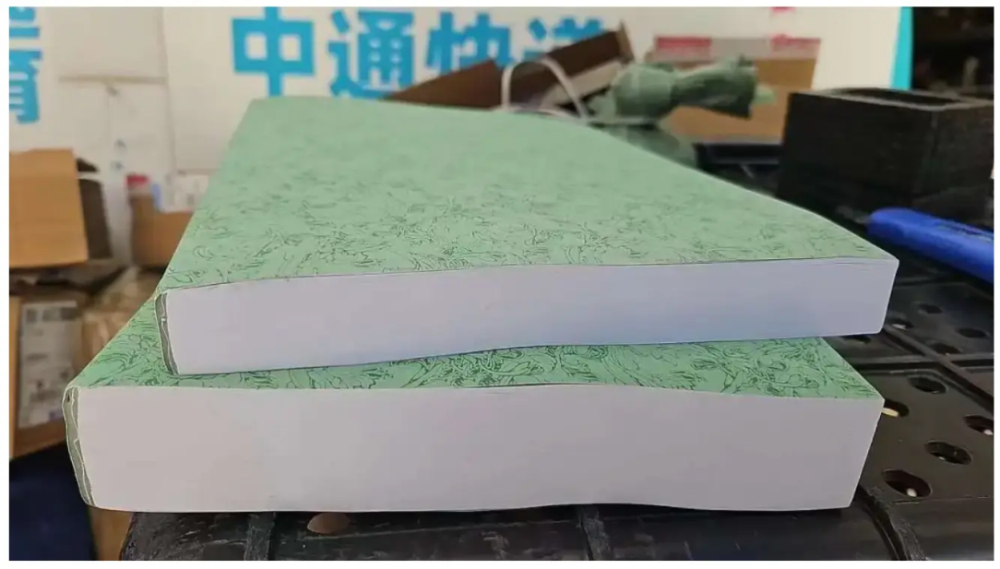

也有同学跟我说，我的内容被他们大学老师推荐了。

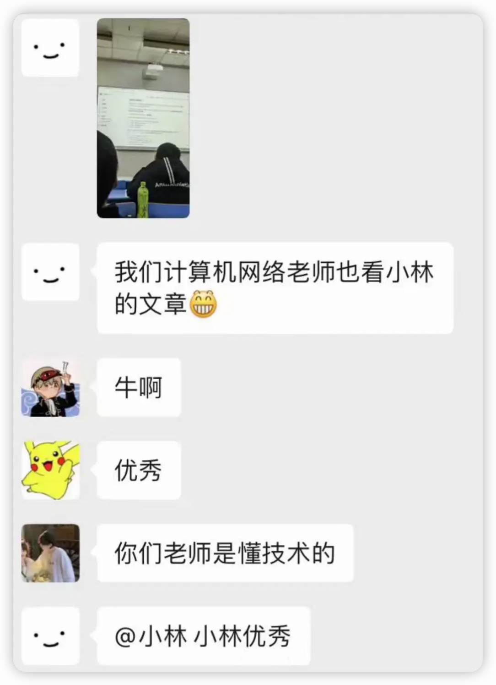

还有同学学校的就业分享会，看到我的图解网站被求职成功的学长学姐推荐啦

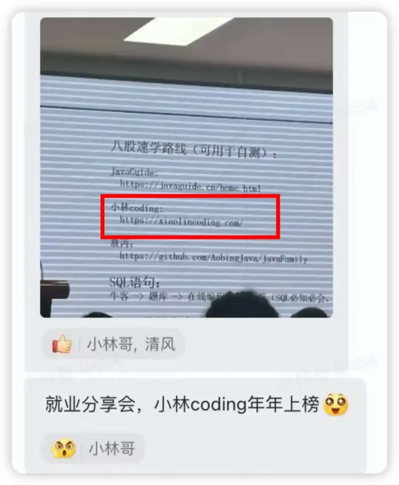

还有同学入职大厂之后，在大厂内部技术论坛看到图解网站被他们的架构师推荐了。

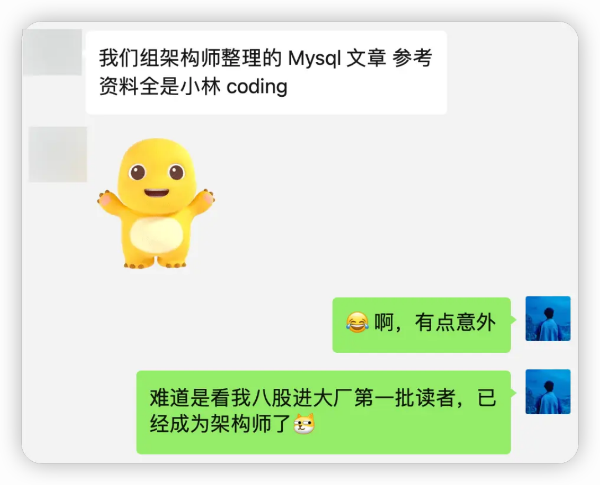

这些图解系列的文章内容过于硬核，会比较长，不太适合短期面试复习的内容，所以为了网站的内容更丰富，我就有了新目标，增加真实的面试题！

于是，我在 2024 年，我又继续肝了一年，持续在公众号分享各大互联网公司的面经， **这一肝就肝了近 100 万字**。

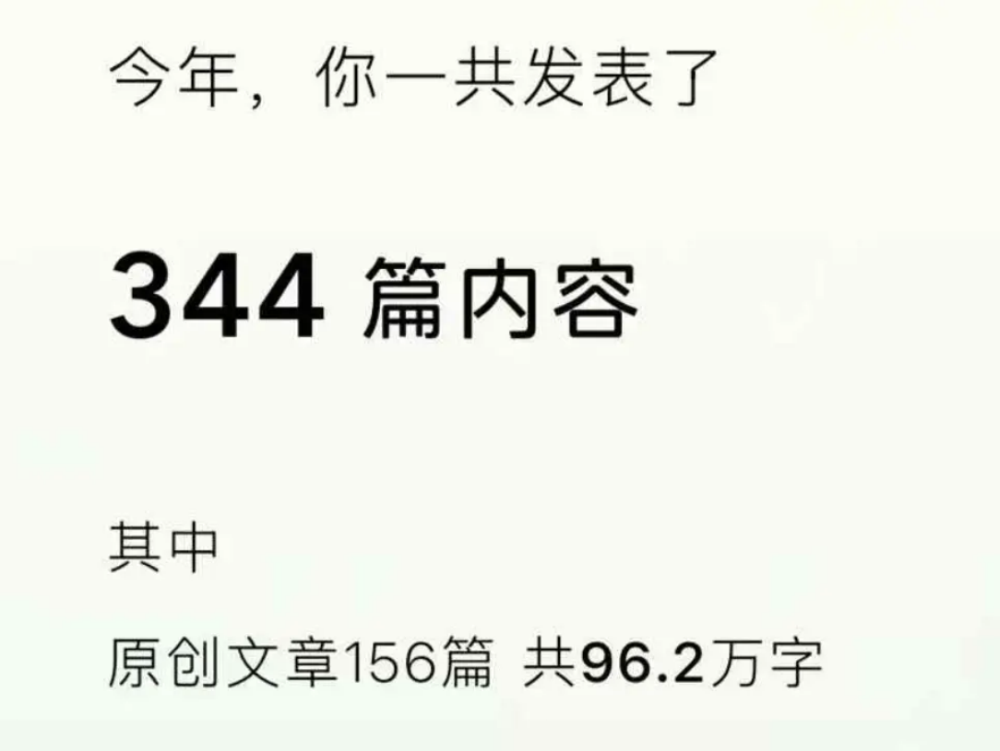

令我没想到的是，这一年竟然有 1560 人看过我所有面经，你们都是我的精神股东！

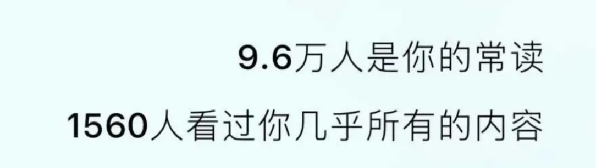

之所以一直持续在更新面经，主要也是让大家知道面试的时候，面试官到底对哪些知识是感兴趣的，不至于一头雾水的去面试，毫无准备的面试，通常大概率会失败的，不打没有准备的仗。

但是也有不少在准备面试的时候，花了非常的多精力，可是也是像个无头苍蝇一样，啥都学一点，最终的结果也是不理想的，这种主要是方向没搞对。

人生苦短，把有限精力放在面试官感兴趣的知识点来学习也是很关键的，这样的学习效果能事半功倍，把节省下来的时间，拿去好好玩，你们说是不是？

做一件事容易，可要咬着牙坚持做上一年，那可就太难了。

到现在已经累计沉淀了 **近 200+ 篇** 「互联网中大厂真实面经」，这里面涵盖了大家所熟悉的互联网公司的面经，所有的面经都来自于同学们真实面试题，并且我针对每一篇面经的技术八股都做了详细的解析。

有天深夜晚上，我想着既然沉淀的内容越来越多的，很明显这已经是个很庞大的学习内容了，所幸我就把在公众号发布过上百篇面经好好整理一下，放到网站上供大家学习了。

有了想法之后，就得立马说干就干！你们说是不是？

所以，我在 2024 年给网站增加了两大块内容，分别是《Java面试题》、《大厂真实面经》。

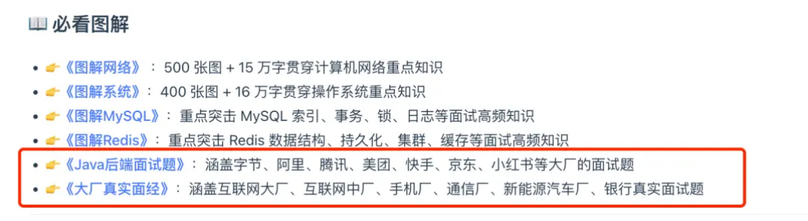

https://xiaolincoding.com

《Java面试题》系列是从写过的上百篇真实面经中，把面试题做了详细的分类，共总结了 **10 套面试题**，覆盖Java 基础、Java 集合、Java 并发、Spring、MySQL、Redis、网络、操作系统、数据结构与算法， **累计 20 万字**，都是互联网大厂后端开发面试常考的知识内容。

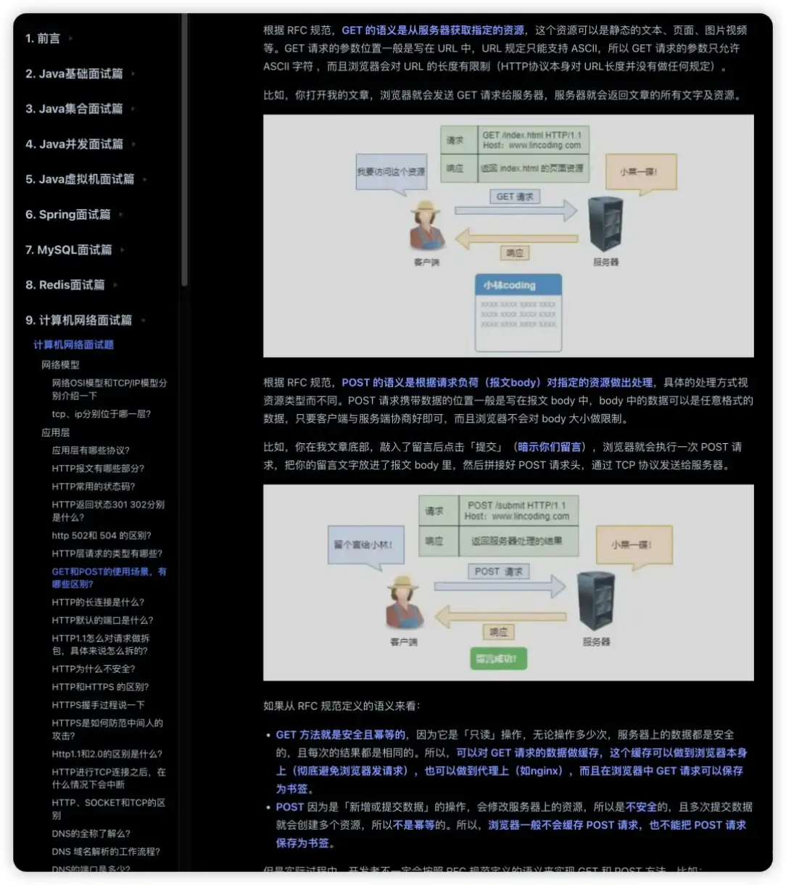

https://xiaolincoding.com/interview/

《大厂真实面经》系列是根据公司类型来划分，精选出了 **50+ 家公司的 Java 面经**，并按照「互联网中大厂」/「互联网中厂」/「手机厂」/「通信硬件厂」/「新能源汽车厂」/「银行」分类的方式，将这些精选的公司面经整理到网站。

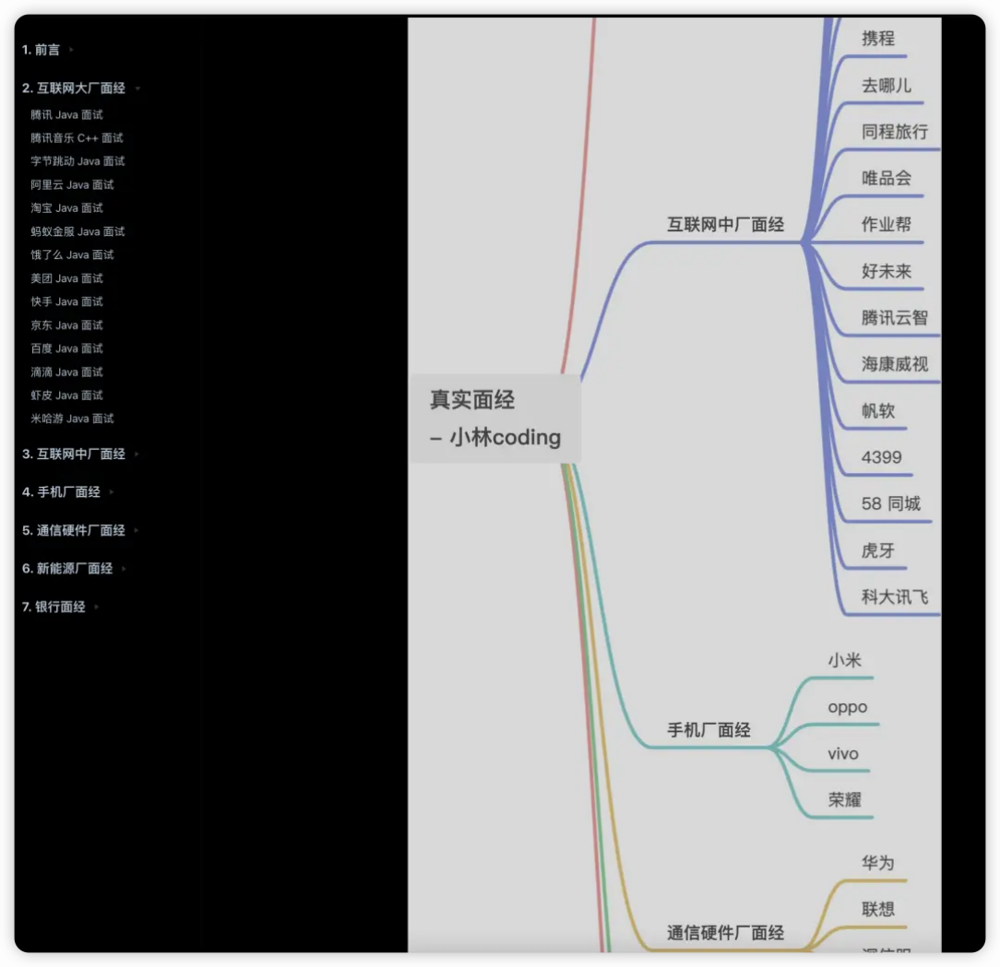

https://xiaolincoding.com/backend_interview/

#### 再来聊聊网站的打赏收入和运营成本。

我网站是有挂一个赞赏码，时不时会收到一些读者们的打赏支持，其中令我影响深刻的是一位当妈妈读者跟我说， 歇了一年，看了我网站的内容，学习到了很多知识，最终成功找到工作了。

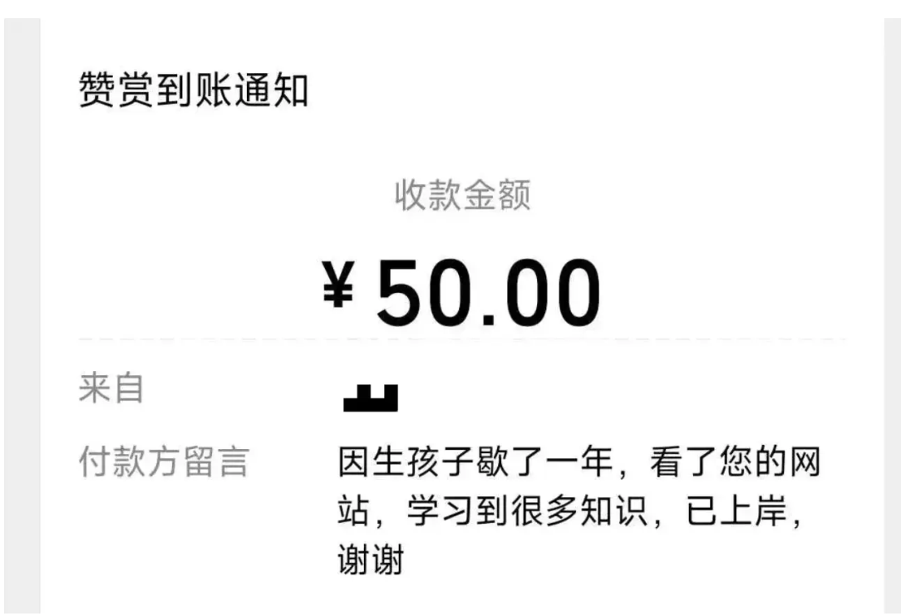

我也统计了一下，2024 年网站一共累计了收到了多少打赏，累计收到 180+位读者的打赏，共有 1759.97 元。

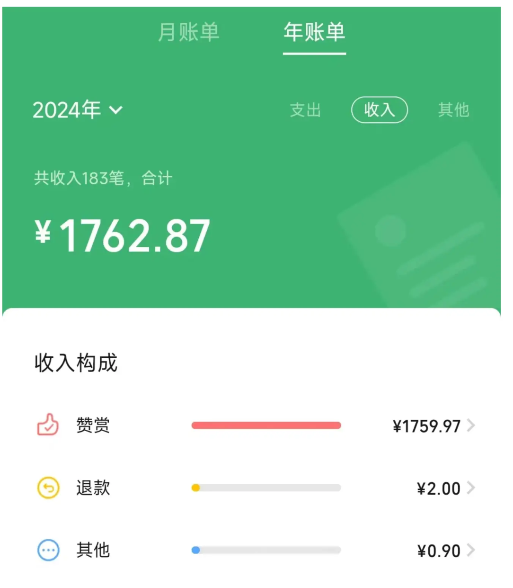

虽然说我网站很简单，但是耐不住同学们的学习热情，再加上网站的图片资源非常多，所以我网站的运营成本主要是流量成本，再加上网站时不时会被攻击或者盗刷流量，光是 2024 年这一年，网站就崩了 7 次，这要是在公司里，年终奖直接没了哈哈，这网站全年可用性 99 % 都没有。

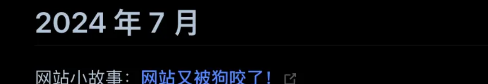

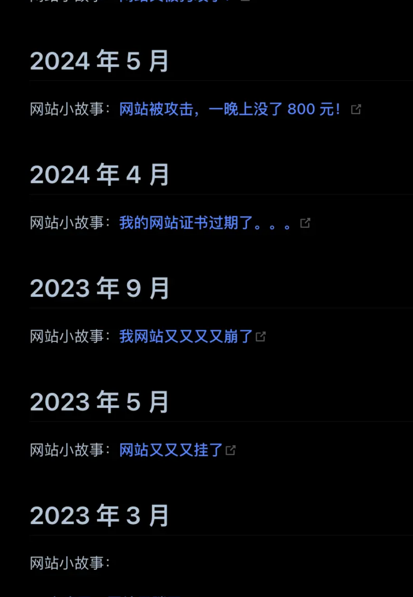

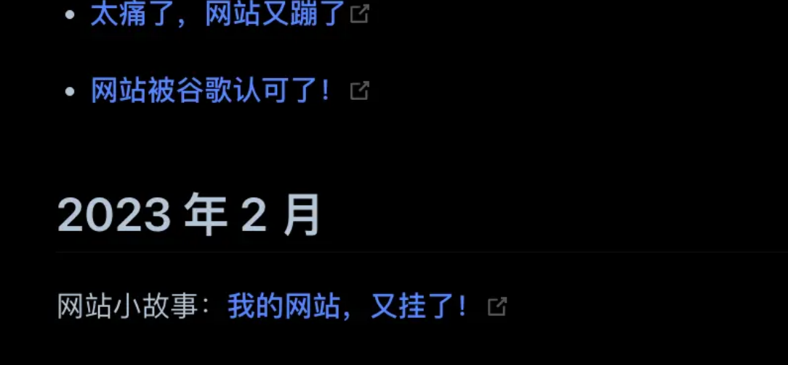

我也盘算了一下，网站这一年花了多少流量费：145（2 月份）+500（4 月份）+690（5 月份）+100（6 月份）+426 （7 月份）+266（8 月份）+370（9 月份）+426（10 月份）+163（12 月份）= 3086 元，再加上服务器一年的成本， 超过 4000 元啦。

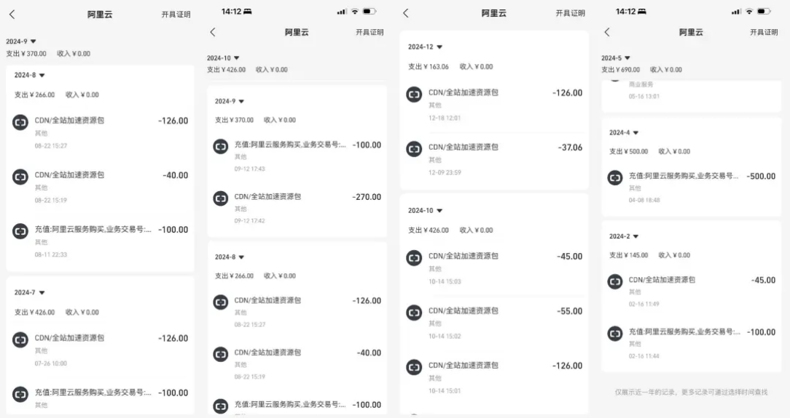

虽然打赏的钱无法支撑网站的服务器运营费，但是这个没关系，公众号会有甲方爸爸支持哈哈。

大家可以放一百个心，即使成本越来越高，网站我也会持续运营下去的。

我自己回顾文章的时候，也是喜欢在网站去看过去写过的内容，更不想让网站消失在大家的记忆里。

虽然说网站的内容不足以支撑大家长线的学习，但是当你们在需要的时候，打开网站来看看面试内容，能够陪伴大家某个关键的阶段，这就足够了。

祝大家新春快乐，有蛇有得有福气，无忧无虑无烦恼，开心就好！！！

