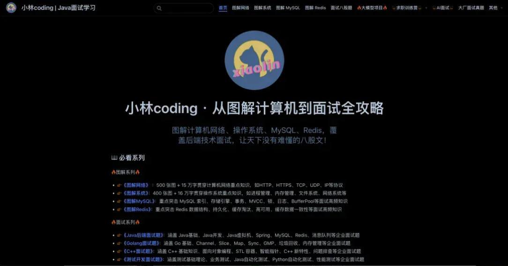

# 图解MySQL介绍

大家好，我是小林。

我是《图解MySQL》的作者，这是一份 **专注 MySQL 学习与面试的开源资料**，内容都是整理于我的公众号里的图解MySQL的文章。

简单介绍下《图解MySQL》，整个内容共有 **`20W` 字 +** **`320` 张图**，每一篇都自己手绘了很多图，目的也很简单，想通过「说人话+图解」的方式，让你轻松掌握 MySQL 的核心知识。

本《图解MySQL》PDF文档的内容，在我的图解网站也可以阅读

在线阅读地址是：https://www.xiaolincoding.com/mysql

## 适合什么群体？

- 《图解MySQL》写的 MySQL 知识主要是 **面向后端开发和 DBA** 的，因为小林本身也是个后端开发，所以涉及到的知识主要是关于日常开发或者面试的 MySQL 知识。

非常适合有一点 MySQL 基础，但是又不怎么扎实，或者知识点串不起来的同学，说白 **这本《图解MySQL》就是为了拯救半桶水的同学而出来的**。

因为小林写的图解MySQL就四个字， **通俗易懂**！

相信你在看这本图解MySQL的时候，你心里的感受会是：

- 「卧槽，索引原理原来是这样的」
- 「卧槽，事务和锁的关系我终于搞懂了」
- 「卧槽，MySQL 日志我串起来了」
- 「卧槽，相见恨晚」

当然，也适合面试突击 MySQL 知识时拿来看。《图解MySQL》里的内容基本是面试常见的知识点，比如索引、事务、锁、日志等等，也有很多面试常问的问题，比如：

- 为什么 MySQL 要用 B+ 树作为索引？
- 索引什么时候会失效？
- 事务的隔离级别是怎么实现的？
- MySQL 可重复读隔离级别完全解决幻读了吗？
- MySQL 有哪些锁？是怎么加锁的？
- update 没加索引会锁全表吗？

redo log、undo log、binlog 有什么用？

不敢说 100 % 涵盖了面试的 MySQL 问题，但是至少 90% 是有的，而且内容的深度应对大厂也是绰绰有余，有非常多的读者跑来感激小林的图解MySQL，帮助他们拿到了国内很多一线大厂的 offer。

## 要怎么阅读？

很诚恳的告诉你，《图解MySQL》不是教科书，而是我写的图解MySQL文章的整合，所以肯定是没有教科书那么细致和全面，当然也就不会有很多废话，都是直击重点，不绕弯，而且有的知识点书上看不到。

阅读的顺序可以不用从头读到尾，你可以根据你想要了解的知识点，通过本站的搜索功能，去看哪个章节的内容就好，可以随意阅读任何章节。

- 《图解MySQL》目录结构如下（别看篇章不多，每一章都是很长很长的文章哦）：
