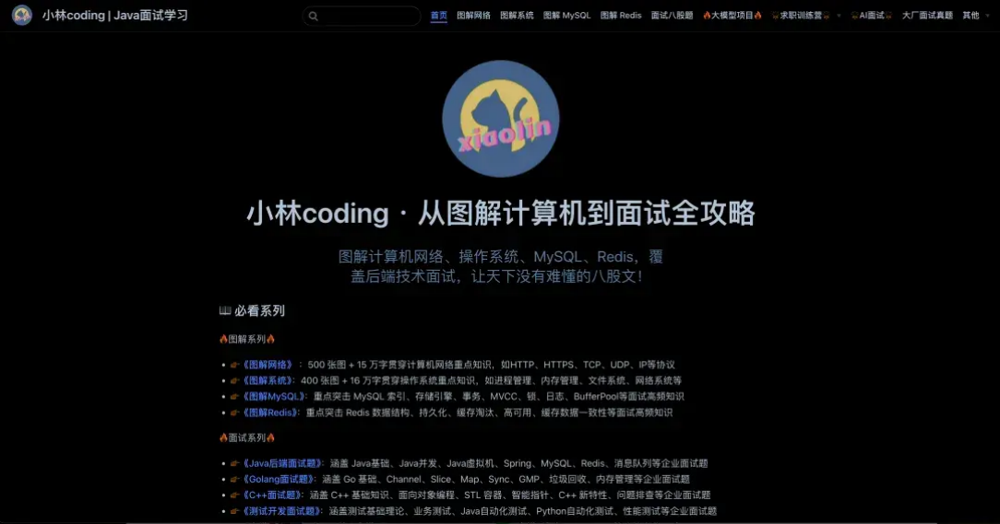

# 图解Redis介绍

大家好，我是小林，是《图解Redis》的作者，这是一份 **专注 Redis 学习与面试的开源资料**，内容都是整理于我的公众号：小林coding里的图解Redis的文章。

简单介绍下《图解Redis》，整个内容共有 **`18W` 字 +** **`200` 张图**，每一篇都自己手绘了很多图，目的也很简单，想通过「说人话+图解」的方式，让你彻底搞懂 Redis 的核心原理。

本《图解Redis》PDF文档的内容，在我的图解网站也可以阅读

在线阅读地址是：https://www.xiaolincoding.com/redis

## 适合什么群体？

- 《图解Redis》写的 Redis 知识主要是 **面向后端开发和架构师** 的，因为小林本身也是个后端开发，所以涉及到的知识主要是关于日常开发或者面试的 Redis 知识。

非常适合有一点 Redis 基础，但是又不怎么扎实，或者知识点串不起来的同学，说白 **这本《图解Redis》就是为了拯救半桶水的同学而出来的**。

因为小林写的《图解Redis》就四个字， **通俗易懂**！

相信你在看这本图解Redis的时候，你心里的感受会是：

- 「卧槽，Redis 数据结构底层原来是这样实现的」
- 「卧槽，持久化、主从复制、哨兵的原理我终于搞懂了」
- 「卧槽，缓存雪崩、击穿、穿透的解决方案我串起来了」
- 「卧槽，相见恨晚」

当然，也适合面试突击 Redis 知识时拿来看。《图解Redis》里的内容基本是面试常见的知识点，比如数据类型、持久化、集群、缓存等等，也有很多面试常问的问题，比如：

- Redis 有哪些数据类型？底层是怎么实现的？
- AOF 和 RDB 持久化是怎么实现的？
- Redis 过期删除策略和内存淘汰策略有什么区别？
- 主从复制、哨兵、Cluster 集群是怎么工作的？
- 什么是缓存雪崩、击穿、穿透？如何解决？
- 数据库和缓存如何保证一致性？
- Redis 大 Key 有什么影响？

不敢说 100 % 涵盖了面试的 Redis 问题，但是至少 90% 是有的，而且内容的深度应对大厂也是绰绰有余，有非常多的读者跑来感激小林的图解Redis，帮助他们拿到了国内很多一线大厂的 offer。

## 要怎么阅读？

很诚恳的告诉你，《图解Redis》不是教科书，而是我写的图解Redis文章的整合，所以肯定是没有教科书那么细致和全面，当然也就不会有很多废话，都是直击重点，不绕弯，而且有的知识点书上看不到。

阅读的顺序可以不用从头读到尾，你可以根据你想要了解的知识点，通过本站的搜索功能，去看哪个章节的内容就好，可以随意阅读任何章节。

- 《图解Redis》目录结构如下（别看篇章不多，每一章都是很长很长的文章哦）：
   - **一、基础篇** 什么是Redis？

**二、面试篇**

Redis 常见面试题

**三、数据类型篇**

Redis 数据类型和应用场景

图解 Redis 数据结构

**四、持久化篇**

AOF 持久化是怎么实现的？

- RDB 快照是怎么实现的？

Redis 大 Key 对持久化有什么影响？

**五、功能篇**

Redis 过期删除策略和内存淘汰策略有什么区别？

多节点争抢资源， Redis 分布式锁是怎么实现的？

**六、高可用篇**

主从复制是怎么实现的？

为什么要有哨兵？

为什么要有 cluster 集群？

如何保证 Redis 分布式锁的高可用和高性能？

**七、缓存篇**

什么是缓存雪崩、击穿、穿透？

数据库和缓存如何保证一致性？

## 有错误怎么办？

小林是个手残党，时常写出错别字。

如果你在学习的过程中， **如果你发现有任何错误或者疑惑的地方，欢迎你通过以下方式给我反馈**：

登记飞书表格：小林图解网站问题反馈登记（推荐）

小林抽时间会逐个修正，然后发布新版本的《图解Redis》，一起迭代出更好的《图解Redis》！ 在这里先提前感谢大家了！

新的图解文章都在公众号首发，别忘记关注了哦！如果你想加入百人技术交流群，扫码下方二维码回复「加群」。
