# 五、功能篇

## 5.1 Redis 过期删除策略和内存淘汰策略有什么区别？

大家好，我是小林。

Redis 的「内存淘汰策略」和「过期删除策略」，很多小伙伴容易混淆，这两个机制虽然都是做删除的操作，但是触发的条件和使用的策略都是不同的。

今天就跟大家理一理，「内存淘汰策略」和「过期删除策略」。

发车！

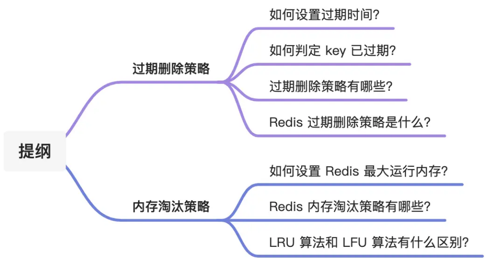

### 过期删除策略

Redis 是可以对 key 设置过期时间的，因此需要有相应的机制将已过期的键值对删除，而做这个工作的就是过期键值删除策略。

#### **如何设置过期时间？**

先说一下对 key 设置过期时间的命令。 设置 key 过期时间的命令一共有 4 个：

   - `expire <key> <n>`：设置 key 在 n 秒后过期，比如 expire key 100 表示设置 key 在 100 秒后过期；
   - `pexpire <key> <n>`：设置 key 在 n 毫秒后过期，比如 pexpire key2 100000 表示设置 key2 在 100000 毫秒 （100 秒）后过期。
   - `expireat <key>  <n>`： 设置 key 在某个时间戳（精确到秒）之后过期，比如 expireat key3 1655654400 表示 key3 在时间戳 1655654400 后过期（精确到秒）；
   - `pexpireat <key>  <n>`：设置 key 在某个时间戳（精确到毫秒）之后过期，比如 pexpireat key4 1655654400000 表示 key4 在时间戳 1655654400000 后过期（精确到毫秒）
- 当然，在设置字符串时，也可以同时对 key 设置过期时间，共有 3 种命令：
   - `set <key>  <value> ex <n>`：设置键值对的时候，同时指定过期时间（精确到秒）；
   - `set <key>  <value> px <n>`：设置键值对的时候，同时指定过期时间（精确到毫秒）；
   - `setex <key>  <n>  <valule>`：设置键值对的时候，同时指定过期时间（精确到秒）。
- 如果你想查看某个 key 剩余的存活时间，可以使用 `TTL <key>` 命令。

`##` 设置键值对的时候，同时指定过期时间位 `60` 秒 `> setex key1 60 value1 OK`

`##` 查看 `key1` 过期时间还剩多少 `> ttl key1 (integer) 56 > ttl key1 (integer) 52`

如果突然反悔，取消 key 的过期时间，则可以使用 `PERSIST <key>` 命令。

`##` 取消 `key1` 的过期时间 `> persist key1 (integer) 1`

`##` 使用完 `persist` 命令之后， `##` 查下 `key1` 的存活时间结果是 `-1`，表明 `key1` 永不过期 `> ttl key1 (integer) -1`

#### **如何判定 key 已过期了？**

每当我们对一个 key 设置了过期时间时，Redis  会把该 key 带上过期时间存储到一个 **过期字典** （expires dict）中， 也就是说「过期字典」保存了数据库中所有 key 的过期时间。

过期字典存储在 redisDb 结构中，如下：

```
typedef struct redisDb {
    dict *dict;    /* 数据库键空间，存放着所有的键值对 */
    dict *expires; /* 键的过期时间 */
    ....
} redisDb;
```

###### 过期字典数据结构结构如下：

过期字典的 key 是一个指针，指向某个键对象；

过期字典的 value 是一个 long long 类型的整数，这个整数保存了 key 的过期时间；

过期字典的数据结构如下图所示：

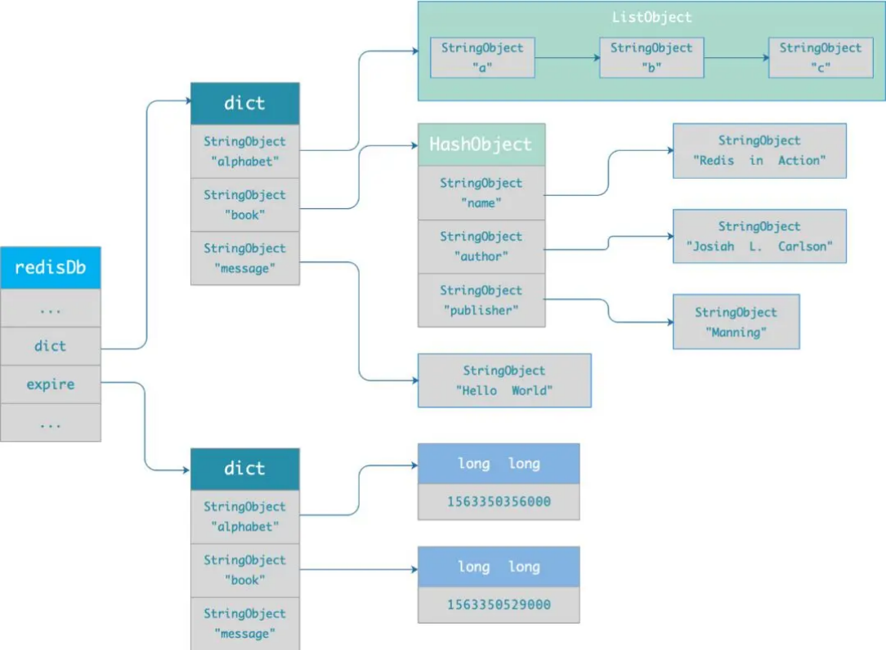

字典实际上是哈希表，哈希表的最大好处就是让我们可以用 O(1) 的时间复杂度来快速查找。当我们查询一个 key 时，Redis 首先检查该 key 是否存在于过期字典中：

如果不在，则正常读取键值；

- 如果存在，则会获取该 key 的过期时间，然后与当前系统时间进行比对，如果比系统时间大，那就没有过期，否则判定该 key 已过期。

过期键判断流程如下图所示：


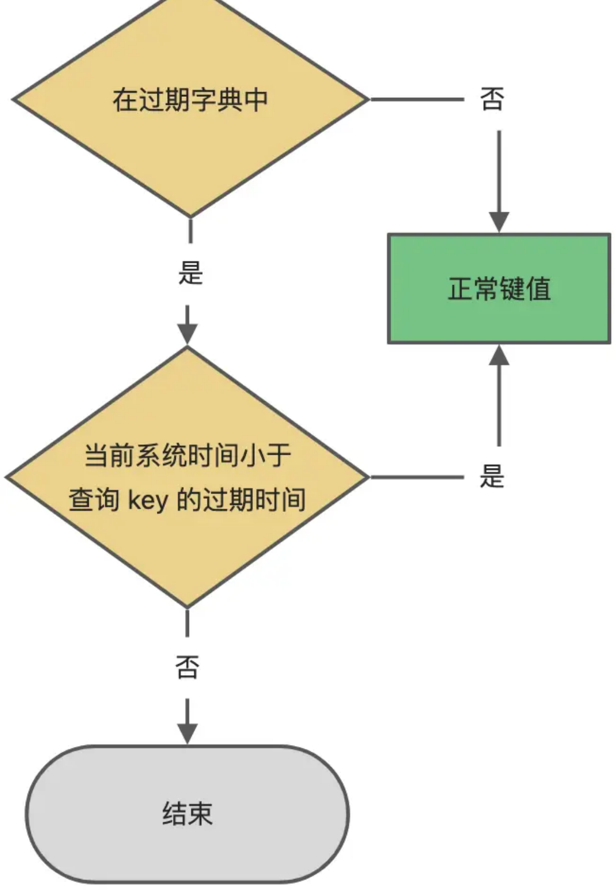

#### **过期删除策略有哪些？**

在说 Redis 过期删除策略之前，先跟大家介绍下，常见的三种过期删除策略：

- 定时删除；
- 惰性删除；
- 定期删除；

接下来，分别分析它们的优缺点。

定时删除策略是怎么样的？

定时删除策略的做法是， **在设置 key 的过期时间时，同时创建一个定时事件，当时间到达时，由事件处理器自动执行 key 的删除操作。**

定时删除策略的 **优点**：

- 可以保证过期 key 会被尽快删除，也就是内存可以被尽快地释放。因此，定时删除对内存是最友好的。

###### 定时删除策略的 **缺点**：

- 在过期 key 比较多的情况下，删除过期 key 可能会占用相当一部分 CPU 时间，在内存不紧张但 CPU 时间紧张的情况下，将 CPU 时间用于删除和当前任务无关的过期键上，无疑会对服务器的响应时间和吞吐量造成影响。所以，定时删除策略对 CPU 不友好。

惰性删除策略是怎么样的？

惰性删除策略的做法是， **不主动删除过期键，每次从数据库访问 key 时，都检测 key 是否过期，如果过期则删除该 key。**

惰性删除策略的 **优点**：

- 因为每次访问时，才会检查 key 是否过期，所以此策略只会使用很少的系统资源，因此，惰性删除策略对 CPU 时间最友好。

###### 惰性删除策略的 **缺点**：

- 如果一个 key 已经过期，而这个 key 又仍然保留在数据库中，那么只要这个过期 key 一直没有被访问，它所占用的内存就不会释放，造成了一定的内存空间浪费。所以，惰性删除策略对内存不友好。

定期删除策略是怎么样的？

定期删除策略的做法是， **每隔一段时间「随机」从数据库中取出一定数量的 key 进行检查，并删除其中的过期 key。**

###### 定期删除策略的 **优点**：

- 通过限制删除操作执行的时长和频率，来减少删除操作对 CPU 的影响，同时也能删除一部分过期的数据减少了过期键对空间的无效占用。

###### 定期删除策略的 **缺点**：

内存清理方面没有定时删除效果好，同时没有惰性删除使用的系统资源少。

难以确定删除操作执行的时长和频率。如果执行的太频繁，定期删除策略变得和定时删除策略一样，对CPU 不友好；如果执行的太少，那又和惰性删除一样了，过期 key 占用的内存不会及时得到释放。

#### **Redis 过期删除策略是什么？**

前面介绍了三种过期删除策略，每一种都有优缺点，仅使用某一个策略都不能满足实际需求。

所以， **Redis 选择「惰性删除+定期删除」这两种策略配和使用**，以求在合理使用 CPU 时间和避免内存浪费之间取得平衡。

Redis 是怎么实现惰性删除的？

Redis 的惰性删除策略由 db.c 文件中的 `expireIfNeeded` 函数实现，代码如下：

```
int expireIfNeeded(redisDb *db, robj *key) {
    // 判断 key 是否过期
    if (!keyIsExpired(db,key)) return 0;
    ....
    /* 删除过期键 */
    ....
    // 如果 server.lazyfree_lazy_expire 为 1 表示异步删除，反之同步删除；
    return server.lazyfree_lazy_expire ? dbAsyncDelete(db,key) :
                                         dbSyncDelete(db,key);
}
```

Redis 在访问或者修改 key 之前，都会调用 expireIfNeeded 函数对其进行检查，检查 key 是否过期：

   - 如果过期，则删除该 key，至于选择异步删除，还是选择同步删除，根据 `lazyfree_lazy_expire` 参数配置决定（Redis 4.0版本开始提供参数），然后返回 null 客户端；
   - 如果没有过期，不做任何处理，然后返回正常的键值对给客户端；
- 惰性删除的流程图如下：

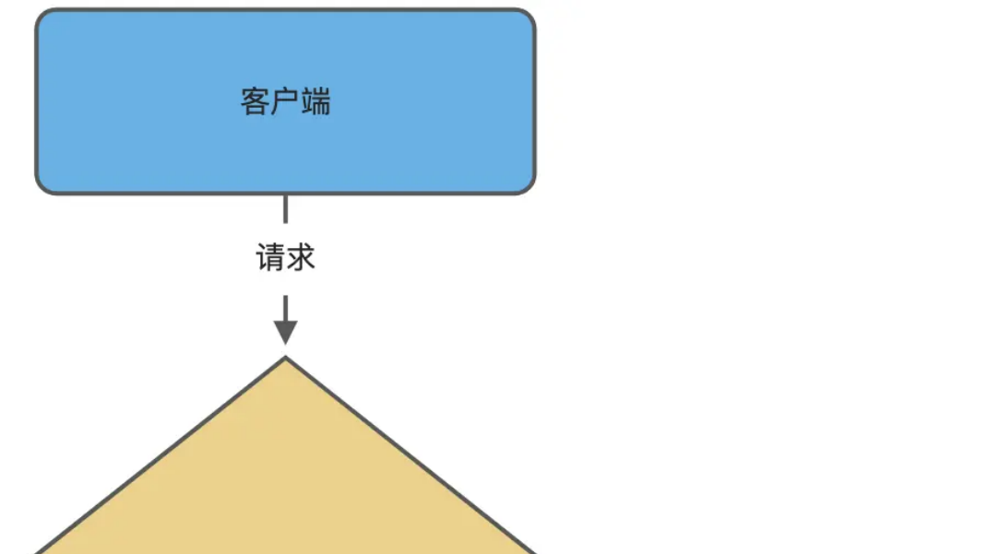

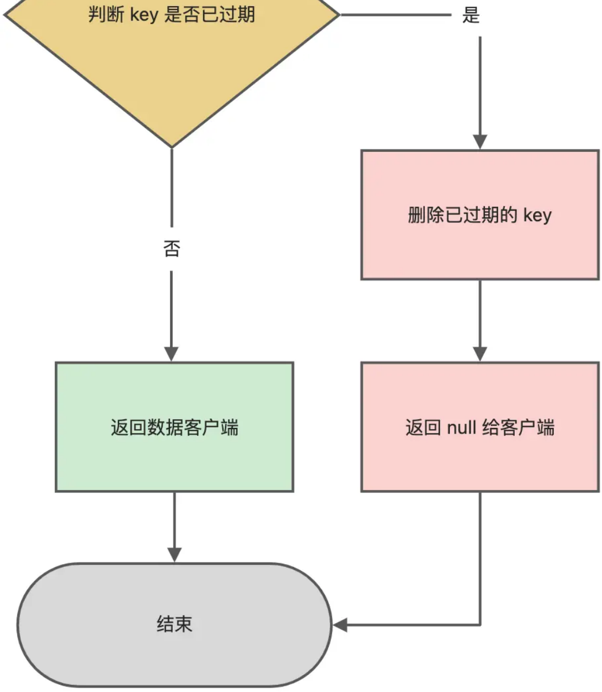

Redis 是怎么实现定期删除的？

再回忆一下，定期删除策略的做法： **每隔一段时间「随机」从数据库中取出一定数量的 key 进行检查，并删除其中的过期key。**

- _1_、这个间隔检查的时间是多长呢？

在 Redis 中，默认每秒进行 10 次过期检查一次数据库，此配置可通过 Redis 的配置文件 redis.conf 进行配置，配置键为 hz 它的默认值是 hz 10。

特别强调下，每次检查数据库并不是遍历过期字典中的所有 key，而是从数据库中随机抽取一定数量的 key 进行过期检查。

###### _2_、随机抽查的数量是多少呢？

我查了下源码，定期删除的实现在 expire.c 文件下的 `activeExpireCycle` 函数中，其中随机抽查的数量由 `ACTIVE_EXPIRE_CYCLE_LOOKUPS_PER_LOOP` 定义的，它是写死在代码中的，数值是 20。

也就是说，数据库每轮抽查时，会随机选择 20 个 key 判断是否过期。

接下来，详细说说 Redis 的定期删除的流程：

1. 从过期字典中随机抽取 20 个 key；
2. 检查这 20 个 key 是否过期，并删除已过期的 key；
3. 如果本轮检查的已过期 key 的数量，超过 5 个（20/4），也就是「已过期 key 的数量」占比「随机抽取 key 的数量」大于 25%，则继续重复步骤 1；如果已过期的 key 比例小于 25%，则停止继续删除过期 key，然后等待下一轮再检查。

可以看到，定期删除是一个循环的流程。

那 Redis 为了保证定期删除不会出现循环过度，导致线程卡死现象，为此增加了定期删除循环流程的时间上限，默认不会超过 25ms。

针对定期删除的流程，我写了个伪代码：

```
do {
    //已过期的数量
    expired = 0；
    //随机抽取的数量
    num = 20;
    while (num--) {
```

`/*` 如果本轮检查的已过期 `key` 的数量，超过 `25%`，则继续随机抽查，否则退出本轮检查 `*/ } while (expired > 20/4);`

###### 定期删除的流程如下：


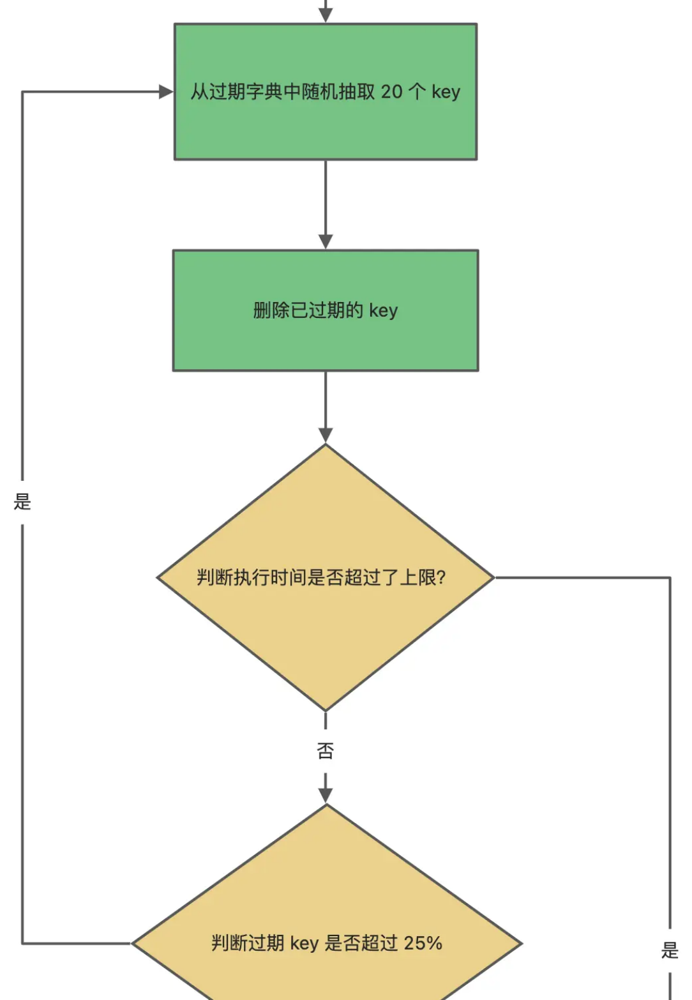

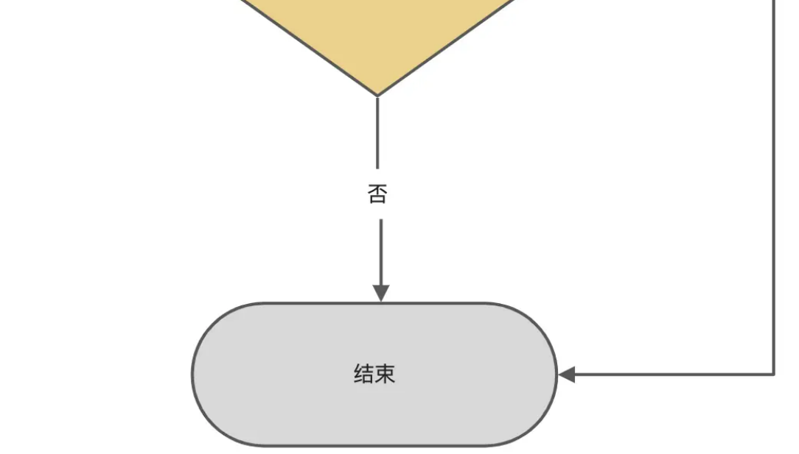

### 内存淘汰策略

前面说的过期删除策略，是删除已过期的 key，而当 Redis 的运行内存已经超过 Redis 设置的最大内存之后，则会使用内存淘汰策略删除符合条件的 key，以此来保障 Redis 高效的运行。

#### **如何设置 Redis 最大运行内存？**

在配置文件 redis.conf 中，可以通过参数 `maxmemory <bytes>` 来设定最大运行内存，只有在 Redis 的运行内存达到了我们设置的最大运行内存，才会触发内存淘汰策略。

不同位数的操作系统，maxmemory 的默认值是不同的：

- 在 64 位操作系统中，maxmemory 的默认值是 0，表示没有内存大小限制，那么不管用户存放多少数据到 Redis 中，Redis 也不会对可用内存进行检查，直到 Redis 实例因内存不足而崩溃也无作为。
- 在 32 位操作系统中，maxmemory 的默认值是 3G，因为 32 位的机器最大只支持 4GB 的内存，而系统本身就需要一定的内存资源来支持运行，所以 32 位操作系统限制最大 3 GB 的可用内存是非常合理的，这样可以避免因为内存不足而导致 Redis 实例崩溃。

#### **Redis 内存淘汰策略有哪些？**

Redis 内存淘汰策略共有八种，这八种策略大体分为「不进行数据淘汰」和「进行数据淘汰」两类策略。

- _1_、不进行数据淘汰的策略

**noeviction** （Redis3.0之后，默认的内存淘汰策略）：它表示当运行内存超过最大设置内存时，不淘汰任何数据， 这时如果有新的数据写入，会报错通知禁止写入，不淘汰任何数据，但是如果没用数据写入的话，只是单纯的查询或者删除操作的话，还是可以正常工作。

###### _2_、进行数据淘汰的策略

针对「进行数据淘汰」这一类策略，又可以细分为「在设置了过期时间的数据中进行淘汰」和「在所有数据范围内进行淘汰」这两类策略。

在设置了过期时间的数据中进行淘汰：

- **volatile-random**：随机淘汰设置了过期时间的任意键值；
- **volatile-ttl**：优先淘汰更早过期的键值。
- **volatile-lru** （Redis3.0 之前，默认的内存淘汰策略）：淘汰所有设置了过期时间的键值中，最久未使用的键值；
- **volatile-lfu** （Redis 4.0 后新增的内存淘汰策略）：淘汰所有设置了过期时间的键值中，最少使用的键值；

在所有数据范围内进行淘汰：

- **allkeys-random**：随机淘汰任意键值;
- **allkeys-lru**：淘汰整个键值中最久未使用的键值；
- **allkeys-lfu** （Redis 4.0 后新增的内存淘汰策略）：淘汰整个键值中最少使用的键值。

如何查看当前 Redis 使用的内存淘汰策略？

可以使用 `config get maxmemory-policy` 命令，来查看当前 Redis 的内存淘汰策略，命令如下：

```
127.0.0.1:6379> config get maxmemory-policy
```

```
1) "maxmemory-policy"
```

```
2) "noeviction"
```

可以看出，当前 Redis 使用的是 `noeviction` 类型的内存淘汰策略，它是 Redis 3.0 之后默认使用的内存淘汰策略， 表示当运行内存超过最大设置内存时，不淘汰任何数据，但新增操作会报错。

如何修改 Redis 内存淘汰策略？

设置内存淘汰策略有两种方法：

- 方式一：通过“ `config set maxmemory-policy <` 策略 `>` ”命令设置。它的优点是设置之后立即生效，不需要重启 Redis 服务，缺点是重启 Redis 之后，设置就会失效。
- 方式二：通过修改 Redis 配置文件修改，设置 “ `maxmemory-policy <` 策略 `>` ”，它的优点是重启 Redis 服务后配置不会丢失，缺点是必须重启 Redis 服务，设置才能生效。

#### **LRU 算法和 LFU 算法有什么区别？**

LFU 内存淘汰算法是 Redis  4.0 之后新增内存淘汰策略，那为什么要新增这个算法？那肯定是为了解决 LRU 算法的问题。

接下来，就看看这两个算法有什么区别？Redis 又是如何实现这两个算法的？

- 什么是 LRU 算法？

**LRU** 全称是 Least Recently Used 翻译为 **最近最少使用**，会选择淘汰最近最少使用的数据。

传统 LRU 算法的实现是基于「链表」结构，链表中的元素按照操作顺序从前往后排列，最新操作的键会被移动到表头，当需要内存淘汰时，只需要删除链表尾部的元素即可，因为链表尾部的元素就代表最久未被使用的元素。

Redis 并没有使用这样的方式实现 LRU 算法，因为传统的 LRU 算法存在两个问题：

- 需要用链表管理所有的缓存数据，这会带来额外的空间开销；
- 当有数据被访问时，需要在链表上把该数据移动到头端，如果有大量数据被访问，就会带来很多链表移动操作，会很耗时，进而会降低 Redis 缓存性能。

Redis 是如何实现 LRU 算法的？

Redis 实现的是一种 **近似 LRU 算法**，目的是为了更好的节约内存，它的 **实现方式是在 Redis 的对象结构体中添加一个额外的字段，用于记录此数据的最后一次访问时间**。

当 Redis 进行内存淘汰时，会使用 **随机采样的方式来淘汰数据**，它是随机取 5 个值（此值可配置），然后 **淘汰最久没有使用的那个**。

Redis 实现的 LRU 算法的优点：

- 不用为所有的数据维护一个大链表，节省了空间占用；
- 不用在每次数据访问时都移动链表项，提升了缓存的性能；

但是 LRU 算法有一个问题， **无法解决缓存污染问题**，比如应用一次读取了大量的数据，而这些数据只会被读取这一次，那么这些数据会留存在 Redis 缓存中很长一段时间，造成缓存污染。

因此，在 Redis 4.0 之后引入了 LFU 算法来解决这个问题。

什么是 LFU 算法？

LFU 全称是 Least Frequently Used 翻译为 **最近最不常用**，LFU 算法是根据数据访问次数来淘汰数据的，它的核心思想是“如果数据过去被访问多次，那么将来被访问的频率也更高”。

所以， LFU 算法会记录每个数据的访问次数。当一个数据被再次访问时，就会增加该数据的访问次数。这样就解决了偶尔被访问一次之后，数据留存在缓存中很长一段时间的问题，相比于 LRU 算法也更合理一些。

Redis 是如何实现 LFU 算法的？

LFU 算法相比于  LRU 算法的实现，多记录了「数据的访问频次」的信息。Redis 对象的结构如下：

 typedef struct redisObject { ... // 24 bits，用于记录对象的访问信息 unsigned lru:24; ... } robj;

Redis 对象头中的 lru 字段，在 LRU 算法下和 LFU 算法下使用方式并不相同。

**在 LRU 算法中**，Redis 对象头的 24 bits 的 lru 字段是用来记录 key 的访问时间戳，因此在 LRU 模式下，Redis可以根据对象头中的 lru 字段记录的值，来比较最后一次 key 的访问时间长，从而淘汰最久未被使用的 key。

**在 LFU 算法中**，Redis对象头的 24 bits 的 lru 字段被分成两段来存储，高 16bit 存储 ldt(Last Decrement Time)，低 8bit 存储 logc(Logistic Counter)。

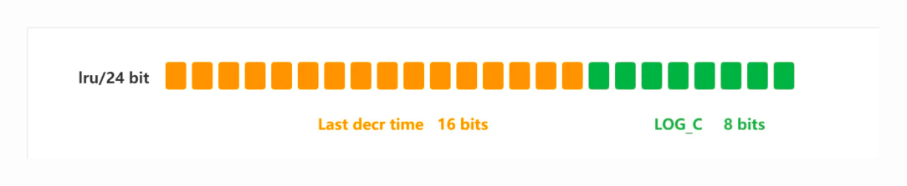

- ldt 是用来记录 key 的访问时间戳；
- logc 是用来记录 key 的访问频次，它的值越小表示使用频率越低，越容易淘汰，每个新加入的 key 的logc 初始值为 5。

注意，logc 并不是单纯的访问次数，而是访问频次（访问频率），因为 **logc  会随时间推移而衰减的**。

在每次 key 被访问时，会先对 logc 做一个衰减操作，衰减的值跟前后访问时间的差距有关系，如果上一次访问的时间与这一次访问的时间差距很大，那么衰减的值就越大，这样实现的 LFU 算法是根据 **访问频率** 来淘汰数据的，而不只是访问次数。访问频率需要考虑 key 的访问是多长时间段内发生的。key 的先前访问距离当前时间越长，那么这个 key 的访问频率相应地也就会降低，这样被淘汰的概率也会更大。

对 logc 做完衰减操作后，就开始对 logc  进行增加操作，增加操作并不是单纯的 + 1，而是根据概率增加，如果 logc 越大的 key，它的 logc 就越难再增加。

所以，Redis 在访问 key 时，对于 logc  是这样变化的：

1. 先按照上次访问距离当前的时长，来对 logc 进行衰减；
2. 然后，再按照一定概率增加 logc 的值

redis.conf 提供了两个配置项，用于调整 LFU 算法从而控制 logc 的增长和衰减：

- `lfu-decay-time` 用于调整 logc 的衰减速度，它是一个以分钟为单位的数值，默认值为1，lfu-decay-time 值越大，衰减越慢；

`lfu-log-factor` 用于调整 logc 的增长速度，lfu-log-factor 值越大，logc 增长越慢。

### 总结

Redis 使用的过期删除策略是「惰性删除+定期删除」，删除的对象是已过期的 key。


内存淘汰策略是解决内存过大的问题，当 Redis 的运行内存超过最大运行内存时，就会触发内存淘汰策略，Redis 4.0 之后共实现了 8 种内存淘汰策略，我也对这 8 种的策略进行分类，如下：

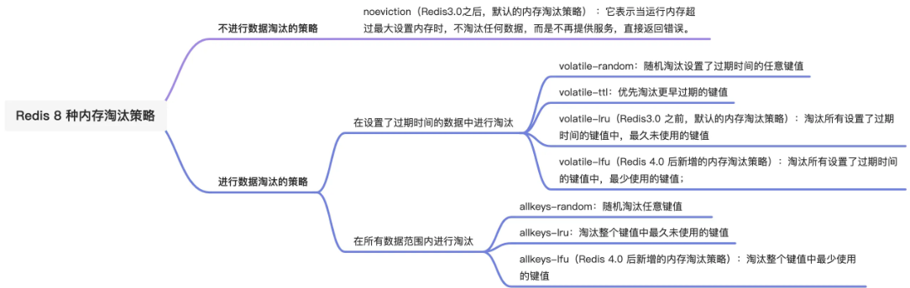

完！

答应我，下次别再搞混了

最新的图解文章都在公众号首发，别忘记关注哦！！如果你想加入百人技术交流群，扫码下方二维码回复「加群」。


5.2 多节点争抢资源， Redis 分布式锁是怎么实现的？

原文地址：面试官：多节点争抢资源， Redis 分布式锁是怎么实现的？

大家好，今天给大家分享 Redis 里的一个知识点 — Redis 分布式锁。

**在分布式系统的世界里，Redis 就像一座高效运转的共享仓库** — 多个节点通过共享数据协同发力，左手接过业务系统的海量读写请求，右手以毫秒级速度完成数据交付。

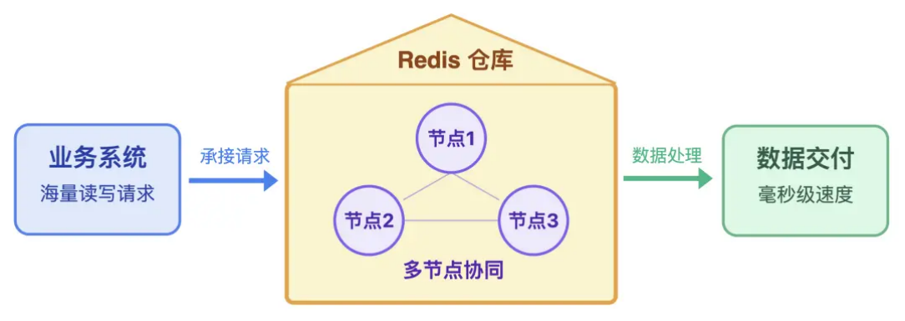

可再默契的团队，如果没有统一的行动准则，也难免遇到“抢活干”的问题。而 Redis 分布式锁，就像是分布式世界里的 “秩序守护者”。它会清晰地告诉每个节点：

**什么时候能操作数据、能不能同时操作，把数据操作的边界和顺序划分得明明白白，从根源上杜绝争抢。**

接下来，我们就来看看 — Redis 分布式锁是怎么给多节点系统 “立规矩” 的。

### 谁在给 _Redis_ 锁制造冲突？

Redis 锁的核心目标，是在分布式环境中建立"共享资源访问规则"，让锁机制井然有序运行。但在实际落地时，总有些问题在制造冲突：

**问题一：锁争抢 — 多人抢同一把锁，导致数据错乱**

节点想要拿到锁，得经历两步操作：

**先判断这把锁当前有没有被人占用，确认空闲后再动手抢占锁。**

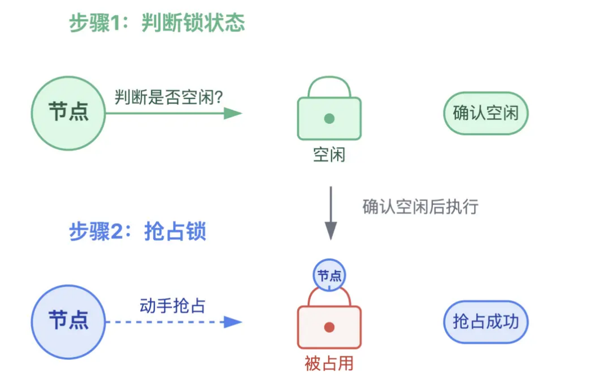

但问题恰恰出在这两步是分开做的 — 哪怕中间只隔了一瞬间的空隙，也足以埋下隐患。

想象一下这样的场景：有好几个节点同时要抢同一把锁。节点 A 先查询了锁的状态，发现 “没人占用”，正准备动手抢占时，节点 B 几乎在同一时间也查了锁的状态，得到了同样的结果。

**接下来，两个节点都顺利完成了抢占操作，以至于每个节点都觉得自己抢到了唯一的锁。** 进而同时去操作同一个共享资源，最终引发数据错乱、操作冲突。

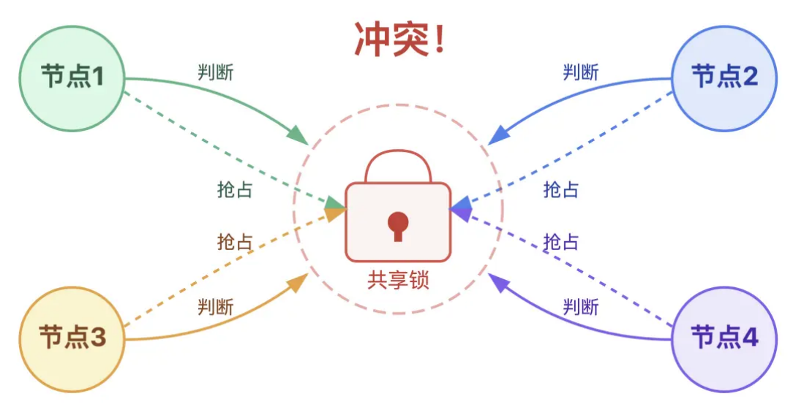

锁争抢就是典型的“多人抢锁”乱象，而当锁被某一节点占用后，又可能面临「锁不释放」的情况，这便是“僵尸锁” 带来的挑战。

#### **问题二：僵尸锁 — 锁不释放，导致业务流程阻塞**

某个节点拿到锁后，粗心地忘了给锁设定过期时间，紧接着又因为节点宕机或程序报错，没法主动释放这把锁。

**于是这条锁记录就彻底赖在 Redis 里不走了，变成没人管的 “僵尸锁”** — 牢牢霸占着对应的共享资源，后面不管哪个节点想操作这个资源，全被它拦在门外，直接影响整个系统正常干活。

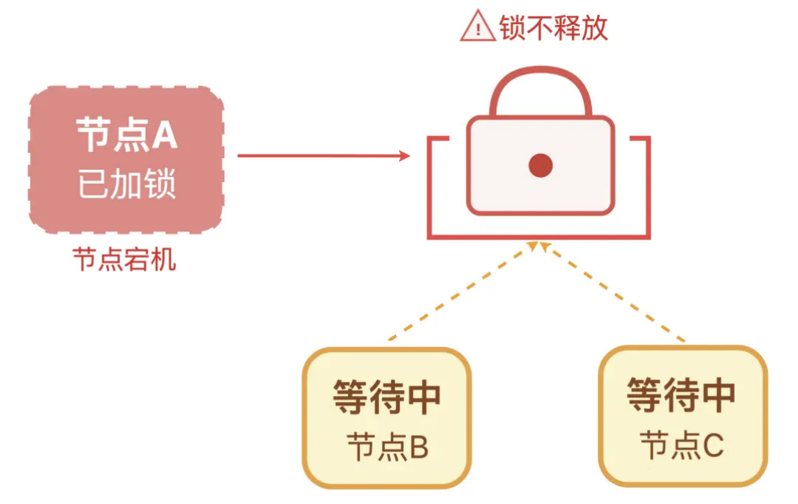

为了解决“僵尸”锁问题，给锁设置过期时间成为必然选择，但这一解决方案又会催生新的矛盾，即锁过期的问题。

#### **问题三：锁过期 — 过期时间与任务时长不匹配**

某个节点拿到锁并且设置完过期时间后，马上投入业务处理，可偏偏业务还没做完，锁的过期时间就到了。

Redis 见状直接自动释放了锁，而原来拿锁的节点对此毫无察觉，还在闷头干活。这时，其他节点一看锁没了，立刻一拥而上把锁抢到手，然后操作同一个资源 — **结果就是两个节点同时改一个数据，直接造成并发冲突。**

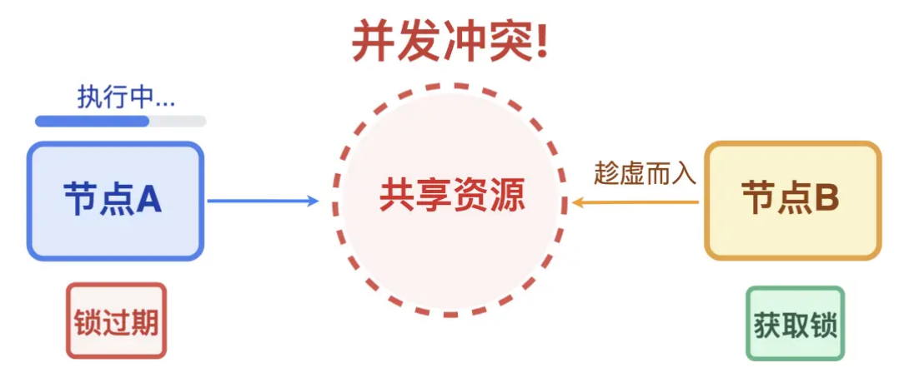

但无论是锁争抢、僵尸锁，还是锁过期导致的冲突，都有一个前提： **锁的存储节点足够稳定。** 而当 Redis 架构本身出现隐患时，上述所有问题都可能升级为影响整个系统的故障。

#### **问题四：锁存储不可靠 — 单节点部署的隐患**

当存储分布式锁的 Redis 只用单节点部署时，无异于把所有 “锁管理大权” 交给了唯一的管理员。一旦这个管理员突然 “罢工”（比如宕机），那么所有加锁、解锁、查锁状态的操作都会彻底卡壳，直接导致整个分布式锁机制瘫痪。

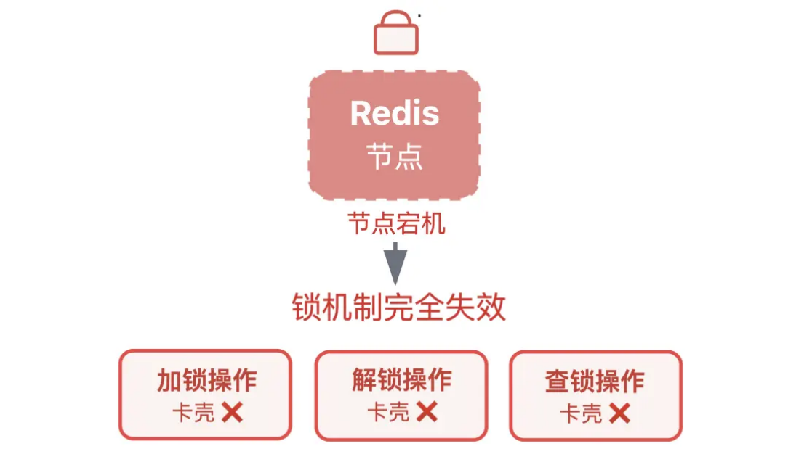

到头来，共享资源要么没人敢碰，要么大家一窝蜂乱抢，场面完全失控。

这些问题就像横亘在我们面前的四座大山，要构建可靠的分布式锁，就必须逐一攻克。接下来，我们就来看业务层面如何借助 Redis 的核心特性来实现分布式锁的。

### _Redis_ 锁的 _“_ 秩序构建术 _”_

面对分布式环境的复杂挑战，Redis 锁通过分层设计构建了一套完整的"秩序体系"。从加锁到释放锁，每个环节都蕴含着精妙的设计思想。

#### **1、加锁机制：从单节点到高可用**

加锁的核心目标是保证同一时间只有一个业务能操作共享资源，Redis 锁通过两层设计来实现这个目标：

**第一层：单节点锁 — 破解“锁争抢”和“僵尸锁”**

Redis 单节点锁的核心命令看似简单： **SET lock_key unique_value NX EX 30。** 但这条命令里藏着解决两大基础难题的巧思。我们逐一拆开来看：

先看 unique_value，它是给每个节点生成的唯一标识，就像给每个节点发了一张专属入场券。释放锁的时候，节点必须出示这张入场券，只有校验通过，才能删除自己持有的锁，绝不会误删别人的锁。

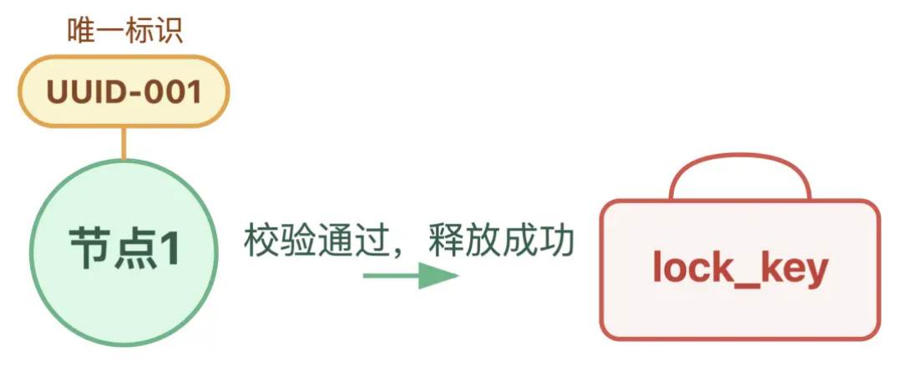

再看 NX（Not eXists），它的意思是仅当锁对应的 lock_key 不存在时，才执行加锁操作。这就像只有空座位才能入座，直接保证了锁的互斥性 — 同一时间，只有一个节点能成功获取锁，从根源上解决了大家抢着用资源的锁争抢问题。


然后是 EX 30，它的作用是给锁设置 30 秒的过期时间。好比座位有最长占用时限，超时后自动 “让座”，不会一直占着资源不释放，从根本上避免了节点宕机等异常情况导致的“僵尸锁”。


而这条 SET 命令的关键，就是把抢锁（NX）和设过期时间（EX），变成了一步完成的原子操作，中间没有任何可中断的间隙：

**要么指令未执行，锁没抢到；要么指令完整执行，抢到的锁已经自带过期时间。**

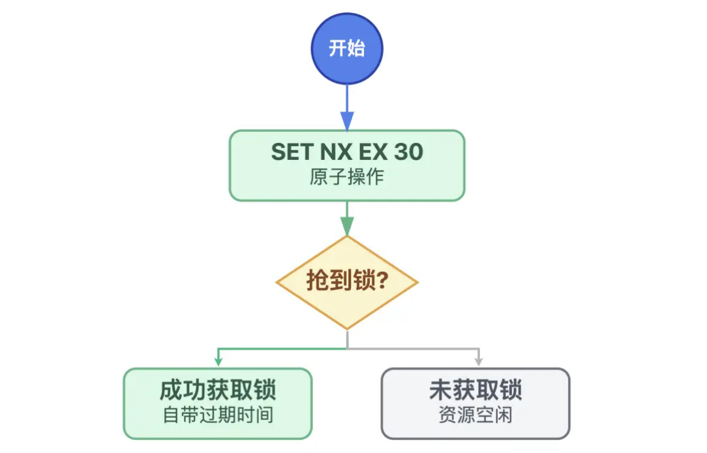

这就从机制上杜绝了因分步执行而引发的各类异常。

不过单节点 Redis 锁虽然简单高效，但存在一个致命弱点： **如果 Redis 节点宕机，整个锁机制就会失效。** 因此，为了提升锁机制的高可用性，需要一种能突破单节点依赖的解决方案 — 高可用锁。

**第二层：高可用锁 — 解决单点依赖**

为了破解单节点锁的可用性瓶颈，Redis 的作者 Antirez 提出了 Redlock 算法。其核心思想是：

**给 Redis 锁部署至少 3 个独立的节点（实际常用 5 个），只有超过半数节点都成功给资源加锁时，资源才算真的拿到了有效锁。**

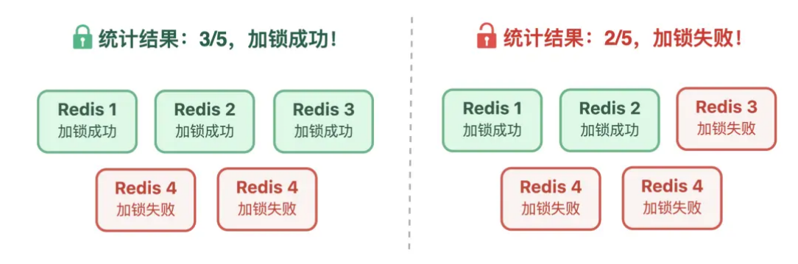

Redlock 算法的执行步骤如下：

1. 向 N 个独立的 Redis 锁节点依次发送 `SET NX EX` 加锁请求，实际应用中通常会部署 5 个；
2. 统计成功给资源加锁的节点数量，若成功数量超过 N/2，比如部署 5 个节点时至少有 3 个成功，就判定加锁成功；
3. 如果成功数量少于半数，则说明加锁失败，立即向所有锁节点释放锁，避免产生"僵尸锁"。

这种设计的精妙之处在于，即便部分锁节点宕机（不超过半数），剩余的多数锁节点仍能正常提供锁服务，从根本上规避了单点故障风险。这就像开会投票，只要超过半数人同意，决议就能生效，少数人的缺席不会影响整体决策。

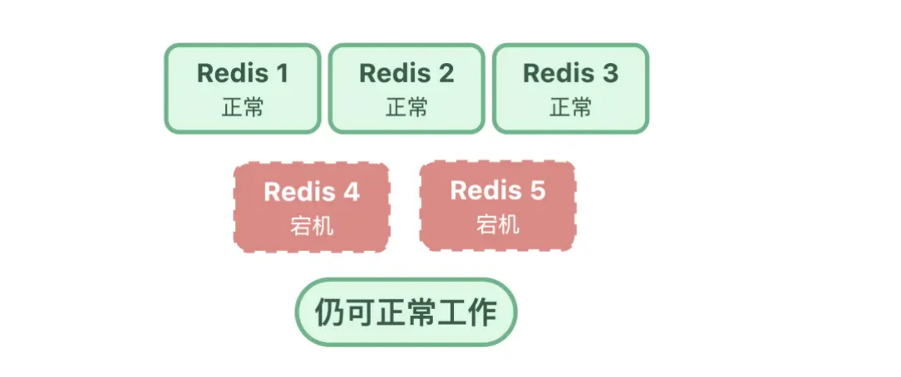

通过 Redlock 算法的加锁机制，我们确保了分布式环境下资源的互斥访问，但锁的释放环节同样需要谨慎处理，毕竟一旦释放逻辑出现疏漏，就可能引发新的并发混乱。

#### **2、释放锁机制：先 “验身份” 再删锁**

先前加锁时，我们会针对要保护的共享资源，在锁节点存入一把 “带身份标识的锁” — unique_value，就像给这把锁刻上了自己的 “专属名字”。等业务要释放共享资源时，不能直接删锁，得先去锁节点验证：

**“这把锁是不是我的？”**

确认无误后，才能删除锁，也就是真正释放锁。

但这里有个关键问题：如果 “先查身份、再删锁” 分成两步做，中间就会有个 “时间差漏洞”

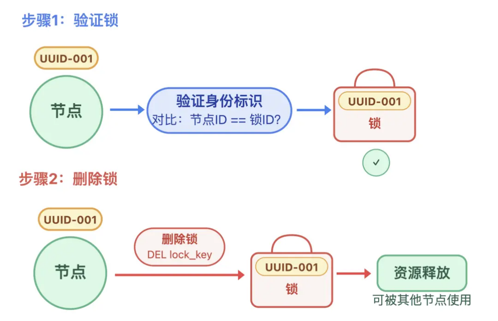

比如你刚查完，确认这把锁是自己的，可还没来得及删，这把锁的过期时间就到了，系统自动把它释放了；而就在这一瞬间，其他业务刚好抢到了这把锁。等你反应过来执行删除操作时，删的已经不是自己的锁，而是别人刚抢到的新锁了。

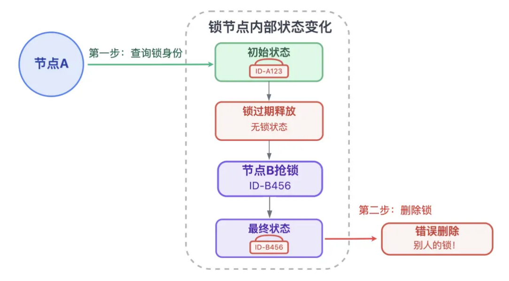

这一下就出大问题了： **不仅误删了别人的锁，还让共享资源失去了保护** — 没有锁的约束，其他业务可能会一窝蜂地操作这个资源，最后很可能导致数据错乱。

为了规避这种风险，Redis 提供了 Lua 脚本支持，能将判断和删除这两个操作封装成一个原子操作。对应的脚本如下：

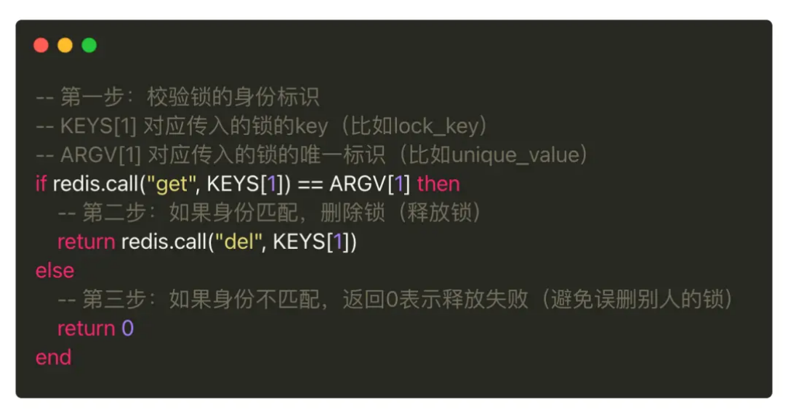

这段脚本相当于让 「验锁 + 删锁」 一步到位，安全可靠！

最终，从单节点锁到 Redlock 算法，从加锁到释放锁，Redis 为我们构建了完整的分布式锁理论基础。接下来，我们将这些理论转化为实践，看看如何在项目中正确落地。

### _Redis_ 锁的落地指南

分布式锁的落地从来不是一刀切的，而是要"因地制宜" — 简单场景用单节点锁高效落地，核心业务靠高可用锁保驾护航。下面我们结合不同的业务场景，拆解对应的 Redis 锁实践方案：

- **1、简单场景：单节点锁轻量高效**

如果你的业务不是支付、下单这种核心场景，那单节点 Redis 锁就完全够用了，简单还不占资源。例如我们要给 1001 号商品的库存加锁，核心命令如下：


使用时需要注意三个关键细节，不然容易出问题：

**第一个细节是 unique_value 必须独一无二。**

命令里的 "node1_uuid_12345" 可不是随便填的字符串，它是每个加锁请求的专属 “身份证”，得保证全网唯一。核心目的就是让后续解锁时，能准确识别出 “这把锁是我加的”，避免误解锁别人的锁。

**第二个是过期时间** **`EX 30` 的设置，得合理预留缓冲。**

比如你预估一个任务平均 10 秒能完成，那过期时间就别设 10 秒，建议设 30 秒。多出来的 20 秒是缓冲，万一某个任务因为网络延迟、数据量稍大慢了点，也不会出现 “任务还没做完，锁就过期了” 的情况。

###### **第三个是加锁失败后别做无效等待。**

如果执行上面的 SET 命令后，返回的是 `nil`，说明锁已经被别人占用了。这时候别一直死等，要么设置最多重试 `3` 次（每次间隔几百毫秒），要么直接返回 `“` 操作失败，请稍后再试 `”`，避免浪费服务器资源。


基础版的单节点锁用起来简单又高效，但如果任务执行时间不确定，很可能出现“任务还没做完，锁就过期了”的情况。这时，“看门狗（Watch Dog）” 机制就能派上用场。

#### **2、长任务场景：用“看门狗”给锁自动续期**

看门狗机制的工作原理其实很简单：

当业务节点成功抢到锁之后，系统会在这个节点上启动一个后台线程，就像给业务栓了一只尽职尽责的看门狗。这只 “看门狗” 会按固定时间（比如每隔 10 秒）主动检查：

- **“主人，你还在使用这把锁吗？”**

如果发现业务还在正常执行，它就会立刻给锁 “续期”，比如把锁的过期时间再延长 30 秒，不让锁提前过期被别人抢走。


目前主流的开源框架 Redisson 已经内置了这个看门狗机制，使用起来十分便捷。

不过要注意，不管是基础版单节点锁，还是带看门狗的锁，都只是解决了单节点场景的锁问题。如果是支付、下单这类核心业务，我们需要更高的可用性保障，这时候基于 **Redlock 算法** 的高可用部署方案就成了首选。

#### **3、核心场景：高可用锁守住业务“生命线”**

针对支付、下单等核心业务场景，建议直接采用 Redlock 算法，并部署至少 3 个独立的 Redis 锁节点。具体部署建议如下：


- **节点数量选择奇数**：优先选择 3、5、7 个节点，便于快速计算 “超过半数” 的成功条件，确保锁机制的有效性；
- **保证节点独立性**：节点之间不能有主从复制关系，最好分布在不同物理机或机房，避免因机房断电、网络故障等问题导致多个节点同时失效；
- **合理设置请求超时**：向每个节点发送加锁请求时，建议设置 50-100ms 的超时时间，避免单个节点响应缓慢拖垮整个加锁流程。

总之，从基础单节点锁到高可用部署，Redis 提供了灵活多样的锁解决方案。但要真正用好这些方案，避免实际应用中出现隐患，还需要注意一些关键细节。

### _Redis_ 锁的隐形 _“_ 陷阱 _”_

分布式锁看着简单好上手，但实际落地时，稍有疏忽整个锁机制就可能 “罢工”。今天就来聊聊几个必须盯紧的关键细节，帮你避开常见陷阱：

#### **陷阱一：看门狗不是万能的**

先说说大家常依赖的看门狗机制 — 它确实能自动给锁续期，但并非绝对可靠。如果持有锁的服务器突然宕机，看门狗线程会随之终止，无法继续给锁续期，锁最终还是会因过期而释放。


所以我们设计业务逻辑时，尽量要 “短平快”，能尽快释放锁就别长时间占用；同时做好异常兜底方案，避免锁过期后不同线程同时操作数据，导致数据不一致的问题。

#### **陷阱二：Redlock 切勿滥用**

Redlock 算法的可靠性确实更高，但相比单节点锁，它需要访问多个节点来确认锁的状态，性能开销更大。对于非核心业务场景，「单节点锁 + 看门狗」的组合已经能满足需求，不必过度追求高可用而采用 Redlock，否则会造成性能浪费。


#### **陷阱三：锁的粒度要把握适中**

最后是锁的粒度设计，这直接关系到系统的运行效率。

- **粒度太粗**，比如整个系统共用一把锁，会导致所有请求排队等待，引发严重的性能瓶颈；
- **粒度太细**，比如为每个数据项都单独设锁，则会增加系统复杂性和运维开销，还可能出现 "锁爆炸" 问题。建议根据实际业务场景合理设计锁粒度，在并发安全和系统性能之间找到平衡点。


掌握这些最佳实践后，我们才能真正构建出既可靠又高效的分布式锁系统。

### 总结

从单节点锁的「先到先得」逻辑，到 Redlock 算法的「少数服从多数」原则；从 `NX EX` 原子命令的精妙设计，到 Lua 脚本保障的安全释放，Redis 分布式锁用简洁而优雅的实现，精准解决了分布式系统的三大核心难题 — **互斥性、防死锁、高可用**。

- 下一次当你遇到分布式定时任务重复执行、核心数据同步错乱等并发问题时，不妨先问问自己：

我的系统中，分布式锁真的用对了吗？核心资源真的被有效 “锁住” 了吗？

最新的图解文章都在公众号首发，别忘记关注哦！！如果你想加入百人技术交流群，扫码下方二维码回复「加群」。


