# 六、高可用篇

## 6.1 主从复制是怎么实现的？

大家好，我是小林哥。

我在前两篇已经给大家图解了 AOF 和 RDB，这两个持久化技术保证了即使在服务器重启的情况下也不会丢失数据 （或少量损失）。

不过，由于数据都是存储在一台服务器上，如果出事就完犊子了，比如：

如果服务器发生了宕机，由于数据恢复是需要点时间，那么这个期间是无法服务新的请求的；

- 如果这台服务器的硬盘出现了故障，可能数据就都丢失了。

要避免这种单点故障，最好的办法是将数据备份到其他服务器上，让这些服务器也可以对外提供服务，这样即使有一台服务器出现了故障，其他服务器依然可以继续提供服务。

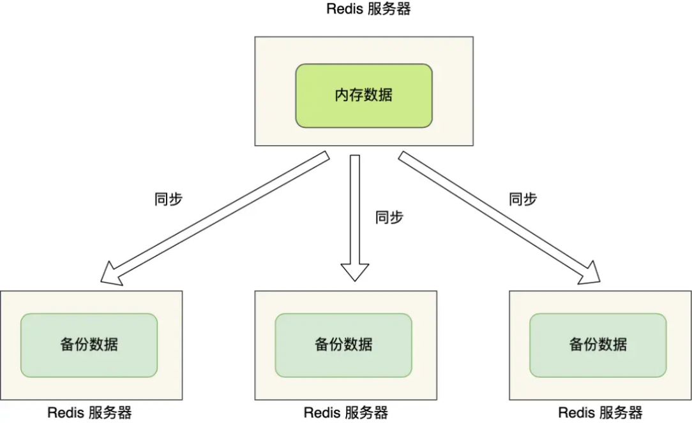

多台服务器要保存同一份数据，这里问题就来了。

这些服务器之间的数据如何保持一致性呢？数据的读写操作是否每台服务器都可以处理？

Redis 提供了 **主从复制模式**，来避免上述的问题。

这个模式可以保证多台服务器的数据一致性，且主从服务器之间采用的是「读写分离」的方式。

主服务器可以进行读写操作，当发生写操作时自动将写操作同步给从服务器，而从服务器一般是只读，并接受主服务器同步过来写操作命令，然后执行这条命令。

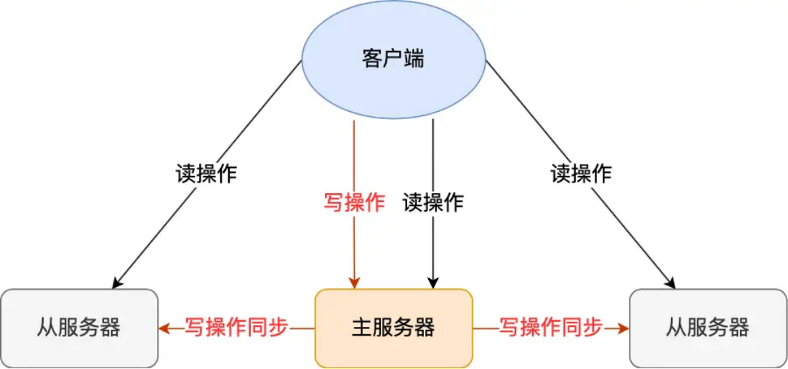

也就是说，所有的数据修改只在主服务器上进行，然后将最新的数据同步给从服务器，这样就使得主从服务器的数据是一致的。

同步这两个字说的简单，但是这个同步过程并没有想象中那么简单，要考虑的事情不是一两个。

我们先来看看，主从服务器间的第一次同步是如何工作的？

### 第一次同步

多台服务器之间要通过什么方式来确定谁是主服务器，或者谁是从服务器呢？

我们可以使用 `replicaof` （Redis 5.0 之前使用 slaveof）命令形成主服务器和从服务器的关系。

比如，现在有服务器 A 和服务器 B，我们在服务器 B 上执行下面这条命令：

`##` 服务器 `B` 执行这条命令 `replicaof <` 服务器 `A` 的 `IP` 地址 `> <` 服务器 `A` 的 `Redis` 端口号 `>`

接着，服务器 B 就会变成服务器 A 的「从服务器」，然后与主服务器进行第一次同步。

主从服务器间的第一次同步的过程可分为三个阶段：

   - 第一阶段是建立链接、协商同步；
   - 第二阶段是主服务器同步数据给从服务器；
   - 第三阶段是主服务器发送新写操作命令给从服务器。
- 为了让你更清楚了解这三个阶段，我画了一张图。

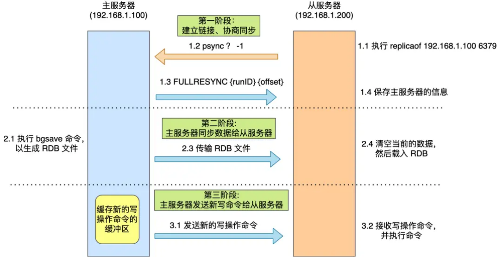

接下来，我在具体介绍每一个阶段都做了什么。

第一阶段：建立链接、协商同步

执行了 replicaof 命令后，从服务器就会给主服务器发送 `psync` 命令，表示要进行数据同步。

psync 命令包含两个参数，分别是 **主服务器的 runID** 和 **复制进度 offset**。

runID，每个 Redis 服务器在启动时都会自动生产一个随机的 ID 来唯一标识自己。当从服务器和主服务器第一次同步时，因为不知道主服务器的 run ID，所以将其设置为 "?"。

offset，表示复制的进度，第一次同步时，其值为 -1。

主服务器收到 psync 命令后，会用 `FULLRESYNC` 作为响应命令返回给对方。

并且这个响应命令会带上两个参数：主服务器的 runID 和主服务器目前的复制进度 offset。从服务器收到响应后， 会记录这两个值。

FULLRESYNC 响应命令的意图是采用 **全量复制** 的方式，也就是主服务器会把所有的数据都同步给从服务器。

所以，第一阶段的工作时为了全量复制做准备。

那具体怎么全量同步呀呢？我们可以往下看第二阶段。

第二阶段：主服务器同步数据给从服务器

接着，主服务器会执行 bgsave 命令来生成 RDB 文件，然后把文件发送给从服务器。

从服务器收到 RDB 文件后，会先清空当前的数据，然后载入 RDB 文件。

这里有一点要注意，主服务器生成 RDB 这个过程是不会阻塞主线程的，因为 bgsave 命令是产生了一个子进程来做生成 RDB 文件的工作，是异步工作的，这样 Redis 依然可以正常处理命令。

但是，这期间的写操作命令并没有记录到刚刚生成的 RDB 文件中，这时主从服务器间的数据就不一致了。

那么为了保证主从服务器的数据一致性， **主服务器在下面这三个时间间隙中将收到的写操作命令，写入到 replication buffer 缓冲区里**：

主服务器生成 RDB 文件期间；

主服务器发送 RDB 文件给从服务器期间；

「从服务器」加载 RDB 文件期间；

第三阶段：主服务器发送新写操作命令给从服务器

在主服务器生成的 RDB 文件发送完，从服务器收到 RDB 文件后，丢弃所有旧数据，将 RDB 数据载入到内存。完成 RDB 的载入后，会回复一个确认消息给主服务器。

接着，主服务器将 replication buffer 缓冲区里所记录的写操作命令发送给从服务器，从服务器执行来自主服务器 replication buffer  缓冲区里发来的命令，这时主从服务器的数据就一致了。

至此，主从服务器的第一次同步的工作就完成了。

### 命令传播

主从服务器在完成第一次同步后，双方之间就会维护一个 TCP 连接。

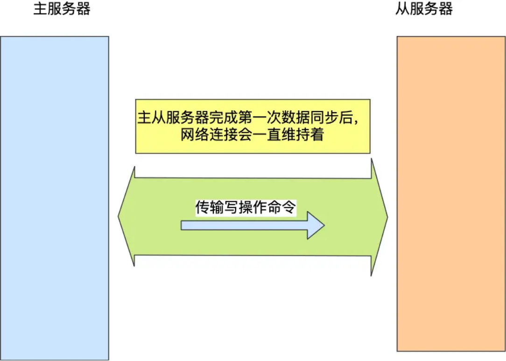

后续主服务器可以通过这个连接继续将写操作命令传播给从服务器，然后从服务器执行该命令，使得与主服务器的数据库状态相同。

而且这个连接是长连接的，目的是避免频繁的 TCP 连接和断开带来的性能开销。

上面的这个过程被称为 **基于长连接的命令传播**，通过这种方式来保证第一次同步后的主从服务器的数据一致性。

### 分摊主服务器的压力

在前面的分析中，我们可以知道主从服务器在第一次数据同步的过程中，主服务器会做两件耗时的操作：生成 RDB 文件和传输 RDB 文件。

主服务器是可以有多个从服务器的，如果从服务器数量非常多，而且都与主服务器进行全量同步的话，就会带来两个问题：

- 由于是通过 bgsave 命令来生成 RDB 文件的，那么主服务器就会忙于使用 fork() 创建子进程，如果主服务器的内存数据非大，在执行 fork() 函数时是会阻塞主线程的，从而使得 Redis 无法正常处理请求；
- 传输 RDB 文件会占用主服务器的网络带宽，会对主服务器响应命令请求产生影响。

这种情况就好像，刚创业的公司，由于人不多，所以员工都归老板一个人管，但是随着公司的发展，人员的扩充， 老板慢慢就无法承担全部员工的管理工作了。

要解决这个问题，老板就需要设立经理职位，由经理管理多名普通员工，然后老板只需要管理经理就好。

Redis 也是一样的，从服务器可以有自己的从服务器，我们可以把拥有从服务器的从服务器当作经理角色，它不仅可以接收主服务器的同步数据，自己也可以同时作为主服务器的形式将数据同步给从服务器，组织形式如下图：

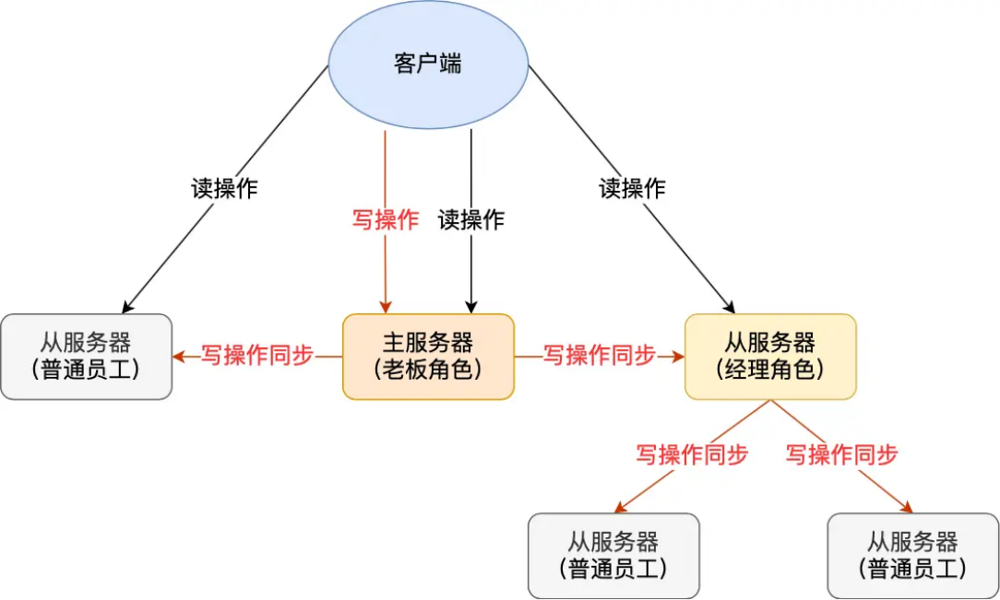

通过这种方式， **主服务器生成 RDB 和传输 RDB 的压力可以分摊到充当经理角色的从服务器**。

那具体怎么做到的呢？

其实很简单，我们在「从服务器」上执行下面这条命令，使其作为目标服务器的从服务器：

`replicaof <` 目标服务器的 `IP> 6379`

此时如果目标服务器本身也是「从服务器」，那么该目标服务器就会成为「经理」的角色，不仅可以接受主服务器同步的数据，也会把数据同步给自己旗下的从服务器，从而减轻主服务器的负担。

### 增量复制

主从服务器在完成第一次同步后，就会基于长连接进行命令传播。

可是，网络总是不按套路出牌的嘛，说延迟就延迟，说断开就断开。

如果主从服务器间的网络连接断开了，那么就无法进行命令传播了，这时从服务器的数据就没办法和主服务器保持一致了，客户端就可能从「从服务器」读到旧的数据。

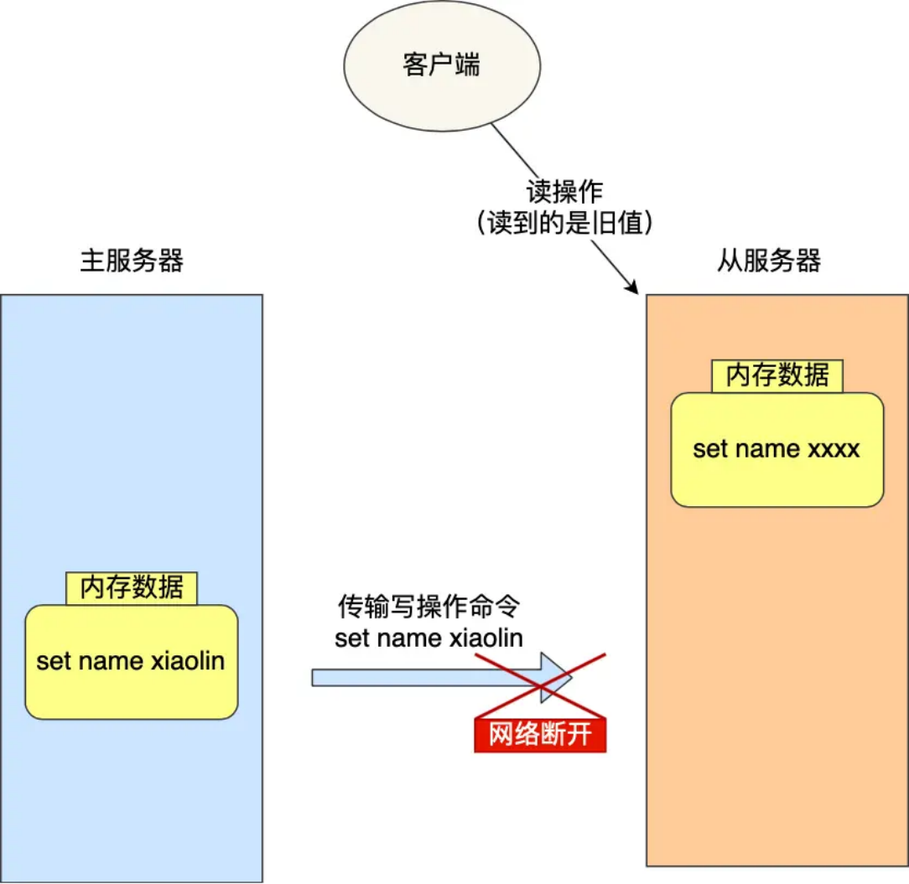

那么问题来了，如果此时断开的网络，又恢复正常了，要怎么继续保证主从服务器的数据一致性呢？

在 Redis 2.8 之前，如果主从服务器在命令同步时出现了网络断开又恢复的情况，从服务器就会和主服务器重新进行一次全量复制，很明显这样的开销太大了，必须要改进一波。

所以，从 Redis 2.8 开始，网络断开又恢复后，从主从服务器会采用 **增量复制** 的方式继续同步，也就是只会把网络断开期间主服务器接收到的写操作命令，同步给从服务器。

网络恢复后的增量复制过程如下图：

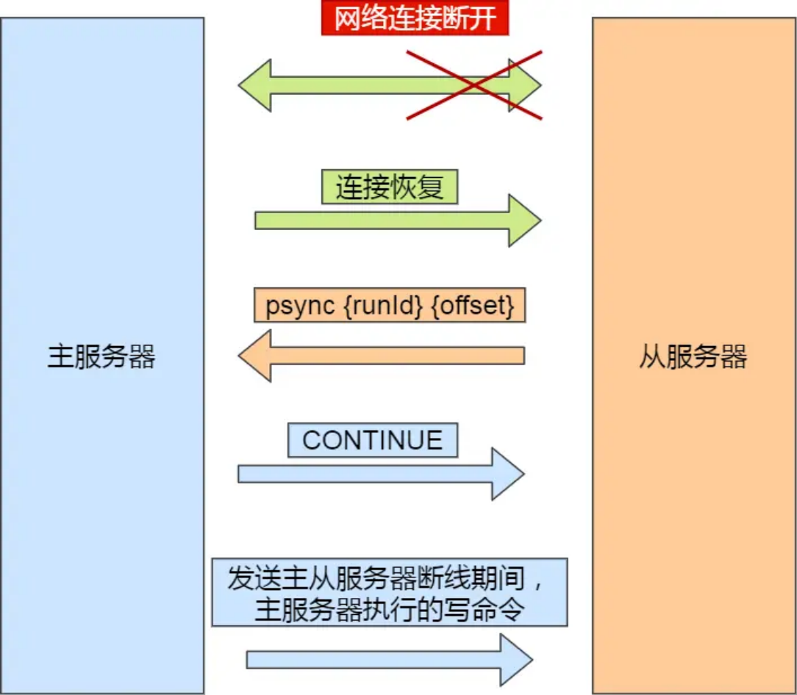

主要有三个步骤：

- 从服务器在恢复网络后，会发送 psync 命令给主服务器，此时的 psync 命令里的 offset 参数不是 -1； 主服务器收到该命令后，然后用 CONTINUE 响应命令告诉从服务器接下来采用增量复制的方式同步数据； 然后主服务将主从服务器断线期间，所执行的写命令发送给从服务器，然后从服务器执行这些命令。

那么关键的问题来了， **主服务器怎么知道要将哪些增量数据发送给从服务器呢？**

答案藏在这两个东西里：

   - **repl_backlog_buffer**，是一个「**环形**」缓冲区，用于主从服务器断连后，从中找到差异的数据；
   - **replication offset**，标记上面那个缓冲区的同步进度，主从服务器都有各自的偏移量，主服务器使用 master_repl_offset 来记录自己「写」到的位置，从服务器使用 slave_repl_offset 来记录自己「读」到的位置。
- 那 repl_backlog_buffer 缓冲区是什么时候写入的呢？
- 在主服务器进行命令传播时，不仅会将写命令发送给从服务器，还会将写命令写入到 repl_backlog_buffer 缓冲区里，因此这个缓冲区里会保存着最近传播的写命令。

网络断开后，当从服务器重新连上主服务器时，从服务器会通过 psync 命令将自己的复制偏移量 slave_repl_offset 发送给主服务器，主服务器根据自己的 master_repl_offset 和 slave_repl_offset 之间的差距，然后来决定对从服务器执行哪种同步操作：

- 如果判断出从服务器要读取的数据还在 repl_backlog_buffer 缓冲区里，那么主服务器将采用 **增量同步** 的方式；
- 相反，如果判断出从服务器要读取的数据已经不存在 repl_backlog_buffer 缓冲区里，那么主服务器将采用 **全量同步** 的方式。

当主服务器在 repl_backlog_buffer 中找到主从服务器差异（增量）的数据后，就会将增量的数据写入到 replication buffer 缓冲区，这个缓冲区我们前面也提到过，它是缓存将要传播给从服务器的命令。

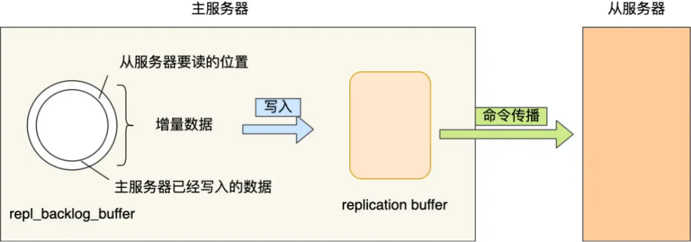

repl_backlog_buffer 缓行缓冲区的默认大小是 1M，并且由于它是一个环形缓冲区，所以当缓冲区写满后，主服务器继续写入的话，就会覆盖之前的数据。因此，当主服务器的写入速度远超于从服务器的读取速度，缓冲区的数据一下就会被覆盖。

那么在网络恢复时，如果从服务器想读的数据已经被覆盖了，主服务器就会采用全量同步，这个方式比增量同步的性能损耗要大很多。

因此， **为了避免在网络恢复时，主服务器频繁地使用全量同步的方式，我们应该调整下 repl_backlog_buffer 缓冲区大小，尽可能的大一些**，减少出现从服务器要读取的数据被覆盖的概率，从而使得主服务器采用增量同步的方式。

那 repl_backlog_buffer 缓冲区具体要调整到多大呢？

repl_backlog_buffer 最小的大小可以根据这面这个公式估算。

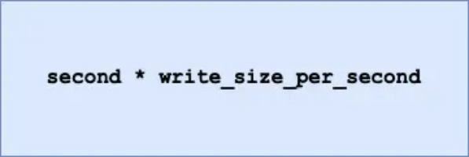

我来解释下这个公式的意思：

second 为从服务器断线后重新连接上主服务器所需的平均时间(以秒计算)。

write_size_per_second 则是主服务器平均每秒产生的写命令数据量大小。

举个例子，如果主服务器平均每秒产生 1 MB 的写命令，而从服务器断线之后平均要 5 秒才能重新连接主服务器。 那么 repl_backlog_buffer 大小就不能低于 5 MB，否则新写地命令就会覆盖旧数据了。

当然，为了应对一些突发的情况，可以将 repl_backlog_buffer 的大小设置为此基础上的 2 倍，也就是 10 MB。

关于 repl_backlog_buffer 大小修改的方法，只需要修改配置文件里下面这个参数项的值就可以。

```
repl-backlog-size 1mb
```

### 总结

主从复制共有三种模式： **全量复制、基于长连接的命令传播、增量复制**。

主从服务器第一次同步的时候，就是采用全量复制，此时主服务器会两个耗时的地方，分别是生成 RDB 文件和传输 RDB 文件。为了避免过多的从服务器和主服务器进行全量复制，可以把一部分从服务器升级为「经理角色」， 让它也有自己的从服务器，通过这样可以分摊主服务器的压力。

第一次同步完成后，主从服务器都会维护着一个长连接，主服务器在接收到写操作命令后，就会通过这个连接将写命令传播给从服务器，来保证主从服务器的数据一致性。

如果遇到网络断开，增量复制就可以上场了，不过这个还跟 repl_backlog_size 这个大小有关系。

如果它配置的过小，主从服务器网络恢复时，可能发生「从服务器」想读的数据已经被覆盖了，那么这时就会导致主服务器采用全量复制的方式。所以为了避免这种情况的频繁发生，要调大这个参数的值，以降低主从服务器断开后全量同步的概率。

### 面试题

#### **Redis主从节点时长连接还是短连接？**

长连接

#### **怎么判断 Redis 某个节点是否正常工作？**

Redis 判断节点是否正常工作，基本都是通过互相的 ping-pong 心态检测机制，如果有一半以上的节点去 ping 一个节点的时候没有 pong 回应，集群就会认为这个节点挂掉了，会断开与这个节点的连接。

Redis 主从节点发送的心态间隔是不一样的，而且作用也有一点区别：

- Redis 主节点默认每隔 10 秒对从节点发送 ping 命令，判断从节点的存活性和连接状态，可通过参数replping-slave-period控制发送频率。
- Redis 从节点每隔 1 秒发送 replconf ack{offset} 命令，给主节点上报自身当前的复制偏移量，目的是为了： 实时监测主从节点网络状态；
   - 上报自身复制偏移量， 检查复制数据是否丢失， 如果从节点数据丢失， 再从主节点的复制缓冲区中拉取丢失数据。

#### **主从复制架构中，过期key如何处理？**

主节点处理了一个key或者通过淘汰算法淘汰了一个key，这个时间主节点模拟一条del命令发送给从节点，从节点收到该命令后，就进行删除key的操作。

#### **Redis 是同步复制还是异步复制？**

Redis 主节点每次收到写命令之后，先写到内部的缓冲区，然后异步发送给从节点。

#### **主从复制中两个 Buffer(replication buffer、repl backlog buffer)有什么区别？**

replication buffer、repl backlog buffer 区别如下：

出现的阶段不一样：

   - repl backlog buffer 是在增量复制阶段出现， **一个主节点只分配一个 repl backlog buffer**；
   - replication buffer 是在全量复制阶段和增量复制阶段都会出现， **主节点会给每个新连接的从节点，分配一个 replication buffer**；
- 这两个 Buffer 都有大小限制的，当缓冲区满了之后，发生的事情不一样：
   - 当 repl backlog buffer 满了，因为是环形结构，会直接 **覆盖起始位置数据** ;
   - 当 replication buffer 满了，会导致连接断开，删除缓存，从节点重新连接， **重新开始全量复制**。

#### **如何应对主从数据不一致？**

为什么会出现主从数据不一致？

主从数据不一致，就是指客户端从从节点中读取到的值和主节点中的最新值并不一致。

之所以会出现主从数据不一致的现象，是 **因为主从节点间的命令复制是异步进行的**，所以无法实现强一致性保证 （主从数据时时刻刻保持一致）。

具体来说，在主从节点命令传播阶段，主节点收到新的写命令后，会发送给从节点。但是，主节点并不会等到从节点实际执行完命令后，再把结果返回给客户端，而是主节点自己在本地执行完命令后，就会向客户端返回结果了。 如果从节点还没有执行主节点同步过来的命令，主从节点间的数据就不一致了。

如何如何应对主从数据不一致？

第一种方法，尽量保证主从节点间的网络连接状况良好，避免主从节点在不同的机房。

第二种方法，可以开发一个外部程序来监控主从节点间的复制进度。具体做法：

- Redis 的 INFO replication 命令可以查看主节点接收写命令的进度信息（master_repl_offset）和从节点复制写命令的进度信息（slave_repl_offset），所以，我们就可以开发一个监控程序，先用 INFO replication 命令查到主、从节点的进度，然后，我们用 master_repl_offset 减去 slave_repl_offset，这样就能得到从节点和主节点间的复制进度差值了。
- 如果某个从节点的进度差值大于我们预设的阈值，我们可以让客户端不再和这个从节点连接进行数据读取， 这样就可以减少读到不一致数据的情况。不过，为了避免出现客户端和所有从节点都不能连接的情况，我们需要把复制进度差值的阈值设置得大一些。

#### **主从切换如何减少数据丢失？**

主从切换过程中，产生数据丢失的情况有两种：

异步复制同步丢失

集群产生脑裂数据丢失

我们不可能保证数据完全不丢失，只能做到使得尽量少的数据丢失。

##### **异步复制同步丢失**

对于 Redis 主节点与从节点之间的数据复制，是异步复制的，当客户端发送写请求给主节点的时候，客户端会返回 ok，接着主节点将写请求异步同步给各个从节点，但是如果此时主节点还没来得及同步给从节点时发生了断电，那么主节点内存中的数据会丢失。

减少异步复制的数据丢失的方案

Redis 配置里有一个参数 min-slaves-max-lag，表示一旦所有的从节点数据复制和同步的延迟都超过了 min-slavesmax-lag 定义的值，那么主节点就会拒绝接收任何请求。

假设将 min-slaves-max-lag 配置为 10s 后，根据目前 master->slave 的复制速度，如果数据同步完成所需要时间超过10s，就会认为 master 未来宕机后损失的数据会很多，master 就拒绝写入新请求。这样就能将 master 和 slave 数据差控制在10s内，即使 master 宕机也只是这未复制的 10s 数据。

那么对于客户端，当客户端发现 master 不可写后，我们可以采取降级措施，将数据暂时写入本地缓存和磁盘中， 在一段时间（等 master 恢复正常）后重新写入 master 来保证数据不丢失，也可以将数据写入 kafka 消息队列，等 master 恢复正常，再隔一段时间去消费 kafka 中的数据，让将数据重新写入 master。

##### **集群产生脑裂数据丢失**

先来理解集群的脑裂现象，这就好比一个人有两个大脑，那么到底受谁控制呢？

那么在 Redis 中，集群脑裂产生数据丢失的现象是怎样的呢？

在 Redis 主从架构中，部署方式一般是「一主多从」，主节点提供写操作，从节点提供读操作。

如果主节点的网络突然发生了问题，它与所有的从节点都失联了，但是此时的主节点和客户端的网络是正常的，这个客户端并不知道 Redis 内部已经出现了问题，还在照样的向这个失联的主节点写数据（过程A），此时这些数据被主节点缓存到了缓冲区里，因为主从节点之间的网络问题，这些数据都是无法同步给从节点的。

这时，哨兵也发现主节点失联了，它就认为主节点挂了（但实际上主节点正常运行，只是网络出问题了），于是哨兵就会在从节点中选举出一个 leeder 作为主节点，这时集群就有两个主节点了  —— **脑裂出现了**。

这时候网络突然好了，哨兵因为之前已经选举出一个新主节点了，它就会把旧主节点降级为从节点（A），然后从节点（A）会向新主节点请求数据同步， **因为第一次同步是全量同步的方式，此时的从节点（A）会清空掉自己本地的数据，然后再做全量同步。所以，之前客户端在过程 A 写入的数据就会丢失了，也就是集群产生脑裂数据丢失的问题**。

总结一句话就是：由于网络问题，集群节点之间失去联系。主从数据不同步；重新平衡选举，产生两个主服务。等网络恢复，旧主节点会降级为从节点，再与新主节点进行同步复制的时候，由于会从节点会清空自己的缓冲区，所以导致之前客户端写入的数据丢失了。

###### 减少脑裂的数据丢的方案

当主节点发现「从节点下线的数量太多」，或者「网络延迟太大」的时候，那么主节点会禁止写操作，直接把错误返回给客户端。

在 Redis 的配置文件中有两个参数我们可以设置：

- min-slaves-to-write x，主节点必须要有 **至少 x 个从节点连接**，如果小于这个数，主节点会禁止写数据。 min-slaves-max-lag x，主从数据复制和同步的延迟 **不能超过 x 秒**，如果主从同步的延迟超过 x 秒，主节点会禁止写数据。

我们可以把 min-slaves-to-write 和 min-slaves-max-lag 这两个配置项搭配起来使用，分别给它们设置一定的阈值， 假设为 N 和 T。

这两个配置项组合后的要求是， **主节点连接的从节点中至少有 N 个从节点，「并且」主节点进行数据复制时的 ACK 消息延迟不能超过 T 秒**，否则，主节点就不会再接收客户端的写请求了。

即使原主节点是假故障，它在假故障期间也无法响应哨兵心跳，也不能和从节点进行同步，自然也就无法和从节点进行 ACK 确认了。这样一来，min-slaves-to-write 和 min-slaves-max-lag 的组合要求就无法得到满足， **原主节点就会被限制接收客户端写请求，客户端也就不能在原主节点中写入新数据了**。

**等到新主节点上线时，就只有新主节点能接收和处理客户端请求，此时，新写的数据会被直接写到新主节点中。而原主节点会被哨兵降为从节点，即使它的数据被清空了，也不会有新数据丢失。我再来给你举个例子。**

假设我们将 min-slaves-to-write 设置为 1，把 min-slaves-max-lag 设置为 12s，把哨兵的 down-after-milliseconds 设置为 10s，主节点因为某些原因卡住了 15s，导致哨兵判断主节点客观下线，开始进行主从切换。同时，因为原主节点卡住了 15s，没有一个从节点能和原主节点在 12s 内进行数据复制，原主节点也无法接收客户端请求了。这样一来，主从切换完成后，也只有新主节点能接收请求，不会发生脑裂，也就不会发生数据丢失的问题了。

#### **主从如何做到故障自动切换？**

主节点挂了，从节点是无法自动升级为主节点的，这个过程需要人工处理，在此期间 Redis 无法对外提供写操作。 此时，Redis 哨兵机制就登场了，哨兵在发现主节点出现故障时，由哨兵自动完成故障发现和故障转移，并通知给应用方，从而实现高可用性。

最新的图解文章都在公众号首发，别忘记关注哦！！如果你想加入百人技术交流群，扫码下方二维码回复「加群」。


## 6.2 为什么要有哨兵？

大家好，我是小林。

这次聊聊，Redis 的哨兵机制。

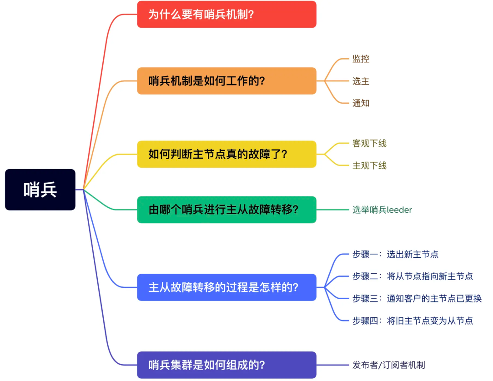

### 为什么要有哨兵机制？

在 Redis 的主从架构中，由于主从模式是读写分离的，如果主节点（master）挂了，那么将没有主节点来服务客户端的写操作请求，也没有主节点给从节点（slave）进行数据同步了。

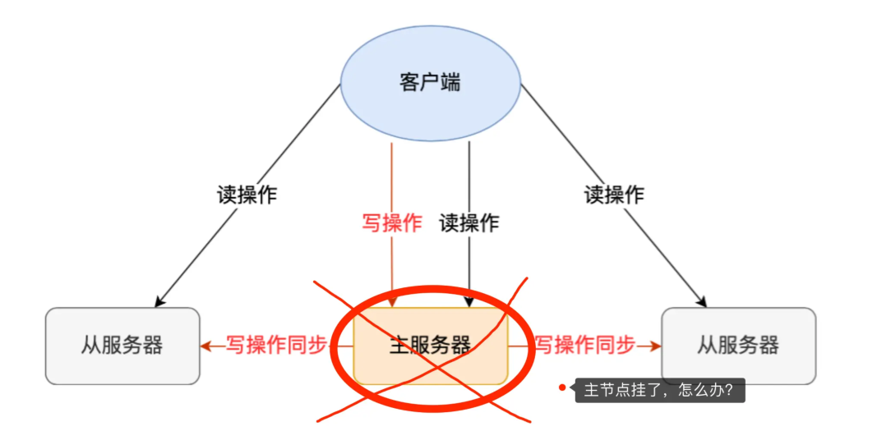

这时如果要恢复服务的话，需要人工介入，选择一个「从节点」切换为「主节点」，然后让其他从节点指向新的主节点，同时还需要通知上游那些连接 Redis 主节点的客户端，将其配置中的主节点 IP 地址更新为「新主节点」的 IP 地址。

这样也不太“智能”了，要是有一个节点能监控「主节点」的状态，当发现主节点挂了，它自动将一个「从节点」切换为「主节点」的话，那么可以节省我们很多事情啊！

Redis 在 2.8 版本以后提供的 **哨兵（** **_Sentinel_）机制**，它的作用是实现 **主从节点故障转移**。它会监测主节点是否存活，如果发现主节点挂了，它就会选举一个从节点切换为主节点，并且把新主节点的相关信息通知给从节点和客户端。

### 哨兵机制是如何工作的？

哨兵其实是一个运行在特殊模式下的 Redis 进程，所以它也是一个节点。从“哨兵”这个名字也可以看得出来，它相当于是“观察者节点”，观察的对象是主从节点。

当然，它不仅仅是观察那么简单，在它观察到有异常的状况下，会做出一些“动作”，来修复异常状态。

哨兵节点主要负责三件事情： **监控、选主、通知**。


所以，我们重点要学习这三件事情：

- 哨兵节点是如何监控节点的？又是如何判断主节点是否真的故障了？
- 根据什么规则选择一个从节点切换为主节点？
- 怎么把新主节点的相关信息通知给从节点和客户端呢？

### 如何判断主节点真的故障了？

哨兵会每隔 1 秒给所有主从节点发送 PING 命令，当主从节点收到 PING 命令后，会发送一个响应命令给哨兵，这样就可以判断它们是否在正常运行。

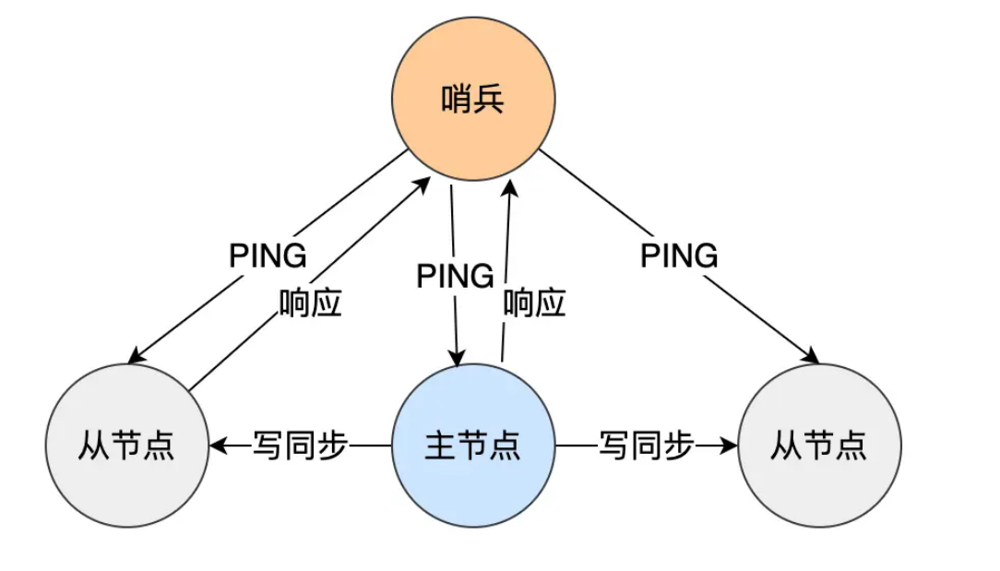

如果主节点或者从节点没有在规定的时间内响应哨兵的 PING 命令，哨兵就会将它们标记为「**主观下线**」。这个 「规定的时间」是配置项 `down-after-milliseconds` 参数设定的，单位是毫秒。

主观下线？难道还有客观下线？

是的没错，客观下线只适用于主节点。

之所以针对「主节点」设计「主观下线」和「客观下线」两个状态，是因为有可能「主节点」其实并没有故障，可能只是因为主节点的系统压力比较大或者网络发送了拥塞，导致主节点没有在规定时间内响应哨兵的 PING 命令。

所以，为了减少误判的情况，哨兵在部署的时候不会只部署一个节点，而是用多个节点部署成 **哨兵集群** （最少需要三台机器来部署哨兵集群）， **通过多个哨兵节点一起判断，就可以就可以避免单个哨兵因为自身网络状况不好，而误判主节点下线的情况**。同时，多个哨兵的网络同时不稳定的概率较小，由它们一起做决策，误判率也能降低。

具体是怎么判定主节点为「客观下线」的呢？

当一个哨兵判断主节点为「主观下线」后，就会向其他哨兵发起命令，其他哨兵收到这个命令后，就会根据自身和主节点的网络状况，做出赞成投票或者拒绝投票的响应。

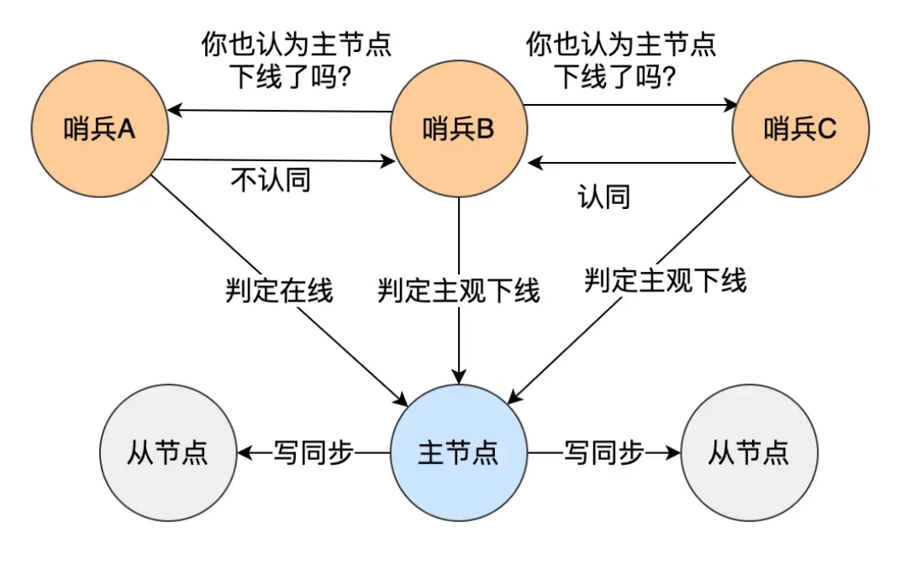

当这个哨兵的赞同票数达到哨兵配置文件中的 quorum 配置项设定的值后，这时主节点就会被该哨兵标记为「客观下线」。

例如，现在有 3 个哨兵，quorum 配置的是 2，那么一个哨兵需要 2 张赞成票，就可以标记主节点为“客观下线” 了。这 2 张赞成票包括哨兵自己的一张赞成票和另外两个哨兵的赞成票。

PS：quorum 的值一般设置为哨兵个数的二分之一加 1，例如 3 个哨兵就设置 2。

哨兵判断完主节点客观下线后，哨兵就要开始在多个「从节点」中，选出一个从节点来做新主节点。

### 由哪个哨兵进行主从故障转移？

前面说过，为了更加“客观”的判断主节点故障了，一般不会只由单个哨兵的检测结果来判断，而是多个哨兵一起判断，这样可以减少误判概率，所以 **哨兵是以哨兵集群的方式存在的**。

问题来了，由哨兵集群中的哪个节点进行主从故障转移呢？

所以这时候，还需要在哨兵集群中选出一个 leader，让 leader 来执行主从切换。

选举 leader 的过程其实是一个投票的过程，在投票开始前，肯定得有个「候选者」。

那谁来作为候选者呢？

哪个哨兵节点判断主节点为「客观下线」，这个哨兵节点就是候选者，所谓的候选者就是想当 Leader 的哨兵。

举个例子，假设有三个哨兵。当哨兵 B 先判断到主节点「主观下线后」，就会给其他实例发送 is-master-down-byaddr 命令。接着，其他哨兵会根据自己和主节点的网络连接情况，做出赞成投票或者拒绝投票的响应。

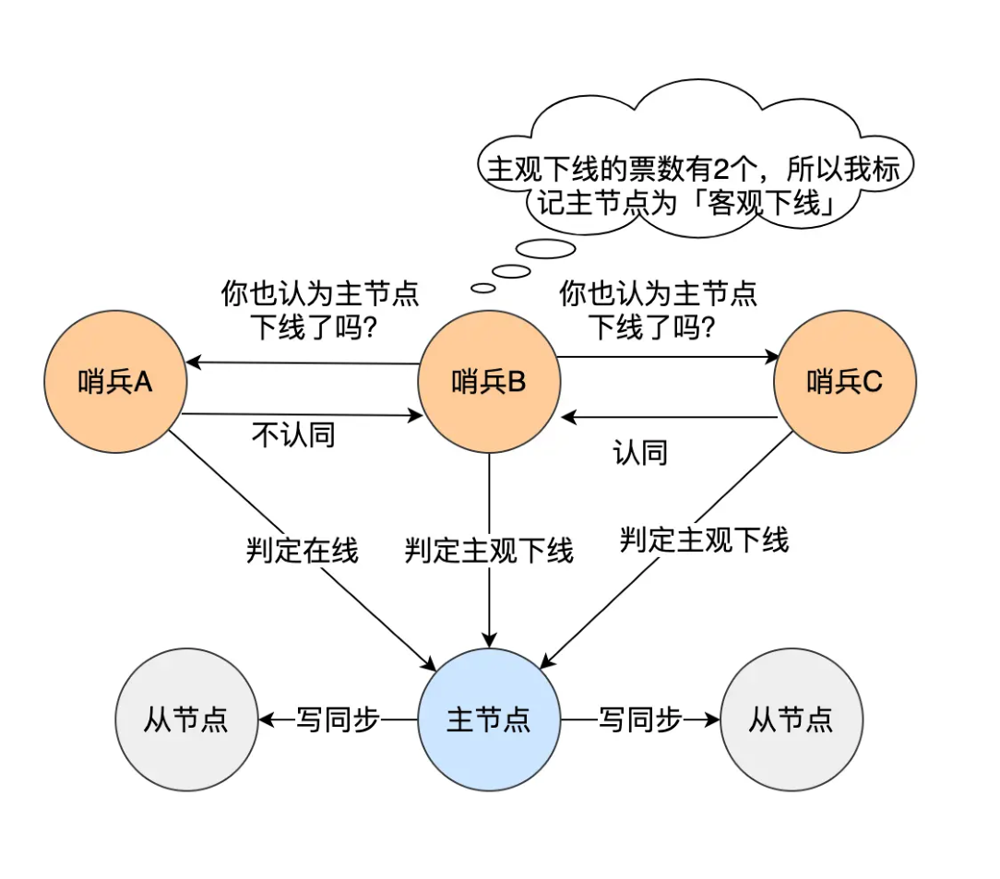

当哨兵 B 收到赞成票数达到哨兵配置文件中的 quorum 配置项设定的值后，就会将主节点标记为「客观下线」，此时的哨兵 B 就是一个 Leader 候选者。

候选者如何选举成为 Leader？

候选者会向其他哨兵发送命令，表明希望成为 Leader 来执行主从切换，并让所有其他哨兵对它进行投票。

每个哨兵只有一次投票机会，如果用完后就不能参与投票了，可以投给自己或投给别人，但是只有候选者才能把票投给自己。

那么在投票过程中，任何一个「候选者」，要满足两个条件：

- 第一，拿到半数以上的赞成票；
- 第二，拿到的票数同时还需要大于等于哨兵配置文件中的 quorum 值。

举个例子，假设哨兵节点有  3 个，quorum 设置为 2，那么任何一个想成为 Leader 的哨兵只要拿到 2 张赞成票，就可以选举成功了。如果没有满足条件，就需要重新进行选举。

这时候有的同学就会问了，如果某个时间点，刚好有两个哨兵节点判断到主节点为客观下线，那这时不就有两个候选者了？这时该如何决定谁是 Leader 呢？

每位候选者都会先给自己投一票，然后向其他哨兵发起投票请求。如果投票者先收到「候选者 A」的投票请求，就会先投票给它，如果投票者用完投票机会后，收到「候选者 B」的投票请求后，就会拒绝投票。这时，候选者 A 先满足了上面的那两个条件，所以「候选者 A」就会被选举为 Leader。

为什么哨兵节点至少要有 3 个？

如果哨兵集群中只有 2 个哨兵节点，此时如果一个哨兵想要成功成为 Leader，必须获得 2 票，而不是 1 票。

所以，如果哨兵集群中有个哨兵挂掉了，那么就只剩一个哨兵了，如果这个哨兵想要成为 Leader，这时票数就没办法达到 2 票，就无法成功成为 Leader，这时是无法进行主从节点切换的。

因此，通常我们至少会配置 3 个哨兵节点。这时，如果哨兵集群中有个哨兵挂掉了，那么还剩下两个哨兵，如果这个哨兵想要成为 Leader，这时还是有机会达到 2 票的，所以还是可以选举成功的，不会导致无法进行主从节点切换。

当然，你要问，如果 3 个哨兵节点，挂了 2 个怎么办？这个时候得人为介入了，或者增加多一点哨兵节点。

再说一个问题，Redis 1 主 4 从，5 个哨兵，quorum 设置为 3，如果 2 个哨兵故障，当主节点宕机时，哨兵能否判断主节点“客观下线”？主从能否自动切换？

- **哨兵集群可以判定主节点“客观下线”**。哨兵集群还剩下 3 个哨兵，当一个哨兵判断主节点“主观下线”后，询问另外 2 个哨兵后，有可能能拿到 3 张赞同票，这时就达到了 quorum 的值，因此，哨兵集群可以判定主节点为“客观下线”。
- **哨兵集群可以完成主从切换**。当有个哨兵标记主节点为「客观下线」后，就会进行选举 Leader 的过程，因为此时哨兵集群还剩下 3 个哨兵，那么还是可以拿到半数以上（5/2+1=3）的票，而且也达到了 quorum 值，满足了选举 Leader 的两个条件，所以就能选举成功，因此哨兵集群可以完成主从切换。

如果 quorum 设置为 2，并且如果有 3 个哨兵故障的话。此时哨兵集群还是可以判定主节点为“客观下线”，但是哨兵不能完成主从切换了，大家可以自己推演下。

如果 quorum 设置为 3，并且如果有 3 个哨兵故障的话，哨兵集群即不能判定主节点为“客观下线”，也不能完成主从切换了。

可以看到，quorum 为 2 的时候，并且如果有 3 个哨兵故障的话，虽然可以判定主节点为“客观下线”，但是不能完成主从切换，这样感觉「判定主节点为客观下线」这件事情白做了一样，既然这样，还不如不要做，quorum 为 3 的时候，就可以避免这种无用功。

所以， **quorum 的值建议设置为哨兵个数的二分之一加 1**，例如 3 个哨兵就设置 2，5 个哨兵设置为 3，而且 **哨兵节点的数量应该是奇数**。

### 主从故障转移的过程是怎样的？

在哨兵集群中通过投票的方式，选举出了哨兵 leader 后，就可以进行主从故障转移的过程了，如下图：

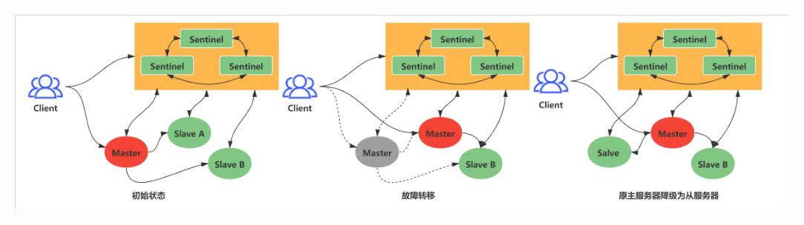

主从故障转移操作包含以下四个步骤：

- 第一步：在已下线主节点（旧主节点）属下的所有「从节点」里面，挑选出一个从节点，并将其转换为主节点。
- 第二步：让已下线主节点属下的所有「从节点」修改复制目标，修改为复制「新主节点」；
- 第三步：将新主节点的 IP 地址和信息，通过「发布者/订阅者机制」通知给客户端；
- 第四步：继续监视旧主节点，当这个旧主节点重新上线时，将它设置为新主节点的从节点；

#### **步骤一：选出新主节点**

故障转移操作第一步要做的就是在已下线主节点属下的所有「从节点」中，挑选出一个状态良好、数据完整的从节点，然后向这个「从节点」发送 SLAVEOF no one 命令，将这个「从节点」转换为「主节点」。

那么多「从节点」，到底选择哪个从节点作为新主节点的？

随机的方式好吗？随机的方式，实现起来很简单，但是如果选到一个网络状态不好的从节点作为新主节点，那么可能在将来不久又要做一次主从故障迁移。

所以，我们首先要把网络状态不好的从节点给过滤掉。首先把已经下线的从节点过滤掉，然后把以往网络连接状态不好的从节点也给过滤掉。

怎么判断从节点之前的网络连接状态不好呢？

Redis 有个叫 down-after-milliseconds * 10 配置项，其 down-after-milliseconds 是主从节点断连的最大连接超时时间。如果在 down-after-milliseconds 毫秒内，主从节点都没有通过网络联系上，我们就可以认为主从节点断连了。 如果发生断连的次数超过了 10 次，就说明这个从节点的网络状况不好，不适合作为新主节点。

至此，我们就把网络状态不好的从节点过滤掉了，接下来要对所有从节点进行三轮考察： **优先级、复制进度、ID 号**。在进行每一轮考察的时候，哪个从节点优先胜出，就选择其作为新主节点。

第一轮考察：哨兵首先会根据从节点的优先级来进行排序，优先级越小排名越靠前，

第二轮考察：如果优先级相同，则查看复制的下标，哪个从「主节点」接收的复制数据多，哪个就靠前。 第三轮考察：如果优先级和下标都相同，就选择从节点 ID 较小的那个。

##### **第一轮考察：优先级最高的从节点胜出**

Redis 有个叫 slave-priority 配置项，可以给从节点设置优先级。

每一台从节点的服务器配置不一定是相同的，我们可以根据服务器性能配置来设置从节点的优先级。

比如，如果「A 从节点」的物理内存是所有从节点中最大的，那么我们可以把「A 从节点」的优先级设置成最高。 这样当哨兵进行第一轮考虑的时候，优先级最高的 A 从节点就会优先胜出，于是就会成为新主节点。

##### **第二轮考察：复制进度最靠前的从节点胜出**

如果在第一轮考察中，发现优先级最高的从节点有两个，那么就会进行第二轮考察，比较两个从节点哪个复制进度。

什么是复制进度？主从架构中，主节点会将写操作同步给从节点，在这个过程中，主节点会用 master_repl_offset 记录当前的最新写操作在 repl_backlog_buffer 中的位置（如下图中的「主服务器已经写入的数据」的位置），而从节点会用 slave_repl_offset 这个值记录当前的复制进度（如下图中的「从服务器要读的位置」的位置）。


如果某个从节点的 slave_repl_offset 最接近 master_repl_offset，说明它的复制进度是最靠前的，于是就可以将它选为新主节点。

**第三轮考察：ID 号小的从节点胜出**

如果在第二轮考察中，发现有两个从节点优先级和复制进度都是一样的，那么就会进行第三轮考察，比较两个从节点的 ID 号，ID 号小的从节点胜出。

什么是 ID 号？每个从节点都有一个编号，这个编号就是 ID 号，是用来唯一标识从节点的。

到这里，选主的事情终于结束了。简单给大家总结下：

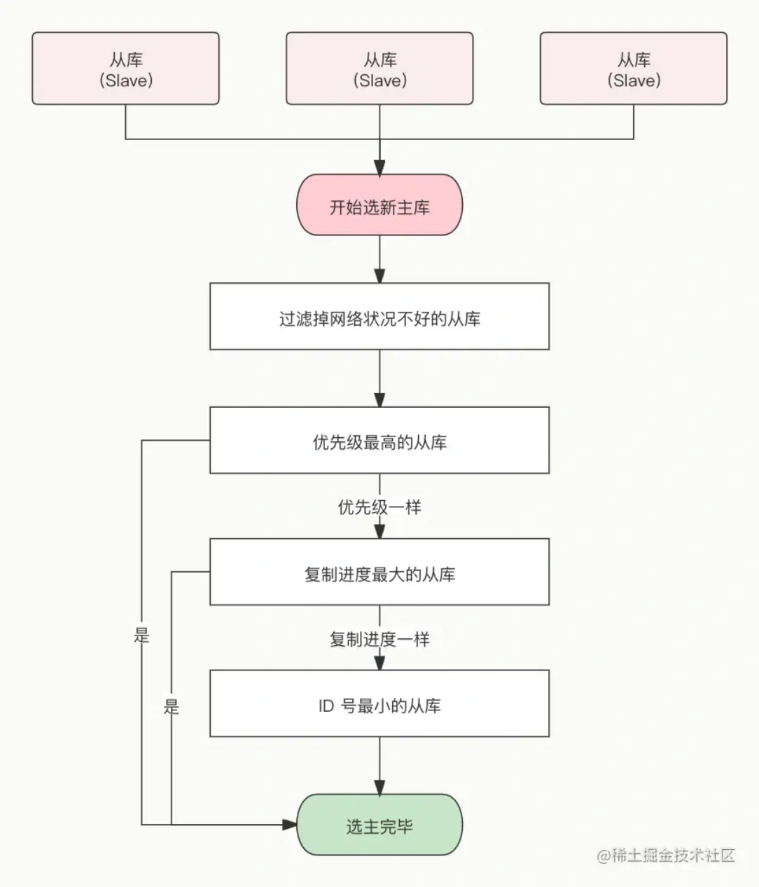

在选举出从节点后，哨兵 leader  向被选中的从节点发送 `SLAVEOF no one` 命令，让这个从节点解除从节点的身份，将其变为新主节点。

如下图，哨兵 leader 向被选中的从节点 server2 发送 `SLAVEOF no one` 命令，将该从节点升级为新主节点。

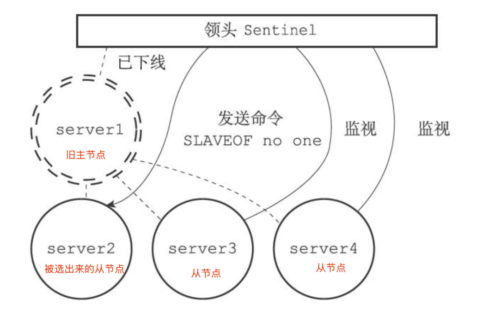

在发送 `SLAVEOF no one` 命令之后，哨兵 leader 会以每秒一次的频率向被升级的从节点发送 `INFO` 命令（没进行故障转移之前， `INFO` 命令的频率是每十秒一次），并观察命令回复中的角色信息，当被升级节点的角色信息从原来的 slave 变为 master 时，哨兵 leader 就知道被选中的从节点已经顺利升级为主节点了。

如下图，选中的从节点 server2 升级成了新主节点：

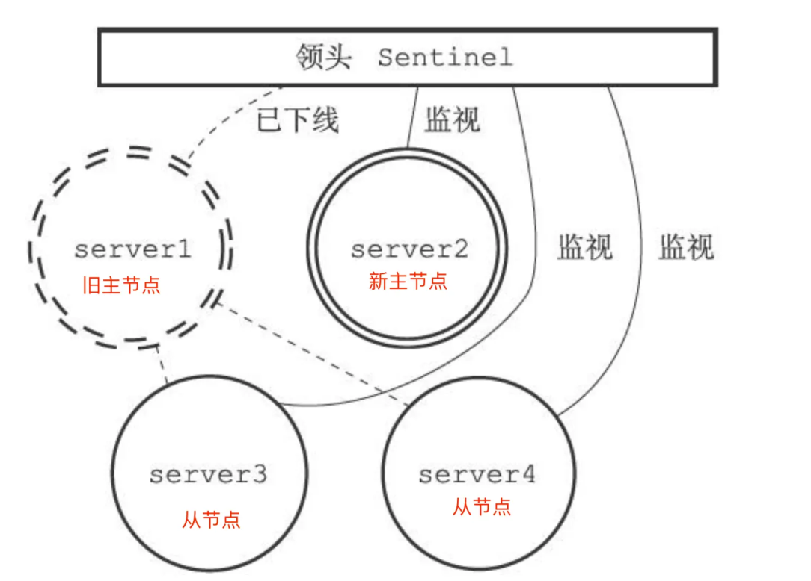

**步骤二：将从节点指向新主节点**

当新主节点出现之后，哨兵 leader  下一步要做的就是，让已下线主节点属下的所有「从节点」指向「新主节点」，这一动作可以通过向「从节点」发送 `SLAVEOF` 命令来实现。

如下图，哨兵 leader 向所有从节点（server3 和 server4）发送 `SLAVEOF`，让它们成为新主节点的从节点。

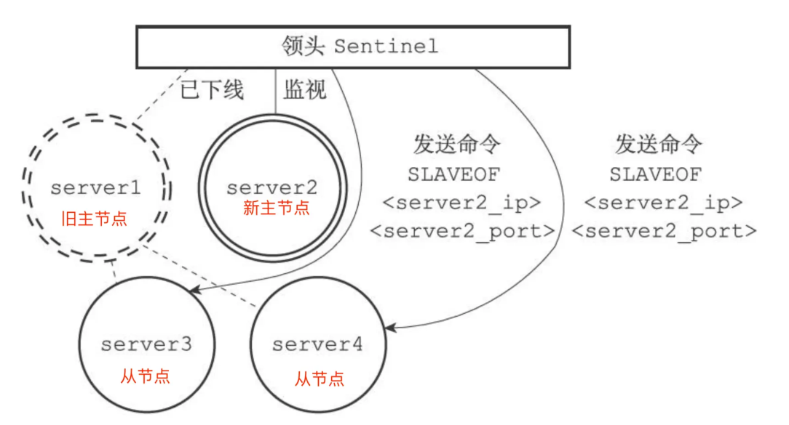

所有从节点指向新主节点后的拓扑图如下：

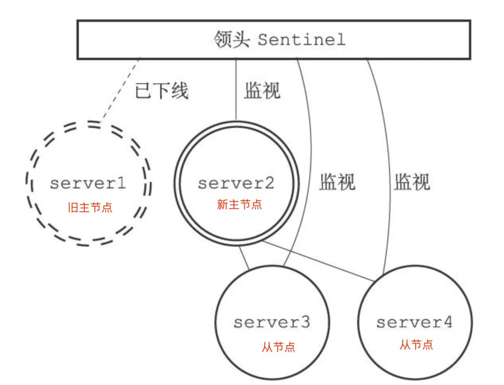

**步骤三：通知客户的主节点已更换**

经过前面一系列的操作后，哨兵集群终于完成主从切换的工作，那么新主节点的信息要如何通知给客户端呢？

这主要 **通过 Redis 的发布者/订阅者机制来实现** 的。每个哨兵节点提供发布者/订阅者机制，客户端可以从哨兵订阅消息。

哨兵提供的消息订阅频道有很多，不同频道包含了主从节点切换过程中的不同关键事件，几个常见的事件如下：

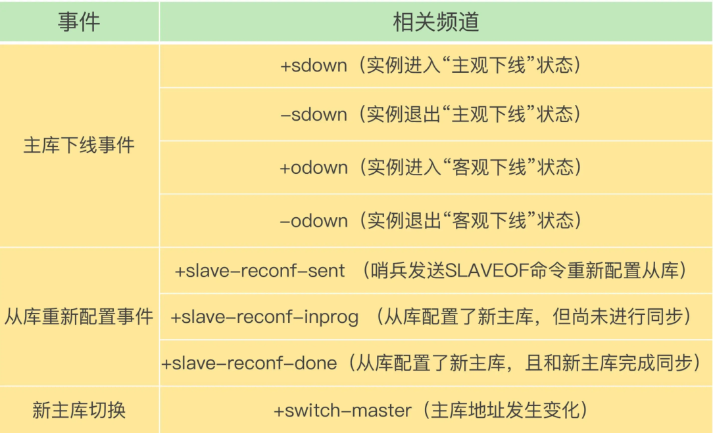

客户端和哨兵建立连接后，客户端会订阅哨兵提供的频道。 **主从切换完成后，哨兵就会向** **`+switch-master` 频道发布新主节点的 IP 地址和端又的消息，这个时候客户端就可以收到这条信息，然后用这里面的新主节点的 IP 地址和端又进行通信了**。

通过发布者/订阅者机制机制，有了这些事件通知，客户端不仅可以在主从切换后得到新主节点的连接信息，还可以监控到主从节点切换过程中发生的各个重要事件。这样，客户端就可以知道主从切换进行到哪一步了，有助于了解切换进度。

#### **步骤四：将旧主节点变为从节点**

故障转移操作最后要做的是，继续监视旧主节点，当旧主节点重新上线时，哨兵集群就会向它发送 `SLAVEOF` 命令， 让它成为新主节点的从节点，如下图：

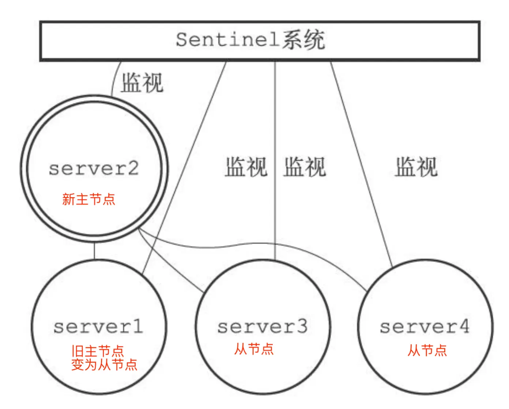

至此，整个主从节点的故障转移的工作结束。

### 哨兵集群是如何组成的？

前面提到了  Redis 的发布者/订阅者机制，那就不得不提一下哨兵集群的组成方式，因为它也用到了这个技术。 在我第一次搭建哨兵集群的时候，当时觉得很诧异。因为在配置哨兵的信息时，竟然只需要填下面这几个参数，设置主节点名字、主节点的 IP 地址和端又号以及 quorum 值。

```
sentinel monitor <master-name> <ip> <redis-port> <quorum>
```

不需要填其他哨兵节点的信息，我就好奇它们是如何感知对方的，又是如何组成哨兵集群的？

后面才了解到， **哨兵节点之间是通过 Redis 的发布者/订阅者机制来相互发现的**。

在主从集群中，主节点上有一个名为 `__sentinel__:hello` 的频道，不同哨兵就是通过它来相互发现，实现互相通信的。

在下图中，哨兵 A 把自己的 IP 地址和端又的信息发布到 `__sentinel__:hello` 频道上，哨兵 B 和 C 订阅了该频道。那么此时，哨兵 B 和 C 就可以从这个频道直接获取哨兵 A 的 IP 地址和端又号。然后，哨兵 B、C 可以和哨兵 A 建立网络连接。

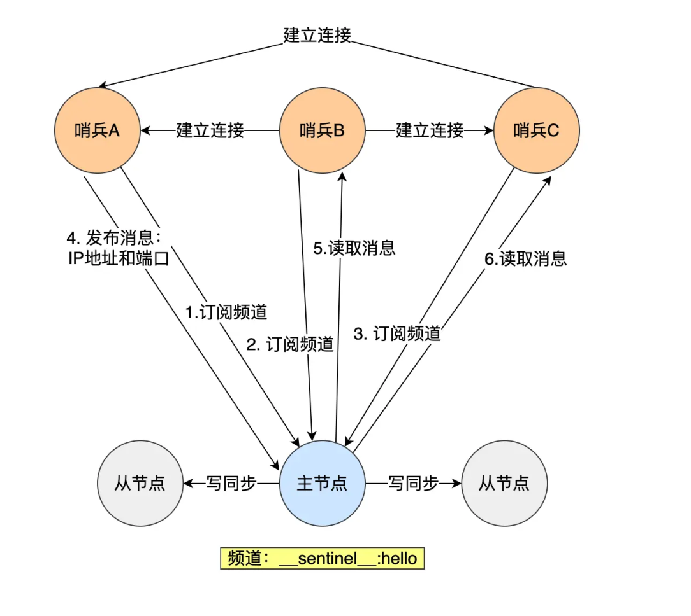

通过这个方式，哨兵 B 和 C 也可以建立网络连接，这样一来，哨兵集群就形成了。

哨兵集群会对「从节点」的运行状态进行监控，那哨兵集群如何知道「从节点」的信息？

主节点知道所有「从节点」的信息，所以哨兵会每 10 秒一次的频率向主节点发送 INFO 命令来获取所有「从节点」的信息。

如下图所示，哨兵 B 给主节点发送 INFO 命令，主节点接受到这个命令后，就会把从节点列表返回给哨兵。接着， 哨兵就可以根据从节点列表中的连接信息，和每个从节点建立连接，并在这个连接上持续地对从节点进行监控。哨兵 A 和 C 可以通过相同的方法和从节点建立连接。

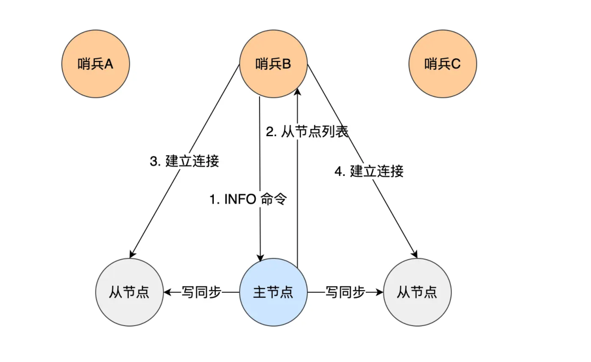

正是通过 Redis 的发布者/订阅者机制，哨兵之间可以相互感知，然后组成集群，同时，哨兵又通过 INFO 命令， 在主节点里获得了所有从节点连接信息，于是就能和从节点建立连接，并进行监控了。

### 总结

Redis 在 2.8 版本以后提供的 **哨兵（** **_Sentinel_）机制**，它的作用是实现 **主从节点故障转移**。它会监测主节点是否存活，如果发现主节点挂了，它就会选举一个从节点切换为主节点，并且把新主节点的相关信息通知给从节点和客户端。

哨兵一般是以集群的方式部署，至少需要 3 个哨兵节点，哨兵集群主要负责三件事情： **监控、选主、通知**。

哨兵节点通过 Redis 的发布者/订阅者机制，哨兵之间可以相互感知，相互连接，然后组成哨兵集群，同时哨兵又通过 INFO 命令，在主节点里获得了所有从节点连接信息，于是就能和从节点建立连接，并进行监控了。

- _1_、第一轮投票：判断主节点下线

当哨兵集群中的某个哨兵判定主节点下线（主观下线）后，就会向其他哨兵发起命令，其他哨兵收到这个命令后， 就会根据自身和主节点的网络状况，做出赞成投票或者拒绝投票的响应。

当这个哨兵的赞同票数达到哨兵配置文件中的 quorum 配置项设定的值后，这时主节点就会被该哨兵标记为「客观下线」。

- _2_、第二轮投票：选出哨兵 _leader_

某个哨兵判定主节点客观下线后，该哨兵就会发起投票，告诉其他哨兵，它想成为 leader，想成为 leader 的哨兵节点，要满足两个条件：

   - 第一，拿到半数以上的赞成票；
   - 第二，拿到的票数同时还需要大于等于哨兵配置文件中的 quorum 值。
- _3_、由哨兵 _leader_ 进行主从故障转移

选举出了哨兵 leader 后，就可以进行主从故障转移的过程了。该操作包含以下四个步骤：

- 第一步：在已下线主节点（旧主节点）属下的所有「从节点」里面，挑选出一个从节点，并将其转换为主节点，选择的规则：
   - 过滤掉已经离线的从节点；
   - 过滤掉历史网络连接状态不好的从节点；
   - 将剩下的从节点，进行三轮考察：优先级、复制进度、ID 号。在每一轮考察过程中，如果找到了一个胜出的从节点，就将其作为新主节点。
- 第二步：让已下线主节点属下的所有「从节点」修改复制目标，修改为复制「新主节点」；
- 第三步：将新主节点的 IP 地址和信息，通过「发布者/订阅者机制」通知给客户端；
- 第四步：继续监视旧主节点，当这个旧主节点重新上线时，将它设置为新主节点的从节点；

完！

参考资料：

- 《Redis 核心技术与实战》
- 《Redis 设计与实现》

最新的图解文章都在公众号首发，别忘记关注哦！！如果你想加入百人技术交流群，扫码下方二维码回复「加群」。


## 6.3 为什么要有 cluster 集群？

原文地址：字节二面：你知道 Redis Cluster 集群工作原理吗？

有位伙伴面试了字节，说有道题，他当时答不上，大家一起来看看： **redis的cluster集群原理，客户端是怎样知道该访问哪个分片的**。

我们应该怎样更好回答呢？可以分这几个维度

- 为什么需要Redis Cluster？哨兵模式不香吗？
- 客户端是怎样知道该访问哪个分片的? (哈希槽)
- redis实例上并没有相应的数据，会怎么样？(MOVED重定向和ASK重定向)
- 各个节点之间是怎么通信的呢(Gossip协议)
- 集群内节点出现故障怎么办（故障转移）
- 加餐：Redis Cluster的Hash Slot 为什么是16384？

### _1._ 为什么需要 _Redis Cluster_？

哨兵模式基于主从模式，实现读写分离，它还可以自动切换，系统可用性更高。但是它 **每个节点存储的数据是一样的，浪费内存，并且不好在线扩容**。

因此，Reids Cluster集群（切片集群的实现方案）应运而生，它在Redis3.0加入的，实现了Redis的分布式存储。对数据进行分片，也就是说 **每台Redis节点上存储不同的内容，来解决在线扩容的问题。并且，它可以保存大量数据，即分散数据到各个Redis实例，还提供复制和故障转移的功能。**

比如你一个Redis实例保存15G甚至更大的数据，响应就会很慢，这是因为Redis RDB 持久化机制导致的， Redis会fork子进程完成 RDB 持久化操作，fork执行的耗时与 Redis 数据量成正相关。

这时候你很容易想到，把15G数据分散来存储就好了嘛。这就是Redis切片集群的初衷。

切片集群是啥呢？来看个例子，如果你要用Redis保存15G的数据，可以用单实例Redis，或者3台Redis实例组成切片集群，对比如下：

切片集群和Redis Cluster的区别：Redis Cluster是从Redis3.0版本开始，官方提供的一种实现切片集群的方案。

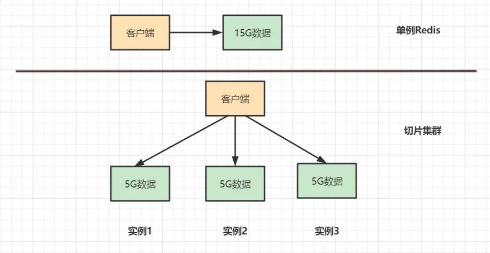

既然数据是分片分布到不同Redis实例的， **那客户端到底是怎么确定想要访问的数据在哪个实例上呢**？我们一起来看下Reids Cluster是怎么做的哈。

### _2._ 客户端是怎样知道该访问哪个分片的 _?_ 哈希槽

Redis Cluster方案采用哈希槽（Hash Slot），来处理数据和实例之间的映射关系。

一个切片集群被分为16384个slot（槽），每个进入Redis的键值对，根据key进行散列，分配到这16384插槽中的一个。使用的哈希映射也比较简单，用CRC16算法计算出一个16bit的值，再对16384取模。数据库中的每个键都属于这16384个槽的其中一个，集群中的每个节点都可以处理这16384个槽。

集群中的每个节点负责一部分的哈希槽，假设当前集群有 A、 B、 C3 个节点，每个节点上负责的哈希槽数 =16384/3，那么可能存在的一种分配：

- 节点A负责0~5460号哈希槽
- 节点B负责5461~10922号哈希槽
- 节点C负责10923~16383号哈希槽

客户端给一个Redis实例发送数据读写操作时，如果这个实例上并没有相应的数据，会怎么样呢？ **MOVED重定向和ASK重定向了解一下哈**

_3._ 实例上并没有相应的数据，会怎么样？ _(MOVED_ 重定向和 _ASK_ 重定向 _)_

在Redis cluster模式下，节点对请求的处理过程如下：

通过哈希槽映射，检查当前Redis key是否存在当前节点

若哈希槽不是由自身节点负责，就返回MOVED重定向

- 若哈希槽确实由自身负责，且key在slot中，则返回该key对应结果
- 若Redis key不存在此哈希槽中，检查该哈希槽是否正在迁出（MIGRATING）？
- 若Redis key正在迁出，返回ASK错误重定向客户端到迁移的目的服务器上
- 若哈希槽未迁出，检查哈希槽是否导入中？

若哈希槽导入中且有ASKING标记，则直接操作，否则返回MOVED重定向

#### **3.1 Moved 重定向**

客户端给一个Redis实例发送数据读写操作时，如果计算出来的槽不是在该节点上，这时候它会返回MOVED重定向错误，MOVED重定向错误中，会将哈希槽所在的新实例的IP和port端又带回去。这就是Redis Cluster的MOVED重定向机制。流程图如下：

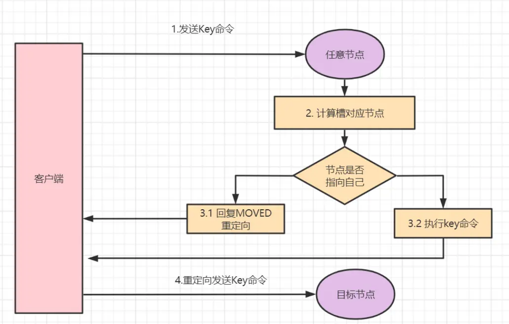

#### **3.2 ASK 重定向**

Ask重定向一般发生于集群伸缩的时候。集群伸缩会导致槽迁移，当我们去源节点访问时，此时数据已经可能已经迁移到了目标节点，使用Ask重定向可以解决此种情况。

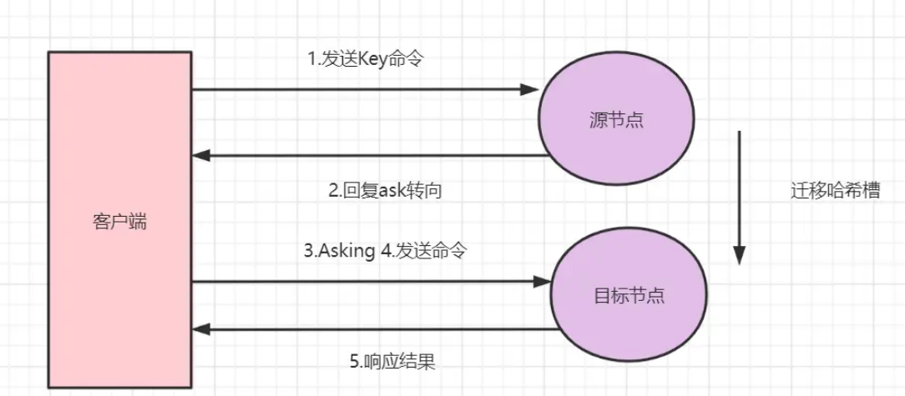

### _4._ 各个节点之间是怎么通信的呢 _(Gossip)_

一个Redis集群由多个节点组成，各个节点之间是怎么通信的呢？通过Gossip协议！Gossip是一种谣言传播协议， 每个节点周期性地从节点列表中选择 k 个节点，将本节点存储的信息传播出去，直到所有节点信息一致，即算法收敛了。

Gossip协议基本思想：一个节点想要分享一些信息给网络中的其他的一些节点。于是，它周期性的随机选择一些节点，并把信息传递给这些节点。这些收到信息的节点接下来会做同样的事情，即把这些信息传递给其他一些随机选择的节点。一般而言，信息会周期性的传递给N个目标节点，而不只是一个。这个N被称为fanout

Redis Cluster集群通过Gossip协议进行通信，节点之前不断交换信息，交换的信息内容包括节点出现故障、新节点加入、主从节点变更信息、slot信息等等。gossip协议包含多种消息类型，包括ping，pong，meet，fail等等

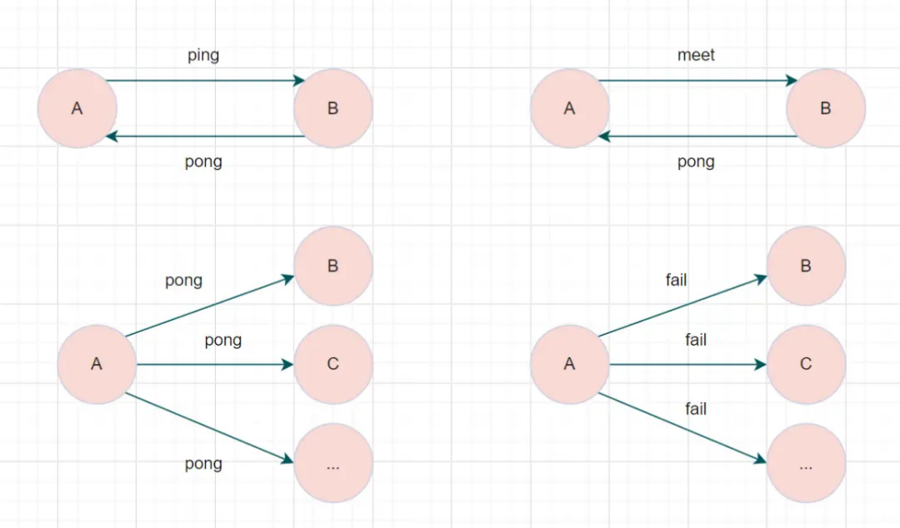

- meet消息：通知新节点加入。消息发送者通知接收者加入到当前集群，meet消息通信正常完成后，接收节点会加入到集群中并进行周期性的ping、pong消息交换。
- ping消息：节点每秒会向集群中其他节点发送 ping 消息，消息中带有自己已知的两个节点的地址、槽、状态信息、最后一次通信时间等
- pong消息：当接收到ping、meet消息时，作为响应消息回复给发送方确认消息正常通信。消息中同样带有自己已知的两个节点信息。
- fail消息：当节点判定集群内另一个节点下线时，会向集群内广播一个fail消息，其他节点接收到fail消息之后把对应节点更新为下线状态。

特别的，每个节点是通过集群总线(cluster bus) 与其他的节点进行通信的。通讯时，使用特殊的端又号，即对外服务端又号加10000。例如如果某个node的端又号是6379，那么它与其它nodes通信的端又号是 16379。 nodes 之间的通信采用特殊的二进制协议。

### _5._ 集群内节点出现故障怎么办（故障转移）

Redis集群实现了高可用，当集群内节点出现故障时，通过 **故障转移**，以保证集群正常对外提供服务。

redis集群通过ping/pong消息，实现故障发现。这个环境包括 **主观下线和客观下线。**

- **主观下线**：某个节点认为另一个节点不可用，即下线状态，这个状态并不是最终的故障判定，只能代表一个节点的意见，可能存在误判情况。

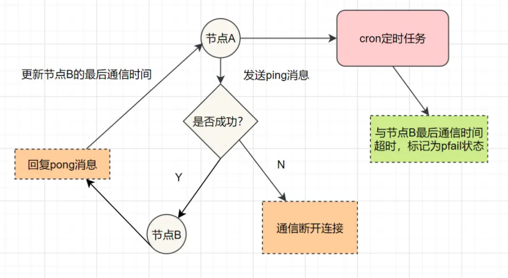

- **客观下线**：指标记一个节点真正的下线，集群内多个节点都认为该节点不可用，从而达成共识的结果。如果是持有槽的主节点故障，需要为该节点进行故障转移。
   - 假如节点A标记节点B为主观下线，一段时间后，节点A通过消息把节点B的状态发到其它节点，当节点 C接受到消息并解析出消息体时，如果发现节点B的pfail状态时，会触发客观下线流程；
   - 当下线为主节点时，此时Redis Cluster集群为统计持有槽的主节点投票，看投票数是否达到一半，当下线报告统计数大于一半时，被标记为客观下线状态。

流程如下：

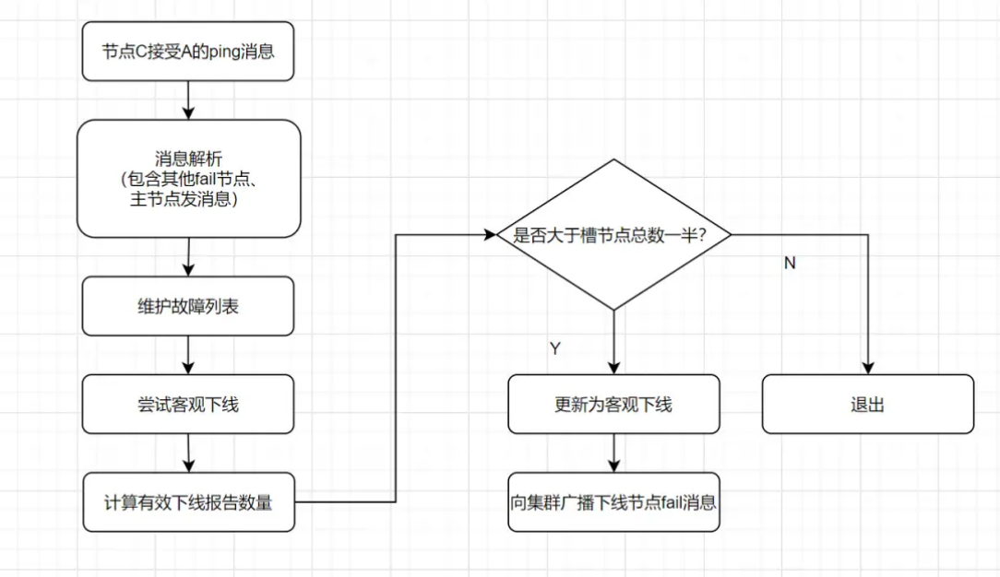

故障恢复：故障发现后，如果下线节点的是主节点，则需要在它的从节点中选一个替换它，以保证集群的高可用。流程如下：

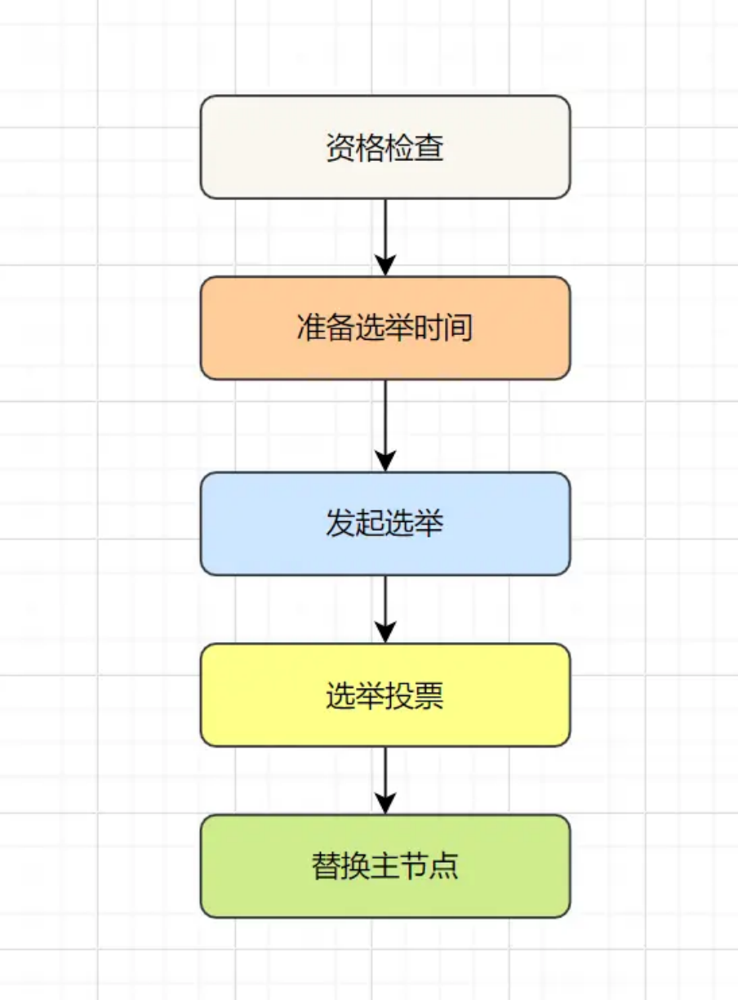

- 资格检查：检查从节点是否具备替换故障主节点的条件。
- 准备选举时间：资格检查通过后，更新触发故障选举时间。
- 发起选举：到了故障选举时间，进行选举。
- 选举投票：只有持有槽的主节点才有票，从节点收集到足够的选票（大于一半），触发替换主节点操

### _6._ 加餐：为什么 _Redis Cluster_ 的 _Hash Slot_ 是 _16384_？

对于客户端请求过来的键值key，哈希槽=CRC16(key) % 16384，CRC16算法产生的哈希值是16bit的，按道理该算法是可以产生2^16=65536个值， **为什么不用65536，用的是16384（2^14）** 呢？

大家可以看下作者的原始回答：

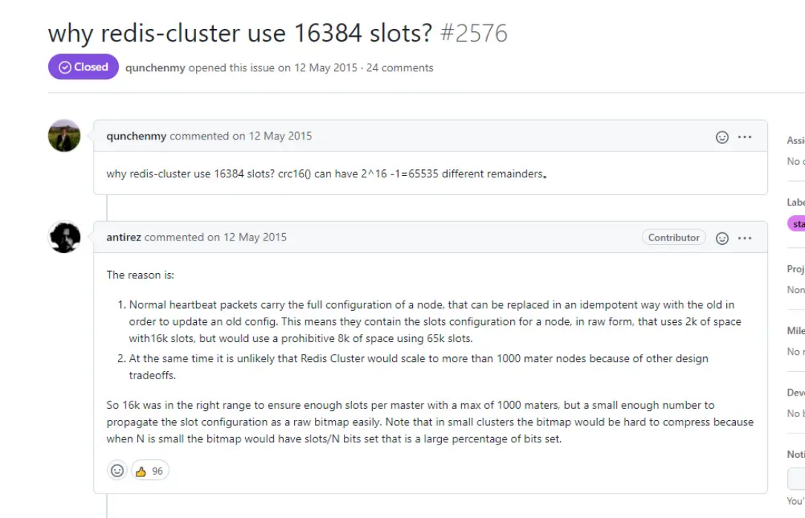

Redis 每个实例节点上都保存对应有哪些slots，它是一个 `unsigned char slots[REDIS_CLUSTER_SLOTS/8]` 类型

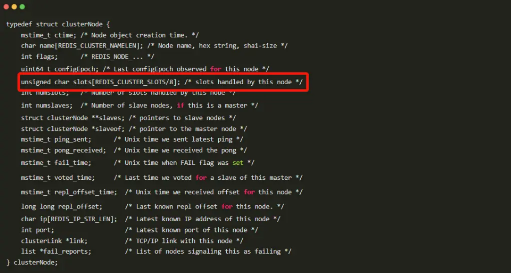

- 在redis节点发送心跳包时需要把所有的槽放到这个心跳包里，如果slots数量是65536，占空间= `65536 / 8(` 一个字节 `8bit) / 1024(1024` 个字节 `1kB)` =8kB，如果使用slots数量是16384，所占空间 = `16384 / 8(` 每个字节 `8bit) / 1024(1024` 个字节 `1kB)` = 2kB，可见16384个slots比 65536省 6kB内存左右，假如一个集群有100 个节点,那每个实例里就省了600kB啦
- 一般情况下Redis cluster集群主节点数量基本不可能超过1000个，超过1000会导致网络拥堵。对于节点数在 1000以内的Redis cluster集群，16384个槽位其实够用了。

**既然为了节省内存网络开销，为什么 slots不选择用8192（即16384/2）呢?**

`8192 / 8(` 每个字节 `8bit) / 1024(1024` 个字节 `1kB)` = 1kB,只需要1KB！可以先看下Redis 把 Key 换算成所属 slots 的方法

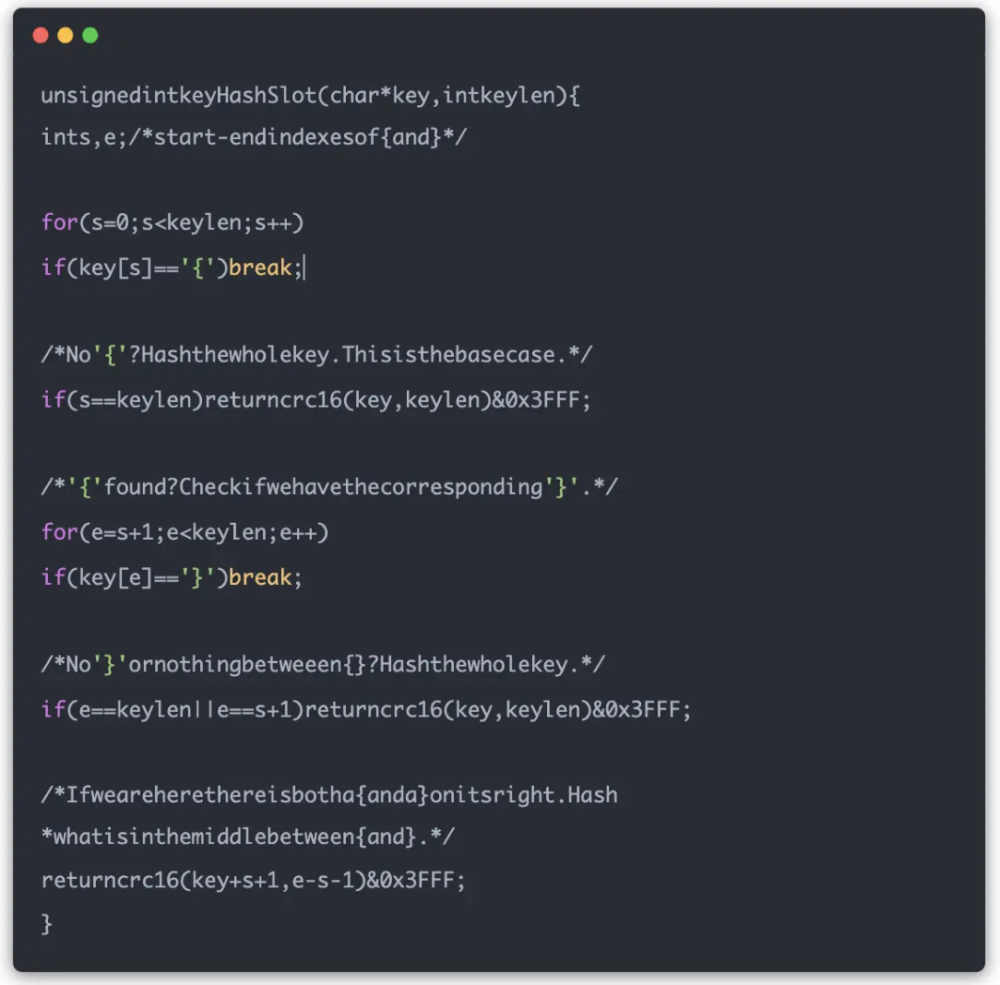

Redis 将key换算成slots 的方法：其实就是是将 `crc16(key)` 之后再和slots的数量进行与计算

这里为什么用 `0x3FFF(16383)` 来计算,而不是 `16384` 呢？因为 **在不产生溢出的情况下** **`x % (2^n)` 等价于** **`x & (2^n - 1)`，** **即** **`x % 16384 == x & 16383`**

那到底为什么不用8192呢？

crc16 出来结果,理论上出现重复的概率为 `1` ⁄ `65536` , 但实际结果重复概率可能比这个大不少，就像crc32 结果理论上 1/40亿分之一，但实际有人测下来10万碰撞的概率就比较大了。

假如 slots 设置成 8192，200个实例的节点情况下，理论值是每40个不同key请求，命中就会失效一次，假如节点数增加到400,那就是20个请求。并且1kb 并不会比 2k 省太多,性价比不是特别高，所以可能选16384会更为通用一点。

### _7._ 总结

- 哨兵模式已经实现了故障自动转移的能力，但业务规模的不断扩展，用户量膨胀，并发量持续提升，会出现了 Redis 响应慢的情况。
- 使用 Redis Cluster 集群，主要解决了大数据量存储导致的各种慢问题，同时也便于横向拓展。在面对千万级甚至亿级别的流量的时候，很多大厂的做法是在千百台的实例节点组成的集群上进行流量调度、服务治理的。
- 整个Redis数据库划分为16384个哈希槽，Redis集群可能有n个实例节点，每个节点可以处理0个到至多 16384 个槽点，这些节点把 16384个槽位瓜分完成。
- Cluster 是具备Master 和 Slave模式，Redis 集群中的每个实例节点都负责一些槽位，节点之间保持TCP通信，当Master发生了宕机， Redis Cluster自动会将对应的Slave节点选为Master，来继续提供服务。
- 客户端能够快捷的连接到服务端，主要是将slots与实例节点的映射关系存储在本地，当需要访问的时候，对 key进行CRC16计算后，再对16384 取模得到对应的 Slot 索引，再定位到相应的实例上。实现高效的连接。

最新的图解文章都在公众号首发，别忘记关注哦！！如果你想加入百人技术交流群，扫码下方二维码回复「加群」。


## 6.4 如何保证 Redis 分布式锁的高可用和高性能？

原文地址：面试官：如何保证分布式锁的高可用和高性能？

现在基本上所有的后端都是分布式系统，数据一致性是我们所有后端工程师必须面对的核心挑战。而要保证一致性，锁就是我们绕不开的工具。从单体应用中的 `synchronized` 或 `ReentrantLock`， 到分布式环境下的分布式锁， 其本质一脉相承，即确保在多线程或多节点环境下，某个关键资源在同一时刻只能被一个执行单元访问。

分布式锁和分布式事务，堪称分布式系统中的两大“拦路虎”，理论深奥，实践中又极易出错。在面试中，分布式锁更是高阶岗位的必考题。然而，还是有很多同学对分布式锁的理解仅仅停留在 `SETNX` 和“设置一个过期时间”的表层。当被进一步追问，比如“如何优雅地等待锁？”、“加锁超时了怎么办？”、“业务执行时间超过了锁的过期时间又该如何？”时，就开始不知道怎么回答了。

一个工业级的分布式锁，需要考虑的远不止于此。

今天，我们就以 Redis 为例，从零开始，层层深入，一步步构建一个真正高可用、高性能的分布式锁方案，确保你在这个话题下拥有足够的深度。

### **_1._ 加锁**

首先要明确，并非只有 Redis 才能实现分布式锁。广义上讲，任何支持“排他性操作”的中间件都可以。比如 ZooKeeper、Nacos 甚至关系型数据库（如利用 MySQL 的 `SELECT ... FOR UPDATE` 语法）。但鉴于 Redis 极高的性能、广泛的应用基础以及其提供的丰富指令，它成为了实现分布式锁的最主流选择。

要用 Redis 实现锁，我们首先要理解锁的本质—— **排他性**。我们只需要在 Redis 中找到一种排他性的操作即可。 `SETNX` （**SET** if **N** ot e **X** ists）命令完美契合了这个需求。此命令只在 `key` 不存在时才会设置成功，并返回1；如果 `key` 已存在，则设置失败，返回0。因此，一个最简单的分布式锁模型就诞生了：

**加锁**：执行 `SETNX lock_key any_value`。 如果返回1，代表加锁成功。

**释放锁**：执行 `DEL lock_key`。

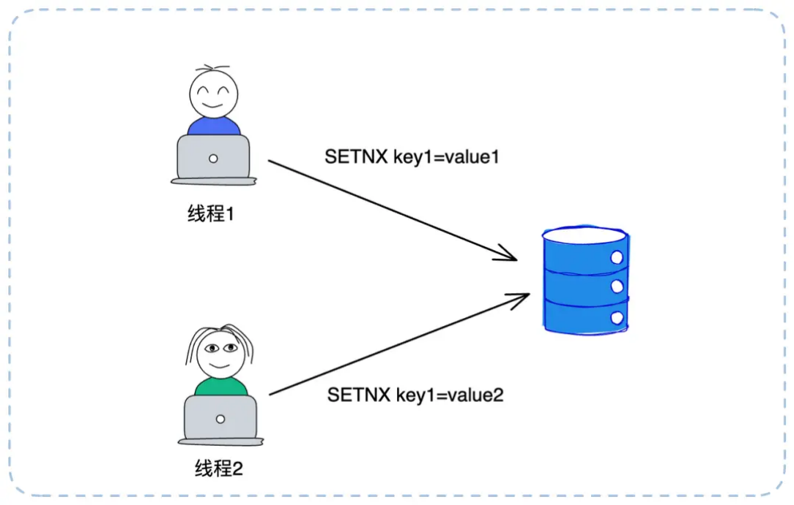

如上图所示，线程1执行 `SETNX key1=value1` 成功，获得了锁。随后线程2执行 `SETNX key1=value2` 失败，进入等待。这个模型虽然简单，但在实际应用中却有很多漏洞，根本无法投入生产。我们来逐一看看它暴露出的问题。

#### **1.1 等待与重试**

当 `SETNX` 失败时，客户端不应立即返回失败，而应进入等待”段。但如何等待，以及在等待过程中遇到网络超时， 都大有讲究。

##### **1.1.1 如何等待锁**

当加锁失败，我们有两种主流的等待策略：

**循环轮询（Spin Lock）**

这是最简单粗暴的方案。比如，加锁失败后，线程 sleep 100毫秒，然后再次尝试 SETNX，直到加锁成功或超出总的等待超时时间。这个“总的等待超时时间”该如何设定？这需要根据业务场景来定。我们应该尽可能确保在等待时间内能拿到锁。因此，这个时间应该约等于一个锁的平均持有时间。 **例如，如果我们通过监控统计，发现99%的业务执行时间都在800毫秒内，那么将总等待时间设为1秒就是个合理的选择。**

这种方式的优点是实现简单，缺点是会带来不必要的 `sleep` （可能锁刚被释放，但线程还在睡眠）和频繁的 Redis 查询（无效轮询），但是实时性不好且空耗资源。

**事件监听**

轮询方式显然不够优雅。更高级的方式是利用 Redis 的发布订阅（Pub/Sub）机制，或者更高阶的 Keyspace Notifications（键空间通知）。加锁失败的客户端可以立即“订阅 ” `lock_key` 的“删除事件” （`DEL` 事件）。当锁被释放 （`DEL`）时，Redis 会主动通知所有订阅者，它们再重新尝试加锁 （`SETNX`）。这种方式实时性更好，也更节省客户端和服务端资源，但实现起来也相对复杂。

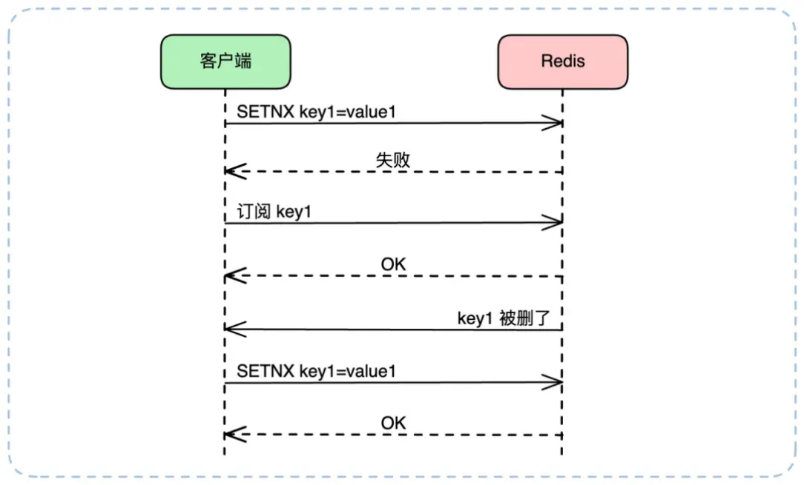

注意：上图只是一个示意。在实际工程中，"检测到锁存在" 和 "发起订阅" 必须是一个原子化或有严密逻辑先后的操作，否则可能在客户端检测到锁存在 （`SETNX` 失败）和发起订阅的这个微小间隙，锁恰好被释放了（`DEL`），导致客户端错过通知，陷入永久等待。

##### **1.1.2 如何重试加锁？**

分布式环境中，网络抖动是常态。如果一个客户端发起 `SETNX` 命令后，收到了一个超时响应，这时它会陷入薛定谔的锁状态：我到底加上锁了吗？

如果贸然重试，可能会覆盖一个已经加锁成功的状态。解决这个问题的核心在于 **保证操作的幂等性**。我们必须让锁的持有者能够“识别”自己的锁。具体做法是，在加锁时， `value` 不再是任意值，而是一个 **全局唯一的ID**，例如 `UUID` 或是唯一的请求ID（Request ID）。

假设我们为 `lock:order:555` 这把锁生成了唯一值 `uuid-client-A`。 当重试时，逻辑如下：

客户端发起 `SETNX lock:order:555 uuid-client-A`，不幸超时。客户端发起重试。此时它不能直接 `SETNX`，而是应该先 `GET lock:order:555`。

###### **情况A：GET 返回 nil（key不存在）**。

这说明上一次的 SETNX 命令没有到达 Redis 或执行失败。客户端此时可以安全地再次执行 SETNX lock:order:555 uuid-client-A。

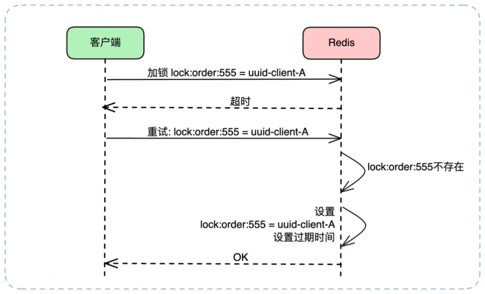

**情况B：GET 返回 uuid-client-A。**

这说明上一次的 SETNX 执行成功了！只是响应包在路上丢了。此时客户端已经持有了锁，它需要做的只是重置一下这把锁的过期时间（我们稍后会讲到），然后心满意足地返回“加锁成功”。


**情况C：GET 返回 uuid-client-B。**

这说明在客户端A超时和重试的间隙，锁被客户端B拿走了（可能是A上次加锁失败，B加锁成功）。此时客户端A 重试失败，应进入上述的等待逻辑。

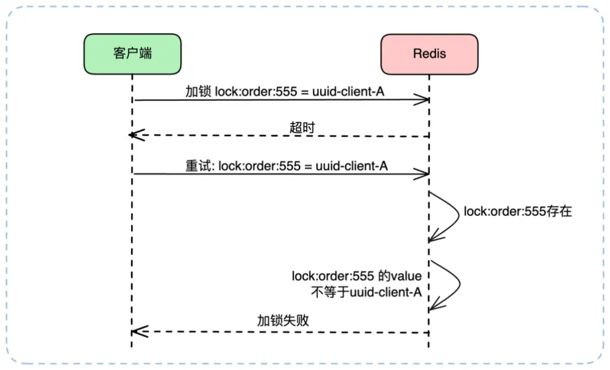

在分布式锁的设计中，如果要支持 **重试机制**，关键是要能够判断 **上一次加锁是否成功**。因此，在加锁时，可以为每个锁的值设置一个唯一标识（例如一个随机生成的 UUID），用于标识锁的持有者。

当客户端因超时等原因需要重试时，可以根据以下逻辑进行判断：

1. **查询锁是否存在**：如果 Redis 中不存在该 key，说明上次加锁没有成功，可以直接重新尝试加锁。
2. **校验锁的归属**：如果 key 存在，并且其 value 与本次请求携带的 UUID 相同，说明上次加锁其实已经成功了。此时，为了防止锁过期失效，可以重新设置锁的过期时间。
3. **锁已被他人持有**：如果 key 存在，但 value 与本次 UUID 不同，说明锁已经被其他客户端持有，本次加锁应视为失败。

在实践中，由于 Redis 性能极高，这种加锁超时的情况很少见，一般重试一两次足矣。但是，如果我们从理论上分析，万一重试也一直超时呢？

其实也无需额外处理。如果之前加锁已经成功了（情况B），那么无非就是后续的重置过期时间失败，等锁到了过期时间，自然就失效了。如果之前没加锁成功（情况A或C），那就更没关系了，别的线程需要时自然可以拿到锁。这也就自然而然地引出了下一个关键概念： **过期时间**。

#### **1.2 锁过期与续约**

- 我们刚才的简单模型（`SETNX` + `DEL`）还有一个致命缺陷：如果一个客户端加锁成功后，业务还没执行完就宕机了 ——比如机器断电、进程崩溃——它将永远无法执行 `DEL`。 这把锁就成了“死锁”，其他所有客户端都将永远等待下去，导致整个业务线瘫痪。

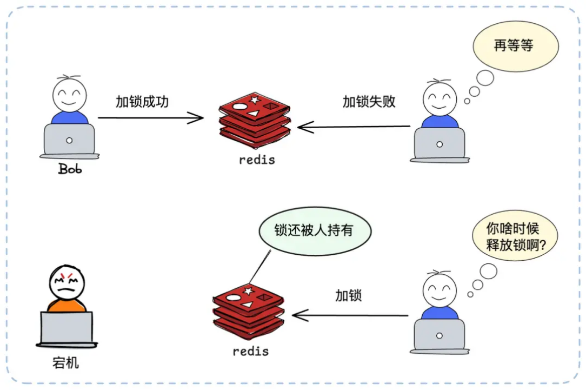

##### **1.2.1 为什么需要过期时间？**

为了防止持有者宕机导致死锁，我们必须引入一道保险—— **锁过期时间**。我们必须在加锁的同时，给锁设置一个过期时间（TTL）。这里要强调一下， **加锁（SETNX）和设置过期时间（EXPIRE）必须是一个原子操作**。否则，如果在 `SETNX` 成功和 `EXPIRE` 之间客户端宕机，依然会产生死锁。

这里我们Redis 提供了原子命令：

```
SET lock_key unique_value EX 30 NX
```

这条命令（`SET ... EX ... NX`）等价于 `SETNX` + `EXPIRE`， 完美解决了原子性问题。这样，即便持有锁的客户端宕机，锁也会在30秒后自动释放，其他客户端得以继续工作。

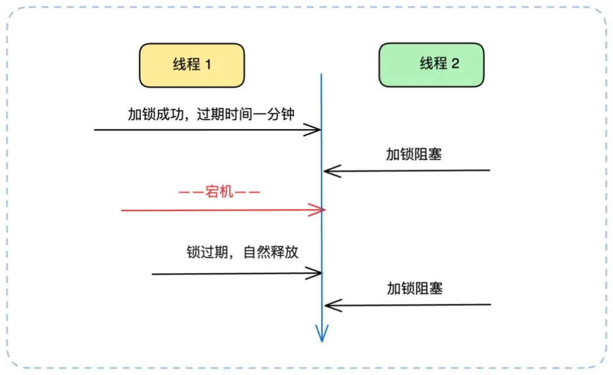

##### **1.2.2 过期时间设多长？**

只要引入了过期时间，面试官几乎必然会问：这个时间应该设置成多长？这又是一个经典问题。答案还是： **根据业务场景**。

你需要评估业务逻辑的执行耗时，比如取 99.9% 分位线（P999），然后再加一个合理的缓冲（Buffer）。例如，99.9% 的请求在5秒内完成，你可以把过期时间设为10秒甚至20秒。

这里还有一个重要观点：过期时间的主要目的是为了防止宕机导致的死锁。而在绝大多数（99.99%）情况下， 锁都应该由客户端在业务执行完毕后主动释放 （`DEL`）。因此，把过期时间设得长一些，比如30秒、1分钟，通常是安全的，也是合理的。

其实很多公司的分布式锁实现，也就到这一步为止了。但我们还可以继续深挖。

##### **1.2.3 锁续约机制**

无论你把过期时间设为30秒还是1分钟，总有可能遇到“天选之子”——某个请求因为GC停顿、网络延迟或极其复杂的计算，执行时间真的超过了锁的过期时间。这时，会发生什么？

1. 客户端A持有锁，业务正在执行。
2. 锁到达1分钟过期时间，被 Redis 自动释放。
3. 另一个客户端B立即通过 `SETNX` 拿到了这把锁，开始执行业务。
4. 紧接着，客户端A的业务终于执行完毕，它会（错误地）去释放锁（我们稍后会讲如何避免）。
5. 这就造成了数据混乱，两个客户端可能同时操作了资源。

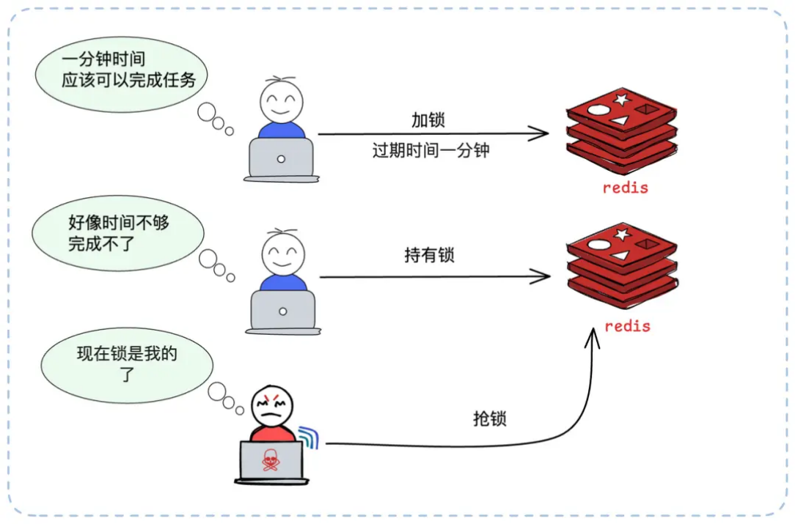

为了解决这个问题，我们需要引入 **锁续约（Renewal）机制**，也常被称为“看门狗（Watchdog）”机制。原理是： 客户端在加锁成功后，启动一个后台线程（或定时任务）。这个线程会 **周期性地** 检查客户端是否还持有锁。如果还持有（即业务尚未执行完），就去“续”一下锁的过期时间，比如重新 `EXPIRE lock_key 60`。

举个例子（按原文）：我们设置锁的过期时间是1分钟。续约线程可以设置在50秒的时候启动检查。

- 在第50秒，续约线程检查到业务还在运行，于是重置过期时间为1分钟。
- 在第100秒（1分40秒），续约线程再次检查，业务还在，再次重置为1分钟。
- 重复上述检查重置过程......
- 在第130秒（2分10秒），业务执行完毕，客户端主动释放锁。
- 在第150秒（2分30秒），续约线程检查到锁已被释放，退出。

理论上，只要确保在剩余过期时间内能够续约成功就可以了。比如这里预留了10秒（60秒-50秒）的窗又期，就算第一次续约失败，也有足够的时间进行重试。

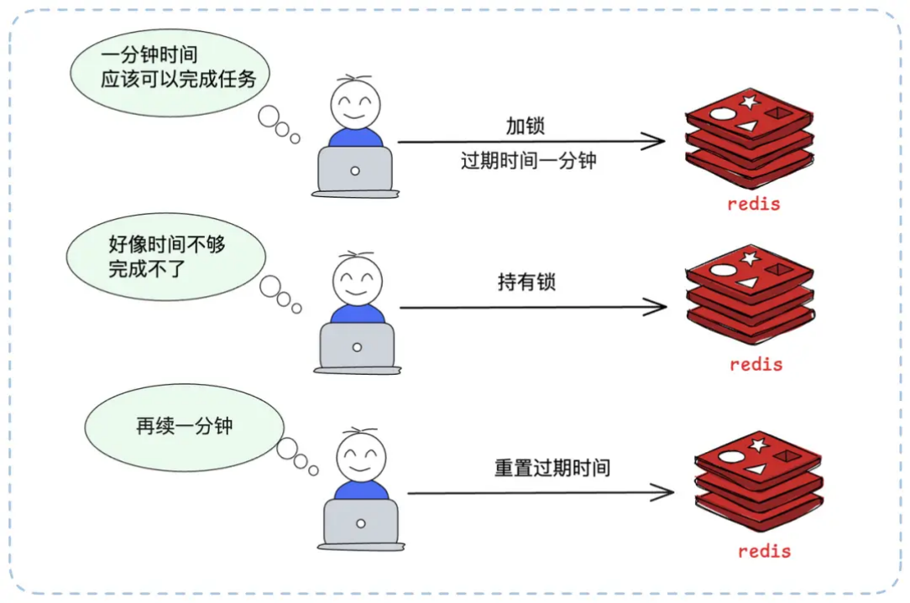

这样，只要客户端A没有宕机，它就可以在业务执行期间内，一直持有这把锁。

##### **1.2.4 续约失败策略**

续约机制也不是万能的。如果续约线程在尝试 `EXPIRE` 时，因为网络问题或 Redis 故障而 **连续失败**，直到锁过期了都没成功，该怎么办？此时，锁已经（或即将）被其他客户端拿到。原客户端A的业务如果继续执行，将导致两个客户端同时处理业务，破坏了排他性。

这时我们面临两种策略：

1. **保守策略（推荐）**：续约失败意味着锁的归属权已经丢失。业务逻辑必须 **立即中断** 并回滚，向上层抛出异常。这是对数据一致性最严格的保障。
2. **激进策略**：假设续约失败是小概率事件，业务逻辑继续执行。这可能会导致数据不一致，但系统“可用性”更高。此策略慎用。

这里提到了中断业务，这又是一个可以在面试的时候跟面试官深聊的亮点。

##### **1.2.5 业务中断策略**

在分布式锁出了问题（如续约失败）时，如何中断业务？这其实是个很困难的事情。分布式锁框架（如 Redisson） 并不能 **直接** 帮你中断业务，它能做的，只是在续约失败时，给业务代码发一个“中断信号”（比如设置一个 `volatile` 标志位，或者调用线程的 `interrupt()` 方法）。 **是否中断，以及如何中断，完全取决于你的业务代码是如何实现的。**

如果你的业务是一个大循环，那么你可以在每个循环开始的时候，检测一下中断信号：

```
// 伪代码：在循环中检测中断信号
for (int i = 0; i < data.size(); i++) {
```

如果你的业务没有循环，而是由多个步骤构成，那么你可以在每一个关键步骤之后都检测一下：

```
// 伪代码：在关键步骤间检测中断信号
step1();
if (lock.isInterrupted()) {
    // 中断并返回
    return;
}
step2();
if (lock.isInterrupted()) {
    // 中断并返回
    return;
}
step3();
```

最后可以总结拔高一下：这种中断业务的难题，在微服务超时控制里也会遇到，目前业界也没有银弹，它强依赖于业务代码的主动配合与检测。

### **_2._ 释放锁**

我们前面提到，加锁时要用唯一ID作为 `value`。 这个ID在释放锁时同样至关重要。正常来说，释放锁（`DEL`） 不会有问题。但在一些特殊场景下（比如Redis宕机恢复，或者业务执行时间超过了锁过期时间），释放锁也可能出大问题。还设有这样一个场景：

1. 客户端A加锁 key1成功 （`value=vaule` 1），过期时间30秒。
2. 客户端A遭遇了长时间的 Full GC，卡顿了35秒，锁续约失效。
3. 在第30秒时，锁自动过期释放。
4. 在第31秒时，客户端B加锁 key1成功（`value=value` 2）。
5. 在第35秒时，客户端A从 GC 中苏醒，它的业务逻辑执行完毕，发起 `DEL key` 1。
6. **灾难发生**：客户端A“释放”了客户端B的锁。

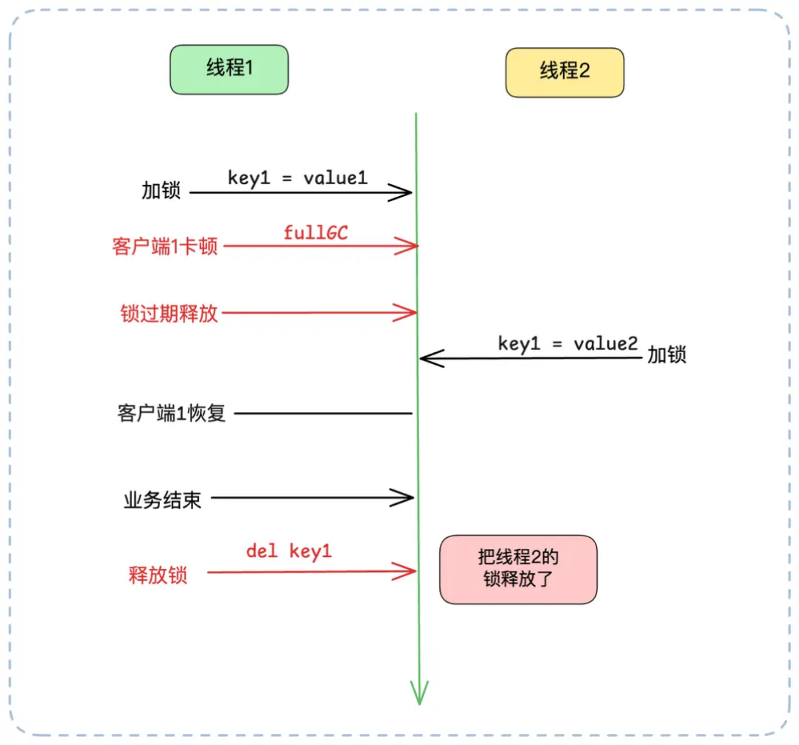

这个场景的根源在于，客户端A释放了“不属于自己”的锁。解决方案就是： **释放锁时，必须检查锁是不是自己的**。 客户端在释放锁时，不能简单粗暴地 `DEL`。 它必须执行一个“复合操作”：“检查 `value` 是否匹配，如果匹配才删除”。这必须是一个 **原子操作**，否则在 `GET` 和 `DEL` 之间锁可能又过期了，产生新的竞态条件。

实现原子化“查删”的最佳方式是使用 **Lua 脚本**，因为 Redis 执行 Lua 脚本是原子的。

- -- 释放锁的 Lua 脚本 -- KEYS[1] 是锁的 key -- ARGV[1] 是客户端的唯一 ID ( 比如 uuid-A) if redis.call("get", KEYS[1]) == ARGV[1] then -- 检查锁的 value 是不是自己的 ID，如果是，才删除 return redis.call("del", KEYS[1]) else -- 如果锁不存在，或者锁的 value 不是自己的 ID，则不删除 return 0 end

这个脚本会先 `get` 锁的 `value`，判断它是否等于客户端传入的唯一ID。如果是，才执行 `del`。 这完美解决了误删问题。

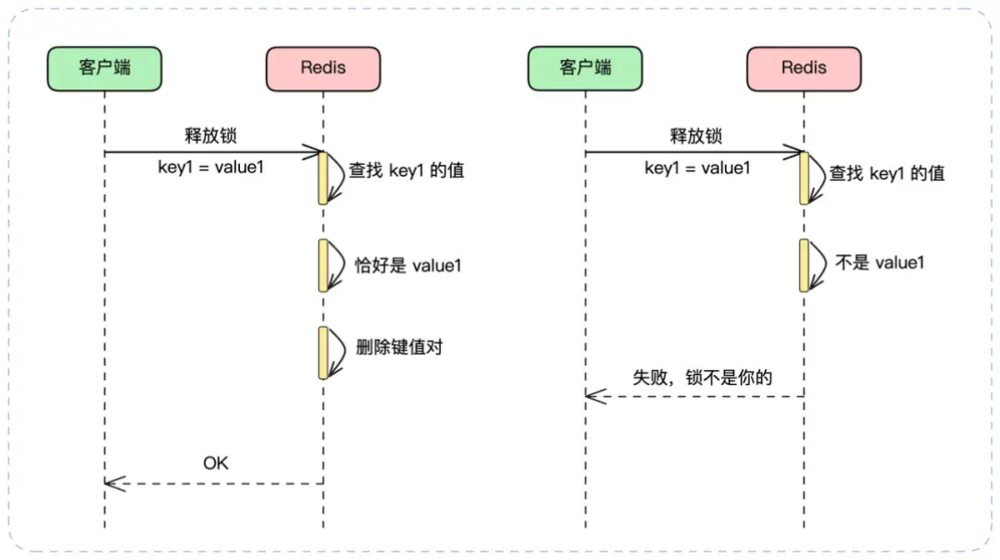

### **_3._ 高阶方案**

#### **3.1 Redlock**

至此，我们的分布式锁似乎已经很健壮了。但它依然依赖一个 **单实例** 的 Redis。如果这个 Redis 实例宕机了，整个分布式锁服务就瘫痪了。

你可能会说：“用 Redis 主从（Master-Slave）复制和哨兵（Sentinel）来保证高可用啊！”，但这不行。Redis 的主从复制是 **异步** 的。这会导致一个致命缺陷：

1. 客户端A在 Master 节点加锁成功。
2. Master 还没来得及把这个 `key` 异步复制给 Slave，就宕机了。
3. 哨兵（Sentinel）将 Slave 提升为新的 Master。
4. 客户端B在新 Master 上尝试加锁，由于新 Master 上根本没有这个 `key`，B也加锁成功了。
5. **灾难发生**：系统中有两个客户端同时持有了锁，排他性被打破。

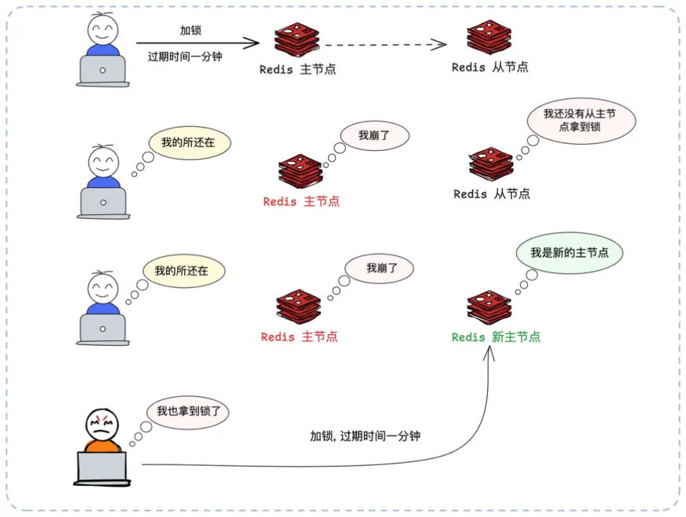

为了解决 Redis 单点和主从异步复制的缺陷，Redis 的作者 Antirez 提出了 **Redlock（红锁）算法**。

Redlock 的思想是“ **多数派原则** ”。它不再依赖单个 Redis 实例，而是部署 N 个。当大多数节点都告诉你加锁成功的时候，就说明加锁成功了。比如你同时在 5 个节点上加锁，那么大多数就意味着至少 3 个节点成功才算加锁成功。

**加锁流程**：

1. 客户端记录当前时间戳。
2. 依次尝试在 **所有5个** 实例上加锁（使用我们前面完善的 `SET ... EX ... NX` 命令），并且为每个实例设置一个很短的连接和响应超时（例如50毫秒），防止在某个宕机节点上浪费太多时间。
3. 统计加锁成功的实例数量。如果 **超过半数** （例如 5个中的3个）成功，并且总耗时小于锁的有效时间 （过期时间 `-` 加锁耗时），则认为加锁成功。
4. 锁的真正有效时间 = 初始设置的过期时间 - 加锁总耗时。

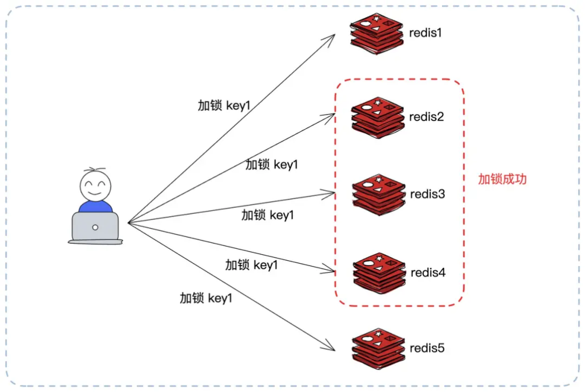

**释放锁流程**：

客户端必须向所有5个实例发起释放锁（前面提到的Lua脚本）的操作，无论加锁时该实例是否成功。这样做是为了清理可能存在的“僵尸锁”。

Redlock 通过“多数派”机制，极大地提升了分布式锁的可用性。即使有1-2个 Redis 实例宕机，锁服务依然可用。

但它也并非银弹。Redlock 的成本更高，实现更复杂，且加锁的性能开销也更大（需要请求多次）。因此，在实际选型中，很多公司会评估后也会认为这种方案过于复杂，单实例 Redis 带来的风险（如宕机、主从切换）是可接受的，从而选择继续使用我们前面讨论的、基于单实例的健壮方案。

#### **3.2 锁的性能优化**

分布式锁虽然解决了问题，但它本身是有开销的：每一次加锁、续约、释放锁，都是一次（甚至多次）网络IO。在高并发场景下，锁的竞争会成为性能瓶颈。

其实分布式锁能做的优化不多。一个思路是优化 Redis本身的性能（比如启用单独的Redis集群，防止被其他业务影响），另一个思路就是减少分布式锁的竞争。

##### **3.2.1 Singleflight 模式**

在高并发下，可能一个服务实例内的几十个线程，和另外几十个实例的几百个线程，都在同一时刻竞争 **同一把锁**。

我们可以借鉴 `singleflight` 模式（在Go中很常用，Guava中也有类似实现）：针对同一个 `key` 的加锁请求，在 **单个实例内部**，只允许一个线程去 Redis 竞争分布式锁。其他线程则在本地等待这个代表的结果。

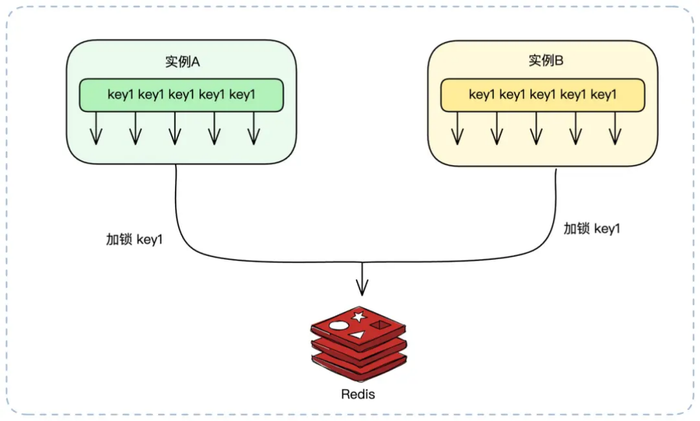

假设有2个实例，每个实例上各有10个线程要去获得 key1 上的分布式锁。

**无优化**：总共有 2 * 10 = 20 个线程会涌向 Redis 竞争锁。

**Singleflight**：实例A内部先选出1个线程，实例B内部也选出1个线程。最终只有2个线程去 Redis 竞争分布式锁。

竞争压力骤减，性能显著提升。竞争越激烈，这种方案的效果越好。如果没什么并发，那就基本没什么效果。

##### **3.2.2 本地锁交接**

这里还有一种更加激进的优化方案。当实例A的线程T1拿到了分布式锁并执行完业务后，它在释放锁 （`DEL`）之前，先检查一下 **本地** （即实例A的内存中）是否还有其他线程（如T2、T3）正在等待这把锁。

如果有（比如T2在等），T1可以直接在内存中把“锁凭证”（那个唯一的UUID）转交给T2，并通知T2“你现在可以执行了”。T1自己则不去 `DEL` 锁，转而由T2在未来去释放。

这种本地接力完全省去了一次 `DEL` 和一次 `SETNX` 的网络开销，在高竞争下效果还是非常不错的。

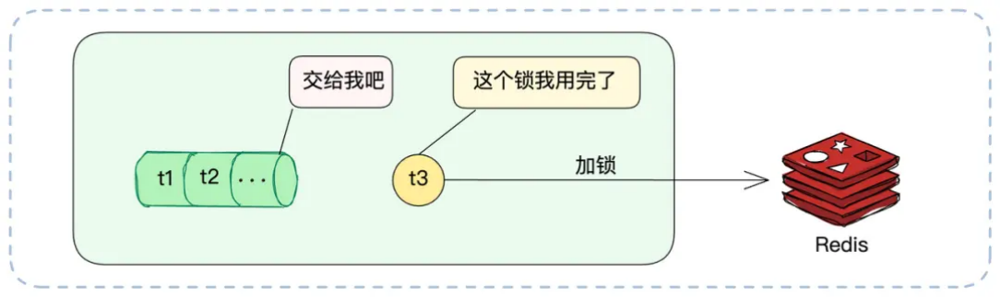

虽然这种方案开起来性能确实得到了极大的提升，但是实际生产环境中这种方式一般用的较少，主要有以下几个点：

1. 复杂度高，容错性差，这种方案引入了 **本地状态依赖** （比如本机的等待队列和锁持有状态），一旦实例 A 崩溃或重启，这个“接力关系”就断了，但在 Redis 看来锁还没释放，造成 **锁泄漏**
2. 失去了分布式锁的原本意义，Redis 分布式锁设计的初衷就是 **锁的状态由 Redis 统一仲裁，不依赖于任何单节点的本地状态**。但这种方法把部分锁语义搬回了节点内存。这意味着锁的持有状态，不再是 **单一数据源**，而是 Redis + 本地协作，这就导致一致性边界模糊，违背集中锁仲裁的设计哲学

##### **3.2.3 分布式锁替换**

针对这种排他场景，还可以进一步优化。就是不用分布式锁。分布式锁是解决并发的其实性能消耗还是不小的，如果能换个思路，也许根本不需要它。严格来说，是原本这些场景就不该用分布式锁。

###### 1、 **数据库乐观锁**

很多场景使用分布式锁，是为了保护一个“读取数据 -> 计算 -> 写回数据”的流程。比如扣减库存：SETNX -> SELECT -> 业务计算 -> UPDATE -> DEL。这个流程完全可以用乐观锁替代。给库存表加一个 `version` 字段：

1. `SELECT stock, version FROM inventory WHERE sku_id = 's101'`
2. 在内存中计算新库存 `new_stock = stock - 1`
3. `UPDATE inventory SET stock = new_stock, version = version + 1 WHERE sku_id = 's101' AND version = (` 第 `1` 步查到的 `version)`

如果 `UPDATE` 的返回行数为0，说明 `version` 已被他人修改（并发冲突）。此时客户端只需从第1步开始重试即可。 全程无锁，性能极高。缺点是可能会有多个线程在做重复计算，但只要最终更新数据库时控制住了并发，就没关系。

###### 2、 **一致性哈希负载均衡**

分布式锁的出现，是因为同一个业务请求（如处理订单 order_id=555）可能被负载均衡打到任何一个实例上。

如果我们能通过一致性哈希等手段，将 **特定ID的请求（如按** **`order_id` 哈希）固定路由到同一个实例** 上，那么问题就从“分布式”退化成了“单机”。我们只需要在那个实例内部使用本地锁（如 Java 的 `ReentrantLock`）或者用单机 `Singleflight` 模式就可以，完全规避了重量级的分布式锁。

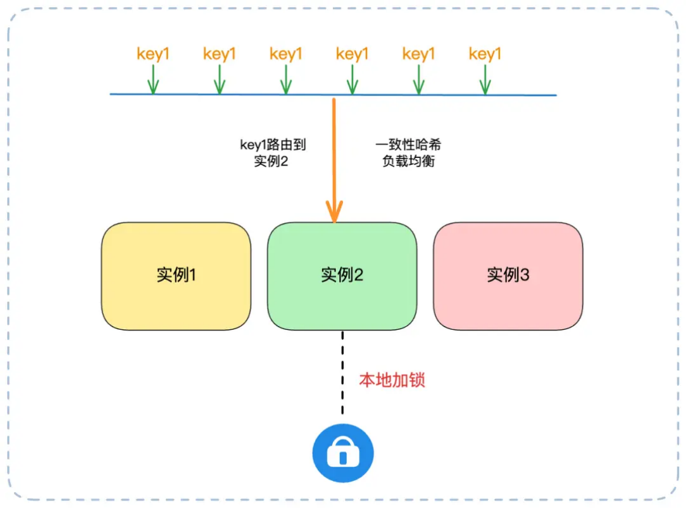

### _4._ 总结

从最初的 `SETNX` 到完善的续约、原子化释放、再到 Redlock 以及各种性能优化手段，我们可以看到，分布式锁的核心始终围绕两个关键词展开： **可靠性** 与 **性能**。

可靠性确保锁语义不被破坏，性能则决定方案能否真正落地。工程实践中，锁并非万能，很多场景完全可以用乐观锁或一致性哈希等思路替代，从根源上消除“锁”的需求。

掌握这些设计背后的取舍逻辑，远比死记实现细节更重要。

分布式锁不是终点，而是理解分布式一致性与系统取舍的起点。

最新的图解文章都在公众号首发，别忘记关注哦！！如果你想加入百人技术交流群，扫码下方二维码回复「加群」。
