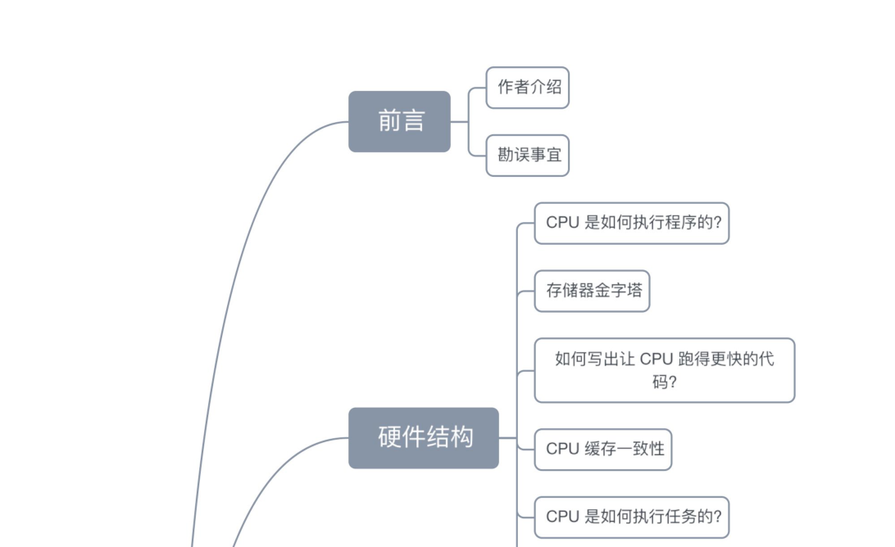
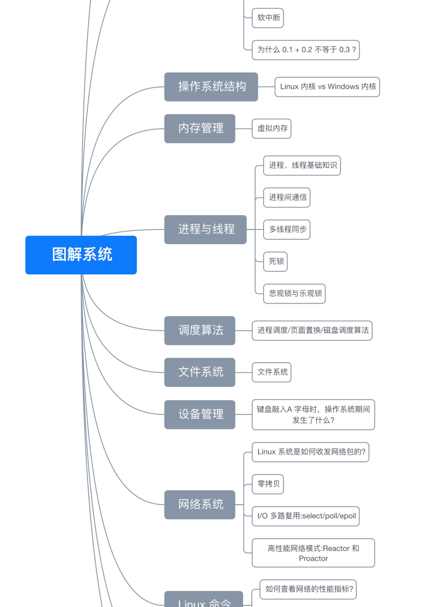

# **前言**

## **作者介绍**

大家好，我是小林，是这本「图解系统」电子书的作者，电子书的内容都是整理于我公众号「**小林 coding**」里的图解文章。

还没关注的朋友，可以微信搜索「**小林coding**」，关注我的公众号， **后续最新版本的 PDF 会在我的公众号第一时间发布**，而且会有更多其他系列的图解文章，比如操作系统、计算机组成、数据库、算法等等。 之前小林公众号也发布过「**图解网络**」，还没领取的小伙伴，关注我公众号后，回复「**网络**」就可以获取啦。

简单介绍下这个 **图解系统 PDF**，这本电子书共有 **15W 字 + 400 张图**，文字都是小林一个字一个字敲出来的，图片都是小林一个点一条线画出来的，非常的不容易。

这本书图解系统适合什么群体呢？

这本书写的网络知识主要是 **面向程序员** 的，因为小林本身也是个程序员，所以涉及到的知识主要是关于程序员日常工作或者面试的操作系统知识。

非常适合有一点操作系统，但是又不怎么扎实，或者知识点串不起来的同学，说白 **这本图解系统就是为了拯救半桶水的同学而出来**。

因为小林写的图解系统就四个字， **通俗易懂**！

相信你在看这本图解系统的时候，你心里的感受会是：

- 「卧槽，原来是这样，大学老师教知识原来是这么理解」
- 「卧槽，我的操作系统知识串起来了」
- 「卧槽，我感觉面试稳了」
- 「卧槽，相见恨晚」

当然，也适合面试突击操作系统知识时拿来看，不敢说 100 % 涵盖了面试的网络问题，但是至少 90% 是有的，而且内容的深度应对大厂也是搓搓有余的，有非常多的读者跑来感激小林的图解系统， **帮助他们拿到了国内很多一线大厂的 offer**。

这本书图解系统要怎么阅读呢？

很诚恳的告诉你，这本书不是教科书。

而是我在公众号里写的图解系统文章的整合，所以肯定是没有教科书那么细致和全面，当然也不就不会有很多废话，而且有的知识点书上看不到。

图解系统 PDF 不仅仅只有操作系统的知识，还涉及计算机组成和 Linux 系统、命令的知识。

阅读的顺序可以不用从头读到尾，你可以根据你想要了解的知识点，去看哪个章节的文章就好，可以随意阅读任何章节的文章。

下面这张思维导图是整个电子书的目录结构：

