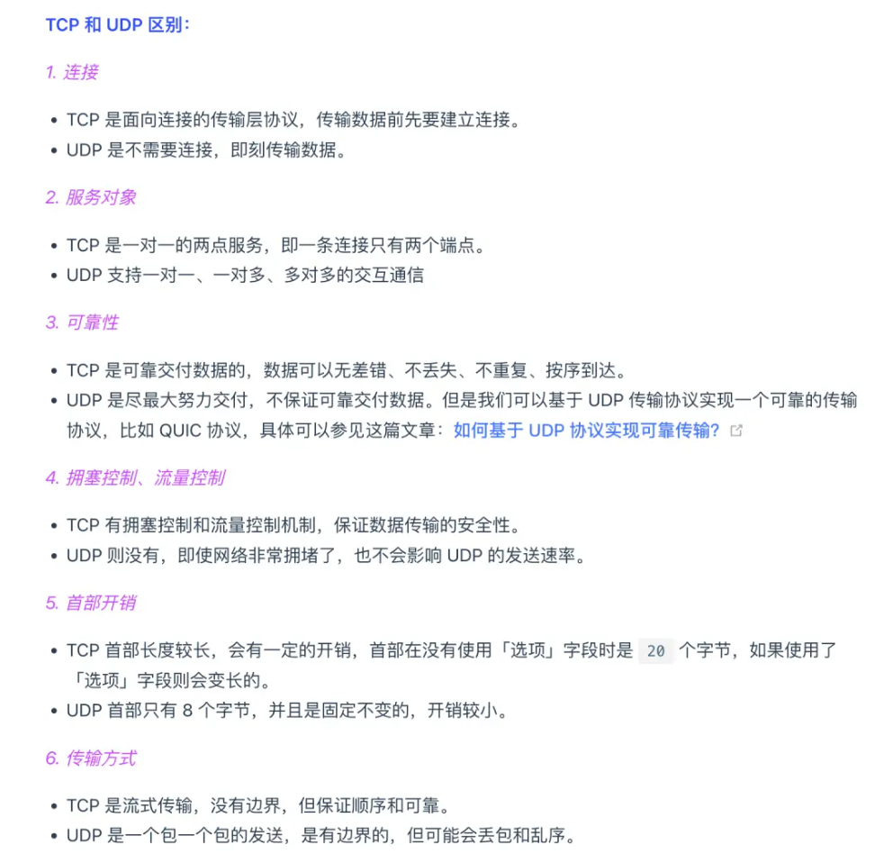
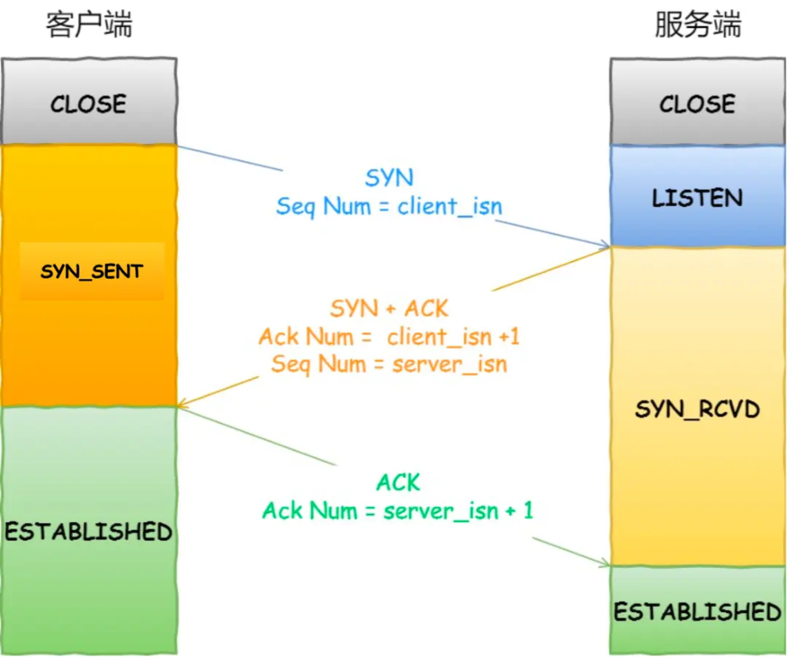
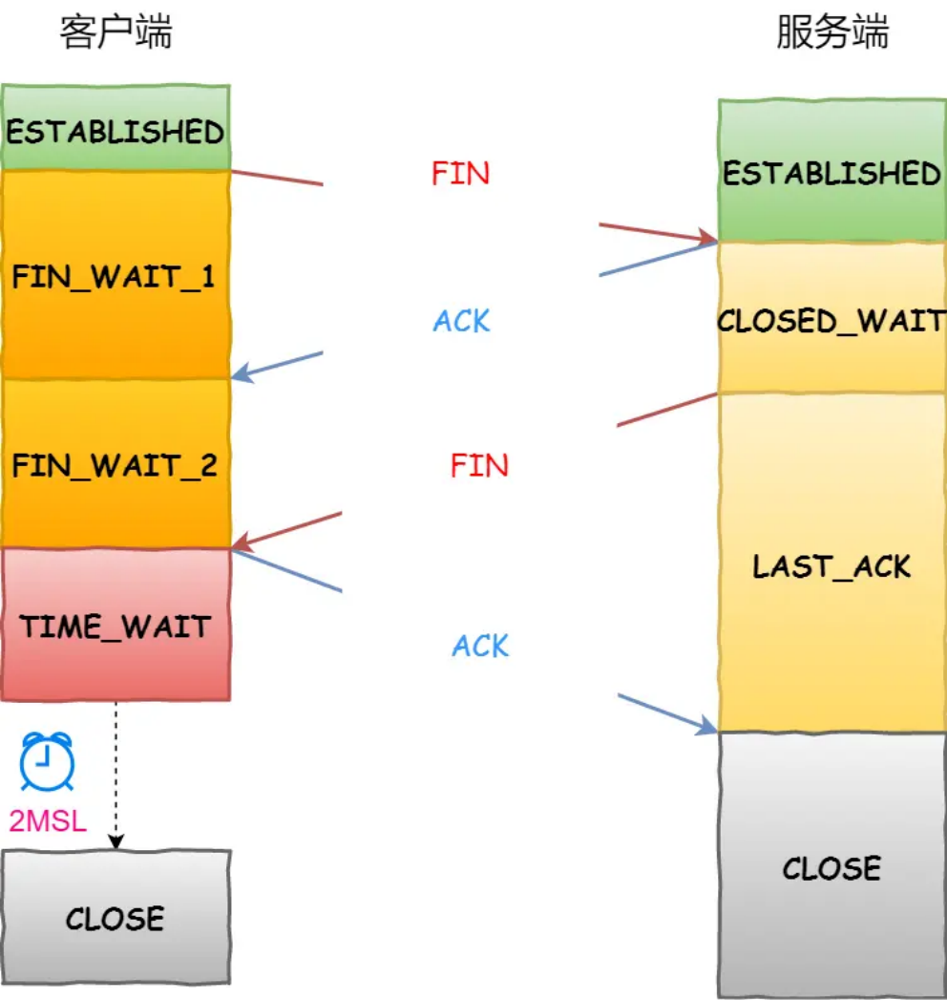
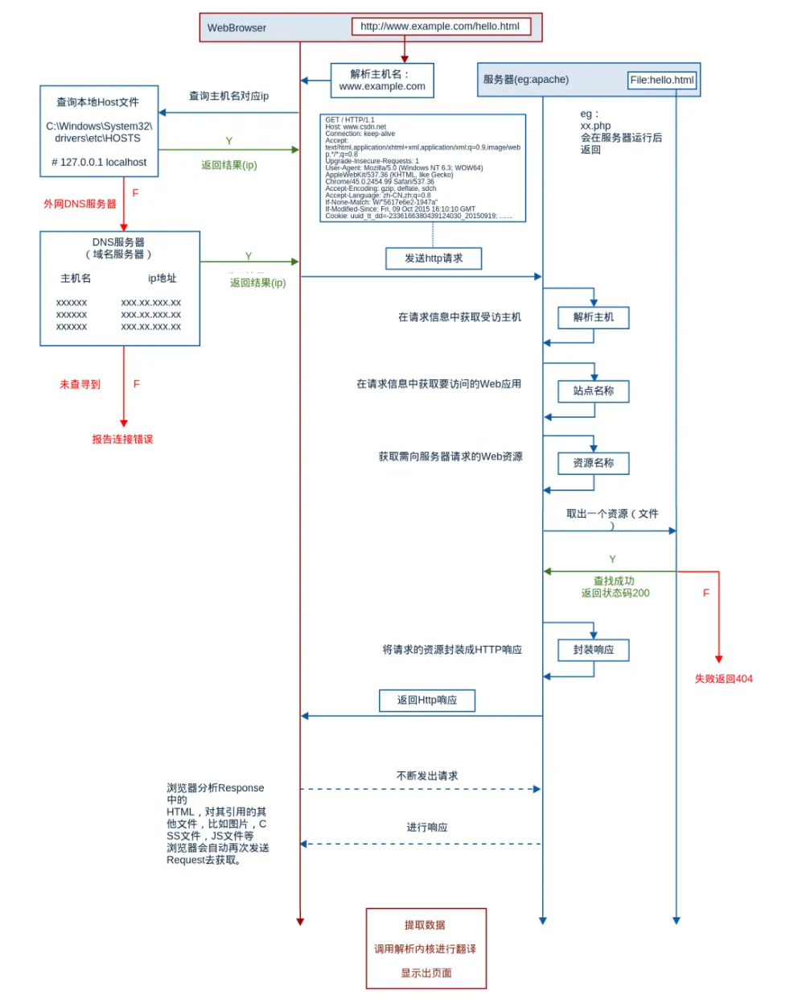
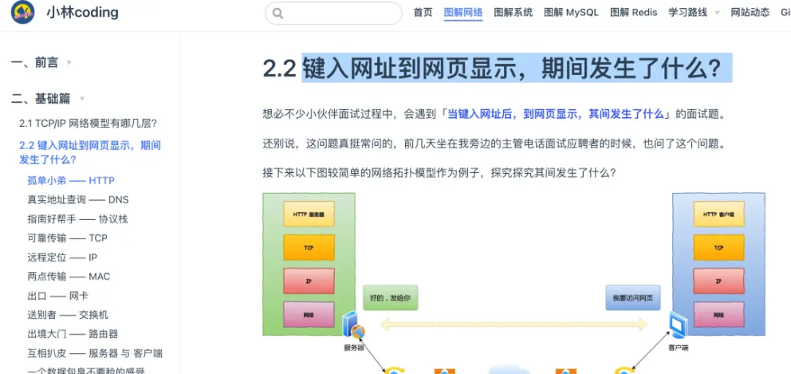
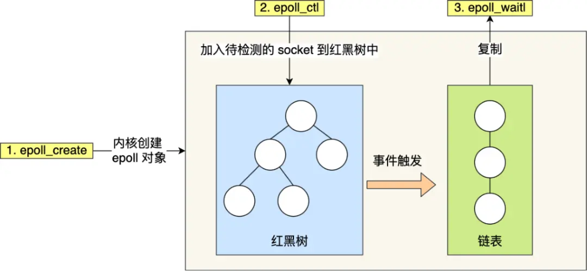
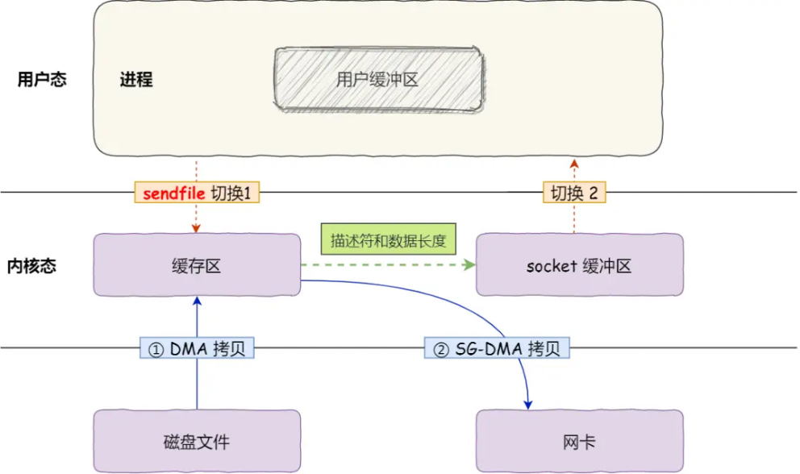
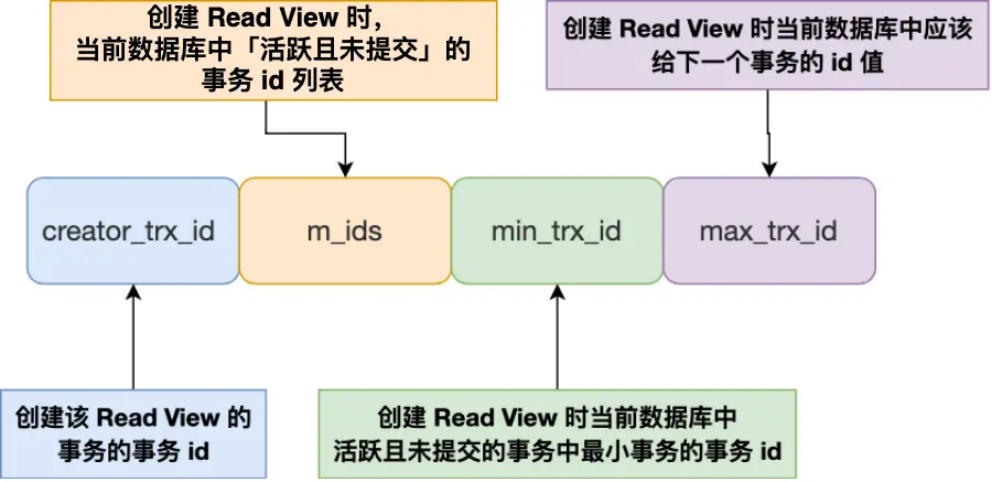
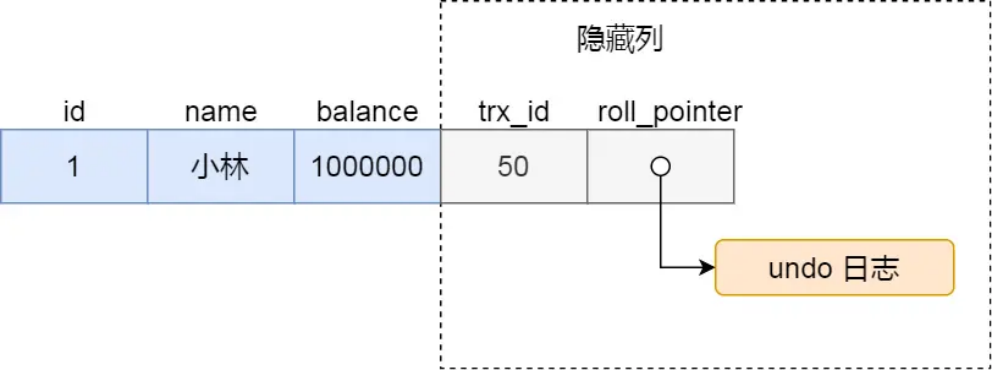
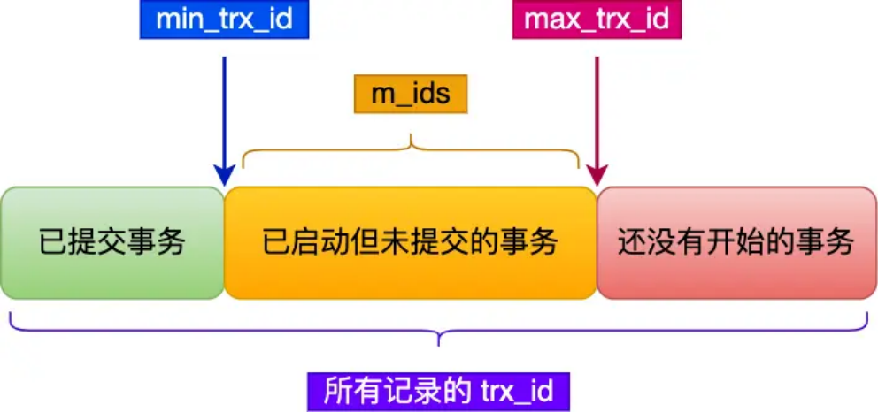

# **<u>前言</u>**

大家好，我是小林，是这本《大厂后端面试真题》pdf的作者，同时也是小林coding 公众号作者， <u>图解网站站长，全网粉丝超 40W+，著有《图解网络》、《图解系统》、《图解MySQL》、《图解 Redis》</u> 开源书籍，Gihutb 开源不到 1 年，斩获 9k+ star，文章阅读量累计超上千万，帮助数万程序员击破八股文的恐惧。

有很多同学一直都没去面试，不知道真实的面试过程中，考察的范围到底是哪些，也总感觉自己有很多技术没有学，一直感觉没有准备到一个满意的状态，越想就越掉头发。

虽然没办法去面试，但是也可以通过其他人的面经来观察一些面试的重点知识。所以这次整理了2024年 6月份之前公众号目前发布过的大厂后端面经，大家可以根据面经，去抓住需要重点准备的技术点，希望对同学有帮助！

注意：本文提供的回答都是只是参考回答！不代表一定准确！

后续新的后端面试题真题，可以关注公众号【小林coding】，会持续带来新的后端面经。

# **<u>字节面试，有点招架不住啊！</u>**

大家好，我是小林。

3 月份很多大厂都开始实习招聘了，近期也有很多同学去面试了，今天分享一位读者的字节实习的面经，读者的技术栈是 C++ 后端。

对于部分问题，我也补充了一些回答，基本上网络、操作系统、mysql、redis 的问题，图解网站的内容都有。

## **<u>计算机网络</u>**

**UDP和TCP区别**

**读者回答：** 先说了概念一个是面向连接的基于字节流的可靠连接，一个是不需要连接的基于数据报的不可靠传输然后说了几个小点，比如首部长度、应用场景、服务对象什么的。

**小林补充**：

from xiaolincoding.com

还有一个很重要的点： **UDP 的实时性比 TCP 好**。

### **TCP 工作流程三次握手四次挥手**

TCP 是面向连接的协议，所以使用 TCP 前必须先建立连接，而 **建立连接是通过三次握手来进行的**。三次握手的过程如下图：

- 一开始，客户端和服务端都处于 CLOSE 状态。先是服务端主动监听某个端口，处于 LISTEN 状态客户端会随机初始化序号（client_isn），将此序号置于 TCP 首部的「序号」字段中，同时把
- SYN 标志位置为 1，表示 SYN 报文。接着把第一个 SYN 报文发送给服务端，表示向服务端发起
- 连接，该报文不包含应用层数据，之后客户端处于 SYN-SENT 状态。
- 服务端收到客户端的 SYN 报文后，首先服务端也随机初始化自己的序号（server_isn），将此序号填入 TCP 首部的「序号」字段中，其次把 TCP 首部的「确认应答号」字段填入 client_isn + 1 , 接着把 SYN 和 ACK 标志位置为 1。最后把该报文发给客户端，该报文也不包含应用层数据，之后服务端处于 SYN-RCVD 状态。
- 客户端收到服务端报文后，还要向服务端回应最后一个应答报文，首先该应答报文 TCP 首部 ACK 标志位置为 1，其次「确认应答号」字段填入 server_isn + 1，最后把报文发送给服务端，这次报文可以携带客户到服务端的数据，之后客户端处于 ESTABLISHED 状态。
   - 服务端收到客户端的应答报文后，也进入 ESTABLISHED 状态。
- 天下没有不散的宴席，对于 TCP 连接也是这样， TCP 断开连接是通过 **四次挥手** 方式。
- 双方都可以主动断开连接，断开连接后主机中的「资源」将被释放，四次挥手的过程如下图：

客户端主动关闭连接 —— TCP 四次挥手

- 客户端打算关闭连接，此时会发送一个 TCP 首部 FIN 标志位被置为 1 的报文，也即 FIN 报文， 之后客户端进入 FIN_WAIT_1 状态。
- 服务端收到该报文后，就向客户端发送 ACK 应答报文，接着服务端进入 CLOSE_WAIT 状态。
- 客户端收到服务端的 ACK 应答报文后，之后进入 FIN_WAIT_2 状态。
- 等待服务端处理完数据后，也向客户端发送 FIN 报文，之后服务端进入 LAST_ACK 状态。
- 客户端收到服务端的 FIN 报文后，回一个 ACK 应答报文，之后进入 TIME_WAIT 状态
- 服务端收到了 ACK 应答报文后，就进入了 CLOSE 状态，至此服务端已经完成连接的关闭。 客户端在经过 2MSL 一段时间后，自动进入 CLOSE 状态，至此客户端也完成连接的关闭。

你可以看到，每个方向都需要 **一个 FIN 和一个 ACK**，因此通常被称为 **四次挥手**。

### **TCP 流量控制、拥塞控制**

**小林补充**：

- 发送方不能无脑的发数据给接收方，要考虑接收方处理能力。如果一直无脑的发数据给对方，但对方处理不过来，那么就会导致触发重发机制，从而导致网络流量的无端的浪费。为了解决这种现象发生， **TCP 提供一种机制可以让「发送方」根据「接收方」的实际接收能力控制发送的数据量，这就是所谓的流量控制。**
- 一般来说，计算机网络都处在一个共享的环境。因此也有可能会因为其他主机之间的通信使得网络拥堵。在网络出现拥堵时，如果继续发送大量数据包，可能会导致数据包时延、丢失等，这时 TCP 就会重传数据，但是一重传就会导致网络的负担更重，于是会导致更大的延迟以及更多的丢包，这个情况就会进入恶性循环被不断地放大....所以，TCP 不能忽略网络上发生的事，它被设计成一个无私的协议，当网络发送拥塞时，TCP 会自我牺牲，降低发送的数据量。于是，就有了拥塞控制，目的就是 **避免「发送方」的数据填满整个网络。**

### **访问一个网站流程，从http方面**

**小林补充**：

from csdn-

更详细传输层->网络层->数据链路层->路由器的过程，看图解网络->基础篇->键入网址到网页显示期间发生了什么？。

### **知道ip和port就可以生成tcp连接吗？连接建立的具体流程**

**读者回答：** 客户端有对方的ip和端口，然后调用connect()，服务器端也要选择所有ip都能访问。

### **select、poll、epoll区别**

**小林补充**：

select 实现多路复用的方式是，将已连接的 Socket 都放到一个 **文件描述符集合**，然后调用 select 函数将文件描述符集合 **拷贝** 到内核里，让内核来检查是否有网络事件产生，检查的方式很粗暴，就是通过 **遍历** 文件描述符集合的方式，当检查到有事件产生后，将此 Socket 标记为可读或可写， 接着再把整个文件描述符集合 **拷贝** 回用户态里，然后用户态还需要再通过 **遍历** 的方法找到可读或可写的 Socket，然后再对其处理。

所以，对于 select 这种方式，需要进行 **2 次「遍历」文件描述符集合**，一次是在内核态里，一个次是在用户态里，而且还会发生 **2 次「拷贝」文件描述符集合**，先从用户空间传入内核空间，由内核修改后， 再传出到用户空间中。

select 使用固定长度的 BitsMap，表示文件描述符集合，而且所支持的文件描述符的个数是有限制的， 在 Linux 系统中，由内核中的 FD_SETSIZE 限制， 默认最大值为 1024，只能监听 0~1023 的文件描述符。

poll 不再用 BitsMap 来存储所关注的文件描述符，取而代之用动态数组，以链表形式来组织，突破了 select 的文件描述符个数限制，当然还会受到系统文件描述符限制。

但是 poll 和 select 并没有太大的本质区别， **都是使用「线性结构」存储进程关注的 Socket 集合，因此都需要遍历文件描述符集合来找到可读或可写的 Socket，时间复杂度为 O(n)，而且也需要在用户态与内核态之间拷贝文件描述符集合**，这种方式随着并发数上来，性能的损耗会呈指数级增长。

epoll 通过两个方面解决了 select/poll 的问题。

1、epoll 在内核里使用「红黑树」来关注进程所有待检测的 Socket，红黑树是个高效的数据结构，增删改一般时间复杂度是 O(logn)，通过对这棵黑红树的管理，不需要像 select/poll 在每次操作时都传入整个 Socket 集合，减少了内核和用户空间大量的数据拷贝和内存分配。

- 2、epoll 使用事件驱动的机制，内核里维护了一个「链表」来记录就绪事件，只将有事件发生的 Socket 集合传递给应用程序，不需要像 select/poll 那样轮询扫描整个集合（包含有和无事件的 Socket），大大提高了检测的效率。

### **epoll 具体工作流程**

**读者回答：** 先建立epoll对象，然后添加事件，然后wait等待事件发生但他好像不是很满意这个回答。

**小林补充**：

1. 通过epoll_create创建epoll对象，此时epoll对象的内核结构包含就绪链表和红黑树，就绪队列是用于保存所有读写事件到来的socket。红黑树用于保存所有待检测的socket。
2. 通过 epoll_crt 将待检测的socket，加入到红黑树中，并注册一个事件回调函数，当有事件到来的之后，会调用这个回调函数，进而通知到 epoll 对象。
3. 调用 epoll_wait 等待事件的发生，当内核检测到事件发生后，调用该socket注册的回调函数，执行回调函数就能找到socket对应的epoll对象，然后会将事件加入到epoll对象的绪队列中，最后将就绪队列返回给应用层。

### **零拷贝**

**读者回答：** 记混了，回答了DMA，说主要是为了减少拷贝操作，举了使用零拷贝的项目，比如nginx。 **小林补充**：

sendfile 系统调用实现了零拷贝技术，零拷贝技术的文件传输方式相比传统文件传输的方式，减少了 2 次上下文切换和数据拷贝次数，只需要 2 次上下文切换和数据拷贝次数，就可以完成文件的传输，而且 2 次的数据拷贝过程，都不需要通过 CPU，2 次都是由 DMA 来搬运，使用零拷贝的项目有nginx、 kafka。

## **<u>Redis</u>**

### **redis 优点、场景**

redis 优点快。

Redis 是一种基于内存的数据库，对数据的读写操作都是在内存中完成，因此 **读写速度非常快**，适用于服务器与数据库间的缓存，还可以用来做分布式锁、秒杀、消息队列。

### **redis 为什么快？**

之所以 Redis 采用单线程那么快，有如下几个原因：

- Redis 的大部分操作 **都在内存中完成**，并且采用了高效的数据结构，因此 Redis 瓶颈可能是机器的内存或者网络带宽，而并非 CPU，既然 CPU 不是瓶颈，那么自然就采用单线程的解决方案了； Redis 采用单线程模型可以 **避免了多线程之间的竞争**，省去了多线程切换带来的时间和性能上的开销，而且也不会导致死锁问题。
- Redis 采用了 **I/O 多路复用机制** 处理大量的客户端 Socket 请求，IO 多路复用机制是指一个线程处理多个 IO 流，就是我们经常听到的 select/epoll 机制。简单来说，在 Redis 只运行单线程的情况下，该机制允许内核中，同时存在多个监听 Socket 和已连接 Socket。内核会一直监听这些 Socket 上的连接请求或数据请求。一旦有请求到达，就会交给 Redis 线程处理，这就实现了一个 Redis 线程处理多个 IO 流的效果。

### **持久化**

Redis 的读写操作都是在内存中，所以 Redis 性能才会高，但是当 Redis 重启后，内存中的数据就会丢失，那为了保证内存中的数据不会丢失，Redis 实现了数据持久化的机制，这个机制会把数据存储到磁盘，这样在 Redis 重启就能够从磁盘中恢复原有的数据。

Redis 共有三种数据持久化的方式：

- **AOF 日志**：每执行一条写操作命令，就把该命令以追加的方式写入到一个文件里； **RDB 快照**：将某一时刻的内存数据，以二进制的方式写入磁盘；
- **混合持久化方式**：Redis 4.0 新增的方式，集成了 AOF 和 RBD 的优点；

### **分布式锁的实现和四个特性**

**小林补充**：

- **互斥性**：锁的目的是获取资源的使用权，所以只让一个竞争者持有锁，这一点要尽可能保证； **安全性**：避免死锁情况发生。当一个竞争者在持有锁期间内，由于意外崩溃而导致未能主动解锁， 其持有的锁也能够被正常释放，并保证后续其它竞争者也能加锁；
- **对称性**：同一个锁，加锁和解锁必须是同一个竞争者。不能把其他竞争者持有的锁给释放了，这又称为锁的可重入性。
- **可靠性**：需要有一定程度的异常处理能力、容灾能力。

### **一条语句可以完成加锁操作吗？**

**读者回答：** 可以，但是他一直反问，让我有点动摇

**小林补充**：

可以的。

Redis 的 SET 命令有个 NX 参数可以实现「key不存在才插入」，所以可以用它来实现分布式锁：

如果 key 不存在，则显示插入成功，可以用来表示加锁成功；
如果 key 存在，则会显示插入失败，可以用来表示加锁失败。

   - 如果 key 不存在，则显示插入成功，可以用来表示加锁成功；
   - 如果 key 存在，则会显示插入失败，可以用来表示加锁失败。
- 基于 Redis 节点实现分布式锁时，对于加锁操作，我们需要满足三个条件。
   - 加锁包括了读取锁变量、检查锁变量值和设置锁变量值三个操作，但需要以原子操作的方式完成， 所以，我们使用 SET 命令带上 NX 选项来实现加锁；
   - 锁变量需要设置过期时间，以免客户端拿到锁后发生异常，导致锁一直无法释放，所以，我们在 SET 命令执行时加上 EX/PX 选项，设置其过期时间；
   - 锁变量的值需要能区分来自不同客户端的加锁操作，以免在释放锁时，出现误释放操作，所以，我们使用 SET 命令设置锁变量值时，每个客户端设置的值是一个唯一值，用于标识客户端；
- 满足这三个条件的分布式命令如下：

SET lock_key unique_value NX PX 10000

- lock_key 就是 key 键；

NX 代表只在 lock_key 不存在时，才对 lock_key 进行设置操作；

- unique_value 是客户端生成的唯一的标识，区分来自不同客户端的锁操作；
- NX 代表只在 lock_key 不存在时，才对 lock_key 进行设置操作；
- PX 10000 表示设置 lock_key 的过期时间为 10s，这是为了避免客户端发生异常而无法释放锁。

### **同一个用户id两次加锁会怎么样？发生死锁了怎么解决？**

第二次加锁时，这种情况不算他成功，不引入额外复杂性。

死锁有过期时间兜底。

## **<u>MySQL</u>**

### **MVCC 概念？如何实现？**

**小林补充**：

我们需要了解两个知识：

- Read View 中四个字段作用；

聚簇索引记录中两个跟事务有关的隐藏列；

那 Read View 到底是个什么东西？

img

Read View 有四个重要的字段：

- m_ids：指的是在创建 Read View 时，当前数据库中「活跃事务」的 **事务 id 列表**，注意是一个列表， **“活跃事务”指的就是，启动了但还没提交的事务**。
- min_trx_id：指的是在创建 Read View 时，当前数据库中「活跃事务」中事务 **id 最小的事务**，也就是 m_ids 的最小值。
- max_trx_id：这个并不是 m_ids 的最大值，而是 **创建 Read View 时当前数据库中应该给下一个事务的 id 值**，也就是全局事务中最大的事务 id 值 + 1；
- creator_trx_id：指的是 **创建该 Read View 的事务的事务 id**。

知道了 Read View 的字段，我们还需要了解聚簇索引记录中的两个隐藏列。

假设在账户余额表插入一条小林余额为 100 万的记录，然后我把这两个隐藏列也画出来，该记录的整个示意图如下：

图片

- 对于使用 InnoDB 存储引擎的数据库表，它的聚簇索引记录中都包含下面两个隐藏列：
   - trx_id，当一个事务对某条聚簇索引记录进行改动时，就会 **把该事务的事务 id 记录在 trx_id 隐藏列里**；

roll_pointer，每次对某条聚簇索引记录进行改动时，都会把旧版本的记录写入到 undo 日志中，然后 **这个隐藏列是个指针，指向每一个旧版本记录**，于是就可以通过它找到修改前的记录。

- 在创建 Read View 后，我们可以将记录中的 trx_id 划分这三种情况：

##### img

- 一个事务去访问记录的时候，除了自己的更新记录总是可见之外，还有这几种情况：
   - 如果记录的 trx_id 值小于 Read View 中的 min_trx_id 值，表示这个版本的记录是在创建 Read View **前** 已经提交的事务生成的，所以该版本的记录对当前事务 **可见**。
   - 如果记录的 trx_id 值大于等于 Read View 中的 max_trx_id 值，表示这个版本的记录是在创建 Read View **后** 才启动的事务生成的，所以该版本的记录对当前事务 **不可见**。
   - 如果记录的 trx_id 值在 Read View 的 min_trx_id 和 max_trx_id 之间，需要判断 trx_id 是否在 m_ids 列表中：
      - 如果记录的 trx_id **在** m_ids 列表中，表示生成该版本记录的活跃事务依然活跃着（还没提交事务），所以该版本的记录对当前事务 **不可见**。

如果记录的 trx_id **不在** m_ids 列表中，表示生成该版本记录的活跃事务已经被提交，所以该版本的记录对当前事务 **可见**。

**这种通过「版本链」来控制并发事务访问同一个记录时的行为就叫 MVCC（多版本并发控制）。**

### **可重复读概念**

**可重复读（*repeatable read*）**，指一个事务执行过程中看到的数据，一直跟这个事务启动时看到的数据是一致的， **MySQL InnoDB 引擎的默认隔离级别**；

### **可重复读下，快照是在什么时候生成的，是事务启动时，还是语句执行前**

**读者回答：** 死记硬背八股了，我回答事务启动时。

**小林补充**：

在 MySQL 有两种开启事务的命令，分别是：

- 第一种：begin/start transaction 命令；
- 第二种：start transaction with consistent snapshot 命令；

这两种开启事务的命令，创建 read view 的时机是不同的：

- 执行了 begin/start transaction 命令后，并不会创建 read view，只有在第一次执行 select 语句
- 后， 才会创建 read view。
- 执行了 start transaction with consistent snapshot 命令，就会马上创建 read view。

### **可重复读下，执行两个select语句，会生成几个快照？**

**读者回答：** 上一个问题引申的，我回答不知道。

**小林补充**：只会生成一次 read view。

### **可重复读下场景题**

问题：他给的场景是先select value where id = 1的记录此时value = 1，然后update value = 2 where id = 1，然后再select value where id = 1，查询的结果是什么，此时事务还未提交。

**读者回答：** 回答了 value 是 1。

**小林补充**：value 是2，同一个事务的所有更新操作，都是可见的。事务隔离性，隔离的是其他事务，不隔离自己人。

## **<u>C++</u>**

1. 指针与引用区别
   - 正常回答
1. 智能指针
   - 正常回答
