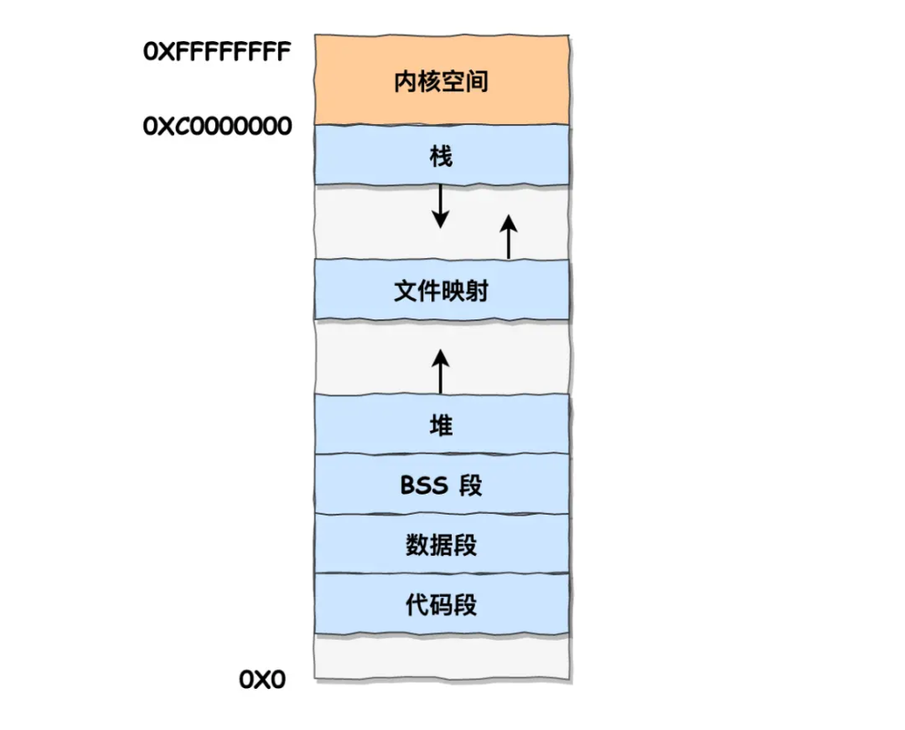
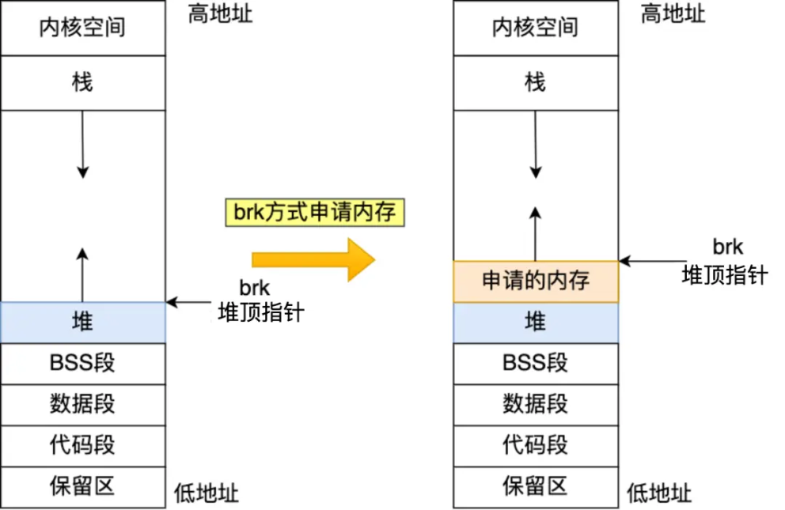
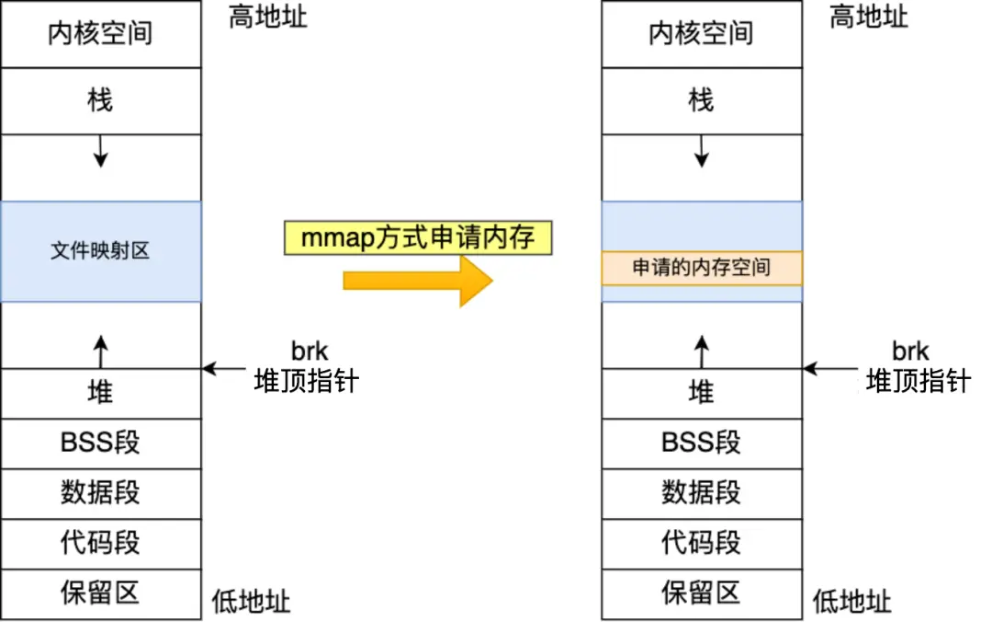
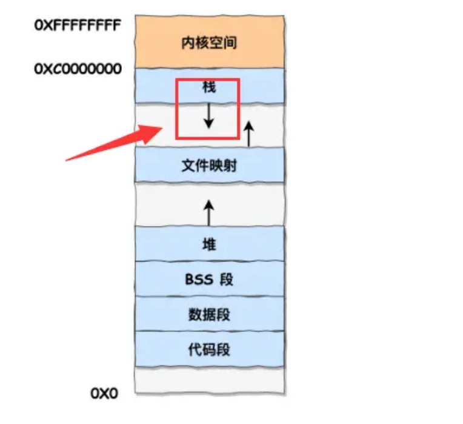
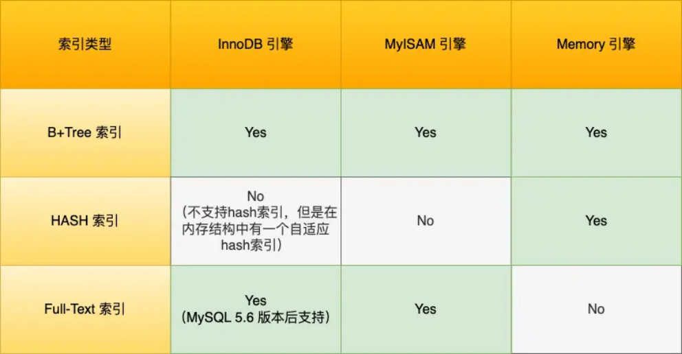
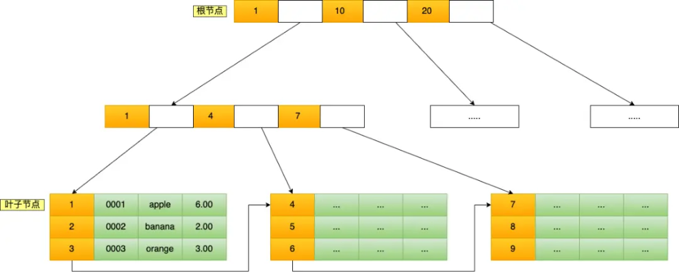

# **<u>腾讯一面，没有稳住，凉了！</u>**

大家好，我是小林。

春招开展也有 1 个多月了，这段时间多给大家分享真实的面经题目。

今天这个一位读者腾讯 go 暑期实习的一面的面经。

### **你们学校里面学的是 go 吗，还是学的 C**

答：项目中用的。一开始用的 java，后来做新项目时通过调研选择了 go 并选择深入学习下去。

### **你能简单说一下里操作系统保护模式和实模式，区别在哪**

读者答：（1）实模式早期的那种处理器的一个工作模式，然后他只能使用一些低端的中断处理方式，很难实现一些复杂的功能。（2）保护模式的话它是相对于那个实模式来说它是一种更高级别的工作模式， 它能访问的内存也更多，然后它也支持一些就是什么特权就是权限的一些东西比方说内、内核态和用户态的一些东西，更加灵活和安全吧。

**小林补充：**

其实问这个问题的目的，是为了引出虚拟内存，所以他后面都往虚拟内存方向问了。

- **实模式** 将整个物理内存看成分段的区域，程序代码和数据位于不同区域，系统程序和用户程序并没有区别对待，而且每一个指针都是指向实际的物理地址。这样一来，用户程序的一个指针如果指向了系统程序区域或其他用户程序区域，并修改了内容，那么对于这个被修改的系统程序或用户程序，其后果就很可能是灾难性的。再者，随着软件的发展，1M的寻址空间已经远远不能满足实际的需求了。最后，对处理器多任务支持需求也日益紧迫，所有这些都促使新技术的出现。
- 为了克服实模式下的内存非法访问问题，并满足飞速发展的内存寻址和多任务需求，处理器厂商开发出 **保护模式**。在保护模式中，除了内存寻址空间大大提高；提供了硬件对多任务的支持； **物理内存地址也不能直接被程序访问，程序内部的地址(虚拟地址)要由操作系统转化为物理地址去访问， 程序对此一无所知**。至此，进程(程序的运行态)有了严格的边界，任何其他进程根本没有办法访问不属于自己的物理内存区域，甚至在自己的虚拟地址范围内也不是可以任意访问的，因为有一些虚拟区域已经被放进一些公共系统运行库。这些区域也不能随便修改，若修改就会有出现linux中的段错误，或Windows中的非法内存访问对话框。

### **虚拟内存，它的内存布局大概是什么样子的**

读者答：（1）首先这个程序在运行的时候他使用的那个地址是虚拟内存的地址，然后虚拟内存和实际

物理内存它是有的地址上是有一个映射的。（2）然后关于这个虚拟内存的布局的话，可以根据就在我在学 c 语言的时候，我们就知道这个里面有什么比方说代码段、数据段，还有什么堆空间站空间这些东西，应该是在分别对应于不同的内存地址中。

##### **小林补充：**

我们看看用户空间分布的情况，以 32 位系统为例，我画了一张图来表示它们的关系：

##### 虚拟内存空间划分

通过这张图你可以看到，用户空间内存，从 **低到高** 分别是 6 种不同的内存段：

BSS 段，包括未初始化的静态变量和全局变量；

- 代码段，包括二进制可执行代码；
- 数据段，包括已初始化的静态常量和全局变量；
- BSS 段，包括未初始化的静态变量和全局变量；
- 堆段，包括动态分配的内存，从低地址开始向上增长；
- 文件映射段，包括动态库、共享内存等，从低地址开始向上增长。
- 栈段，包括局部变量和函数调用的上下文等。栈的大小是固定的，一般是 8 MB。当然系统也提供了参数，以便我们自定义大小；

上图中的内存布局可以看到，代码段下面还有一段内存空间的（灰色部分），这一块区域是「保留区」，之所以要有保留区这是因为在大多数的系统里，我们认为比较小数值的地址不是一个合法地址， 例如，我们通常在 C 的代码里会将无效的指针赋值为 NULL。因此，这里会出现一段不可访问的内存保留区，防止程序因为出现 bug，导致读或写了一些小内存地址的数据，而使得程序跑飞。

在这 7 个内存段中，堆和文件映射段的内存是动态分配的。比如说，使用 C 标准库的 malloc() 或者 mmap()，就可以分别在堆和文件映射段动态分配内存。

### **怎么申请堆空间**

读者答：用 c 语言的话一般是用 malloc 函数去去申请，如果是 C++ 的话一般是用 new 去申请。而栈空间的话程序的临时变量就普通声明的时候他就是用的是栈空间。

### **malloc 是一个系统调用么**

读者答：应该是吧

**小林补充：**

实际上，malloc() 并不是系统调用，而是 C 库里的函数，用于动态分配内存。

malloc 申请内存的时候，会有两种方式向操作系统申请堆内存。

方式一：通过 brk() 系统调用从堆分配内存

方式二：通过 mmap() 系统调用在文件映射区域分配内存；

方式一实现的方式很简单，就是通过 brk() 函数将「堆顶」指针向高地址移动，获得新的内存空间。如下图：

img

方式二通过 mmap() 系统调用中「私有匿名映射」的方式，在文件映射区分配一块内存，也就是从文件映射区“偷”了一块内存。如下图：

img

### **栈空间地址增长顺序（从低到高还是从高到低）**

没答好，答案反复改了好几次，先说从高到底，又改成从低到高，然后又改成从高到低。

读者答：从高到低，然后站顶个指针他的他在移动的时候他会越变越小，他始终是一个最小的值。

**小林补充：**

栈空间地址增长顺序是高 --> 底。

### **go 里面有协程，操作系统里面有进程和线程，简单说一下他们的区别**

读者答：（1）从操作系统层面，分线程和进程，在操作系统中没有协程的概念。进程是当前运行的整个程序，有自己的空间和数据资源。线程是进程的一部分，一个进程可以开很多个线程，但是这些线程都共享同一块内存地址（应该是资源当时太紧张说错了）。（2）协程是 go 提出来的概念，是 go 程序运行时维护的一个轻量级的线程，go 有 GMP 模型，M 对应着线程，p 是个调度机器，g 是协程。在程序运行的时候通过 p 把协程调度到 M 线程上去。线程执行完毕后，会让 p 再调度新的协程到线程上执行。

**小林补充：**

线程和协程区别，要从栈的大小、调度、切换这三个角度来讲。

进程可以理解为一个动态的程序，进程是操作系统资源分配的基本单位，而线程是操作系统调度的基本单位，进程独占一个虚拟内存空间，而进程里的线程共享一个进程虚拟内存空间。线程的粒度更小

协程可以理解为用户态线程，跟线程的区别主要有三个方面

1. 大小，协程到校为2k，可以动态扩容，而线程大小为2m,协程更轻量
2. 线程切换需要用户态到内核态的切换，而协程的切换不用，只在用户态完成，切换消耗更小
3. 线程的调度由操作系统完成，而协程的调度有运行时的调度器完成

### **go 里的空结构体可以用来做什么事**

我一开始只想到 channel，面试官提醒说可不可以实现个集合容器我又结合 map 说了一下

答：空结构体在使用的时候表示它的类型，然后这个东西一般在 channel 里面比较常用，就是说用它来表示表示你需要用的数据类型。你在同步操作时，需要的一个具体的一个元素的类型，但是

因为你只要保持同步操作，而不是说真的要传数据所以说我们只需要用个空的这个结构体就可以了。

追问：那这个控结构体会占内存空间吗

答：应该不会占内存空间。

面试官提示：还有一个用法就是，如果在 go 里面要去实现一个 set 就是一个集合的话，如果用空结构体的话应该是怎么去实现？可以和其他的数据结构一起去用。

答：比方说你用 map 去实现一个 set 集合，map 不是 key 和 value 对应吗，我想判断某个元素是否出现，我把这个元素的类型作为他的 key，然后他如果出现的话我需要往 map 里插入，但是我只知道我只需要知道的是他出现过，所以说他的那个值 value 类型就可以设置为空就用 Struct，这样就可以通过一个 map 实现一个集合的类型，然后要做查询操作的话你就是使用就是从 map 中取值判断这个值是否存在就可以了。

**小林补充：**

struct{}不占据任何内存空间

一般有三个用途：

1. 实现set集合
2. 和channel配合使用，不具备任何意义，但除用作goroutine之间通知
3. 实现一个不带字段，仅包含方法的结构体

### **go 里面有哪些锁，怎么使用，用过么**

读者答：操作系统信号量的一些锁。他也有 channel 这个东西这两个东西都可以实现并发的这个操作。 然后如果用锁的话就是说他有互斥锁、读写的锁，或者是信号量就刚才提到信号量。然后具体使用的话，需要我举个例子吗？

**小林补充：**

互斥锁和读写锁

### **MySQL 常见的存储引擎是哪个？他的索引有哪些**

读者答：InnoDB，inner DB 比较常见的锁引一个是 B 树，还有一个是倒牌表，然后它也支持哈西索引和那个一个东西叫空间索引好像是。

**小林补充：**

MySQL 常见的存储引擎 InnoDB、MyISAM 和 Memory。InnoDB 是在 MySQL 5.5 之后成为默认的 MySQL 存储引擎，B+Tree 索引类型也是 MySQL 存储引擎采用最多的索引类型。

### **InnoDB 它如果是存储一张表的话它是怎么去存储的**

读者答：如果使用 B+数的话这个他的每一条信息他都是存到这个 B+ 树的叶子节点上，然后他的索引和他的那个具体数据是在一起的。

**小林补充：**

表的数据是存储在聚簇索引，聚簇索引的 B+Tree 的叶子节点存放的是实际数据，所有完整的用户记录都存放在主键索引的 B+Tree 的叶子节点里。

主键索引的 B+Tree 如图所示（图中叶子节点之间我画了单向链表，但是实际上是双向链表，原图我找不到了，修改不了，偷个懒我不重画了，大家脑补成双向链表就行）：

### **如说你创建一个索引的话，比如一个字一个表里面有 a b c 三个字段，对 b 和 c 这两个字段去做一个索引，顺序的话是先 b 或后 c， 那这时候我需要去查 c 这个字段能用上这个索引么？**

不知怎么答糊涂了，把问题都搞错了，又重新答了一遍

读者答：如果对对 c 要对 c 查询的话他无法使用到这个索引，因为我们刚才建的那个索引它是一个复合类型的，就是你既有 b 有 c，然后你只有在要你的查询条件包含 b c 的时候你才能按最左匹配原则去进行查询，而如果你只查 c 的话是无法使用这个缩影的需要为 c 单独建立索引才可以。

**小林补充：**

联合索引(b,c)，如果查询条件是有c字段，是无法利用走该联合索引的，因为联合索引的b+树是先按b排序，再按c排序，所以如果查询条件只有一个c 字段，它就无法在这颗联合索引的b+树进行二分查找，这就是联合索引有最左匹配规则的来源。

### **算法题：反转链表**

用三个指针很快写完，面试官问我可不可以用两个指针，我不知道，我又用头插法写了一遍。

之后让我对比了这两个方法。

感觉面试官像是已经决定要挂我了随便出的算法题走个流程。

### **说一下数据库隔离级别。**

读者答：读未提交，读提交，可重复读、可串行化。

### **这个读可重复读和那个读提交这两个有什么区别**

我举了两个例子，读提交的流程说成了读未提交的，经过面试官提醒才发现并改过来

读者答：对于可重复读来说，就是在 a 进入这个事务以后，那个他的这个数据在他的视图来说就是已经是固定了，如果说在 a 这个事务提交之前 B 的这个事务修改了那个数据，在 A 是看不到的

于读提交的情况来说，就是说还是 a b 两个事务，b 事务修改一个数据然后并且提交以后，但 a a 还没有提交，然后 a 这个时候去读那个数据，就会读到 b 已经修改的数据。

**小林补充** :

读提交，指一个事务提交之后，它做的变更才能被其他事务看到。

可重复读，指一个事务执行过程中看到的数据，一直跟这个事务启动时看到的数据是一致的，MySQL InnoDB 引擎的默认隔离级别。

对于「读提交」和「可重复读」隔离级别的事务来说，它们是通过 MVCC 来实现的， **它们的区别在于创建 Read View 的时机不同**，大家可以把 Read View 理解成一个数据快照，就像相机拍照那样，定格某一时刻的风景。

「读提交」隔离级别是在「每个语句执行前」都会重新生成一个 Read View，而「可重复读」隔离级别是「启动事务时」生成一个 Read View，然后整个事务期间都在用这个 Read View。

## **<u>反问</u>**

有哪些需要深入学习的地方？

答：如果想往后端开发方向发展的话，就数据库这一块可能你需要再再多看一看，他的一些内部原理相关的书或者课程。

在公司这块的话就是实习的过程中做 go 的相关的东西多吗，还是说需要转语言什么的。

答：基本上内部现在大部分都是往 go 上面去转的，所以这个这个这个没有什么问题。一般来说不会需要去转语言的。

## **<u>总结</u>**

### **读者总结**

感觉：

1. 有很多地方说了又改，给人印象很不好。
2. 谈吐不自然，说话磕磕绊绊。

不足之处：

1. 对基础知识掌握不牢固，遇到拿不准的地方喜欢瞎说。
2. 对自己的项目描述不是很完善，需要详细补充内容。

### **小林总结**

- 面试的回答的时候，最好先抛出结论，再举例子，而不是先举例子，再说结论。因为面试其实说的是关键词，只要你说的几个技术词，命中了面试官心里的预期，他就会认为你知道这个知识的了。 如果你面后端，mysql确实得补一补，像索引和事务是最常见的两个问题，可以到我的图解mysql 网站补一补这两个知识。

