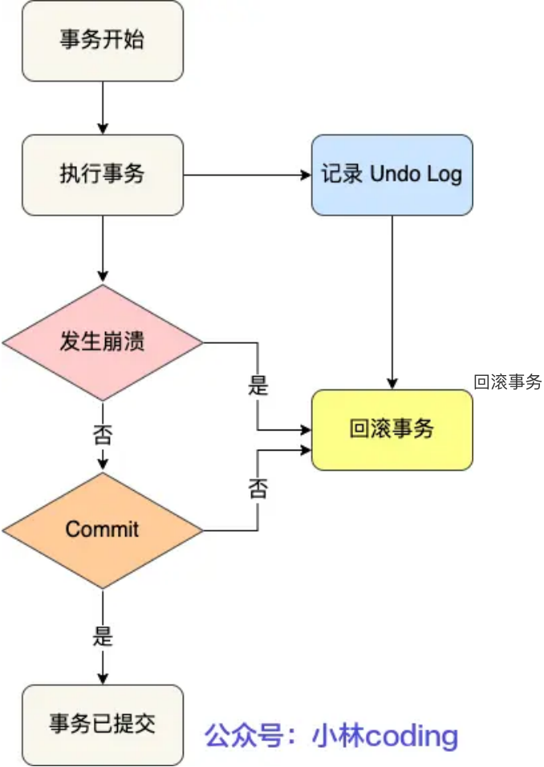
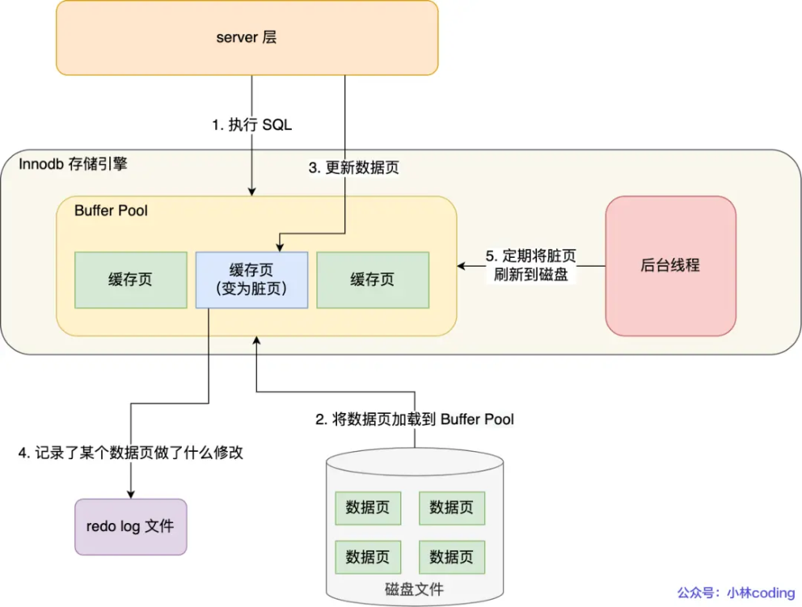
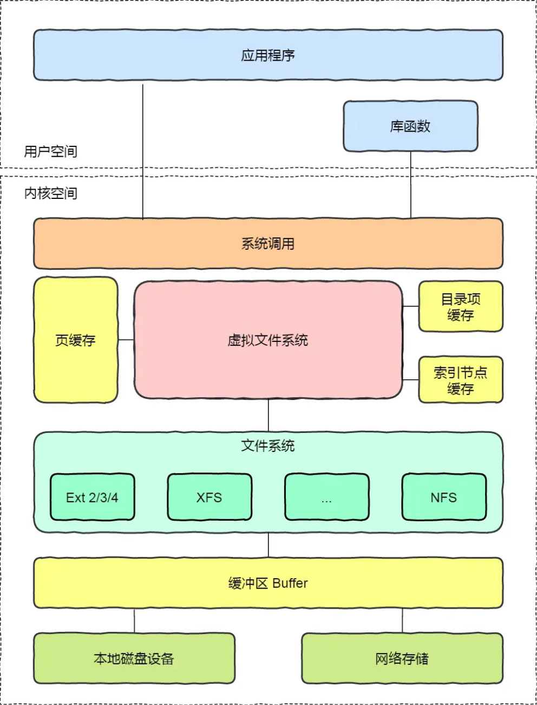
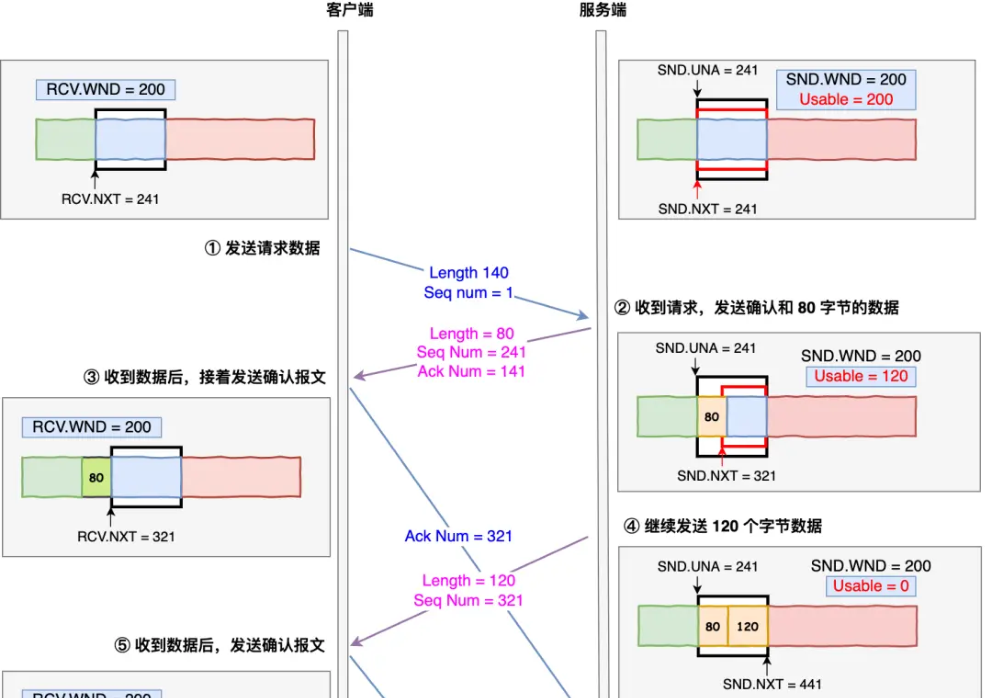
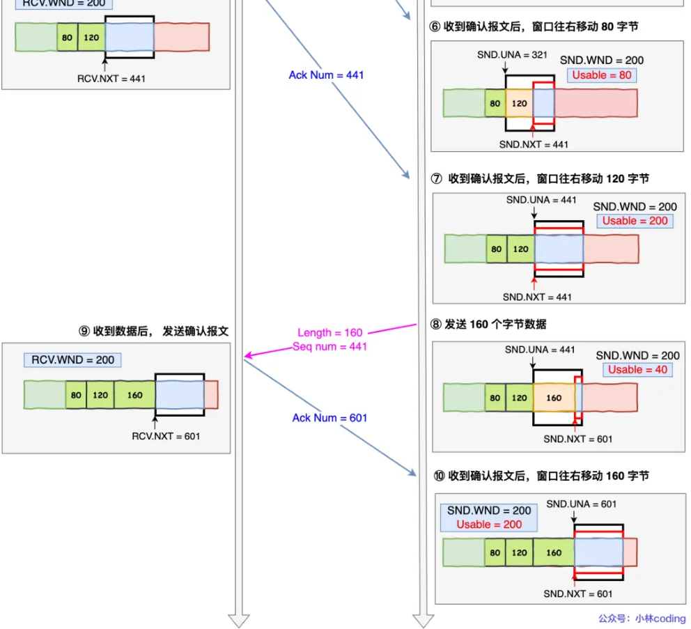

# **<u>美团面试，问的都是基础啊！</u>**

大家好，我是小林。

今天分享一位读者的春招面经，美团基础架构的面经。

问的全是基础，一个编程语言的问都没有。

## **<u>问题记录</u>**

### **MySQL-MVCC**

读者答：InooDB是通过 MVCC 实现可重复读的隔离级别的，MVCC 就是多版本并发控制，它其实记录了历史版本的数据，解决了读写并发冲突问题。有一个版本编码，然后它进入了各种操作下的数据状态，能够根据当前这个指令的状态来读取不同时期的数据快照。主要实现方法的话就是通过事务版本号，读取视图还有undo日志进行完善的。

**小林补充：** 具体的实现原理过程，可以去 xiaolincoding.com 网站->图解MySQL->事务隔离级别是怎么实现的？这篇文章学习。

### **MySQL-原子性怎么实现的**

说错了，说成redoLog了。应该是undoLog。

读者答：原子性的话会在写数据之前有一个，就是WAL的过程，就是写一个 redo log，然后如果数据没有写完或者是执行操作失败的话，可以恢复所有已提交的事务或者回滚。

**小林补充：**

事务的原子性是通过 undo log 实现的。

undo log 是一种用于撤销回退的日志。在事务没提交之前，MySQL 会先记录更新前的数据到 undo log 日志文件里面，当事务回滚时，可以利用 undo log 来进行回滚。如下图：

回滚事务

每当 InnoDB 引擎对一条记录进行操作（修改、删除、新增）时，要把回滚时需要的信息都记录到 undo log 里，比如：

在 **插入** 一条记录时，要把这条记录的主键值记下来，这样之后回滚时只需要把这个主键值对应的记录 **删掉** 就好了；

- 在 **删除** 一条记录时，要把这条记录中的内容都记下来，这样之后回滚时再把由这些内容组成的记录 **插入** 到表中就好了；
- 在 **更新** 一条记录时，要把被更新的列的旧值记下来，这样之后回滚时再把这些列 **更新为旧值** 就好了。

在发生回滚时，就读取 undo log 里的数据，然后做原先相反操作。比如当 delete 一条记录时，undo log 中会把记录中的内容都记下来，然后执行回滚操作的时候，就读取 undo log 里的数据，然后进行 insert 操作。

不同的操作，需要记录的内容也是不同的，所以不同类型的操作（修改、删除、新增）产生的 undo log 的格式也是不同的，具体的每一个操作的 undo log 的格式我就不详细介绍了，感兴趣的可以自己去查查。

### **MySQL-持久性是怎么实现的**

读者答：通过 redo log 保证持久化。buffer pool 中有 undo 页，对 undo 页的修改也都会记录到 redo log。redo log 会每秒刷盘，提交事务时也会刷盘，数据页和 undo 页都是靠这个机制保证持久化的。

通过两次写来实现，当缓冲池的脏页刷新时，并不直接写磁盘，而是会通过memcpy函数将脏页先拷贝到内存中的doublewrite buffer，之后通过doublewrite buffer再分两次，每次写入1MB到共享表空间的物理磁盘上，然后马上调用fsync函数，同步磁盘，进行数据持久化。

**小林补充：**

事务的持久性是通过  redo log  实现的。

我们修改某条记录，其实该记录并不是马上刷入磁盘的，而是将 Innodb 的 Buffer Pool  标记为脏页， 等待后续的异步刷盘。

Buffer Pool 是提高了读写效率没错，但是问题来了，Buffer Pool 是基于内存的，而内存总是不可靠， 万一断电重启，还没来得及落盘的脏页数据就会丢失。

为了防止断电导致数据丢失的问题，当有一条记录需要更新的时候，InnoDB 引擎就会先更新内存（同时标记为脏页），然后将本次对这个页的修改以 redo log 的形式记录下来， **这个时候更新就算完成了**。

后续，InnoDB 引擎会在适当的时候，由后台线程将缓存在 Buffer Pool 的脏页刷新到磁盘里，这就是 **WAL （Write-Ahead Logging）技术**。

**WAL 技术指的是， MySQL 的写操作并不是立刻写到磁盘上，而是先写日志，然后在合适的时间再写到磁盘上**。

过程如下图：

redo log 是物理日志，记录了某个数据页做了什么修改，比如 **对 XXX 表空间中的 YYY 数据页 ZZZ 偏移量的地方做了AAA 更新**，每当执行一个事务就会产生这样的一条或者多条物理日志。

在事务提交时，只要先将 redo log 持久化到磁盘即可，可以不需要等到将缓存在 Buffer Pool 里的脏页数据持久化到磁盘。

当系统崩溃时，虽然脏页数据没有持久化，但是 redo log 已经持久化，接着 MySQL 重启后，可以根据 redo log 的内容，将所有数据恢复到最新的状态。

### **操作系统-死锁怎么产生的**

读者答：死锁会产生的话一般会出现就是嗯资源就是互相占用，但是没有办法解锁，形成循环这样的情况，比如说 a 线程有一部分 b 线程需要的资源， b 线程有一部分 a 需要的资源，那他两个人互相的互斥等待形成了死锁，两个线程都没有办法完成任务。

**小林补充：**

死锁问题的产生是由两个或者以上线程并行执行的时候，争夺资源而互相等待造成的。

死锁只有同时满足互斥、持有并等待、不可剥夺、环路等待这四个条件的时候才会发生。

所以要避免死锁问题，就是要破坏其中一个条件即可，最常用的方法就是使用资源有序分配法来破坏环路等待条件。

### **操作系统-怎么避免死锁**

读者答：

- 避免死锁的话可以手动的 kill 掉某一个进程来结束当前的死锁状态。
- 也可以说设置一些抢占的规则。如果这个进程占用的时间非常长的话，通过上下文切换给另外一个进程运行的机会，
- 也可以在分配资源的时候进行预先的设计，就是有一个银行家算法来进行一个不会发生死锁的进程运行的调度

### **操作系统-pageCache是什么**

读者答：缓存一些比较常访问的文件到缓存中，这样子的话它就能减少两次从内核空间拷贝的过程，就是来减少查询这个内容的时间。

##### **小林补充：**

为了提升对文件的读写效率，Linux 内核会以页大小（4KB）为单位，将文件划分为多数据块。当用户对文件中的某个数据块进行读写操作时，内核首先会申请一个内存页（称为页缓存）与文件中的数据块进行绑定。如下图所示：

如上图所示，当用户对文件进行读写时，实际上是对文件的页缓存进行读写。所以对文件进行读写操作时，会分以下两种情况进行处理：

当从文件中读取数据时，如果要读取的数据所在的页缓存已经存在，那么就直接把页缓存的数据拷贝给用户即可。否则，内核首先会申请一个空闲的内存页（页缓存），然后从文件中读取数据到页缓存，并且把页缓存的数据拷贝给用户。

- 当向文件中写入数据时，如果要写入的数据所在的页缓存已经存在，那么直接把新数据写入到页缓

存即可。否则，内核首先会申请一个空闲的内存页（页缓存），然后从文件中读取数据到页缓存， 并且把新数据写入到页缓存中。对于被修改的页缓存，内核会定时把这些页缓存刷新到文件中。

### **计算机网络-TCP的可靠性和顺序性怎么实现的**

读者答：TCP 它实现可靠性和有序性的操作的话，是通过快重传或者是回退 n 这样子的设计来实现。如果报文在传递的过程中丢失之后能够进行重传。而会怎么能发现这个报文丢失呢？主要是根据一些序列号和 ACK的配合来帮助两个服务之间知道当前传递的信息会丢失。

### **计算机网络-怎么进行流量控制的？**

回答成拥塞控制了；

读者答：内部维护了一个能接收消息的一个窗口的大小，如果他出现就是消息丢失的情况，然后这个消息窗口的大小会减半。启动的时候采用慢启动的方式，从0开始指数级增加窗口大小，直到到达阀值之后线性增加窗口大小。

##### **小林补充：**

流量控制主要是可以让「发送方」根据「接收方」的实际接收能力控制发送的数据量。

实现的方式，接收方会有一个接收缓冲区，如果内核接收到了数据，没有被应用读取的话，接收窗口就会收缩，然后会在tcp报文携带接收窗口的大小，发送发收到后，就会控制的发送流量。

下面举个栗子，为了简单起见，假设以下场景：

- 客户端是接收方，服务端是发送方
- 假设接收窗口和发送窗口相同，都为 200
- 假设两个设备在整个传输过程中都保持相同的窗口大小，不受外界影响

流量控制

根据上图的流量控制，说明下每个过程：

1. 客户端向服务端发送请求数据报文。这里要说明下，本次例子是把服务端作为发送方，所以没有画出服务端的接收窗口。
2. 服务端收到请求报文后，发送确认报文和 80 字节的数据，于是可用窗口 Usable 减少为 120 字节，同时 SND.NXT 指针也向右偏移 80 字节后，指向 321， **这意味着下次发送数据的时候，序列号是 321。**
3. 客户端收到 80 字节数据后，于是接收窗口往右移动 80 字节， RCV.NXT 也就指向 321， **这意味着客户端期望的下一个报文的序列号是 321**，接着发送确认报文给服务端。
4. 服务端再次发送了 120 字节数据，于是可用窗口耗尽为 0，服务端无法再继续发送数据。
5. 客户端收到 120 字节的数据后，于是接收窗口往右移动 120 字节， RCV.NXT 也就指向 441，接着发送确认报文给服务端。
6. 服务端收到对 80 字节数据的确认报文后， SND.UNA 指针往右偏移后指向 321，于是可用窗口 Usable 增大到 80。
7. 服务端收到对 120 字节数据的确认报文后， SND.UNA 指针往右偏移后指向 441，于是可用窗口 Usable 增大到 200。
8. 服务端可以继续发送了，于是发送了 160 字节的数据后， SND.NXT 指向 601，于是可用窗口 Usable 减少到 40。
9. 客户端收到 160 字节后，接收窗口往右移动了 160 字节， RCV.NXT 也就是指向了 601，接着发送确认报文给服务端。
10. 服务端收到对 160 字节数据的确认报文后，发送窗口往右移动了 160 字节，于是 SND.UNA 指针偏移了 160 后指向 601，可用窗口 Usable 也就增大至了 200。

### **Redis-怎么持久化的数据**

读者答：Redis 的话，它其实提供了两种持久化数据的方法，一种是AOF，一种是RDB。然后 AOF 的话它是一种，就是说每一条操作信息它都会进行追加记录这样的一种持久化的方式。当那个数据库重新启动的时候，它就会根据 AOF 里面记录的数据操作，然后来进行一个数据库内容的重建。而 RDB 的话， 它是做快照，也就是说在数据库运行的过程中，它可能会另开一个 IO 的线程来进行数据库的快照记录， 这样子的话来记录它某一个时间段的数据情况，这样子它进行恢复，数据库再次启动的时候就可以直接根据 RDB 文件来进行恢复这两个操作。

这样一执行的话就可以看出来， AOF 的话，它虽然就是在执行的过程中性能的损耗是小的，但是如果数据库要进行重新启动的话，那它需要的耗时是比较长的。而 RDB 的话，它虽然重新启动的耗时小，但是说它在过程中会有一定的性能损耗。而且如果是在两个快照创建的中间就是数据库宕机，或者是这样子没有做成快照的话，会造成一部分数据的缺失。

### **Redis-集群是怎么做的？就是数据怎么分片的，然后它的集群的高可用是什么？怎么部署的，这个有没有了解过？**

读者答：我了解到它是有一个主从模型的，从它从模型的话就是复制一份主节点的备份，然后如果主节点宕机的情况下，从节点是可以成为主节点来提供服务的，别的就没有什么了解的。

后续查资料补充add：在应对数据量扩容时，虽然增加内存这种纵向扩展的方法简单直接，但是会造成数据库的内存过大，导致性能变慢。Redis 切片集群提供了横向扩展的模式，也就是使用多个实例，并给每个实例配置一定数量的哈希槽，数据可以通过键的哈希值映射到哈希槽，再通过哈希槽分散保存到不同的实例上。这样做的好处是扩展性好，不管有多少数据，切片集群都能应对。

### **分布式-分布式事务是什么**

读者答：我只知道分布式事务中的 2 阶段提交和 3 阶段提交这样一个概念

2 阶段提交：准备阶段和提交阶段
3 阶段提交：比2PC多了一个阶段，即把原来2PC的准备阶段拆分成CanCommit和PreCommit两个

- 2 阶段提交：准备阶段和提交阶段
- 3 阶段提交：比2PC多了一个阶段，即把原来2PC的准备阶段拆分成CanCommit和PreCommit两个阶段，同时引入超时机制来解决2PC的同步阻塞问题。

后续查资料补充add：实际使用都是使用消息队列+本地消息表保证最终一致性，2PC这种强一致性用在一些金融业务中，实现很麻烦。

### **分布式-paxos和raft的区别**

读者答：Paxos在一个节点当选为就是 leader 节点之后，其他的从节点如果不满主节点的那个投票策略的话，是可以对主节点的投票就是进行否决的。Paxos就是三阶段提交。但是 raft 的话就是只要集群中存在 leader 节点的话，从节点就是会按照主节点的策略来进行一致性的执行。
