# **<u>字节面试体验拉满！</u>**

大家好，我是小林。

今天分享一位读者春招的字节二面面经，岗位是后端开发。

一个编程语言都没问，都是问网络+项目+mysql+redis。

**<u>问题记录</u>**

### **使用消息中间件降低消息持久化的压力是怎么做的，为什么可以降低？**

读者答：在突发大量消息的情况下可以做到流量削峰，在消费者消费能力达不到生产者产生消息的速度时也能够正常运行。

### **怎么解决消息队列上的消息堆压？**

读者答：

- （1）自身场景下，消息堆压是暂时的，消息堆压只是突发状况，就算不额外处理，随着时间流逝也可消费完毕。
- （2）假如存在持续性消息堆压，可以考虑临时增加消费者的数量，提升消费者的消费能力。

##### **小林补充：**

如果是线上突发问题，要临时扩容，增加消费端的数量，与此同时，降级一些非核心的业务。通过扩容和降级承担流量，这是为了表明你对应急问题的处理能力。其次，才是排查解决异常问题，如通过监控，日志等手段分析是否消费端的业务逻辑代码出现了问题，优化消费端的业务处理逻辑。

### **在并发编程时，在需要加锁时，不加锁会有什么问题？**

读者答：两个线程使用同一个全局变量会有不一致的问题，比如a线程把全局变量加1，b线程读的时候，如果还是从缓存中读的，那么会没有发现这个更新，就会产生不一致的问题。

### **如何避免出现死锁？**

读者答：在使用之前，考虑死锁产生的条件：互斥访问、占有并保持、循环等待。

针对以上几点，可以：资源一次性分配、占有时可被打断、考虑资源分配顺序。

### **HTTP状态码有哪些？**

读者答：

- 1xx信息的响应，比如100表示临时响应。
- 2xx成功。
- 3xx重定向，301永久更改，308临时更改（是308么？）哦不，是307，记得不是很清楚了。 4xx客户端问题，404 not found找不到资源，403 客户端没有访问权限。
- 5xx服务端问题，502网关问题。

面试官：307其实是临时没错，他是比较新的版本，旧的是 302，现在业界还是旧的用的比较多。

##### **小林补充：**

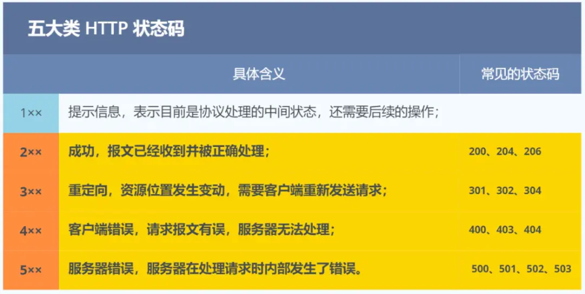

五大类 HTTP 状态码

1xx 类状态码属于 **提示信息**，是协议处理中的一种中间状态，实际用到的比较少。

2xx 类状态码表示服务器 **成功** 处理了客户端的请求，也是我们最愿意看到的状态。

- 「**200 OK**」是最常见的成功状态码，表示一切正常。如果是非 HEAD 请求，服务器返回的响应头都会有 body 数据。
- 「**204 No Content**」也是常见的成功状态码，与 200 OK 基本相同，但响应头没有 body 数据。 「**206 Partial Content**」是应用于 HTTP 分块下载或断点续传，表示响应返回的 body 数据并不是资源的全部，而是其中的一部分，也是服务器处理成功的状态。

3xx 类状态码表示客户端请求的资源发生了变动，需要客户端用新的 URL 重新发送请求获取资源，也就是 **重定向**。

- 「**301 Moved Permanently**」表示永久重定向，说明请求的资源已经不存在了，需改用新的 URL 再次访问。
- 「**302 Found**」表示临时重定向，说明请求的资源还在，但暂时需要用另一个 URL 来访问。

301 和 302 都会在响应头里使用字段 Location，指明后续要跳转的 URL，浏览器会自动重定向新的 URL。

   - 「**304 Not Modified**」不具有跳转的含义，表示资源未修改，重定向已存在的缓冲文件，也称缓存重定向，也就是告诉客户端可以继续使用缓存资源，用于缓存控制。
- 4xx 类状态码表示客户端发送的 **报文有误**，服务器无法处理，也就是错误码的含义。

「
「
「

   - 「**400 Bad Request**」表示客户端请求的报文有错误，但只是个笼统的错误。
   - 「**403 Forbidden**」表示服务器禁止访问资源，并不是客户端的请求出错。
   - 「**404 Not Found**」表示请求的资源在服务器上不存在或未找到，所以无法提供给客户端。
- 5xx 类状态码表示客户端请求报文正确，但是 **服务器处理时内部发生了错误**，属于服务器端的错误码。
   - 「**500 Internal Server Error**」与 400 类型，是个笼统通用的错误码，服务器发生了什么错误， 我们并不知道。
   - 「**501 Not Implemented**」表示客户端请求的功能还不支持，类似“即将开业，敬请期待”的意

思。

- 「**502 Bad Gateway**」通常是服务器作为网关或代理时返回的错误码，表示服务器自身工作正常，访问后端服务器发生了错误。
- 「**503 Service Unavailable**」表示服务器当前很忙，暂时无法响应客户端，类似“网络服务正忙， 请稍后重试”的意思。

### **HTTP1.0和2.0的区别，或者2.0和3.0的区别？**

读者答：

- （1）每次请求他都会与服务器建立一个tcp的连接。请求处理完以后他会立刻断开tcp，他有短暂的一个tcp链接。在1.1中，他稍微有些改善。
- （2）2.0提供了一个多路复用的功能。还有二进制分帧和首部压缩。

##### **小林补充：**

HTTP/2 相比 HTTP/1.1 性能上的改进：

头部压缩

- 二进制格式
- 并发传输
- 服务器主动推送资源

##### _1._ 头部压缩

HTTP/2 会 **压缩头** （Header）如果你同时发出多个请求，他们的头是一样的或是相似的，那么，协议会帮你 **消除重复的部分**。

这就是所谓的 HPACK 算法：在客户端和服务器同时维护一张头信息表，所有字段都会存入这个表，生成一个索引号，以后就不发送同样字段了，只发送索引号，这样就 **提高速度** 了。

##### _2._ 二进制格式

HTTP/2 不再像 HTTP/1.1 里的纯文本形式的报文，而是全面采用了 **二进制格式**，头信息和数据体都是二进制，并且统称为帧（frame）： **头信息帧（Headers Frame）和数据帧（Data Frame）**。

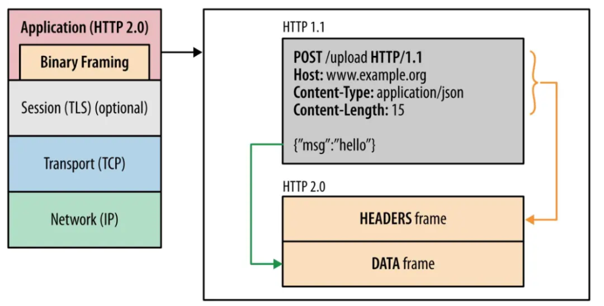

HTTP/1 与 HTTP/2

这样虽然对人不友好，但是对计算机非常友好，因为计算机只懂二进制，那么收到报文后，无需再将明文的报文转成二进制，而是直接解析二进制报文，这 **增加了数据传输的效率**。

_3._ 并发传输

我们都知道 HTTP/1.1 的实现是基于请求-响应模型的。同一个连接中，HTTP 完成一个事务（请求与响应），才能处理下一个事务，也就是说在发出请求等待响应的过程中，是没办法做其他事情的，如果响应迟迟不来，那么后续的请求是无法发送的，也造成了 **队头阻塞** 的问题。

- 而 HTTP/2 就很牛逼了，引出了 Stream 概念，多个 Stream 复用在一条 TCP 连接。

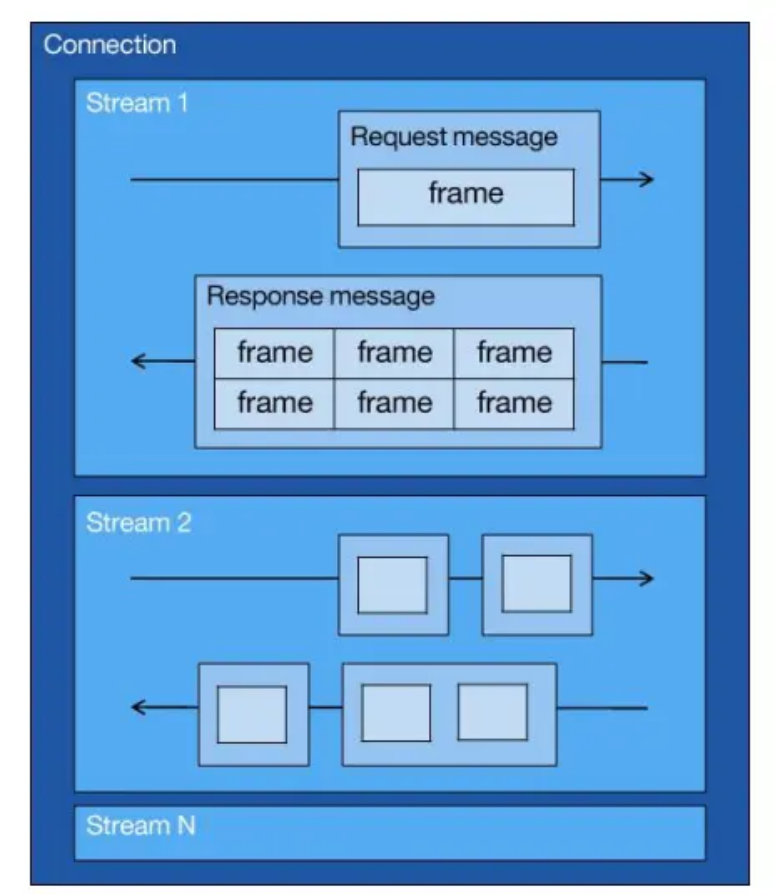

img

从上图可以看到，1 个 TCP 连接包含多个 Stream，Stream 里可以包含 1 个或多个 Message， Message 对应 HTTP/1 中的请求或响应，由 HTTP 头部和包体构成。Message 里包含一条或者多个 Frame，Frame 是 HTTP/2 最小单位，以二进制压缩格式存放 HTTP/1 中的内容（头部和包体）。

**针对不同的 HTTP 请求用独一无二的 Stream ID 来区分，接收端可以通过 Stream ID 有序组装成 HTTP 消息，不同 Stream 的帧是可以乱序发送的，因此可以并发不同的 Stream，也就是 HTTP/2 可以并行交错地发送请求和响应**。

比如下图，服务端 **并行交错地** 发送了两个响应：Stream 1 和 Stream 3，这两个 Stream 都是跑在一个 TCP 连接上，客户端收到后，会根据相同的 Stream ID 有序组装成 HTTP 消息。

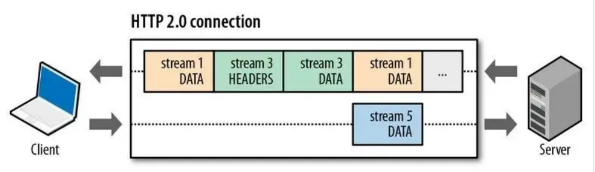

img

_4_、服务器推送

HTTP/2 还在一定程度上改善了传统的「请求 - 应答」工作模式，服务端不再是被动地响应，可以 **主动** 向客户端发送消息。

客户端和服务器 **双方都可以建立 Stream**， Stream ID 也是有区别的，客户端建立的 Stream 必须是奇数号，而服务器建立的 Stream 必须是偶数号。

比如下图，Stream 1 是客户端向服务端请求的资源，属于客户端建立的 Stream，所以该 Stream 的 ID 是奇数（数字 1）；Stream 2 和 4 都是服务端主动向客户端推送的资源，属于服务端建立的 Stream， 所以这两个 Stream 的 ID 是偶数（数字 2 和 4）。

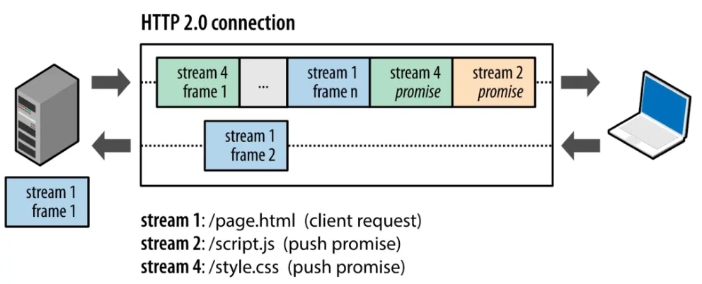

img

再比如，客户端通过 HTTP/1.1 请求从服务器那获取到了 HTML 文件，而 HTML 可能还需要依赖 CSS 来渲染页面，这时客户端还要再发起获取 CSS 文件的请求，需要两次消息往返，如下图左边部分：

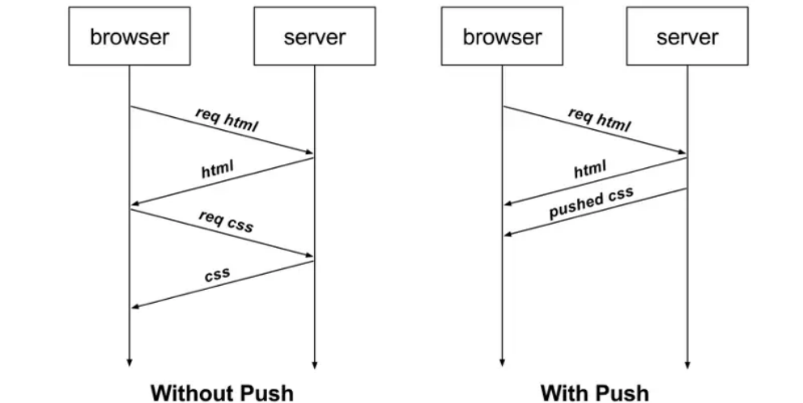

img

如上图右边部分，在 HTTP/2 中，客户端在访问 HTML 时，服务器可以直接主动推送 CSS 文件，减少了消息传递的次数。

HTTP/2 有什么缺陷？

HTTP/2 通过 Stream 的并发能力，解决了 HTTP/1 队头阻塞的问题，看似很完美了，但是 HTTP/2 还是存在“队头阻塞”的问题，只不过问题不是在 HTTP 这一层面，而是在 TCP 这一层。

**HTTP/2 是基于 TCP 协议来传输数据的，TCP 是字节流协议，TCP 层必须保证收到的字节数据是完整且连续的，这样内核才会将缓冲区里的数据返回给 HTTP 应用，那么当「前 1 个字节数据」没有到达时， 后收到的字节数据只能存放在内核缓冲区里，只有等到这 1 个字节数据到达时，HTTP/2 应用层才能从内核中拿到数据，这就是 HTTP/2 队头阻塞问题。**

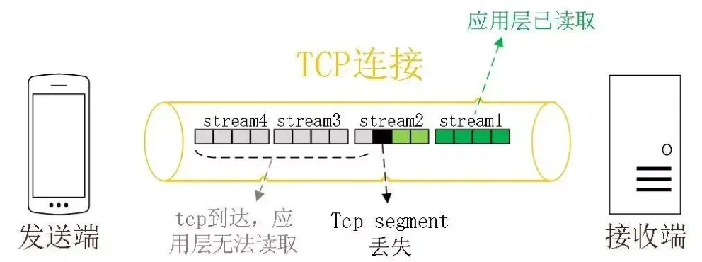

img

举个例子，如下图：

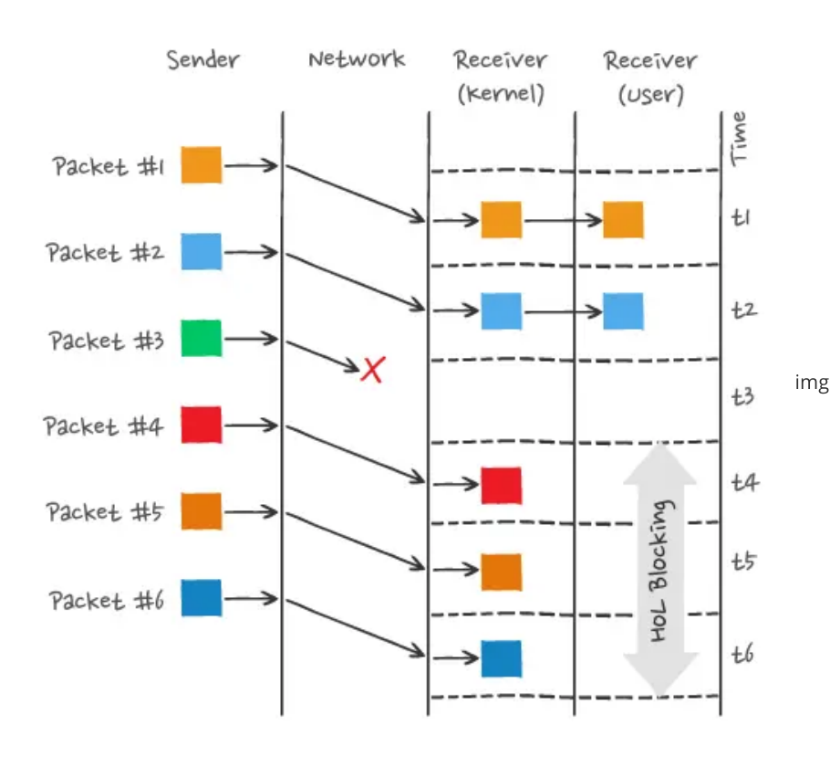

img

图中发送方发送了很多个 packet，每个 packet 都有自己的序号，你可以认为是 TCP 的序列号，其中 packet 3 在网络中丢失了，即使 packet 4-6 被接收方收到后，由于内核中的 TCP 数据不是连续的，于是接收方的应用层就无法从内核中读取到，只有等到 packet 3 重传后，接收方的应用层才可以从内核中读取到数据，这就是 HTTP/2 的队头阻塞问题，是在 TCP 层面发生的。

所以，一旦发生了丢包现象，就会触发 TCP 的重传机制，这样在一个 TCP 连接中的 **所有的 HTTP 请求都必须等待这个丢了的包被重传回来**。

前面我们知道了 HTTP/1.1 和 HTTP/2 都有队头阻塞的问题：

- HTTP/1.1 中的管道（pipeline）虽然解决了请求的队头阻塞，但是 **没有解决响应的队头阻塞**，因为服务端需要按顺序响应收到的请求，如果服务端处理某个请求消耗的时间比较长，那么只能等响应完这个请求后， 才能处理下一个请求，这属于 HTTP 层队头阻塞。
- HTTP/2 虽然通过多个请求复用一个 TCP 连接解决了 HTTP 的队头阻塞，但是 **一旦发生丢包，就会阻塞住所有的 HTTP 请求**，这属于 TCP 层队头阻塞。

HTTP/2 队头阻塞的问题是因为 TCP，所以 **HTTP/3 把 HTTP 下层的 TCP 协议改成了 UDP！**

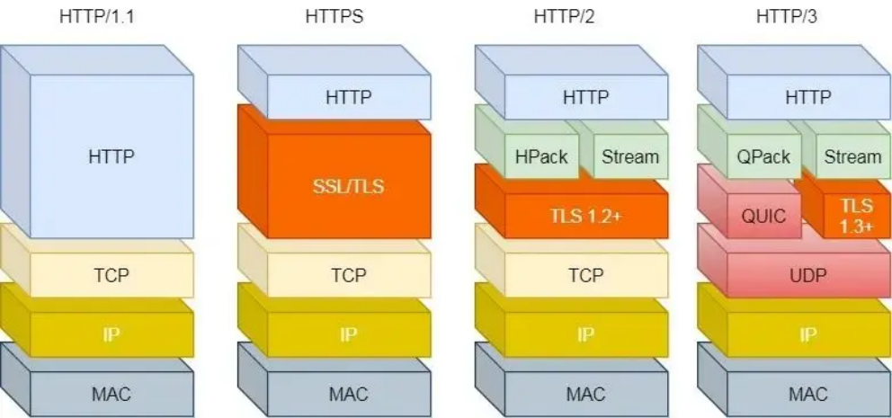

HTTP/1 ~ HTTP/3

UDP 发送是不管顺序，也不管丢包的，所以不会出现像 HTTP/2 队头阻塞的问题。大家都知道 UDP 是不可靠传输的，但基于 UDP 的 **QUIC 协议** 可以实现类似 TCP 的可靠性传输。

QUIC 有以下 3 个特点。

   - 无队头阻塞更快的连接建立连接迁移
- _1_、无队头阻塞

QUIC 协议也有类似 HTTP/2 Stream 与多路复用的概念，也是可以在同一条连接上并发传输多个 Stream，Stream 可以认为就是一条 HTTP 请求。

QUIC 有自己的一套机制可以保证传输的可靠性的。 **当某个流发生丢包时，只会阻塞这个流，其他流不会受到影响，因此不存在队头阻塞问题**。这与 HTTP/2 不同，HTTP/2 只要某个流中的数据包丢失了，其他流也会因此受影响。

所以，QUIC 连接上的多个 Stream 之间并没有依赖，都是独立的，某个流发生丢包了，只会影响该流， 其他流不受影响。

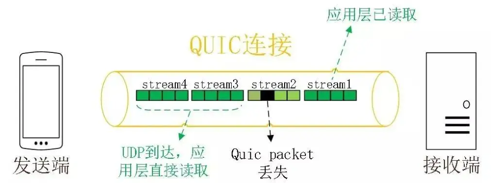

img

- _2_、更快的连接建立

对于 HTTP/1 和 HTTP/2 协议，TCP 和 TLS 是分层的，分别属于内核实现的传输层、openssl 库实现的表示层，因此它们难以合并在一起，需要分批次来握手，先 TCP 握手，再 TLS 握手。

HTTP/3 在传输数据前虽然需要 QUIC 协议握手，但是这个握手过程只需要 1 RTT，握手的目的是为确认双方的「连接 ID」，连接迁移就是基于连接 ID 实现的。

但是 HTTP/3 的 QUIC 协议并不是与 TLS 分层，而是 QUIC 内部包含了 TLS，它在自己的帧会携带 TLS 里的“记录”，再加上 QUIC 使用的是 TLS/1.3，因此仅需 1 个 RTT 就可以「同时」完成建立连接与密钥协商，如下图：

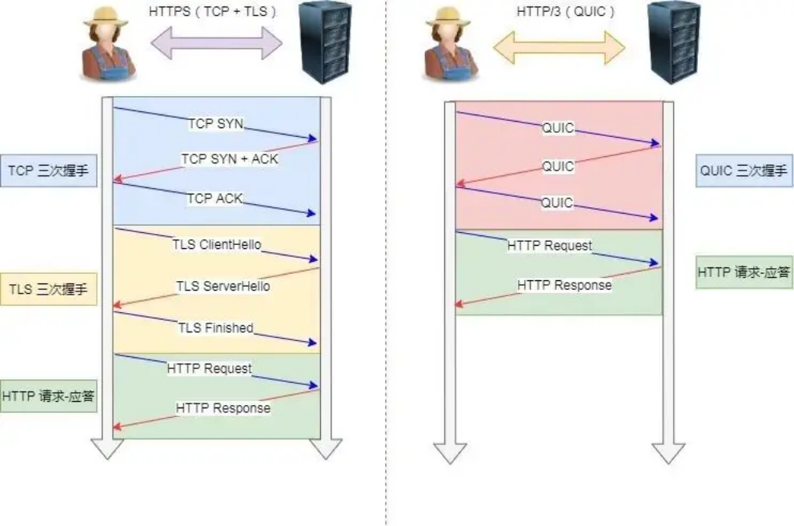

TCP HTTPS（TLS/1.3） 和 QUIC HTTPS

甚至，在第二次连接的时候，应用数据包可以和 QUIC 握手信息（连接信息 + TLS 信息）一起发送，达到 0-RTT 的效果。

如下图右边部分，HTTP/3 当会话恢复时，有效负载数据与第一个数据包一起发送，可以做到 0-RTT（下图的右下角）：

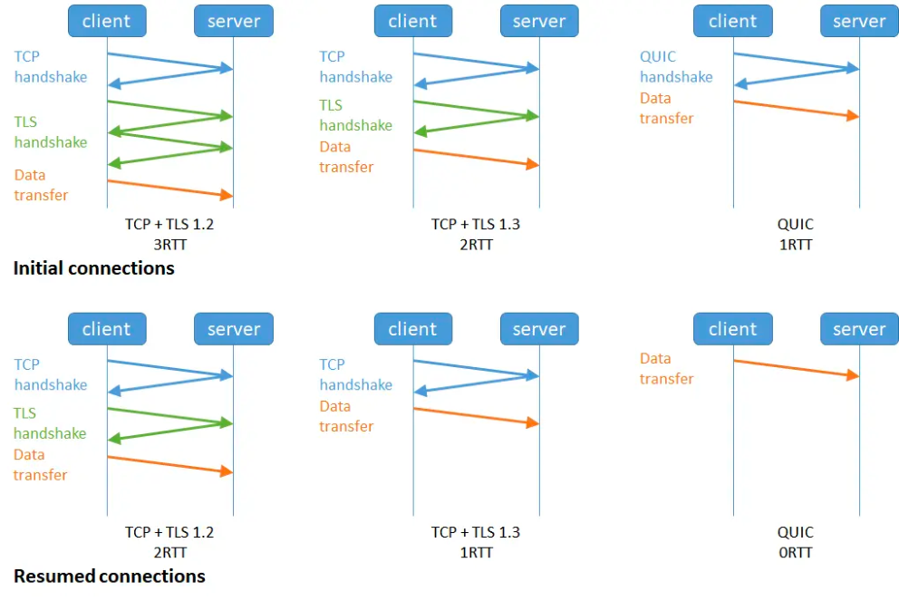

img

- _3_、连接迁移

基于 TCP 传输协议的 HTTP 协议，由于是通过四元组（源 IP、源端口、目的 IP、目的端口）确定一条 TCP 连接。

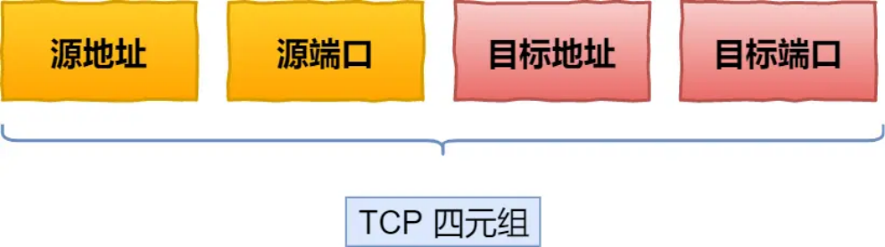

##### TCP 四元组

那么 **当移动设备的网络从 4G 切换到 WIFI 时，意味着 IP 地址变化了，那么就必须要断开连接，然后重新建立连接**。而建立连接的过程包含 TCP 三次握手和 TLS 四次握手的时延，以及 TCP 慢启动的减速过程，给用户的感觉就是网络突然卡顿了一下，因此连接的迁移成本是很高的。

而 QUIC 协议没有用四元组的方式来“绑定”连接，而是通过 **连接 ID** 来标记通信的两个端点，客户端和服务器可以各自选择一组 ID 来标记自己，因此即使移动设备的网络变化后，导致 IP 地址变化了，只要仍保有上下文信息（比如连接 ID、TLS 密钥等），就可以“无缝”地复用原连接，消除重连的成本，没有丝毫卡顿感，达到了 **连接迁移** 的功能。

### **口述回答题目：MySQL联合索引**

一开始给了个写sql语句的题，我说我平时用orm框架访问数据库，很少写sql，于是换了个索引的问题。

题目：

index(abc)

1. select * from T where a=x and b=y and c=z
2. select * from T where a=x and b>y and c=z
3. select * from T where c=z and a=x and b=y
4. select (a,b) from T where a=x and b>y
5. select count(*) from T where a=x
6. select count(*) from T where b=y
7. select count(*) form T

读者答：

- （1）根据最左匹配原则，走索引，先匹配a再匹配b再匹配c。
- （2）a走索引，b因为在索引中有序，依旧可以走索引，c需要回表查询。
- （3）因为mysql查询器优化，和（1）一样。
- （4）a走索引，b也走索引，因为ab都在索引上，最后不用回表。
- （5）走索引。
- （6）只有b，无法使用联合索引，需要回表查询。
- （7）不需要回表。

##### **小林补充：**

1. a、b、c三个字段都可以走联合索引
2. a和b都会走联合索引，但是由于最左匹配原则， 范围查找后面的字段是无法走联合索引的，但是在 mysql 5.6 版本后，c 字段虽然无法走联合索引，但是因为有索引下推的特性，c 字段在 inndob 层过滤完满足查询条件的记录后，才返回给server 层进行回表，相比没有索引下推，减少了回表的次数。
3. 查询条件的顺序不影响，优化器会优化，所以a、b、c三个字段都可以走联合索引
4. a和b都会走联合索引，查询是覆盖索引，不需要回表
5. a 可以走联合索引
6. 只有b，无法使用联合索引，由于表存在联合索引，所以 count(*) 选择的扫描方式是扫描联合索引来统计个数，扫描的方式是type=index
7. 由于表存在联合索引，所以 count(*) 选择的扫描方式是扫描联合索引来统计个数，扫描的方式是 type=index

关于 count(*) 为什么选择扫描联合索引（二级索引），而不扫描聚簇索引的原因：这是因为相同数量的二级索引记录可以比聚簇索引记录占用更少的存储空间，所以二级索引树比聚簇索引树小，这样遍历二级索引的 I/O 成本比遍历聚簇索引的 I/O 成本小，因此「优化器」优先选择的是二级索引。

### **Redis怎么实现分布式锁**

读者答：应用程序获取redis的连接，然后发送一个命令获取锁。（面试官：什么命令？）SETNX。因为这个指令是Redis里的原子命令，可以把一个key设置其对应的value。然后这个时候这个应用程序就就开始去临界区进行一些操作。如果说如果说他看来运他执行那个命令失败了。就说明这个锁已经被其他的户端持有了，这样的话他就需要等待。成功获取锁并且执行完临界区操作之后，便可以用del命令在 redis删除这个key，实现释放锁的目的。

##### **小林补充：**

Redis 的 SET 命令有个 NX 参数可以实现「key不存在才插入」，所以可以用它来实现分布式锁：

如果 key 不存在，则显示插入成功，可以用来表示加锁成功；
如果 key 存在，则会显示插入失败，可以用来表示加锁失败。

- 如果 key 不存在，则显示插入成功，可以用来表示加锁成功；
- 如果 key 存在，则会显示插入失败，可以用来表示加锁失败。

基于 Redis 节点实现分布式锁时，对于加锁操作，我们需要满足三个条件。

- 加锁包括了读取锁变量、检查锁变量值和设置锁变量值三个操作，但需要以原子操作的方式完成， 所以，我们使用 SET 命令带上 NX 选项来实现加锁；
- 锁变量需要设置过期时间，以免客户端拿到锁后发生异常，导致锁一直无法释放，所以，我们在 SET 命令执行时加上 EX/PX 选项，设置其过期时间；
- 锁变量的值需要能区分来自不同客户端的加锁操作，以免在释放锁时，出现误释放操作，所以，我们使用 SET 命令设置锁变量值时，每个客户端设置的值是一个唯一值，用于标识客户端；

##### 满足这三个条件的分布式命令如下：

SET lock_key unique_value NX PX 10000

- lock_key 就是 key 键；

NX 代表只在 lock_key 不存在时，才对 lock_key 进行设置操作；

- unique_value 是客户端生成的唯一的标识，区分来自不同客户端的锁操作；
- NX 代表只在 lock_key 不存在时，才对 lock_key 进行设置操作；
- PX 10000 表示设置 lock_key 的过期时间为 10s，这是为了避免客户端发生异常而无法释放锁。

而解锁的过程就是将 lock_key 键删除（del lock_key），但不能乱删，要保证执行操作的客户端就是加锁的客户端。所以，解锁的时候，我们要先判断锁的 unique_value 是否为加锁客户端，是的话，才将 lock_key 键删除。

可以看到，解锁是有两个操作，这时就需要 Lua 脚本来保证解锁的原子性，因为 Redis 在执行 Lua 脚本时，可以以原子性的方式执行，保证了锁释放操作的原子性。

// 释放锁时，先比较 unique_value 是否相等，避免锁的误释放 if redis.call("get",KEYS[1]) == ARGV[1] then return redis.call("del",KEYS[1]) else return 0 end

这样一来，就通过使用 SET 命令和 Lua 脚本在 Redis 单节点上完成了分布式锁的加锁和解锁。

### **思考题：抛硬币，先抛到正面算赢，否则轮流抛。问先抛的人获胜的概率。**

读者答：阿巴阿巴……考虑一轮，（正，-）（反，正）（反，反），其中，（正，-）可以还原成（正， 正）（正，）两份，而（反，反）相当于再来一次，这样（正，-）占2份，（反，正）占1份，赢的概率就算2/3

### **算法题：寻找峰值**

给定一个输入数组nums，其中nums[i] != nums[i+1]，找到峰值元素并返回其索引。

数组可能包含多个峰值，在这种情况下，返回任何一个峰值所在位置即可。

你可以假设nums[-1]= nums[n]= -∞。

读者答：

（1）遍历递增序列，遇到第一个非递增的位置返回，时间复杂度为O(n)。
（2）寻找最大值，时间复杂度依旧为O(n)。
（3）二分查找变体，在二分查找时，取中间位置m，并与它相邻位置m+1进行比较，如果m大于

- （1）遍历递增序列，遇到第一个非递增的位置返回，时间复杂度为O(n)。
- （2）寻找最大值，时间复杂度依旧为O(n)。
- （3）二分查找变体，在二分查找时，取中间位置m，并与它相邻位置m+1进行比较，如果m大于 m+1，说明峰值应该在左侧，否则应该在右侧，移动对应的左右边界。

### **反问**

- （1）在面试的过程中，我存在什么问题，需要在哪些方面加强学习？或者说想要从事后端开发， 我还欠缺什么知识？

面试官：数据库的部分你可以多研究一下。微服务的部分可能也可以研究一下，因为像我刚刚其实问你能不能讲微服务，我其实是希望你能懂的，你懂的话我就问这方面的问题。

（2）假如我有机会加入进行实习，大概会做些什么样的内容？

面试官：后端这块，我们做的B2B的，我们的产品形态会跟数据库有一点像。如果能够深度的去，了解一下数据库的实现、怎么设计的，那可能会比较好一点。

## **<u>面试总结</u>**

### **感觉**

感觉整体沟通比较顺畅，面试官很和蔼，在我回答有问题或者卡壳的时候能很好的引导，给人感觉很舒服。

### **不足之处**

1. 有些没准备的问题回答的不是很好，比如对比http1.0和2.0,答的很没有条理。
2. 回答过程中不必要的语气词和废话过多，对于自己不确定的问题给人感觉印象很差。
