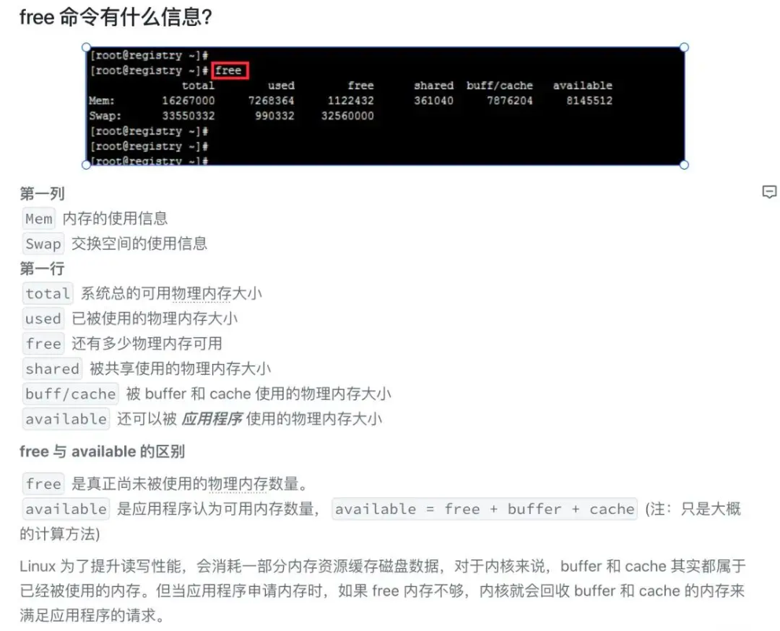
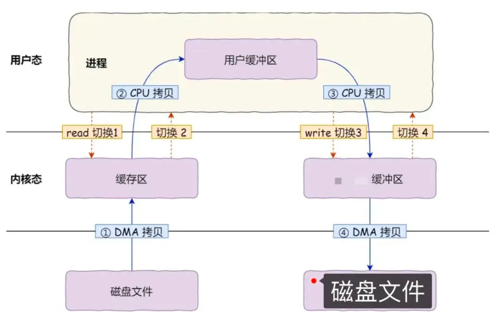
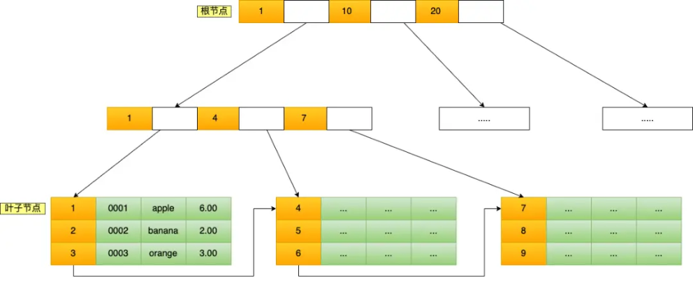
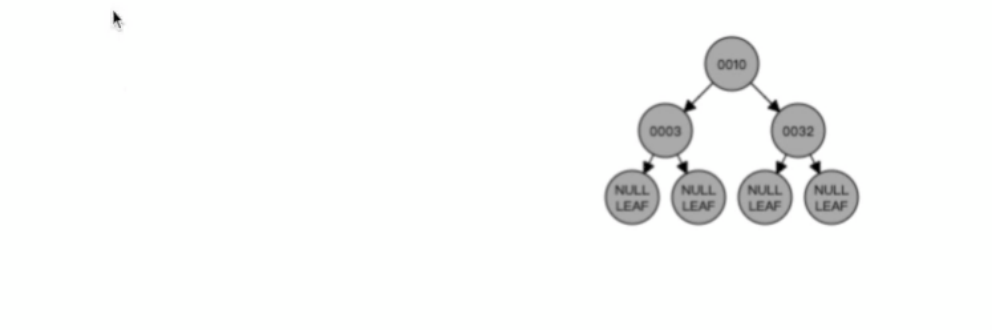
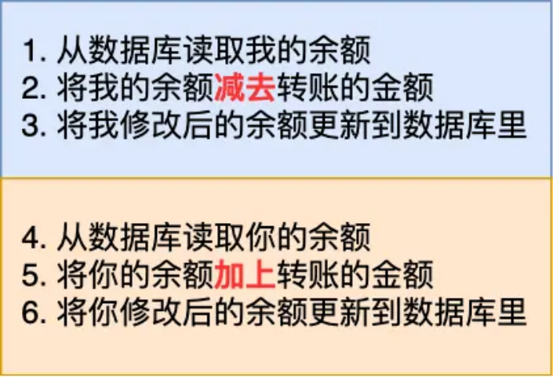
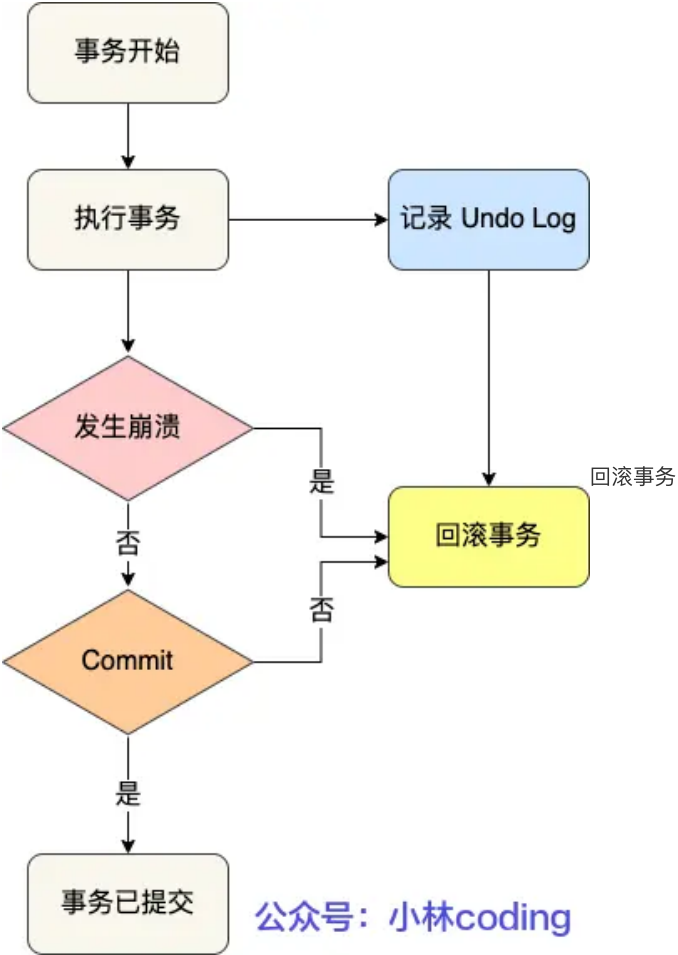
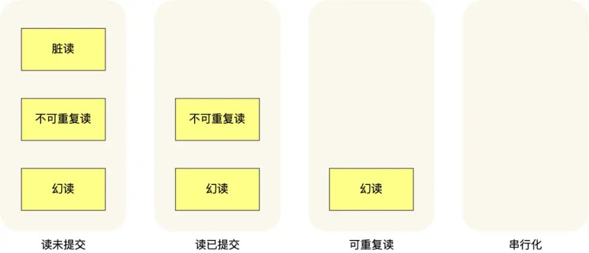

# **<u>这次轮到阿里了！</u>**

大家好，我是小林。

最近分享了很多字节、腾讯、美团的春招后端面经，有同学问有没有阿里巴巴的？ 这不来了嘛，今天就补上了。

这次是一位读者阿里巴巴春招的后端面经，问了比较多的计算机基础和数据库的内容。

## **<u>操作系统</u>**

**一个操作系统，我们在衡量它的内存占用的时候，它一般会有哪些内存的部分？**

读者答：堆和栈

**小林补充：**

这个其实是问你对free命令的理解。

### **主机的内存做一些清理的动作。你知道这里面会涉及到对哪些内存区域进行操作吗？**

读者答：不了解

**小林补充：**

系统内存紧张的时候，就会进行回收内存的工作，那具体哪些内存是可以被回收的呢？

主要有两类内存可以被回收，而且它们的回收方式也不同。

- **文件页** （File-backed Page）：内核缓存的磁盘数据（Buffer）和内核缓存的文件数据（Cache） 都叫作文件页。大部分文件页，都可以直接释放内存，以后有需要时，再从磁盘重新读取就可以了。而那些被应用程序修改过，并且暂时还没写入磁盘的数据（也就是脏页），就得先写入磁盘， 然后才能进行内存释放。所以， **回收干净页的方式是直接释放内存，回收脏页的方式是先写回磁盘后再释放内存**。
- **匿名页** （Anonymous Page）：这部分内存没有实际载体，不像文件缓存有硬盘文件这样一个载体，比如堆、栈数据等。这部分内存很可能还要再次被访问，所以不能直接释放内存，它们 **回收的方式是通过 Linux 的 Swap 机制**，Swap 会把不常访问的内存先写到磁盘中，然后释放这些内存， 给其他更需要的进程使用。再次访问这些内存时，重新从磁盘读入内存就可以了。

文件页和匿名页的回收都是基于 LRU 算法，也就是优先回收不常访问的内存。LRU 回收算法，实际上维护着 active 和 inactive 两个双向链表，其中：

**active_list** 活跃内存页链表，这里存放的是最近被访问过（活跃）的内存页； **inactive_list** 不活跃内存页链表，这里存放的是很少被访问（非活跃）的内存页；

越接近链表尾部，就表示内存页越不常访问。这样，在回收内存时，系统就可以根据活跃程度，优先回收不活跃的内存。

### **从 a 文件 copy 到另外一个目录， b 作为一个从 a 目录 copy 到一个 b 目录这样的一个文件，操作过程中间包含了哪些系统调用？这里面执行了多少次拷贝的动作？**

读者答：不知道

##### **小林补充：**

简单理解这个过程就是，在另外一个目录创建a文件，然后通过read读取原来a文件的数据，然后write写入到新目录的a文件。

发生了 4 次数据拷贝，其中两次是 DMA 的拷贝，另外两次则是通过 CPU 拷贝的。

下面说一下这个过程：

- 第一次拷贝，把磁盘上的数据拷贝到操作系统内核的缓冲区里，这个拷贝的过程是通过 DMA 搬运的。
- 第二次拷贝，把内核缓冲区的数据拷贝到用户的缓冲区里，于是我们应用程序就可以使用这部分数据了，这个拷贝到过程是由 CPU 完成的。
- 第三次拷贝，把刚才拷贝到用户的缓冲区里的数据，再拷贝到内核缓冲区里，这个过程依然还是由 CPU 搬运的。

第四次拷贝，把内核缓冲区里的数据，拷贝到磁盘，这个过程又是由 DMA 搬运的。

## **<u>数据库</u>**

### **NoSQL和关系型数据库的区别**

读者答：

他们主要的差异在于：关系型数据库它是有比较统一的格式组成，表与表之间是会有关系的映射的。但是NoSQL基本上键值对的形式，能够在不同的场景中提供不一样的业务。比如像MongoDB，它属于文档式的存储，还有一些图数据库相关的数据库，它就没有关系型数据库这么强的关系性。然后主要的一个差距就是在这里。

##### **小林补充：**

NoSQL和关系型数据库是两种不同的数据库类型，它们具有一些显著的区别。以下是从多个角度分析这两种数据库类型的区别：

1. 数据模型：关系型数据库采用表格模型来存储数据，表格中的每行都代表一个记录，每列代表一个属性或字段。而NoSQL数据库则采用不同的数据模型，如文档、键值对、图形和列式等。
2. 数据结构：关系型数据库的数据结构严格，要求每个表都必须有一个预定义的模式（schema）， 包括数据类型、大小、关系等。而NoSQL数据库没有这种限制，允许数据结构的动态变化。
3. 可扩展性：NoSQL数据库通常具有很好的可扩展性，可以通过添加更多的节点来水平扩展，以应对大规模数据处理和高并发访问的需求。关系型数据库也可以进行垂直扩展，即增加更多的处理能力和存储空间，但这种方式的扩展存在一定的局限性。
4. ACID特性：关系型数据库通常具有ACID特性（原子性、一致性、隔离性和持久性），它们可以确保数据的完整性和一致性。而NoSQL数据库通常不支持完全的ACID特性，但提供了更高的可用性和性能。
5. 查询语言：关系型数据库通常使用SQL语言来查询和操作数据，这种语言简单易学，能够完成复杂的数据查询和统计分析。而NoSQL数据库则使用不同的查询语言，如MongoDB的Mongo Query和 Cassandra的CQL等。

### **MySQL表里的数据很多，如何加快数据的查询？**

读者答：可以建立索引来提高数据的查询速度。

##### **小林补充：**

当你想查阅书中某个知识的内容，你会选择一页一页的找呢？还是在书的目录去找呢？

傻瓜都知道时间是宝贵的，当然是选择在书的目录去找，找到后再翻到对应的页。书中的 **目录**，就是充当 **索引** 的角色，方便我们快速查找书中的内容，所以索引是以空间换时间的设计思想。

那换到数据库中，索引的定义就是帮助存储引擎快速获取数据的一种数据结构，形象的说就是 **索引是数据的目录**。

所以，要加快数据的查询，就是通过建立索引来提高查询的速度。

### **索引是怎么实现的？为什么它就能加快查询的？**

读者答：我个人理解，索引是一种数据的组织结构，它能够根据场景的不同，采取不同的数据结构存储数据，加快数据的查询。对于索引，如果内存够大，或追求极致的查找效率，当然哈希索引会是很快的。如果B+树的结构适合存到磁盘上。这样子的索引结构是比较适合存在磁盘像 SSD 这样子的磁盘结构上的，因为它提供了一个它一个叶子节点，像跟磁盘的结构差不多，一个叶子节点大概有 16 KB 的大小，跟磁盘的一个页大小是基本上能够整数倍吻合。同时也能够提供一些范围查找，加快数据的读取速度。

##### **小林补充：**

Innodb 存储引擎的索引是 B+ 树结构，我以 B+ 树作为例子。

B+Tree 是一种多叉树，叶子节点才存放数据，非叶子节点只存放索引，而且每个节点里的数据是 **按主键顺序存放** 的。每一层父节点的索引值都会出现在下层子节点的索引值中，因此在叶子节点中，包括了所有的索引值信息，并且每一个叶子节点都有两个指针，分别指向下一个叶子节点和上一个叶子节点，形成一个双向链表。

主键索引的 B+Tree 如图所示（图中叶子节点之间我画了单向链表，但是实际上是双向链表，原图我找不到了，修改不了，偷个懒我不重画了，大家脑补成双向链表就行）：

主键索引 B+Tree

比如，我们执行了下面这条查询语句：

select * from product where id= 5;

这条语句使用了主键索引查询 id 号为 5 的商品。查询过程是这样的，B+Tree 会自顶向下逐层进行查找：

- 将 5 与根节点的索引数据 (1，10，20) 比较，5 在 1 和 10 之间，所以根据 B+Tree的搜索逻辑，找到第二层的索引数据 (1，4，7)；
- 在第二层的索引数据 (1，4，7)中进行查找，因为 5 在 4 和 7 之间，所以找到第三层的索引数据 （4，5，6）；

在叶子节点的索引数据（4，5，6）中进行查找，然后我们找到了索引值为 5 的行数据。

正是因为 B+ 树的索引是有序存放的，所以我们可以通过类似于二分查找算法快速找到对应的数据。

### **B+树具体实现？**

读者答：B+树它是一种树形结构，在这棵树里它是能支持多个节点的（多叉树）。也就是相比于平衡二叉树来说，它一层能够存储的节点数量是更多的。B+树它比较特殊的地方是在于，除了叶子节点以外， 它存的基本上都是路径信息， index 信息。只有在最后一层页节点才会存储具体的数据信息。

### **B+和红黑树，B树的区别**

读者答：

- 红黑树，它其实也是二叉树的一种，它叶节点只有 red 和 black 两种类型。所以相比于B+数来说， 它整个树的结构，深度高度是会更高的。对于查询来说，高度更高意味着就是查的效率会更低这样子。所以B+树会比红黑树更加的矮胖，它一层能存储的数据会更多一点。
- B树呢，也是个多叉树，但是在一些数据扫描的情况下， b 树可能会有一个回溯的过程，但是B+树就可以直接的通过遍历的方式来查找。

##### **小林补充：**

红黑树，它也是通过一些约束条件来达到自平衡，不过红黑树的约束条件比较复杂，不是本篇的重点重点，大家可以看《数据结构》相关的书籍来了解红黑树的约束条件。

下面是红黑树插入节点的过程，这左旋右旋的操作，就是为了自平衡。

##### 图片

**不管平衡二叉查找树还是红黑树，都会随着插入的元素增多，而导致树的高度变高，这就意味着磁盘 I/O 操作次数多，会影响整体数据查询的效率**。

虽然平衡二叉查找树和红黑树能保持查询操作的时间复杂度在O(logn)，但是因为它本质上是一个二叉树，每个节点只能有 2 个子节点，那么当节点个数越多的时候，树的高度也会相应变高，这样就会增加磁盘的 I/O 次数，从而影响数据查询的效率。

为了解决降低树的高度的问题，后面就出来了 B 树和 B+，它不再限制一个节点就只能有 2 个子节点， 而是允许 M 个子节点 (M>2)，从而降低树的高度，这样就可以减少磁盘的  I/O 次数。

B 树和 B+ 都是通过多叉树的方式，会将树的高度变矮，所以这两个数据结构非常适合检索存于磁盘中的数据。但是 MySQL 默认的存储引擎 InnoDB 采用的是 B+ 作为索引的数据结构，原因有：

- B+ 树的非叶子节点不存放实际的记录数据，仅存放索引，因此数据量相同的情况下，相比存储即存索引又存记录的 B 树，B+树的非叶子节点可以存放更多的索引，因此 B+ 树可以比 B 树更「矮胖」，查询底层节点的磁盘 I/O次数会更少。

B+ 树有大量的冗余节点（所有非叶子节点都是冗余索引），这些冗余索引让 B+ 树在插入、删除的

- B+ 树有大量的冗余节点（所有非叶子节点都是冗余索引），这些冗余索引让 B+ 树在插入、删除的

效率都更高，比如删除根节点的时候，不会像 B 树那样会发生复杂的树的变化；

- B+ 树叶子节点之间用链表连接了起来，有利于范围查询，而 B 树要实现范围查询，因此只能通过树的遍历来完成范围查询，这会涉及多个节点的磁盘 I/O 操作，范围查询效率不如 B+ 树。

### **我们什么时候会用到事务？**

读者答：有多个操作，并且想要这个操作是原子性，要不这多个操作一起成功，要不就一起失败。这样的场景会需要事务。

**小林补充：**

这是我的钱包，共有 100 万元。

图片

今天我心情好，我决定给你的转账 100 万，最后的结果肯定是我的余额变为 0 元，你的余额多了 100 万元，是不是想到就很开心？

转账这一动作在程序里会涉及到一系列的操作，假设我向你转账 100 万的过程是有下面这几个步骤组成的：

图片

可以看到这个转账的过程涉及到了两次修改数据库的操作。

假设在执行第三步骤之后，服务器忽然掉电了，就会发生一个蛋疼的事情，我的账户扣了 100 万，但是钱并没有到你的账户上，也就是说 **这 100 万消失了！**

要解决这个问题，就要保证转账业务里的所有数据库的操作是不可分割的，要么全部执行成功，要么全部失败，不允许出现中间状态的数据。

数据库中的「**事务（*Transaction*）**」就能达到这样的效果。

我们在转账操作前先开启事务，等所有数据库操作执行完成后，才提交事务，对于已经提交的事务来说，该事务对数据库所做的修改将永久生效，如果中途发生发生中断或错误，那么该事务期间对数据库所做的修改将会被回滚到没执行该事务之前的状态。

### **一起成功，一起失败的原子性怎么保证的**

读者答：如果执行失败就回滚。如果执行成功，就持久化，使用undo log来进行保证原子性的。

**小林补充：**

undo log（回滚日志）保证了事务的 ACID 特性中的原子性（Atomicity）。

undo log 是一种用于撤销回退的日志。在事务没提交之前，MySQL 会先记录更新前的数据到 undo log 日志文件里面，当事务回滚时，可以利用 undo log 来进行回滚。如下图：

回滚事务

每当 InnoDB 引擎对一条记录进行操作（修改、删除、新增）时，要把回滚时需要的信息都记录到 undo log 里，比如：

在 **插入** 一条记录时，要把这条记录的主键值记下来，这样之后回滚时只需要把这个主键值对应的记录 **删掉** 就好了；

- 在 **删除** 一条记录时，要把这条记录中的内容都记下来，这样之后回滚时再把由这些内容组成的记录 **插入** 到表中就好了；
- 在 **更新** 一条记录时，要把被更新的列的旧值记下来，这样之后回滚时再把这些列 **更新为旧值** 就好了。

在发生回滚时，就读取 undo log 里的数据，然后做原先相反操作。比如当 delete 一条记录时，undo log 中会把记录中的内容都记下来，然后执行回滚操作的时候，就读取 undo log 里的数据，然后进行 insert 操作。

### **假如我们现在对已经插入了一条数据，我们接下来去修正另外一条数据。被查入的这条数据在这个时候能够被查询到吗？**

读者答：要看数据库的隔离级别，如果它的隔离级别比较高，这个事务没有完成之前，他对数据的修改，另一个事务是没有办法感知到的。但是如果他事务的隔离级别比较低，是可以能够查到的。

### **一般有哪些隔离级别**

读者答：大概有 4 种隔离级别读未提交，读已提交，可重复读和串行化情况。

##### **小林补充：**

SQL 标准提出了四种隔离级别来规避这些现象，隔离级别越高，性能效率就越低，这四个隔离级别如下：

- **读未提交（read uncommitted）**，指一个事务还没提交时，它做的变更就能被其他事务看到； **读提交（read committed）**，指一个事务提交之后，它做的变更才能被其他事务看到；
- **可重复读（repeatable read）**，指一个事务执行过程中看到的数据，一直跟这个事务启动时看到的数据是一致的， **MySQL InnoDB 引擎的默认隔离级别**；
- **串行化（serializable）**；会对记录加上读写锁，在多个事务对这条记录进行读写操作时，如果发生了读写冲突的时候，后访问的事务必须等前一个事务执行完成，才能继续执行；

按隔离水平高低排序如下：

图片

针对不同的隔离级别，并发事务时可能发生的现象也会不同。

图片

也就是说：

- 在「读未提交」隔离级别下，可能发生脏读、不可重复读和幻读现象；
- 在「读提交」隔离级别下，可能发生不可重复读和幻读现象，但是不可能发生脏读现象；
- 在「可重复读」隔离级别下，可能发生幻读现象，但是不可能脏读和不可重复读现象；
- 在「串行化」隔离级别下，脏读、不可重复读和幻读现象都不可能会发生。

所以，要解决脏读现象，就要升级到「读提交」以上的隔离级别；要解决不可重复读现象，就要升级到 「可重复读」的隔离级别，要解决幻读现象不建议将隔离级别升级到「串行化」。

不同的数据库厂商对 SQL 标准中规定的 4 种隔离级别的支持不一样，有的数据库只实现了其中几种隔离级别， **我们讨论的 MySQL 虽然支持 4 种隔离级别，但是与SQL 标准中规定的各级隔离级别允许发生的现象却有些出入**。

MySQL 在「可重复读」隔离级别下，可以很大程度上避免幻读现象的发生（注意是很大程度避免，并不是彻底避免），所以 MySQL 并不会使用「串行化」隔离级别来避免幻读现象的发生，因为使用「串行化」隔离级别会影响性能。

## **<u>Go</u>**

### **Why Go？**

读者答：go支持高并发，在我的研究领域基本都是用go，有比较好的生态。

**小林补充：**

云原生像k8s,docker都是go实现，对go也有比较好的api支持，然后go在并发生而也有天然的优势，语法也简单

### **为什么Goroutine支持高并发**

读者答：相比于线程来说，它所占用的资源更小的。一个线程可以有多个协程；线程进程可以看作是同步机制，而协程非阻塞模式。和channel的组合能让开发的过程中不会太过于去考虑事物的并发控制，因为通过 channel 可以进行控制，因为是协程，他们其实共享了一些资源，所以他们其实可以通过共享内存的方式去进行相关的交互。相对比起线程的加锁机制来说，协程的效率会更高一些。

**小林补充：**

1. 协程大小相对于县城来说更笑，大小只有2k，内存中可以允许有更多的携程来处理并发任务
2. 协程的上下文切换不哦那个由用户态切换到内核态，且保存的寄存器值更少，所以切成切换的开销更小，效率更高
3. go语言在语言层面go语言的的runtime内置了协程调度器，整体通过gmp模型高效的调度 goroutine的运行

### **开销大的话，用线程池不就能解决吗？**

读者答：可以解决，但是需要用户自己建线程池也需要开销，还需要对所有的线程手动管理。

小林补充：

线程池虽然可以控制线程的数量到那时线程的上下文切换开销相比于协程更大，需要用户态到内核态的切换。并且还需要自己实现和维护线程池，实现起来复杂

### **开销是指什么？你觉得线程池需要做哪些管理？**

读者答：维护过期的线程，具体的不清楚了。

**小林补充：**

开销指线程切换的开销，用户态到内核态的切换，以及执行上下文的保存

- 1、corePoolSize（核心线程数量）

向线程池提交一个任务，此时，若线程池已创建的线程数小于corePoolSize，即便此时存在空闲线程， 也会通过创建一个新线程来执行该任务，直到已创建的线程数大于或等于corePoolSize时，（除了利用提交新任务来创建和启动线程（按需构造），也可以通过 prestartCoreThread() 或 prestartAllCoreThreads() 方法来提前启动线程池中的基本线程。）

2、maximumPoolSize（最大线程数量）

线程池所允许的最大同时可执行线程数量。当队列满了，且已创建的线程数小于maximumPoolSize，则线程池会创建新的线程来执行任务。另外，对于无界队列，可忽略该参数。

3、keepAliveTime（线程存活保持时间）

当线程池中线程数大于核心线程数时，线程的空闲时间如果超过线程存活时间，那么这个线程就会被销毁，直到线程池中的线程数小于等于核心线程数。

- 4、workQueue（任务队列）

用于传输和保存等待执行任务的阻塞队列。

- 5、threadFactory（线程工厂）

用于创建新线程。threadFactory创建的线程也是采用new Thread()方式，threadFactory创建的线程名都具有统一的风格：pool-m-thread-n（m为线程池的编号，n为线程池内的线程编号）。

- 6、handler（线程饱和策略）

当线程池和队列都满了，再加入线程会执行此策略。
