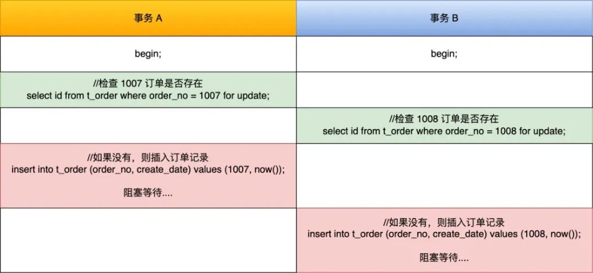
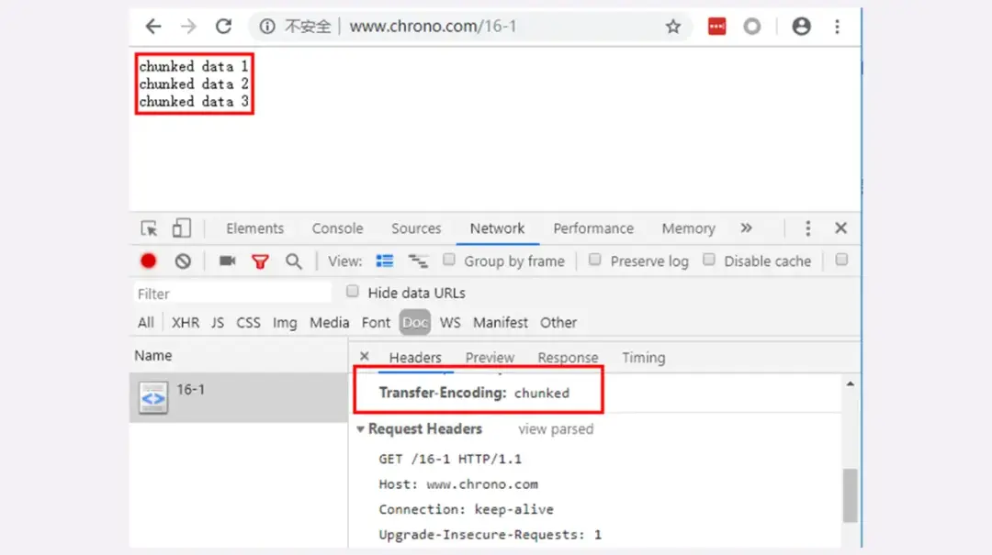

# **<u>腾讯面试比之前的要难，开始会胡说八道了</u>**

今天又来分享面经了，这次腾讯春招实习的面经，岗位是 java 后端开发。

读者的背景是985硕，根据读者的面试感受说是，腾讯面试比之前的要难，但是增加自信了，遇到不会的问题，开始会胡说八道了。

### **说一下BIO、NIO和AIO**

##### **读者答：**

- BIO是阻塞IO。在上一个线程的任务执行完之前，该线程必须阻塞等待上一个线程执行完毕。 NIO是非阻塞IO。一旦是响应事件发生了，该线程就会将对应的响应事件交给对应的事件处理器进行处理。
- AIO是异步IO。主线程接收到请求后，可以分发给其他线程进行异步处理，主线程继续接收其他请求。

**小林补充：**

BIO（Blocking IO）、NIO（Non-Blocking IO）和AIO（Asynchronous IO）是Java中常用的IO模式。 它们之间的主要区别在于IO的处理方式和效率。

BIO是同步阻塞IO，在进行IO操作时，必须等待IO操作完成后才能进行下一步操作，这时线程会被阻塞。BIO适用于连接数比较小且固定的架构，由于线程阻塞等待IO操作，所以并发处理能力不强。

NIO是同步非阻塞IO，可以支持多个连接同时进行读写操作，因此可以用较少的线程来处理大量的连接。NIO通过Selector来监听多个Channel的状态，当Channel中有数据可读或可写时，Selector会通知程序进行读写操作。NIO适用于连接数多且连接时间较短的场景。

AIO是异步非阻塞IO，与NIO不同的是，AIO不需要用户线程等待IO操作完成，而是由操作系统来完成IO 操作，操作系统完成IO操作后会通知用户线程处理。AIO适用于连接数较多且连接时间较长的场景，如高性能网络服务器等。

### **你说一下NIO是如何实现同步非阻塞的？主线程是只有一个嘛？**

**读者答：**

NIO底层是用Selector、Channel和ByteBuffer来实现的。主线程在循环使用select方法进行阻塞等待， 当有acceptable、readable或者writable事件发生的时候，循环就会往下走，将对应的事件交给对应的事件处理器进行处理。

他可以多线程的，可以有多个accept()线程和多个worker线程。

**小林补充：**

在NIO中，使用了多路复用器Selector来实现同步非阻塞的IO操作。Selector是一个可以监控多个通道 （Channel）是否有数据可读或可写的对象，当一个或多个Channel准备好读或写时，Selector会通知程序进行读写操作，而不是像BIO一样阻塞等待IO操作完成。

在NIO中，主线程通常只有一个，但是可以使用Selector来管理多个Channel，实现多个连接的非阻塞读写操作。当有多个Channel需要进行IO操作时，Selector会轮询这些Channel，检查它们的状态是否可读或可写，如果有可读或可写的Channel，就将其加入到一个已选择键集合中，等待程序处理。这样，一个线程就可以同时处理多个Channel，提高了系统的并发处理能力。

### **你用过哪些设计模式**

单例模式，观察者模式，责任链模式

### **讲一下观察者模式**

##### **读者答：**

观察者模式就是他有多个观察者，有一个观察管理者，观察者一开始会都注册到观察管理者的列表当中，当对应的位置发生了相应的事件呢，就会由观察管理者调用相应的观察者的方法执行相应的动作。

**小林补充：**

观察者模式（Observer Pattern）是一种设计模式，它定义了一种一对多的依赖关系，让多个观察者对象同时监听某一个主题对象，当主题对象状态发生变化时，它的所有观察者都会收到通知并自动更新。

在观察者模式中，有两个核心角色：Subject（主题）和Observer（观察者）。主题是被观察的对象， 它维护了一个观察者列表，可以动态添加或删除观察者。当主题状态发生变化时，它会通知所有观察者，并调用它们的更新方法。观察者是接收主题通知的对象，它定义了一个更新方法，使主题在状态发生变化时能够及时通知到它。

观察者模式可以实现松耦合的设计，主题对象和观察者对象之间没有直接的耦合关系，它们之间通过抽象的接口进行通信，可以方便地增加或删除观察者，而不需要修改主题对象的代码。观察者模式在很多场景中都有应用，比如GUI事件处理、消息队列、发布订阅系统等。

java 代码示例：

当然，以下是一个简单的Java代码实例，演示了观察者模式的基本实现：

```
import java.util.ArrayList;
import java.util.List;
```

```
        for (Observer observer : observers) {
            observer.update(message);
        }
    }

    public void setMessage(String message) {
        this.message = message;
        notifyObservers();
    }
}

// 具体观察者（ConcreteObserver）实现
class ConcreteObserver implements Observer {
    private String name;

    public ConcreteObserver(String name) {
        this.name = name;
    }

    @Override
    public void update(String message) {
        System.out.println(name + " received message: " + message);
    }
}

// 测试类
public class ObserverPatternDemo {
    public static void main(String[] args) {
        ConcreteSubject subject = new ConcreteSubject();

        Observer observer1 = new ConcreteObserver("Observer1");
        Observer observer2 = new ConcreteObserver("Observer2");
        Observer observer3 = new ConcreteObserver("Observer3");

        subject.registerObserver(observer1);
        subject.registerObserver(observer2);
        subject.registerObserver(observer3);

        subject.setMessage("Hello, everyone!");

        subject.removeObserver(observer2);

        subject.setMessage("How are you doing?");
    }
}
```

运行上述代码，输出如下：

Observer1 received message: Hello, everyone! Observer2 received message: Hello, everyone! Observer3 received message: Hello, everyone! Observer1 received message: How are you doing? Observer3 received message: How are you doing?

可以看到，当主题对象状态发生变化时，它会通知所有观察者，并调用它们的更新方法。观察者可以根据接收到的消息进行相应的处理。

### **java内存结构**

**读者答：**

JVM内存结构分为5大区域，程序计数器、虚拟机栈、本地方法栈、堆内存、方法区。

**方法区：**

用来存储加载的类信息、常量、静态变量、编译后的代码等数据。

**堆内存**：

堆内存可以细分为：老年代、新生代(Eden、From Survivor、To Survivor)。JVM启动时创建，用来存放对象的实例。堆内存是垃圾收集器管理的主要区域。

**虚拟机栈**：

线程私有的。虚拟机栈由多个栈帧组成。一个线程会执行一个或多个方法，一个方法对应一个栈帧。每一次方法调用都会有一个对应的栈帧被压入栈中，每一个方法调用结束后，都会有一个栈帧被弹出。栈帧内容包含：局部变量表、操作数栈、动态链接、方法返回地址等信息。

**本地方法栈**：

和虚拟机栈功能类似，虚拟机栈是为虚拟机执行JAVA方法而准备的，本地方法栈是为虚拟机使用Native 本地方法而准备的。

**程序计数器(Program Counter Register)：**

线程私有的，程序计数器主要有两个作用：

1. 作为当前线程所执行的字节码的行号指示器，通过它实现代码的流程控制，如：顺序执行、分支、 循环、异常处理。
2. 在多线程的情况下，程序计数器用于记录当前线程执行的位置，当线程被切换回来的时候可以通过程序计数器中的信息获取上次执行的位置，然后继续执行。

### **说一下数据库事务的四大特性**

##### **读者答：**

事务有ACID四大特性。就是原子性、一致性、隔离性和持久性。原子性就是指事务中的操作要么全做要么全不做，不存在中间态。一致性是指事务执行前后数据库的完整性不被破坏，保持一致。隔离性是指多个事务并发执行时事务之间互不影响。持久性是指事务执行成功后，事务对于数据库的操作会永久的保存在磁盘上，永不丢失。

从一定程度上来讲，AID是手段，C是目的，就是通过原子性、隔离性和持久性来保证一致性。

### **char和varchar的区别**

**读者答：**

char是固定长度的字符串类型，varchar是可变长度的字符串类型。拿char(128)和varchar(128)举例来说。char(128)是无论字符串大小，都会在磁盘上分配128个字符的内存空间。而varchar(128)会根据字符本身的长短来分配内存空间。

**小林补充：**

在MySQL中， CHAR 和 VARCHAR 都是用于存储字符类型数据的数据类型，它们的区别在于存储方式和使用场景。

CHAR 类型用于存储固定长度的字符串，其长度在定义表时就已经固定，且最大长度为255个字符。当存储的字符串长度小于定义的长度时，MySQL会在其后面补充空格使其长度达到定义的长度。由于存储的长度是固定的，因此 CHAR 类型的读取速度比 VARCHAR 类型更快。

VARCHAR 类型则用于存储可变长度的字符串，其长度可以在存储数据时动态地改变，但最大长度也为 255个字符。当存储的字符串长度小于定义的长度时，MySQL不会在其后面补充空格。由于存储的长度是可变的，因此 VARCHAR 类型的存储空间相对更小，但读取速度比 CHAR 类型稍微慢一些。

那与varchar相比，char字段是不是一无是处呢？

大部分情况，是的，最好使用varchar。不过考虑一个极端的场景：某个字段的最大长度是100字节，但是会频繁修改。如果使用 char(100)，则插入记录后就分配了100个字节，后续修改不会造成页分裂、 页空隙等问题，而 varchar(100) 由于没有提前分配存储空间，后续修改时可能出现页分裂，进而导致性能下降。

### **说一下外键约束**

##### **读者答：**

举例来说，某一个字段是表b的主键，但是它也是表a中的字段，表a中该字段的使用范围取决于表b。外键约束主要是用来维护两个表的一致性。

**小林补充：**

外键约束的作用是维护表与表之间的关系，确保数据的完整性和一致性。让我们举一个简单的例子：

假设你有两个表，一个是学生表，另一个是课程表，这两个表之间有一个关系，即一个学生可以选修多门课程，而一门课程也可以被多个学生选修。在这种情况下，我们可以在学生表中定义一个指向课程表的外键，如下所示：

```
CREATE TABLE students (
  id INT PRIMARY KEY,
  name VARCHAR(50),
  course_id INT,
  FOREIGN KEY (course_id) REFERENCES courses(id)
);
```

这里， students 表中的 course_id 字段是一个外键，它指向 courses 表中的 id 字段。这个外键约束确保了每个学生所选的课程在 courses 表中都存在，从而维护了数据的完整性和一致性。

如果没有定义外键约束，那么就有可能出现学生选了不存在的课程或者删除了一个课程而忘记从学生表中删除选修该课程的学生的情况，这会破坏数据的完整性和一致性。因此，使用外键约束可以帮助我们避免这些问题。

### **说一下binlog**

**读者答：**

binlog是二进制日志文件。他主要用来做主从同步。他有statement格式和row格式。statement记录了执行的SQL语句，Row 格式保存哪条记录被修改。binlog事务提交的时候才写入的。也可以用来做归档。

**小林补充：**

binlog日志是MySQL数据库的一种日志记录机制，用于记录数据库的修改操作（如插入、更新、删除等），以便在需要时进行数据恢复、数据复制和数据同步等操作。

binlog日志的实现以下功能：

- 数据恢复：binlog日志可以用于回滚到之前的某个时间点，从而恢复数据。
- 数据复制：binlog日志可以用于在主从数据库之间复制数据，从而实现数据的高可用和负载均衡等功能。

MySQL的binlog日志有三种格式，分别是Statement格式、Row格式和Mixed格式。它们之间的区别如下：

- STATEMENT：每一条修改数据的 SQL 都会被记录到 binlog 中（相当于记录了逻辑操作，所以针对这种格式， binlog 可以称为逻辑日志），主从复制中 slave 端再根据 SQL 语句重现。但 STATEMENT 有动态函数的问题，比如你用了 uuid 或者 now 这些函数，你在主库上执行的结果并不是你在从库执行的结果，这种随时在变的函数会导致复制的数据不一致；
- ROW：记录行数据最终被修改成什么样了（这种格式的日志，就不能称为逻辑日志了），不会出现 STATEMENT 下动态函数的问题。但 ROW 的缺点是每行数据的变化结果都会被记录，比如执行批量 update 语句，更新多少行数据就会产生多少条记录，使 binlog 文件过大，而在 STATEMENT 格式下只会记录一个 update 语句而已；
- MIXED：包含了 STATEMENT 和 ROW 模式，它会根据不同的情况自动使用 ROW 模式和 STATEMENT 模式；

### **说一下分库分表**

##### **读者答：**

我可能知道的就是想我简历上调研过的这个mycat组件，他是根据业务字段的hash值来确定分片的，比如user_id不同的用户信息就会存储到不同分片当中，他是多个分片同时提供服务。

**小林补充：**

当数据量过大造成事务执行缓慢时，就要考虑 **分表**，因为减少每次查询数据总量是解决数据查询缓慢的主要原因。你可能会问：“查询可以通过主从分离或缓存来解决，为什么还要分表？”但这里的查询是指事务中的查询和更新操作。

为了应对高并发，一个数据库实例撑不住，即单库的性能无法满足高并发的要求，就把并发请求分散到多个实例中去，这种就是分库。

**总的来说，分库分表使用的场景不一样：** 分表是因为数据量比较大，导致事务执行缓慢；分库是因为单库的性能无法满足要求。

### **遇到过数据库死锁吗**

**读者答：**

事务A通过数据修改操作占用着资源A,事务B通过数据修改操作占用着资源B,而他们又同时请求对方的资源，互不退让就造成了死锁。如果没有终止一个事务或者回滚过一段时间或超时。

**小林补充：**

假设有两事务，一个事务要插入订单 1007，另外一个事务要插入订单 1008，因为需要对订单做幂等性校验，所以两个事务先要查询该订单是否存在，不存在才插入记录，过程如下：



img

可以看到，两个事务都陷入了等待状态（前提没有打开死锁检测），也就是发生了死锁，因为都在相互等待对方释放锁。

死锁的四个必要条件： **互斥、占有且等待、不可强占用、循环等待**。只要系统发生死锁，这些条件必然成立，但是只要破坏任意一个条件就死锁就不会成立。

### **TCP和UDP的区别**

**读者答：**

1.TCP是面向连接的协议，建立和释放连接需要进行三次握手和四次挥手。UDP是面向无连接的协议，无需进行三次握手和四次挥手。说明udp比TCP实时性更强。

2.TCP 是流式传输，没有边界，但保证顺序和可靠。UDP 是一个包一个包的发送，是有边界的，但可能会丢包和乱序。

3.TCP连接的可靠性强，UDP的可靠性不强。

4.TCP只能一对一，UDP支持一对多和多对多。

5.TCP的头部开销比UDP大。TCP 首部长度较长，会有一定的开销，首部在没有使用「选项」字段时是 20 个字节，如果使用了「选项」字段则会变长的。UDP 首部只有 8 个字节，并且是固定不变的，开销较小。

### **TCP是如何保证可靠的？**

##### **读者答：**

- tcp的序列号可以避免乱序的问题，保证收到的tcp报文都是有序的。

在 TCP 中，当发送端的数据到达接收主机时，接收端主机会返回一个确认应答消息，表示已收到消
息。
TCP 针对数据包丢失的情况，会用重传机制解决。

- 在 TCP 中，当发送端的数据到达接收主机时，接收端主机会返回一个确认应答消息，表示已收到消息。
- TCP 针对数据包丢失的情况，会用重传机制解决。
- 用快重传解决个别报文段的丢失问题。
- 使用滑动窗口实现流量控制。使用接收方确认报文中的窗口字段来控制发送方发送窗口大小，进而控制发送方的发送速率，使得接收方来得及接收。
- 使用基于窗口的拥塞控制，来尽量避免避免网络拥塞。

### **流量控制是使用什么数据结构来实现的？**

##### **读者答：**

流量控制是使用滑动窗口来实现的。接收方确认报文中的窗口字段可以用来控制发送方窗口的大小。如果窗户的值为0，则发送方停止发送数据，但是发送方会定期的向接收方发送窗口探测报文以得到窗口的大小。

**小林补充：**

TCP传输协议中，流量控制是使用滑动窗口（Sliding Window）来实现的。滑动窗口是一种基于数据流的、动态调整的、可变大小的窗口，它通过协商双方的接收窗口和发送窗口大小，控制数据的传输速率。

在TCP协议中，每个数据包都有一个序号，接收方通过序号来确认是否收到了正确的数据包。发送方将数据分成若干个数据段，每个数据段的大小不超过发送窗口的大小，然后将这些数据段发送给接收方。 接收方会确认已经收到的数据，同时告诉发送方自己的接收窗口大小。发送方根据接收方的窗口大小， 动态调整自己的发送窗口大小，从而控制数据的传输速率。

滑动窗口的大小是可以动态调整的，它可以根据网络状况和双方的能力来自适应地调整，从而实现流量控制的功能。如果接收方的接收窗口变小，发送方会相应地减小自己的发送窗口，以避免过多的数据堆积在网络中导致拥塞。如果接收方的接收窗口变大，发送方会相应地增加自己的发送窗口，以提高数据传输速率。

### **分块传输**

**读者答：**

分块传输这一块有个nagle算法。他的目的是尽量发送大数据块，以减少发送报文的数量，提高传输效率。nagle算法规定在上一个未被确认的分组的确认到达之前，不能发送下一个分组。

分块传输其实更像是http协议里的chunk传输。如果是特指tcp 的话，如果应用层的数据超过mss的大小，数据会在tcp层进行分块。

**小林补充：**

分块传输感觉是说http协议里的chunk传输。它允许将数据分成多个块（Chunk）进行传输，每个块都包含一段数据和该块数据的长度。在传输数据时，先发送一个块的长度，然后发送该块的数据，接着发送下一个块的长度和数据，以此类推，直到所有的数据都传输完毕。



如果是特指tcp 的话，如果应用层的数据超过mss的大小，数据会在tcp层进行分块。

**刚才你说nagle算法是为了发送大数据块，数据块是越大越好吗？（我没太听懂这个问题，他又换了个说法，其实我还是没懂，但是他提到了MTU，我就借坡下驴了）**

**读者答：**

您刚才提到了MTU，有可能因为数据块比较大，可能会出现拆包的问题，将一个大数据块分为几个MTU 单元进行传输，因为TCP是按照序列号顺序读取的，所以可能会出现阻塞问题。
