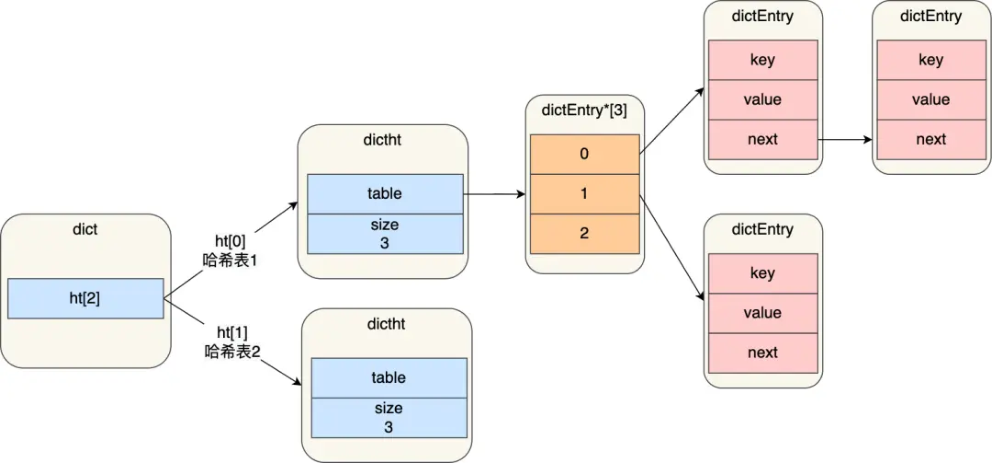
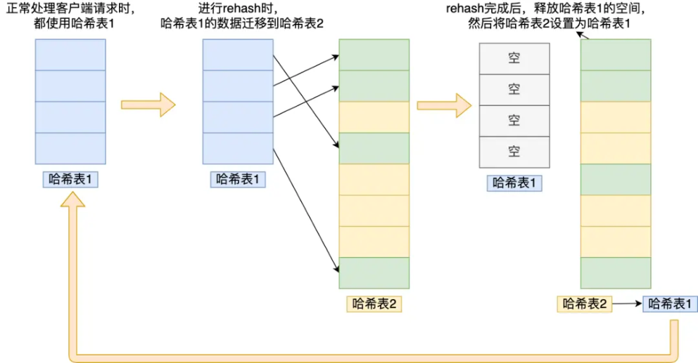
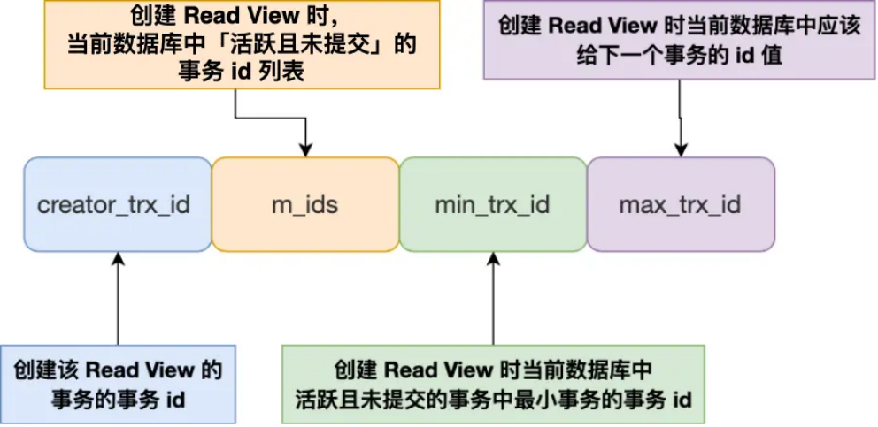
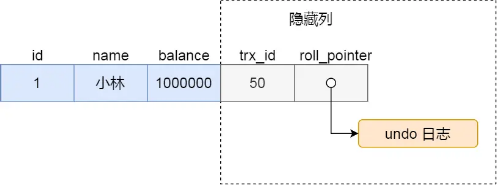
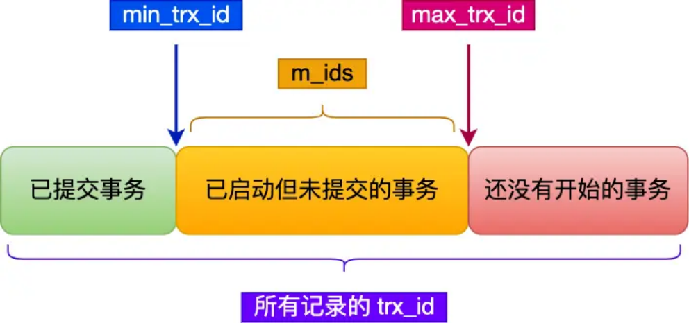

# **<u>快手面试，一直追着问我。。。</u>**

大家好，我是小林。

这段时间分享了很多校招的面经，有很多读者说想看社招的，其实社招面试是基于你的工作项目来展开问的，比如你项目用了 xxx 技术，那么面试就会追问你项目是怎么用 xxx 技术的，遇到什么难点和挑战，然后再考察一下这个 xxx 技术的原理。

今天就分享一位快手社招面经，岗位是后端开发，问题都是基于项目涉及的技术栈去展开聊的，同时最后也会有算法题。

### **项目**

自我介绍+项目介绍

就你负责比较多的项目详细说说，项目背景，data模型，流程，难点和挑战

- 讲讲项目后端用到的技术栈，比如mq，rpc，缓存啥的

消息队列用过吗，业务场景？

- 怎么保证消息的有序性？

### **Redis**

Redis有哪些数据类型

回答：String，list，map，set，Zset，stream，hyperloglog。。。

（打断）追问：map怎么扩容，扩容时会影响缓存吗

回答：底层有两个dict，一个dict负责请求，到达负载比例进行扩容，渐进式扩容，一部分一部分转移到新的dict

追问：扩容时访问key怎么处理?

回答：先从旧dict获取key，查不到的话，然后从新的dict获取key

小林补充：

进行 rehash 的时候，需要用上 2 个哈希表了。

img

在正常服务请求阶段，插入的数据，都会写入到「哈希表 1」，此时的「哈希表 2」 并没有被分配空间。

随着数据逐步增多，触发了 rehash 操作，这个过程分为三步：

- 给「哈希表 2」 分配空间，一般会比「哈希表 1」 大 2 倍；
- 将「哈希表 1」的数据迁移到「哈希表 2」 中；
- 迁移完成后，「哈希表 1」的空间会被释放，并把「哈希表 2」 设置为「哈希表 1」，然后在「哈希表 2」 新创建一个空白的哈希表，为下次 rehash 做准备。

为了方便你理解，我把 rehash 这三个过程画在了下面这张图：

img

这个过程看起来简单，但是其实第二步很有问题， **如果「哈希表 1」的数据量非常大，那么在迁移至 「哈希表 2」的时候，因为会涉及大量的数据拷贝，此时可能会对 Redis 造成阻塞，无法服务其他请求**。

为了避免 rehash 在数据迁移过程中，因拷贝数据的耗时，影响 Redis 性能的情况，所以 Redis 采用了 **渐进式 rehash**，也就是将数据的迁移的工作不再是一次性迁移完成，而是分多次迁移。

渐进式 rehash 步骤如下：

在 rehash 进行期间，每次哈希表元素进行新增、删除、查找或者更新操作时，Redis 除了会执行

- 给「哈希表 2」 分配空间；
- **在 rehash 进行期间，每次哈希表元素进行新增、删除、查找或者更新操作时，Redis 除了会执行对应的操作之外，还会顺序将「哈希表 1」中索引位置上的所有 key-value 迁移到「哈希表 2」 上**；
- 随着处理客户端发起的哈希表操作请求数量越多，最终在某个时间点会把「哈希表 1」的所有 keyvalue 迁移到「哈希表 2」，从而完成 rehash 操作。

这样就巧妙地把一次性大量数据迁移工作的开销，分摊到了多次处理请求的过程中，避免了一次性 rehash 的耗时操作。

在进行渐进式 rehash 的过程中，会有两个哈希表，所以在渐进式 rehash 进行期间，哈希表元素的删除、查找、更新等操作都会在这两个哈希表进行。比如，查找一个 key 的值的话，先会在「哈希表 1」 里面进行查找，如果没找到，就会继续到哈希表 2 里面进行找到。

另外，在渐进式 rehash 进行期间，新增一个 key-value 时，会被保存到「哈希表 2」里面，而「哈希表 1」 则不再进行任何添加操作，这样保证了「哈希表 1」的 key-value 数量只会减少，随着 rehash 操作的完成，最终「哈希表 1」就会变成空表。

跳表结构了解吗

回答：第一层是双向链表，会有多层来作为链表的索引。

追问：和二叉树有什么区别，从时间复杂度和空间复杂度分析

回答：二叉查找树的时间复杂度是O(logn)，空间复杂度是O(n)；跳表的时间复杂度是O(log_{k}n)，k为跳表索引步长，空间复杂度是O(n)

### **MySQL**

MySQL事务用过吗，应用场景是什么

自己学习的demo里用过，场景：银行转账

追问：假如是跨行转账怎么解决事务

回答：我想一想。。。

**小林补充：** 用分布式事务

（打断）追问：跨行先不说，先说不跨行，先说说单库事务，事务的4个基本特性回答：原子性，一致性，隔离性，持久性

追问：一致性指的是什么

回答：一致性指的是事务提交前后数据库状态一致，是原子性，隔离性和持久性的整合追问：隔离级别有哪几种

回答：读未提交，读已提交，可重复读，序列化

追问：可重复读是是什么意思，怎么实现的

同一个事务中多次读取结果一致。通过Read View + MVCC实现，在事务开始时创建一个Read View，之后都用这个Read View。

追问：可重复读具体实现细节

回答：Read View的结构包含（1）当前事务id，（2）active事务id列表，（3）最小active事务id记为 min_txn_id，（4）next事务id记为max_txn_id。如果record对应的事务id，小于最小active事务id，直接读；否则读取最小active事务id之前版本的数据（这块的逻辑答得有问题，用语言表达时有点混乱，可以私下多练习练习表达）

**小林补充：**

我们需要了解两个知识：

Read View 中四个字段作用；

聚簇索引记录中两个跟事务有关的隐藏列；

那 Read View 到底是个什么东西？

img

Read View 有四个重要的字段：

- m_ids：指的是在创建 Read View 时，当前数据库中「活跃事务」的 **事务 id 列表**，注意是一个列表， **“活跃事务”指的就是，启动了但还没提交的事务**。
- min_trx_id：指的是在创建 Read View 时，当前数据库中「活跃事务」中事务 **id 最小的事务**，也就是 m_ids 的最小值。
- max_trx_id：这个并不是 m_ids 的最大值，而是 **创建 Read View 时当前数据库中应该给下一个事务的 id 值**，也就是全局事务中最大的事务 id 值 + 1；
- creator_trx_id：指的是 **创建该 Read View 的事务的事务 id**。

知道了 Read View 的字段，我们还需要了解聚簇索引记录中的两个隐藏列。

假设在账户余额表插入一条小林余额为 100 万的记录，然后我把这两个隐藏列也画出来，该记录的整个示意图如下：

图片

- 对于使用 InnoDB 存储引擎的数据库表，它的聚簇索引记录中都包含下面两个隐藏列：
   - trx_id，当一个事务对某条聚簇索引记录进行改动时，就会 **把该事务的事务 id 记录在 trx_id 隐藏列里**；
   - roll_pointer，每次对某条聚簇索引记录进行改动时，都会把旧版本的记录写入到 undo 日志中，然

##### 后 **这个隐藏列是个指针，指向每一个旧版本记录**，于是就可以通过它找到修改前的记录。

在创建 Read View 后，我们可以将记录中的 trx_id 划分这三种情况：

##### img

- 一个事务去访问记录的时候，除了自己的更新记录总是可见之外，还有这几种情况：
   - 如果记录的 trx_id 值小于 Read View 中的 min_trx_id 值，表示这个版本的记录是在创建 Read View **前** 已经提交的事务生成的，所以该版本的记录对当前事务 **可见**。
   - 如果记录的 trx_id 值大于等于 Read View 中的 max_trx_id 值，表示这个版本的记录是在创建 Read View **后** 才启动的事务生成的，所以该版本的记录对当前事务 **不可见**。
- 如果记录的 trx_id 值在 Read View 的

min_trx_id

##### 和

max_trx_id

之间，需要判断 trx_id 是否在 m_ids 列表中：

- 如果记录的 trx_id **在** m_ids 列表中，表示生成该版本记录的活跃事务依然活跃着（还没提交事务），所以该版本的记录对当前事务 **不可见**。
- 如果记录的 trx_id **不在** m_ids 列表中，表示生成该版本记录的活跃事务已经被提交，所以该版本的记录对当前事务 **可见**。

MySQL binlog，redolog和undolog的区别

回答：从这三种log的功能进行分析，undolog用来做事务回滚；redolog用来处理mysql宕机（或进程挂掉）时的数据恢复；binlog记录所有的数据修改操作，可以用来做全量的数据恢复，主从复制（后一点当时没答出来）。

##### **小林补充：**
