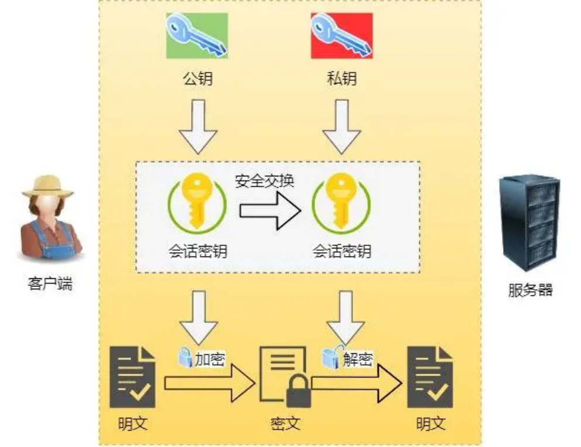

# **<u>我扛住字节面试了，太干了！</u>**

大家好，我是小林。

春招进展快 2 个月，大家都找到暑期实习了吗？今年相比往年我感觉比较卷，很少见到offer收割机的选手。

不管环境如何，持续学习这个是不能放弃的，心态也要稳一稳，坦然面对失败，失败才是常态，成功可能才是偶然的。

好了，鸡汤喝完了，那我来一点干货吧，又干又涩，毫无感情，但是又很有用。

今天分享一位读者字节后端面经，读者技术栈是C++和GO。

## **<u>语言</u>**

### **C ++， Python 哪一个更快？**

读者答：这个我不知道从哪方面说，就是 C + + 的话，它其实能够提供开发者非常多的权限，就是说它能涉及到一些操作系统级别的一些操作，速度应该挺快。然后 Python 实现功能还是蛮快的。

**小林补充：**

一般而言，C++更快一些，因为它是一种编译型语言，可以直接编译成机器码，在执行时不需要解释器的介入，因此执行效率较高。

Python是一种解释型语言，需要在运行时通过解释器将代码转换为机器码来执行，因此相对于C++而言，执行效率较低。但是Python具有很多优秀的库和框架，这些库和框架可以帮助开发人员快速开发出高效的应用程序，从而提高开发效率。

### **编译型语言和解释型语言有没有了解过**

读者答：可能 C + + 它提供的更偏机器语言一样，就是只需要进行相关的编译查找就可以。但是 Python 的话它可能是更像脚本语言，所以说在进行执行的时候还需要再进行嗯，一方面的句子语法处理，所以执行速度上会慢一些。

### **堆内存和栈内存有什么区别**

读者答：go里面的堆分配的主要是一些比较大的对象，栈里面的话可能就是分配一些临时的对象，或者是比较小的数据变量。然后如果分配的就是比如说如果申请了一个channel，或者是一个非常大的对象的话，那么它就会从默认的从栈上的空间分配到堆上，因为堆上的这空堆上的空间进行分配之后，它能保留的时间会更长一些，这大概就是栈和堆之间的一个区别。

##### **小林补充：**

1. 管理方式不同：栈内存由系统自动分配和释放，而堆内存则需要程序员手动分配和释放。
2. 分配方式不同：栈内存是一种连续的内存空间，系统会自动为每个线程分配一定大小的栈空间，函数的参数和局部变量都会在栈上分配内存。而堆内存是不连续的内存空间，程序员需要通过动态分配内存来获得堆内存空间。
3. 大小限制不同：栈内存的大小是固定的，并且比堆内存小得多。程序运行时，每个线程的栈空间通常只有几MB到几十MB，而堆内存的大小则取决于系统的剩余内存大小和程序员的动态分配。
4. 访问速度不同：栈内存的访问速度比堆内存快得多，因为栈内存是连续的，访问局部变量和函数参数时可以直接读取栈指针的偏移量。而堆内存是不连续的，访问速度较慢。

### **局部变量是放在堆还是放在栈里面？**

读者答：局部变量的话，因为它只在一个函数里面进行相关的生命周期的存在，所以应该是在栈上面的。

### **链表跟数组有哪一些区别？**

读者答：链表的长度是不固定的，对它进行相关的插入或者是删除操作是非常快的。查找需要从头到尾遍历值，效率低。

数组来说的话，数组的话是预先分配了一段固定长度的连续的内存空间，通过数组的下标索引来查找和赋值。但是如果要进行插入删除操作的话，那可能会需要就是将数据中你要插入那个位置之后的所有的数组来进行挪位，才能进行相关的插入操作，所以说它这个插入和删除的操作就会相比链表会麻烦。

##### **小林补充：**

可以提一下数组因为内存地址是连续，可以增加cpu缓存命中率，而链表的内存地址并不是连续的，cpu 缓存命中率会很低。

### **数组怎么动态扩容？**

读者答：go 的话它其实提供了一个 slice 这样子的结构，也就是说它底层维护了一个指向数组的指针， 然后还维护了一个数组的长度和一个它的空间预存的一个 CAP 的容量值。然后如果将这个当前的数组 space 的大小它是小于 1024 的话，那基本上都是 2 倍的扩容，然后如果超过 1. 2 次的大小的话，基本上是 1. 25 倍的扩容。

### **协程与我们普通的线程有什么区别？**

读者答：协程可以理解为用户级别的线程，所以说在大小方面和调度方面都是比进程要更加的方便和简便的。

##### **小林补充：**

1. 调度方式不同：线程是由操作系统调度的，而协程则是由程序员控制的。当一个线程被调度时，它会被操作系统挂起，等待下一次调度。而协程则是由程序员在代码中主动调用的，可以在不同的任务之间切换，而不需要等待操作系统的调度。
2. 系统资源占用不同：线程是操作系统管理的实体，它占用系统资源比较大，包括内存、线程栈、 CPU 时间片等。而协程则是在用户空间中实现的，不需要操作系统的支持，因此占用的资源比较少。
3. 切换成本不同：线程的切换需要保存和恢复线程上下文，需要耗费一定的时间和资源。而协程的切换只需要保存和恢复栈帧等少量数据，因此切换成本比线程低。
4. 编程模型不同：线程是面向操作系统的，而协程是面向任务的。线程需要使用操作系统提供的 API 进行线程间通信和同步，而协程则可以使用语言级别的协程库实现协作式多任务。

### **协程的的通讯有哪些方式？**

读者答：不清楚，go 使用时，可能会配合 channel 来进行使用，起一个死循环，监听不同的信号量进行处理。还是说是指那个 GMP 的模型？

##### **小林补充：**

1. 共享内存：协程通过共享内存来交换数据，这种方式简单直接，但需要考虑同步和互斥问题，否则会出现数据竞争等问题。
2. 消息传递：协程通过消息队列等方式来传递数据，这种方式可以避免数据竞争等问题，但需要考虑消息的发送和接收顺序等问题。
3. 信号量：协程通过信号量等方式来实现同步和互斥，这种方式需要考虑好信号量的数量和使用顺序，否则会出现死锁等问题。

### **常规的多线程开发需要注意哪一些问题？**

读者答：场景考虑，你这个线程是不可以就是无限制的创建的吗？而且创建线程是需要开销的，所以一般是会使用线程池这样的方式，先预先创建好一些已经分配好的线程资源，然后有需要用的话就先进行相关的使用，然后这个线程池也负责了一些GC 的处理。

线程池里面大概要开多少的线程数量，这个线程数量的话就会跟你的任务相关。CPU 密集型根据CPU 的核数或者和任务执行的有关的时间来进行这个线程数量的考虑。

### **读写共享变量会遇到什么问题？**

读者答：并发访问

### **什么是死锁？**

读者答：两个或多个进程之间他们都在等待一些资源，然后没有办法完全释放现在已经占有的资源，但是他们需要的资源的话又被其他的进程所占有着，同时这一整个过程中你又没有办法去抢占，造成了一个循环等待的情况（请求保持，互斥，不可剥夺，循环等待）

### **如何避免出现死锁，怎么排查？**

读者答：加锁或者channel，打断点，加日志信息。

**小林补充：**

避免死锁：

- 按照固定的顺序获取锁：按照固定的顺序获取锁可以避免死锁的发生。例如，如果A线程先获取了锁1，再获取锁2，那么B线程就应该先获取锁2，再获取锁1。
- 设置超时时间：在获取锁的过程中，可以设置超时时间，如果超过一定时间还没有获取到锁，就放弃获取锁，避免因等待锁而导致的死锁。

排查方式：

- 使用工具：可以使用一些工具来帮助检测和定位死锁问题，例如jstack和jconsole等。 分析日志：可以分析系统日志和线程日志，查看是否有线程在等待某个锁，从而找出可能导致死锁的原因。
- 代码检查：可以检查代码中是否存在多个线程竞争同一个锁的情况，是否存在锁的嵌套等问题，从而找出可能导致死锁的原因。

## **<u>密码学和计网</u>**

### **用到过哪些加密算法？**

读者答：

Sha256 或者是 MD5 这样子的加密算法。不能还原成原来的数据，用来比较数据是否一致。 对称和非对称的加密算法RSA

##### **小林补充：**

1. 对称加密算法：如DES、3DES、AES等，使用相同的秘钥加密和解密数据，加解密速度快，但秘钥管理困难。
2. 非对称加密算法：如RSA、ECC等，使用公钥加密数据，私钥解密数据，安全性高，但加解密速度较慢。
3. 哈希算法：如MD5、SHA-1、SHA-256等，将任意长度的数据映射成固定长度的哈希值，不可逆、 不可篡改，主要用于数据完整性校验。
4. 消息认证码（MAC）：如HMAC、CMAC等，将消息和秘钥混合处理生成固定长度的认证码，用于防止数据被篡改。
5. 数字签名算法：如RSA、DSA等，将消息和私钥混合处理生成数字签名，用于验证消息的来源和完整性。

### **对称和非对称的加密算法的区别，具体讲讲非对称**

读者答：对称的话它是有一个公钥和一个私钥的，然后私钥的话是只有自己持有的，这样子的话那他别人其实不会获取到你的CL，然后你通过一个嗯可信的第三方来进行相关的妙加密。这样子的话别人只需要通过你的公钥来进行一下获取你的公钥来进行你传输内容的加解密就可以，然后来保证这样子的一个数据的安全性。

### **HTTP和HTTPS有什么区别？**

读者答：因为HTTP是明文传输的，然后 HTTPS 的话就是在这样的基础上增加SSL的一些加密的保护，来保证它传输消息的安全性。

##### **小林补充：**

- HTTP 是超文本传输协议，信息是明文传输，存在安全风险的问题。HTTPS 则解决 HTTP 不安全的缺陷，在 TCP 和 HTTP 网络层之间加入了 SSL/TLS 安全协议，使得报文能够加密传输。
- HTTP 连接建立相对简单， TCP 三次握手之后便可进行 HTTP 的报文传输。而 HTTPS 在 TCP 三次握手之后，还需进行 SSL/TLS 的握手过程，才可进入加密报文传输。
- 两者的默认端口不一样，HTTP 默认端口号是 80，HTTPS 默认端口号是 443。
- HTTPS 协议需要向 CA（证书权威机构）申请数字证书，来保证服务器的身份是可信的。

### **怎么去使用这些加密算法？**

读者答：混合使用对称和非对称加密算法，会话密钥是对称的，获取的过程是非对称的。

**小林补充：**

通过 **混合加密** 的方式可以保证信息的 **机密性**，解决了窃听的风险。

混合加密

HTTPS 采用的是 **对称加密** 和 **非对称加密** 结合的「混合加密」方式：

   - 在通信建立前采用 **非对称加密** 的方式交换「会话秘钥」，后续就不再使用非对称加密。 在通信过程中全部使用 **对称加密** 的「会话秘钥」的方式加密明文数据。
- 采用「混合加密」的方式的原因：
- **对称加密** 只使用一个密钥，运算速度快，密钥必须保密，无法做到安全的密钥交换。
- **非对称加密** 使用两个密钥：公钥和私钥，公钥可以任意分发而私钥保密，解决了密钥交换问题但速度慢。

### **TCP 跟 UDP有什么区别？**

读者答：TCP 的话它提供了一系列的可靠传输机制来保证它这个传输是可靠的，相较而言的话，那它的传输速度就是慢的，而UDP 的话，它没有做这个可靠的控制，它只是尽力而为，所以说它的传输速度是快的，而且占用的资源也会更小一些。具体使用的话要看不同的那个业务场景来进行相关的使用。

### **UDP 怎么改造变为可靠传输？**

读者答：应用层加序列号和ACK。然后本地会缓存一些自己已经发过的消息，然后同时也要求对方在收到消息之后返回 ACK 来确认这个消息已经收到，如果没有收到 ACK 的话，可能会设置一些定时重传的这样的一些方式，来确保这个消息能够成功的发送到对方。

**小林补充：**
