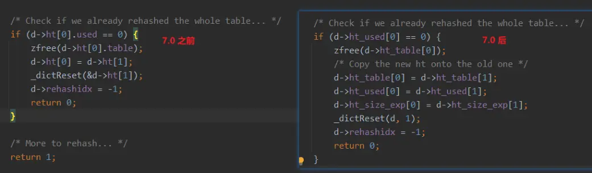
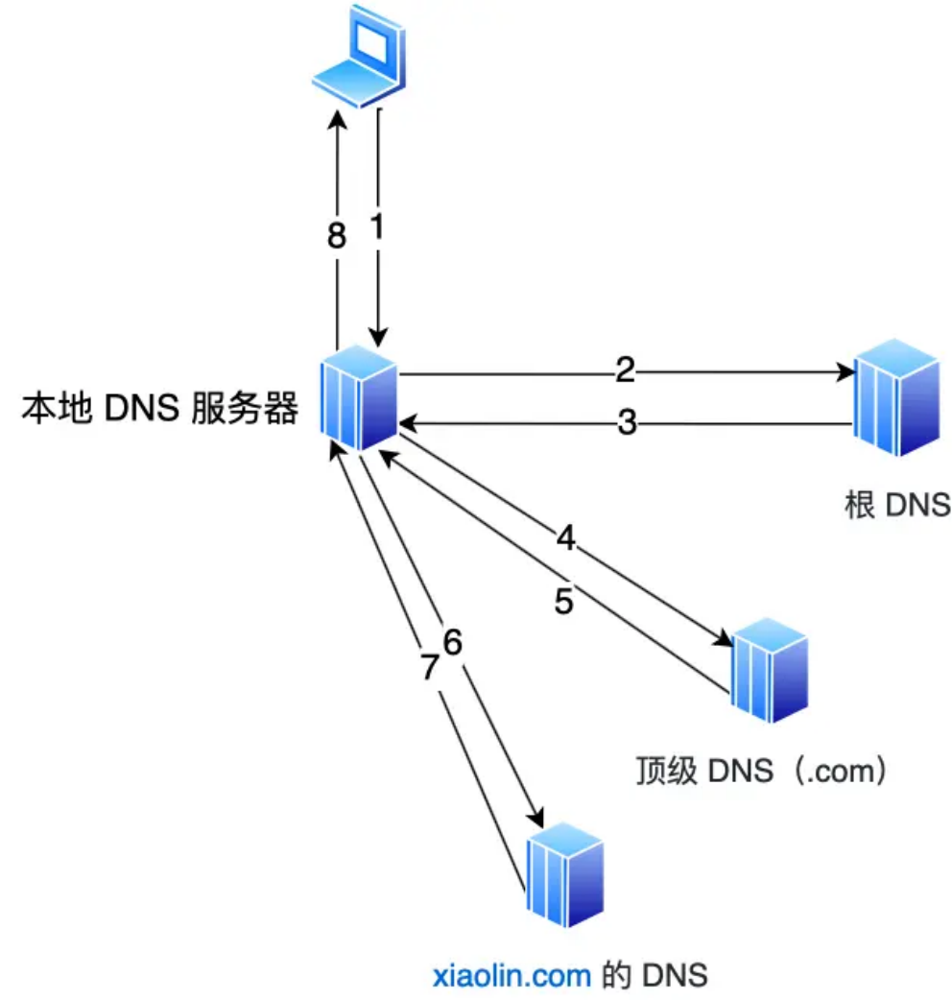
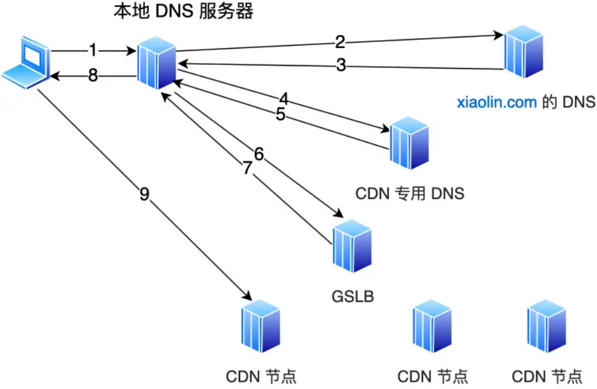
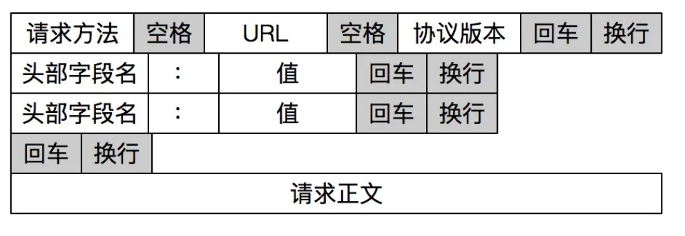

# **<u>腾讯二面顶住了！评价反馈不错</u>**

大家好，我是小林。

分享一篇腾讯春招二面面经，岗位是C++后端，考察的内容是C++、Redis、网络。

## **<u>c++</u>**

### **shared_ptr的原理**

答：内部的共享数据和引用计数实现

##### **补充：**

shared_ptr多个指针指向相同的对象。shared_ptr使用引用计数，每一个shared_ptr的拷贝都指向相同的内存。每使用他一次，内部的引用计数加1，每析构一次，内部的引用计数减1，减为0时，自动删除所指向的堆内存。shared_ptr内部的引用计数是线程安全的，但是对象的读取需要加锁。

shared_ptr的一个最大的陷阱是循环引用，循环引用会导致堆内存无法正确释放，导致内存泄漏，可以通过 weak_ptr 来解决这个问题。

### **多线程怎么保证引用计数的安全的**

答：引用计数这个变量是std::atomic，操作时自带锁

### **常见的锁有哪些**

答：读写锁、互斥锁这些，再就是一些锁思想，比如乐观锁、悲观锁、自旋锁

### **valotile关键字的用处**

答：避免编译器额外优化

## **<u>Redis</u>**

### **微博上的热度排行榜用什么数据结构**

答：Zset，讲了讲zrangebyscore

##### **补充：**

Zset 类型（Sorted Set，有序集合） 可以根据元素的权重来排序，我们可以自己来决定每个元素的权重值。比如说，我们可以根据元素插入 Sorted Set 的时间确定权重值，先插入的元素权重小，后插入的元素权重大。

在面对需要展示最新列表、排行榜等场景时，如果数据更新频繁或者需要分页显示，可以优先考虑使用 Sorted Set。

有序集合比较典型的使用场景就是排行榜。例如学生成绩的排名榜、游戏积分排行榜、视频播放排名、 电商系统中商品的销量排名等。

我们以博文点赞排名为例，小林发表了五篇博文，分别获得赞为 200、40、100、50、150。

> # arcticle:1 文章获得了200个赞

> > ZADD user:xiaolin:ranking 200 arcticle:1 (integer) 1

> # arcticle:2 文章获得了40个赞

> ZADD user:xiaolin:ranking 40 arcticle:2 (integer) 1 # arcticle:3 文章获得了100个赞 > ZADD user:xiaolin:ranking 100 arcticle:3 (integer) 1 # arcticle:4 文章获得了50个赞 > ZADD user:xiaolin:ranking 50 arcticle:4 (integer) 1 # arcticle:5 文章获得了150个赞 > ZADD user:xiaolin:ranking 150 arcticle:5 (integer) 1

文章 arcticle:4 新增一个赞，可以使用 ZINCRBY 命令（为有序集合key中元素member的分值加上 increment）：

> ZINCRBY user:xiaolin:ranking 1 arcticle:4 "51"

查看某篇文章的赞数，可以使用 ZSCORE 命令（返回有序集合key中元素个数）：

> ZSCORE user:xiaolin:ranking arcticle:4 "50"

获取小林文章赞数最多的 3 篇文章，可以使用 ZREVRANGE 命令（倒序获取有序集合 key 从start下标到 stop下标的元素）：

# WITHSCORES 表示把 score 也显示出来 > ZREVRANGE user:xiaolin:ranking 0 2 WITHSCORES 1) "arcticle:1" 2) "200" 3) "arcticle:5" 4) "150" 5) "arcticle:3" 6) "100"

获取小林 100 赞到 200 赞的文章，可以使用 ZRANGEBYSCORE 命令（返回有序集合中指定分数区间内的成员，分数由低到高排序）：

> ZRANGEBYSCORE user:xiaolin:ranking 100 200 WITHSCORES 1) "arcticle:3" 2) "100" 3) "arcticle:5" 4) "150" 5) "arcticle:1" 6) "200"

### **rehash的过程讲一下**

答：新旧表双写，逐渐迁移

##### **补充：**

为了避免 rehash 在数据迁移过程中，因拷贝数据的耗时，影响 Redis 性能的情况，所以 Redis 采用了 **渐进式 rehash**，也就是将数据的迁移的工作不再是一次性迁移完成，而是分多次迁移。

渐进式 rehash 步骤如下：

在 rehash 进行期间，每次哈希表元素进行新增、删除、查找或者更新操作时，Redis 除了会执行

- 给「哈希表 2」 分配空间，一般会比「哈希表 1」 大 2 倍；
- 在 rehash 进行期间，每次哈希表元素进行新增、删除、查找或者更新操作时，Redis 除了会执行对应的操作之外，还会顺序将「哈希表 1」中索引位置上的所有 key-value 迁移到「哈希表 2」 上；
- 随着处理客户端发起的哈希表操作请求数量越多，最终在某个时间点会把「哈希表 1」的所有 keyvalue 迁移到「哈希表 2」，从而完成 rehash 操作。

这样就巧妙地把一次性大量数据迁移工作的开销，分摊到了多次处理请求的过程中，避免了一次性 rehash 的耗时操作。

在进行渐进式 rehash 的过程中，会有两个哈希表，所以在渐进式 rehash 进行期间，哈希表元素的删除、查找、更新等操作都会在这两个哈希表进行。

比如，查找一个 key 的值的话，先会在「哈希表 1」 里面进行查找，如果没找到，就会继续到哈希表 2 里面进行找到。

另外，在渐进式 rehash 进行期间，新增一个 key-value 时，会被保存到「哈希表 2」里面，而「哈希表 1」 则不再进行任何添加操作，这样保证了「哈希表 1」的 key-value 数量只会减少，随着 rehash 操作的完成，最终「哈希表 1」就会变成空表。

### **迁移过程中老表是什么时候释放，怎么知道老表可以释放了**

答：通过数据长度

##### **补充：**

每个 hash table 都有存着一个 used 字段，每次单步 rehash 完成的时候，最后都会检查老表即 ht[0].used 是否变成了 0，变成 0 后，就说明老的哈希表里已经没有数据了，此时就会去 free 掉老表， 交换老表新表的指针，rehashidx 置为 -1，然后就完成了整个 rehash。

## **<u>网络</u>**

### **不同地区的用户的请求怎么打到附近的地区呢？**

答：讲了CDN

##### **补充：**

CDN 将内容资源分发到位于多个地理位置机房中的服务器上，这样我们在访问内容资源的时候，不用访问源服务器。而是直接访问离我们最近的 CDN 节点，这样一来就省去了长途跋涉的时间成本，从而实现了网络加速。

找到离用户最近的 CDN 节点是由 CDN 的 **全局负载均衡器（*Global Sever Load Balance，GSLB*）** 负责的。

那 GSLB 是在什么时候起作用的呢？在回答这个问题前，我们先来看看在没有 CDN 的情况下，访问域名时发生的事情。

在没有 CDN 的情况下，当我们访问域名时，DNS 服务器最终会返回源服务器的地址。

比如，当我们在浏览器输入 <u>www.xiaolin.com</u> 域名后，在本地 host 文件找不到域名时，客户端就会访问本地 DNS 服务器。

##### 图片

这时候:

- 如果本地 DNS 服务器有缓存该网站的地址，则直接返回网站的地址； 如果没有就通过递归查询的方式，先请求根 DNS，根 DNS 返回顶级 DNS（.com）的地址；再请求 .com 顶级 DNS 得到 xiaolin.com 的域名服务器地址，再从 xiaolin.com 的域名服务器中查询到 <u>www.xiaolin.com</u> 对应的 IP 地址，然后返回这个 IP 地址，同时本地 DNS 缓存该 IP 地址，这样下一次的解析同一个域名就不需要做 DNS 的迭代查询了。

**但加入 CDN 后就不一样了**。

图片

会在 xiaolin.com 这个 DNS 服务器上，设置一个 CNAME 别名，指向另外一个域名 <u>www.xiaolin.cdn.co m，返回给本地 DNS 服务器。</u>

接着继续解析该域名，这个时候访问的就是 xiaolin.cdn.com 这台 CDN 专用的 DNS 服务器，在这个服务器上，又会设置一个 CNAME，指向另外一个域名，这次指向的就是 CDN 的 GSLB。

接着，本地 DNS 服务器去请求 CDN 的 GSLB 的域名，GSLB 就会为用户选择一台合适的 CDN 节点提供服务，选择的依据主要有以下几点：

查询 CDN 节点的负载情况，找负载较轻的节点；

- 看用户的 IP 地址，查表得知地理位置，找相对最近的 CDN 节点；
- 看用户所在的运营商网络，找相同网络的 CDN 节点；
- 看用户请求 URL，判断哪一台服务器上有用户所请求的资源；
- 查询 CDN 节点的负载情况，找负载较轻的节点；

GSLB 会基于以上的条件进行综合分析后，找出一台最合适的 CDN 节点，并返回该 CDN 节点的 IP 地址给本地 DNS 服务器，然后本地 DNS 服务器缓存该 IP 地址，并将 IP 返回给客户端，客户端去访问这个 CDN 节点，下载资源。

### **TCP的close_wait在哪端，如果我们场景中出现了大量的 close_wait，你觉得要怎么排查**

答：被动方，代码逻辑有问题，没close

##### **补充：**

CLOSE_WAIT 状态是「被动关闭方」才会有的状态，而且如果「被动关闭方」没有调用 close 函数关闭连接，那么就无法发出 FIN 报文，从而无法使得 CLOSE_WAIT 状态的连接转变为 LAST_ACK 状态。

##### 所以， **当服务端出现大量 CLOSE_WAIT 状态的连接的时候，说明服务端的程序没有调用 close 函数关闭连接**。

那什么情况会导致服务端的程序没有调用 close 函数关闭连接？这时候通常需要排查代码。

我们先来分析一个普通的 TCP 服务端的流程：

1. 创建服务端 socket，bind 绑定端口、listen 监听端口
2. 将服务端 socket 注册到 epoll
3. epoll_wait 等待连接到来，连接到来时，调用 accpet 获取已连接的 socket
4. 将已连接的 socket 注册到 epoll
5. epoll_wait 等待事件发生
6. 对方连接关闭时，我方调用 close

可能导致服务端没有调用 close 函数的原因，如下。

**第一个原因**：第 2 步没有做，没有将服务端 socket 注册到 epoll，这样有新连接到来时，服务端没办法感知这个事件，也就无法获取到已连接的 socket，那服务端自然就没机会对 socket 调用 close 函数了。

不过这种原因发生的概率比较小，这种属于明显的代码逻辑 bug，在前期 read view 阶段就能发现的了。

**第二个原因**：第 3 步没有做，有新连接到来时没有调用 accpet 获取该连接的 socket，导致当有大量的客户端主动断开了连接，而服务端没机会对这些 socket 调用 close 函数，从而导致服务端出现大量 CLOSE_WAIT 状态的连接。

发生这种情况可能是因为服务端在执行 accpet 函数之前，代码卡在某一个逻辑或者提前抛出了异常。

**第三个原因**：第 4 步没有做，通过 accpet 获取已连接的 socket 后，没有将其注册到 epoll，导致后续收到 FIN 报文的时候，服务端没办法感知这个事件，那服务端就没机会调用 close 函数了。

发生这种情况可能是因为服务端在将已连接的 socket 注册到 epoll 之前，代码卡在某一个逻辑或者提前抛出了异常。之前看到过别人解决 close_wait 问题的实践文章，感兴趣的可以看看：一次 Netty 代码不 <u>健壮导致的大量 CLOSE_WAIT 连接原因分析</u>

**第四个原因**：第 6 步没有做，当发现客户端关闭连接后，服务端没有执行 close 函数，可能是因为代码漏处理，或者是在执行 close 函数之前，代码卡在某一个逻辑，比如发生死锁等等。

可以发现， **当服务端出现大量 CLOSE_WAIT 状态的连接的时候，通常都是代码的问题，这时候我们需要针对具体的代码一步一步的进行排查和定位，主要分析的方向就是服务端为什么没有调用 close**。

### **TCP粘包问题怎么解决**

答：特殊标记

追问：打断，如果使用特殊标记解决会遇到什么问题

答：正文转义字符

##### **补充：**

1、固定长度的消息

这种是最简单方法，即每个用户消息都是固定长度的，比如规定一个消息的长度是 64 个字节，当接收方接满 64 个字节，就认为这个内容是一个完整且有效的消息。

但是这种方式灵活性不高，实际中很少用。

##### 2、特殊字符作为边界

我们可以在两个用户消息之间插入一个特殊的字符串，这样接收方在接收数据时，读到了这个特殊字符，就把认为已经读完一个完整的消息。

HTTP 是一个非常好的例子。

##### 图片

HTTP 通过设置回车符、换行符作为 HTTP 报文协议的边界。

有一点要注意，这个作为边界点的特殊字符，如果刚好消息内容里有这个特殊字符，我们要对这个字符转义，避免被接收方当作消息的边界点而解析到无效的数据。

##### 3、自定义消息结构

我们可以自定义一个消息结构，由包头和数据组成，其中包头包是固定大小的，而且包头里有一个字段来说明紧随其后的数据有多大。

比如这个消息结构体，首先 4 个字节大小的变量来表示数据长度，真正的数据则在后面。

struct { u_int32_t message_length; char message_data[]; } message;

当接收方接收到包头的大小（比如 4 个字节）后，就解析包头的内容，于是就可以知道数据的长度，然后接下来就继续读取数据，直到读满数据的长度，就可以组装成一个完整到用户消息来处理了。

### **protobuf了解吗**

答：不了解

##### **补充：**

Protobuf 是用于数据序列化和反序列化的格式，类似于 json。但它们有以下几点区别：

- 数据大小：Protobuf是一种二进制格式，相对于JSON来说，数据大小更小，序列化和反序列化的效率更高，因此在网络传输和存储方面具有一定的优势。
- 性能：由于Protobuf是二进制格式，相对于JSON来说，解析速度更快，占用的CPU和内存资源更
- 少，因此在高并发场景下，性能更优。
- 可读性：JSON是一种文本格式，可读性更好，易于调试和排查问题。而Protobuf是一种二进制格式，可读性较差。

Protobuf适用于高性能、大数据量、高并发等场景，而JSON适用于数据交换、易读性要求高的场景。

### **说一下代码里使用异步的思路**

答：举了个客户端异步connect，使用select检测结果的例子

### **顺势问select/epoll的区别**

答：常规八股回答

##### **补充：**

select 和 poll 的缺陷在于，当客户端越多，也就是 Socket 集合越大，Socket 集合的遍历和拷贝会带来很大的开销，因此也很难应对 C10K。

epoll 是解决 C10K 问题的利器，通过两个方面解决了 select/poll 的问题。

- epoll 在内核里使用「红黑树」来关注进程所有待检测的 Socket，红黑树是个高效的数据结构，增删改一般时间复杂度是 O(logn)，通过对这棵黑红树的管理，不需要像 select/poll 在每次操作时都传入整个 Socket 集合，减少了内核和用户空间大量的数据拷贝和内存分配。
- epoll 使用事件驱动的机制，内核里维护了一个「链表」来记录就绪事件，只将有事件发生的 Socket 集合传递给应用程序，不需要像 select/poll 那样轮询扫描整个集合（包含有和无事件的 Socket），大大提高了检测的效率。

### **IO特别密集时epoll效率还高吗**

答：可以考虑select/poll，这种情况轮询也很高效，且结构简单。

##### **补充：**

可以先解释io特别密集时为什么 epoll 效率不高。原因是：

- 连接密集（短连接特别多），使用epoll的话，每一次连接需要发生epoll_wait->accpet->epoll_ctl 调用，而使用select只需要select->accpet，减少了一次系统调用。
- 读写密集的话，如果收到数据，我们需要响应数据的话，使用epoll的情况下， read 完后也需要 epoll_ctl 加入写事件，相比select多了一次系统调用

### **讲一讲ET模式**

答：常规八股回答

##### **补充：**

epoll 支持两种事件触发模式，分别是边缘触发（edge-triggered，ET）和水平触发（level-triggered， LT）。

这两个术语还挺抽象的，其实它们的区别还是很好理解的。

- 使用边缘触发模式时，当被监控的 Socket 描述符上有可读事件发生时， **服务器端只会从**

**epoll_wait 中苏醒一次**，即使进程没有调用 read 函数从内核读取数据，也依然只苏醒一次，因此我们程序要保证一次性将内核缓冲区的数据读取完；

- 使用水平触发模式时，当被监控的 Socket 上有可读事件发生时， **服务器端不断地从 epoll_wait 中苏醒，直到内核缓冲区数据被 read 函数读完才结束**，目的是告诉我们有数据需要读取；

举个例子，你的快递被放到了一个快递箱里，如果快递箱只会通过短信通知你一次，即使你一直没有去取，它也不会再发送第二条短信提醒你，这个方式就是边缘触发；如果快递箱发现你的快递没有被取出，它就会不停地发短信通知你，直到你取出了快递，它才消停，这个就是水平触发的方式。

这就是两者的区别，水平触发的意思是只要满足事件的条件，比如内核中有数据需要读，就一直不断地把这个事件传递给用户；而边缘触发的意思是只有第一次满足条件的时候才触发，之后就不会再传递同样的事件了。

如果使用水平触发模式，当内核通知文件描述符可读写时，接下来还可以继续去检测它的状态，看它是否依然可读或可写。所以在收到通知后，没必要一次执行尽可能多的读写操作。

如果使用边缘触发模式，I/O 事件发生时只会通知一次，而且我们不知道到底能读写多少数据，所以在收到通知后应尽可能地读写数据，以免错失读写的机会。因此，我们会 **循环** 从文件描述符读写数据，那么如果文件描述符是阻塞的，没有数据可读写时，进程会阻塞在读写函数那里，程序就没办法继续往下执行。所以， **边缘触发模式一般和非阻塞 I/O 搭配使用**，程序会一直执行 I/O 操作，直到系统调用（如 read 和 write）返回错误，错误类型为 EAGAIN 或 EWOULDBLOCK。

一般来说，边缘触发的效率比水平触发的效率要高，因为边缘触发可以减少 epoll_wait 的系统调用次数，系统调用也是有一定的开销的的，毕竟也存在上下文的切换。

### **对于一个后端服务怎么提升性能**

回答：讲了存储层面的使用中间缓存、网络框架设计优化

追问：提示长连接短连接

追问：怎么避免拷贝呢，不同的层面说说

- 回答：C++移动语义、零拷贝

追问：零拷贝的使用场景

追问：kafka了解吗

- 回答：不了解

追问：建议关注一下kafka，很快很好用

## **<u>算法</u>**

手撕：合并两个有序链表

## **<u>感受</u>**

基础问题大部分还好，面试官最后评价还不错。
