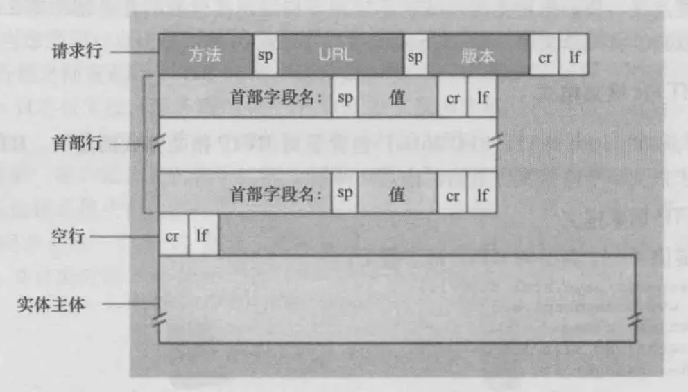

# **<u>感觉被榨干了，被美团拷打一小时！</u>**

大家好，我是小林。

上一次分享了 C++ 面经，这次就来分享 Java 同学的面经理。

今天是美团春招实习的 Java 岗的面经，总共被问了接近 50 个八股文，问了非常多 Java 框架和 Java 并发的问题

面试时长超过了 1 个小时，感觉被榨干了。

## **<u>MySQL</u>**

### **可重复读和已提交读隔离级别表现的现象是什么，区别是什么样的？**

已提交读只能读取其他事务已经提交的数据，但是这个隔离级别就会造成一个不可重复读和幻读的现象，可重复读就是消除了不可重复读和幻读的现象。

**补充：**

- 读提交，指一个事务提交之后，它做的变更才能被其他事务看到，会有不可重复读、幻读的问题。 可重复读，指一个事务执行过程中看到的数据，一直跟这个事务启动时看到的数据是一致的， MySQL InnoDB 引擎的默认隔离级别，解决了不可重复读的问题，并且以很大程度上避免幻读现象的发生。

### **数据文件大体分成哪几种数据文件？**

因为是聚簇索引，所以只有一个文件，索引和数据是放在一起的，就是一个bd文件。

**补充：** 我们每创建一个 database（数据库） 都会在 /var/lib/mysql/ 目录里面创建一个以 database 为名的目录，然后保存表结构和表数据的文件都会存放在这个目录里。

比如，我这里有一个名为 my_test 的 database，该 database 里有一张名为 t_order 数据库表。

然后，我们进入 /var/lib/mysql/my_test 目录，看看里面有什么文件？

[root@xiaolin ~]#ls /var/lib/mysql/my_test db.opt t_order.frm t_order.ibd

可以看到，共有三个文件，这三个文件分别代表着：

- db.opt，用来存储当前数据库的默认字符集和字符校验规则。
- t_order.frm，t_order 的表结构会保存在这个文件。在 MySQL 中建立一张表都会生成一个.frm 文件，该文件是用来保存每个表的元数据信息的，主要包含表结构定义。
- t_order.ibd，t_order 的表数据会保存在这个文件。表数据既可以存在共享表空间文件（文件名： ibdata1）里，也可以存放在独占表空间文件（文件名：表名字.ibd）。这个行为是由参数 innodb_file_per_table 控制的，若设置了参数 innodb_file_per_table 为 1，则会将存储的数据、 索引等信息单独存储在一个独占表空间，从 MySQL 5.6.6 版本开始，它的默认值就是 1 了，因此从这个版本之后， MySQL 中每一张表的数据都存放在一个独立的 .ibd 文件。

### **mysql日志文件是分成了哪几种？**

mysql有三种日志文件，binlog，redolog和undolog。

##### **补充：**

- redo log 重做日志，确保事务的持久性

志

- undo log 回滚日志，确保事务的原子性，用于回滚事务，同时提供mvcc下的非锁定读 bin log 二进制日志，用于主从复制场景下，记录master做过的操作
- relay log 中继日志，用于主从复制场景下，slave通过io线程拷贝master的bin log后本地生成的日志
- 慢查询日志，用于记录执行时间过长的sql，需要设置阈值后手动开启

### **说下MVCC机制的原理？**

MVCC就是多版本并发控制，实现了读写的并发控制，在mysql通过readview 隐藏字段和undolog实现了，比如在可重复读里面，比如开启了一个事务，就生成了一个readview，然后记录现在active的事务，判断查询的数据在这个事务可不可读。

### **索引的类型有哈希索引，B+树索引，而hash索引的时间复杂度是 o1，那为什么我们一般情况下不使用哈希索引，而使用b+树索引呢？**

因为hash索引只能做一个等值查询，像范围查询是做不到的。还有哈希可能会出现hash碰撞的问题。

### **还能想到其他的原因吗？**

想不到了

##### **补充：**

- 哈希索引的key是经过hash运算得出的，即跟实际数据的值没有关系，因此哈希索引不适用于范围查询和排序操作

容易导致全表扫描，因为可能存在不同的key经过hash运算后值相同

索引列上的值相同的话，易造成hash冲突，效率低下

### **对一个慢sql怎么去排查？**

如果是在项目中，可以通过SpringAOP去查询这个接口运行的时间，如果是一个sql，可以通过explain 的指令去查这个sql的执行计划。

**补充：**

可通过开启mysql的慢日志查询，设置好时间阈值，进行捕获

### **索引字段是不是建的越多越好**

不是，建的的越多会占用越多的空间

##### **补充：**

索引越多，在写入频繁的场景下，对于B+树的维护所付出的性能消耗也会越大

## **<u>网络</u>**

### **http协议的报文的格式有了解吗？**

不是太清楚，有报文头，报文体，如果是post请求就会在报文体写上数据。

##### **补充：**

HTTP 请求报文结构

HTTP 的请求报文分为三个部分：

请求行、首部行、实体主体。

### **http常用的状态码？**

4XX是请求报文有误，5XX是服务器有错，2XX是成功的。3XX忘了（是重定向

**补充：**

RFC 规定 HTTP 的状态码为三位数，被分为五类：

- **1xx**：表示目前是协议处理的中间状态，还需要后续操作
- **2xx**：表示成功状态
- **3xx**：重定向状态，资源位置发生变动，需要重新请求
- **4xx**：请求报文有误
- **5xx**：服务端发生错误

## **<u>Java框架</u>**

### **java这一块对框架都是熟悉的吧？**

只用过SSM，SpringBoot还在学中。

### **MyBatis运用了哪些常见的设计模式？**

运用了工厂模式，创建sqlsession的时候用了工厂模式，其他的没想起来。

##### **补充：**

- 工厂模式，工厂模式在 MyBatis 中的典型代表是 SqlSessionFactory 建造者模式，建造者模式在 MyBatis 中的典型代表是 SqlSessionFactoryBuilder
- 单例模式，单例模式在 MyBatis 中的典型代表是 ErrorContext
- 适配器模式，适配器模式在 MyBatis 中的典型代表是 Log
- 代理模式，代理模式在 MyBatis 中的典型代表是 MapperProxyFactory
- 模板方法模式，模板方法在 MyBatis 中的典型代表是 BaseExecutor
- 装饰器模式，装饰器模式在 MyBatis 中的典型代表是 Cache

### **MyBatis中创建了一个Mapper接口，在写一个xml文件，java的接口是要实现的，为什么这没有实现呢？**

（现在回想起来，是要诱导我说动态代理）一个mapper接口通过namespace的id对应的就是一个xml的文件。没了解背后的原理

##### **补充：**

MyBatis中的Mapper接口并不需要实现，它只是定义了一组方法签名。MyBatis会根据Mapper接口中的方法名、参数类型和返回值类型，自动生成实现方法。因此，Mapper接口中的方法不需要实现，也不需要在该接口中编写任何方法体。

相反，你需要编写一个与Mapper接口同名的XML文件，来实现这些方法的具体SQL操作。这样，当你在 Java代码中调用Mapper接口中的方法时，MyBatis会自动将该方法映射到对应的XML文件中的SQL语句，并执行该语句。

### **与传统的JDBC相比，MyBatis的优点？**

有些功能封装的更好，像打开一个sqlsession的连接，而且写的代码要少

##### **补充：**

- mybatis的全局配置文件中可以设置数据库连接池，和spring整合可以配置数据库连接 mybatis把sql和代码分离，提供了Mapper.xml映射文件，在映射文件中通过标签来写sql mybatis中自动完成java对象和sql中参数的映射
- mybatis中通过ResultSetHandler自动将结果集映射到对应的java对象中

### **还记得JDBC连接数据库的步骤吗？**

不记得了，太久没用JDBC

##### **补充：**

使用JDBC连接数据库的步骤如下：

- 加载数据库驱动程序：使用Class.forName()方法加载对应的数据库驱动程序，例如： Class.forName("com.mysql.jdbc.Driver");
- 建立数据库连接：使用DriverManager.getConnection()方法建立与数据库的连接，需要指定数据库的URL、用户名和密码，例如：Connection conn =
- DriverManager.getConnection("jdbc:mysql://localhost/mydatabase", "username", "password");
- 创建Statement对象：使用Connection对象的createStatement()方法创建一个Statement对象，用于执行SQL语句，例如：Statement stmt = conn.createStatement();
- 执行SQL语句：使用Statement对象的executeQuery()或executeUpdate()方法执行SQL语句，例如：ResultSet rs = stmt.executeQuery("SELECT * FROM mytable");
- 处理查询结果：如果执行的是查询语句，需要使用ResultSet对象来处理查询结果，例如：while (rs.next()) { String name = rs.getString("name"); int age = rs.getInt("age"); }
- 关闭数据库连接：在程序结束时，需要使用Connection对象的close()方法关闭数据库连接，例如： conn.close();

### **怎么理解SpringIoc？**

SpringIoc就是控制反转，把创建对象的权力交给了框架，然后Spring通过反射就会创建一个对象。当我创建的一个类要用到这个对象，Spring就会把这个对象交给我。

### **如果让你设计一个SpringIoc，你觉得会从哪些方面考虑这个设计？**

- 多线程，这个对象是单例的还是每个线程都特有的。
- 可能会有循环依赖的问题，像对象A有B的引用，然后对象B有A的引用
- bean的生命周期也需要考虑。

##### **补充：**

1. Bean的生命周期管理：需要设计Bean的创建、初始化、销毁等生命周期管理机制，可以考虑使用工厂模式和单例模式来实现。
2. 依赖注入：需要实现依赖注入的功能，包括属性注入、构造函数注入、方法注入等，可以考虑使用反射机制和XML配置文件来实现。
3. Bean的作用域：需要支持多种Bean作用域，比如单例、原型、会话、请求等，可以考虑使用Map 来存储不同作用域的Bean实例。
4. AOP功能的支持：需要支持AOP功能，可以考虑使用动态代理机制和切面编程来实现。
5. 异常处理：需要考虑异常处理机制，包括Bean创建异常、依赖注入异常等，可以考虑使用trycatch机制来处理异常。
6. 配置文件加载：需要支持从不同的配置文件中加载Bean的相关信息，可以考虑使用XML、注解或者 Java配置类来实现。

### **Spring给我们提供了很多扩展点，这些有了解吗？**

##### 不太清楚扩展点指的什么

##### **补充：**

Spring框架提供了许多扩展点，使得开发者可以根据需求定制和扩展Spring的功能。以下是一些常用的扩展点：

1. BeanFactoryPostProcessor：允许在Spring容器实例化bean之前修改bean的定义。常用于修改 bean属性或改变bean的作用域。
2. BeanPostProcessor：可以在bean实例化、配置以及初始化之后对其进行额外处理。常用于代理 bean、修改bean属性等。
3. PropertySource：用于定义不同的属性源，如文件、数据库等，以便在Spring应用中使用。
4. ImportSelector和ImportBeanDefinitionRegistrar：用于根据条件动态注册bean定义，实现配置类的模块化。
5. Spring MVC中的HandlerInterceptor：用于拦截处理请求，可以在请求处理前、处理中和处理后执行特定逻辑。
6. Spring MVC中的ControllerAdvice：用于全局处理控制器的异常、数据绑定和数据校验。
7. Spring Boot的自动配置：通过创建自定义的自动配置类，可以实现对框架和第三方库的自动配

置。

8. 自定义注解：创建自定义注解，用于实现特定功能或约定，如权限控制、日志记录等。

### **servlet有写过简单的代码吗？**

没用框架之前，就用的servlet，用了框架就用的框架

### **大致了解SpringMVC的处理流程吗？**

首先通过一个dispatchservlet去转接请求，到handlermapping去返回一个执行链，就比如拦截器到哪个controller，返回以后就到handler适配器获取这个请求要求的controller，然后去controller这里返回一个数据或者页面modelandview，然后给前端。

### **SpringAOP主要想解决什么问题**

提供了一个扩展功能，可以一个类的某个方法进行加强，比如在之前加强，在之后加强，环绕加强。

##### **补充：**

Spring AOP主要解决的是横切关注点的问题，即在一个系统中，可能存在多个模块或组件都需要实现类似的功能，比如日志记录、权限校验、事务管理等等。如果每个模块都去实现这些功能，就会导致代码冗余，可维护性和可扩展性降低。而AOP则是基于动态代理的机制，在不修改原有代码的情况下，通过在代码执行前后插入增强代码的方式，实现对横切关注点的统一处理，从而提高代码的复用性和可维护性。

### **SpringAOP的原理了解吗**

基于一个动态代理的设计模式，如果动态加强的类实现了某个接口，就会用JDK动态代理，如果是对于没有实现接口的类，就会用cglib动态代理模板，去生成一个被代理对象的一个子类来作为代理对象。

##### **补充：**

Spring AOP的主要目的是将横切关注点（如日志、安全和事务管理等）从业务逻辑中分离出来，从而提高代码的模块性和可维护性。

原理主要包括以下几个方面：

1. 代理模式：Spring AOP基于代理模式实现，主要有两种代理方式，JDK动态代理和CGLIB代理。JDK 动态代理要求目标类必须实现接口，而CGLIB代理则可以针对没有实现接口的类进行代理。
2. 切面（Aspect）：切面是将横切关注点模块化的实现。切面通常包含通知（Advice）和切点 （Pointcut）。通知是在特定的切点执行的动作，切点则用于定义通知应该在何处执行。
3. 连接点（Joinpoint）：连接点代表在应用程序中可以插入切面的点，如方法调用、异常处理等。
4. 织入（Weaving）：织入是将切面应用到目标对象的过程，从而创建代理对象。在Spring AOP中， 织入过程发生在运行时。

通过以上原理，Spring AOP能够在不修改原有业务代码的情况下，将横切关注点进行模块化管理，提高代码的可读性和易维护性。

### **动态代理和静态代理的区别**

静态代理是自己手写一个代理类，但是动态代理不需要直接实现这个代理类的，相当于静态代理在编译的时候就已经变成了一个个二进制文件了，动态代理在运行的时候动态生成类的字节码文件。

### **动态代理中如果有实现了接口，就会用JDK动态代理呢？**

不太了解（后来查了应该是因为JDK动态代理会继承Proxy类，但是java是单继承）

### **代理模式和适配器模式有什么区别？**

代理模式主要是去加强一个类的方法。适配器模式是接口转换成一个想要的接口（这个问题被面试说回答的不好）

##### **补充：**

代理模式和适配器模式是两种常用的设计模式，它们的区别主要体现在以下几个方面：

1. 作用不同：代理模式是为了控制对对象的访问，而适配器模式是为了解决接口不匹配的问题。
2. 解决问题的角度不同：代理模式是从外部控制访问，保护目标对象，而适配器模式是从内部改变对象接口，让其能够适配客户端的要求。
3. 实现方式不同：代理模式通常使用面向对象的继承或者组合方式实现，而适配器模式则通常使用对象组合方式实现。
4. 适用场景不同：代理模式适用于需要对对象进行控制和保护的情况，例如远程代理、虚拟代理等。 适配器模式适用于需要将一个类的接口转换成客户端期望的另一个接口的情况，例如旧系统的升级改造、不兼容接口的统一等。

## **<u>java 并发</u>**

### **java线程的生命周期有了解吗？**

new就是创建一个线程，变成ready的状态，如果分配到时间片，就会是一个运行的状态，等待其他线程做出一个动作就是waiting的状态，如果是等待其他资源的释放，就是block的状态，最后是一个终止的状态。

### **使用多线程要注意哪些问题？**

避免死锁，保证数据的可见性或者多个线程对这个数据的一致性。

### **保证数据的一致性有哪些方案呢？**

比如有violate修饰一个变量，或者sychonized或者加锁。

### **线程池有了解吗？线程池大概的原理？**

分为核心线程池，线程池的最大容量，还有等待任务的队列，提交一个任务，如果核心线程没有满，就创建一个线程，如果满了，就是会加入等待队列，如果等待队列满了，就会增加线程，如果达到最大线程数量，如果都达到最大线程数量，就会按照一些丢弃的策略进行处理。

### **ArrayList和LinkedList有什么区别**

ArrayList通过数组存储数据，如果查询的话是会快速定位到这个数据，但是新增和删除数据会涉及数据的移动，像linkedList就是双向链表，定位数据会一个个查，新增和删除是一个o1。

##### **补充：**

ArrayList和LinkedList是Java中的两种常用的List实现，它们的区别主要体现在底层数据结构、性能和使用场景上：

1. 底层数据结构：ArrayList基于动态数组实现，LinkedList基于双向链表实现。
2. 插入和删除操作性能：
   - ArrayList：在插入和删除元素时，需要移动元素以保持数组的连续性，所以在非尾部的插入和删除操作性能较差，时间复杂度为O(n)。
   - LinkedList：由于基于链表实现，插入和删除元素只需修改指针，所以在任何位置的插入和删除操作性能较好，时间复杂度为O(1)。
3. 访问和查找操作性能：

ArrayList：由于基于数组实现，支持随机访问，访问和查找元素的时间复杂度为O(1)。 LinkedList：由于基于链表实现，需要顺序遍历链表，访问和查找元素的时间复杂度为O(n)。

4. 内存占用：

ArrayList：内存占用相对较小，因为只需存储元素本身。

LinkedList：由于需要存储额外的指针信息（前后节点指针），内存占用相对较大。

5. 使用场景：
   - ArrayList：更适合频繁访问和查找元素的场景，如查询操作较多的情况。 LinkedList：更适合频繁插入和删除元素的场景，如在列表中间进行大量的增删操作。

### **ArrayList线程安全吗？把ArrayList变成线程安全有哪些方法？**

线程不安全，使用它的线程安全类Vector（被问还有呢？）

##### **补充：**

将ArrayList变成线程安全有几种方法：

1. 使用Collections.synchronizedList()方法将ArrayList转换为线程安全的List。该方法会返回一个线程安全的List，使用该List时需要在访问它的方法上添加synchronized关键字，以保证多线程访问的安全性。
2. 使用CopyOnWriteArrayList类来代替ArrayList。CopyOnWriteArrayList是一种线程安全的List实现，它通过在写操作时复制整个数组来保证线程安全性，在读操作时不需要加锁，因此可以提高读取效率。
3. 使用Lock接口来实现同步。可以使用ReentrantLock类来实现对ArrayList的同步操作，该类提供了与synchronized类似的功能，但是具有更高的灵活性。比如可以使用tryLock()方法来尝试获取锁， 避免了线程的长时间等待。
4. 使用读写锁来实现同步。可以使用ReentrantReadWriteLock类来实现对ArrayList的读写操作的同步。该类提供了读锁和写锁两种锁，多个线程可以同时获取读锁，但是只有一个线程可以获取写锁，在写操作时需要先获取写锁，以保证线程安全。

## **<u>其他</u>**

### **对面向对象的理解？**

像面向过程就是把问题分解成一个一个函数，然后调用函数去解决问题。而面向对象就是把这个世界抽象成一个一个对象，然后赋予这些对象一个属性，成员变量和方法，然后去调用对象的方法去解决问题，耦合性比较低。

### **面向过程的方法存在哪些问题？**

耦合度比较高，分工不好分工。

##### **补充：**

1. 可维护性较差：面向过程编程主要依赖于函数和过程，随着代码规模的增大，可能会导致代码结构复杂，不易维护。
2. 可复用性较低：面向过程编程难以实现模块化，导致代码难以复用，进一步增加开发时间和成本。
3. 扩展性不足：面向过程编程在代码逻辑发生变化时，往往需要对程序进行大量的修改，这样的代码扩展性不足。
4. 抽象能力有限：面向过程编程主要关注过程和算法，而不是数据结构和对象，这使得它在表达现实世界的复杂问题时抽象能力有限。
5. 封装性差：面向过程编程没有提供良好的封装机制，程序中的数据和处理过程容易暴露，可能导致数据安全性和程序稳定性问题。
6. 强耦合：面向过程编程的方法往往导致程序组件之间存在强耦合，当一个组件发生变化时，可能会影响其他组件的正常工作。

### **面向过程好处是什么？**

解决问题思路比较简单。

##### **补充：**

- 面向过程编程采用自顶向下的编程方式，将问题分解为一个个小的模块，便于理解和编写。 每个模块相对独立，出现问题时可以单独调试，降低了调试难度。
- 面向过程编程适合解决简单、逻辑性强的问题，对于初学者来说，学习成本较低。

## **<u>面试总结</u>**

##### 感觉：

- 面试官有引导，大多问的是八股，会的就回答的比较流畅，不熟悉的就磕磕巴巴面试官给的反馈基础还行，但是深度不够，对刚刚设计模式的对比回答不满意，和mybatis的原理回答也不太满意

##### 不足之处：

- 对框架还是不够熟练，回答不够全面，经常被面试官问还有呢，但就回答不上来了
- 网络这方面看了就忘，面试官建议讲项目从以下四点：项目的背景、核心解决思路、技术上的挑战点、最后取得什么结果。
