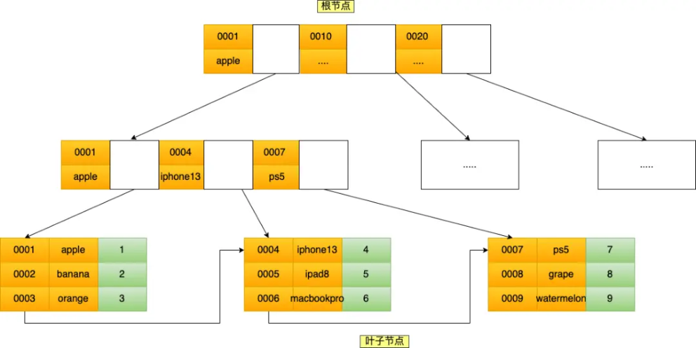
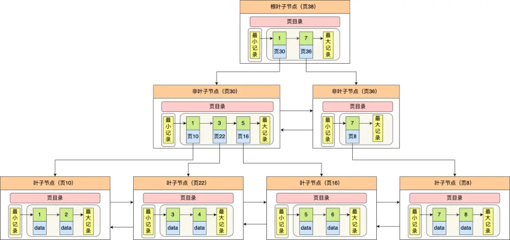
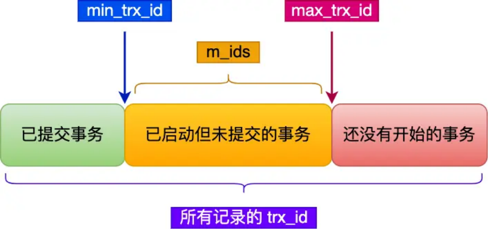
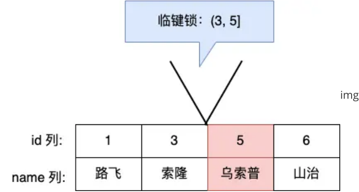
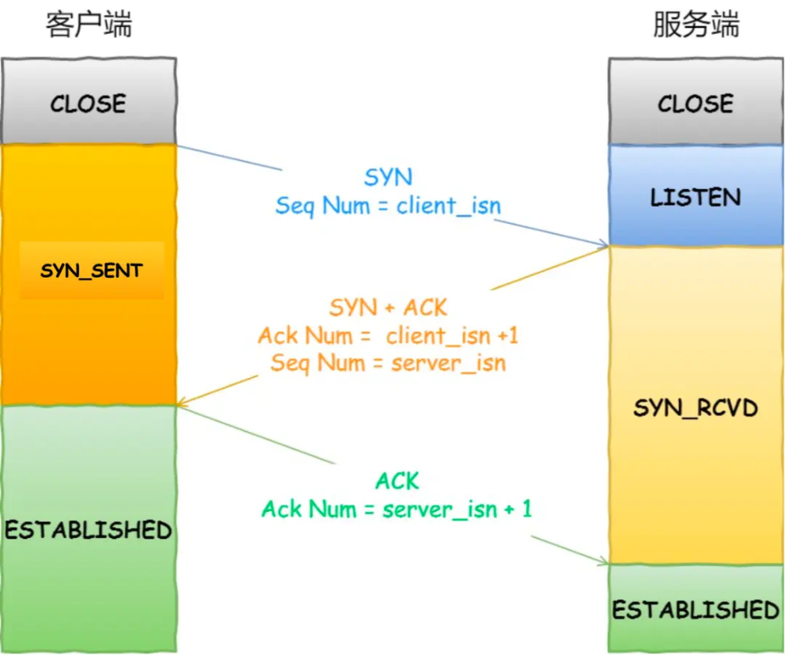
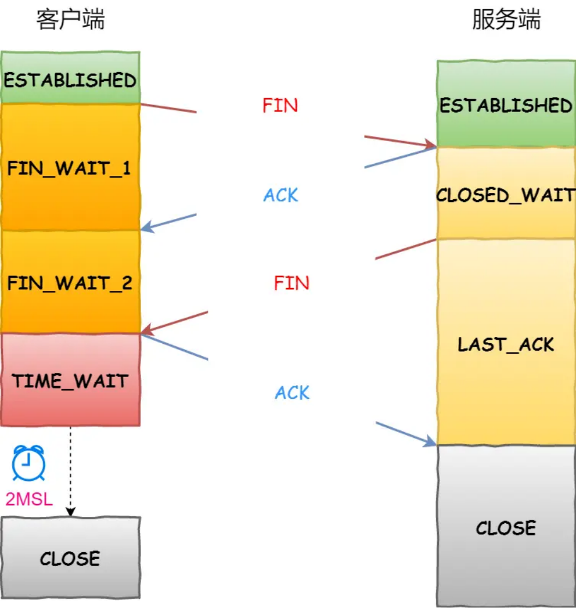

# **<u>腾讯面试体验倍儿好</u>**

大家好，我是小林。

今天分享一位读者的腾讯春招实习面经，岗位Java后端，主要问了MySQL、Java、网络这三大块。

他觉得这场面试非常有收获，虽然都是基础问题，但是往下深挖根茎叶脉全部相连。反问环节面试官给了我很多建议，包括面试、策略、基础、算法等等，是一次宝贵的学习经历。

## **<u>MySQL</u>**

### **介绍一下MySQL的索引机制**

索引可以帮助我们快速搜索数据，innodb 存储引擎用的是 b+树索引，叶子节点存放的是索引+数据，非叶子节点只存放索引。

可以按照四个角度来分类索引。

- 按「数据结构」分类： **B+tree索引、Hash索引、Full-text索引**。
- 按「物理存储」分类： **聚簇索引（主键索引）、二级索引（辅助索引）**。
- 按「字段特性」分类： **主键索引、唯一索引、普通索引、前缀索引**。
- 按「字段个数」分类： **单列索引、联合索引**。

### **联合索引是什么？**

通过将多个字段组合成一个索引，该索引就被称为联合索引。

比如，将商品表中的 product_no 和 name 字段组合成联合索引 (product_no, name)，创建联合索引的方式如下：

CREATE INDEX index_product_no_name ON product(product_no, name);

联合索引 (product_no, name) 的 B+Tree 示意图如下（图中叶子节点之间我画了单向链表，但是实际上是双向链表，原图我找不到了，修改不了，偷个懒我不重画了，大家脑补成双向链表就行）。



联合索引

可以看到，联合索引的非叶子节点用两个字段的值作为 B+Tree 的 key 值。当在联合索引查询数据时， 先按 product_no 字段比较，在 product_no 相同的情况下再按 name 字段比较。

也就是说，联合索引查询的 B+Tree 是先按 product_no 进行排序，然后再 product_no 相同的情况再按 name 字段排序。

因此，使用联合索引时，存在 **最左匹配原则**，也就是按照最左优先的方式进行索引的匹配。在使用联合索引进行查询的时候，如果不遵循「最左匹配原则」，联合索引会失效，这样就无法利用到索引快速查询的特性了。

### **什么是聚簇索引？**

聚簇索引的 B+Tree 的叶子节点存放的是实际数据，所有完整的用户记录都存放在主键索引的 B+Tree 的叶子节点里。

### **什么是覆盖索引？**

在查询时使用了二级索引，如果查询的数据能在二级索引里查询的到，那么就不需要回表，这个过程就是覆盖索引。如果查询的数据不在二级索引里，就会先检索二级索引，找到对应的叶子节点，获取到主键值后，然后再检索主键索引，就能查询到数据了，这个过程就是回表。

### **整个索引查询的过程是怎样的？**

InnoDB 里的 B+ 树中的 **每个节点都是一个数据页**，结构示意图如下：



图片

- B+ 树如何实现快速查找主键为 6 的记录，以上图为例子：
   - 从根节点开始，通过二分法快速定位到符合页内范围包含查询值的页，因为查询的主键值为 6，在 [1, 7)范围之间，所以到页 30 中查找更详细的目录项；

5，所以就到叶子节点（页16）查找记录；

- 在非叶子节点（页30）中，继续通过二分法快速定位到符合页内范围包含查询值的页，主键值大于
- 5，所以就到叶子节点（页16）查找记录；
- 接着，在叶子节点（页16）中，通过槽查找记录时，使用二分法快速定位要查询的记录在哪个槽 （哪个记录分组），定位到槽后，再遍历槽内的所有记录，找到主键为 6 的记录。

可以看到，在定位记录所在哪一个页时，也是通过二分法快速定位到包含该记录的页。定位到该页后， 又会在该页内进行二分法快速定位记录所在的分组（槽号），最后在分组内进行遍历查找。

### **事务的隔离级别有哪些？**

- **读未提交**，指一个事务还没提交时，它做的变更就能被其他事务看到；
- **读提交**，指一个事务提交之后，它做的变更才能被其他事务看到；
- **可重复读**，指一个事务执行过程中看到的数据，一直跟这个事务启动时看到的数据是一致的， **MySQL InnoDB 引擎的默认隔离级别**；
- **串行化**；会对记录加上读写锁，在多个事务对这条记录进行读写操作时，如果发生了读写冲突的时候，后访问的事务必须等前一个事务执行完成，才能继续执行；

### **脏读、幻读、不可重读分别是什么意思？**

- 脏读：如果一个事务「读到」了另一个「未提交事务修改过的数据」，就意味着发生了「脏读」现象。
- 幻读：在一个事务内多次查询某个符合查询条件的「记录数量」，如果出现前后两次查询到的记录数量不一样的情况，就意味着发生了「幻读」现象。
- 不可重复读：在一个事务内多次读取同一个数据，如果出现前后两次读到的数据不一样的情况，就意味着发生了「不可重复读」现象。

### **InnoDB 多版本并发控制的具体原理，底层细节？**

对于「读提交」和「可重复读」隔离级别的事务来说，它们是通过 Read View 来实现的，它们的区别在于创建 Read View 的时机不同，大家可以把 Read View 理解成一个数据快照，就像相机拍照那样，定格某一时刻的风景。

- 「读提交」隔离级别是在「每个select语句执行前」都会重新生成一个 Read View；
- 「可重复读」隔离级别是执行第一条select时，生成一个 Read View，然后整个事务期间都在用这个 Read View。

##### Read View 有四个重要的字段：

- m_ids：指的是在创建 Read View 时，当前数据库中「活跃事务」的 **事务 id 列表**，注意是一个列表， **“活跃事务”指的就是，启动了但还没提交的事务**。
- min_trx_id：指的是在创建 Read View 时，当前数据库中「活跃事务」中事务 **id 最小的事务**，也就是 m_ids 的最小值。
- max_trx_id：这个并不是 m_ids 的最大值，而是 **创建 Read View 时当前数据库中应该给下一个事务的 id 值**，也就是全局事务中最大的事务 id 值 + 1；
- creator_trx_id：指的是 **创建该 Read View 的事务的事务 id**。

对于使用 InnoDB 存储引擎的数据库表，它的聚簇索引记录中都包含下面两个隐藏列：

- trx_id，当一个事务对某条聚簇索引记录进行改动时，就会 **把该事务的事务 id 记录在 trx_id 隐藏列里**；
- roll_pointer，每次对某条聚簇索引记录进行改动时，都会把旧版本的记录写入到 undo 日志中，然后 **这个隐藏列是个指针，指向每一个旧版本记录**，于是就可以通过它找到修改前的记录。

在创建 Read View 后，我们可以将记录中的 trx_id 划分这三种情况：



##### img

- 一个事务去访问记录的时候，除了自己的更新记录总是可见之外，还有这几种情况：
   - 如果记录的 trx_id 值小于 Read View 中的 min_trx_id 值，表示这个版本的记录是在创建 Read View **前** 已经提交的事务生成的，所以该版本的记录对当前事务 **可见**。
- 如果记录的 trx_id 值大于等于 Read View 中的 max_trx_id 值，表示这个版本的记录是在创建 Read View **后** 才启动的事务生成的，所以该版本的记录对当前事务 **不可见**。
- 如果记录的 trx_id 值在 Read View 的 min_trx_id 和 max_trx_id 之间，需要判断 trx_id 是否在 m_ids 列表中：
   - 如果记录的 trx_id **在** m_ids 列表中，表示生成该版本记录的活跃事务依然活跃着（还没提交事务），所以该版本的记录对当前事务 **不可见**。
   - 如果记录的 trx_id **不在** m_ids 列表中，表示生成该版本记录的活跃事务已经被提交，所以该版本的记录对当前事务 **可见**。

**这种通过「版本链」来控制并发事务访问同一个记录时的行为就叫 MVCC（多版本并发控制）。**

### **next Key是什么，怎么实现？**

Next-Key Lock 称为临键锁，是 Record Lock + Gap Lock 的组合，锁定一个范围，并且锁定记录本身。

假设，表中有一个范围 id 为（3，5] 的 next-key lock，那么其他事务即不能插入 id = 4 记录，也不能修改 id = 5 这条记录。



img

所以，next-key lock 即能保护该记录，又能阻止其他事务将新纪录插入到被保护记录前面的间隙中。

### **索引失效的场景有哪些，你知道什么改进方法吗？**

- 当我们使用左或者左右模糊匹配的时候，也就是 like %xx 或者 like %xx% 这两种方式都会造成索引失效；
- 当我们在查询条件中对索引列使用函数，就会导致索引失效。
- 当我们在查询条件中对索引列进行表达式计算，也是无法走索引的。
- MySQL 在遇到字符串和数字比较的时候，会自动把字符串转为数字，然后再进行比较。如果字符串是索引列，而条件语句中的输入参数是数字的话，那么索引列会发生隐式类型转换，由于隐式类型转换是通过 CAST 函数实现的，等同于对索引列使用了函数，所以就会导致索引失效。 联合索引要能正确使用需要遵循最左匹配原则，也就是按照最左优先的方式进行索引的匹配，否则就会导致索引失效。
- 在 WHERE 子句中，如果在 OR 前的条件列是索引列，而在 OR 后的条件列不是索引列，那么索引会失效。

### **提交事务的一整个过程，每个日志都是怎么工作的？**

具体更新一条记录 UPDATE t_user SET name = 'xiaolin' WHERE id = 1; 的流程如下:

1. 执行器负责具体执行，会调用存储引擎的接口，通过主键索引树搜索获取 id = 1 这一行记录：
   - 如果 id=1 这一行所在的数据页本来就在 buffer pool 中，就直接返回给执行器更新； 如果记录不在 buffer pool，将数据页从磁盘读入到 buffer pool，返回记录给执行器。
2. 执行器得到聚簇索引记录后，会看一下更新前的记录和更新后的记录是否一样：
   - 如果一样的话就不进行后续更新流程；
   - 如果不一样的话就把更新前的记录和更新后的记录都当作参数传给 InnoDB 层，让 InnoDB 真正的执行更新记录的操作；
3. 开启事务， InnoDB 层更新记录前，首先要记录相应的 undo log，因为这是更新操作，需要把被更新的列的旧值记下来，也就是要生成一条 undo log，undo log 会写入 Buffer Pool 中的 Undo 页面，不过在内存修改该 Undo 页面后，需要记录对应的 redo log。
4. InnoDB 层开始更新记录，会先更新内存（同时标记为脏页），然后将记录写到 redo log 里面，这个时候更新就算完成了。为了减少磁盘I/O，不会立即将脏页写入磁盘，后续由后台线程选择一个合适的时机将脏页写入到磁盘。这就是 **WAL 技术**，MySQL 的写操作并不是立刻写到磁盘上，而是先写 redo 日志，然后在合适的时间再将修改的行数据写到磁盘上。
5. 至此，一条记录更新完了。
6. 在一条更新语句执行完成后，然后开始记录该语句对应的 binlog，此时记录的 binlog 会被保存到 binlog cache，并没有刷新到硬盘上的 binlog 文件，在事务提交时才会统一将该事务运行过程中的所有 binlog 刷新到硬盘。
7. 事务提交（为了方便说明，这里不说组提交的过程，只说两阶段提交）：
   - **prepare 阶段**：将 redo log 对应的事务状态设置为 prepare，然后将 redo log 刷新到硬盘； **commit 阶段**：将 binlog 刷新到磁盘，接着调用引擎的提交事务接口，将 redo log 状态设置为 commit（将事务设置为 commit 状态后，刷入到磁盘 redo log 文件）；
8. 至此，一条更新语句执行完成。

## **<u>Java</u>**

### **JVM内存区域每一个区域的内容？**

JVM的内存结构主要分为以下几个部分：

- 程序计数器（Program Counter Register）：每个线程都有一个程序计数器。当线程执行 Java 方法时，程序计数器保存当前执行指令的地址，以便在 JVM 调用其他方法或恢复线程执行时重新回到正确的位置。
- Java 虚拟机栈（Java Virtual Machine Stacks）：每个线程都有一个虚拟机栈。虚拟机栈保存着方法执行期间的局部变量、操作数栈、方法出口等信息。线程每调用一个 Java 方法时，会创建一个栈帧（Stack Frame），栈帧包含着该方法的局部变量、操作数栈、方法返回地址等信息。栈帧在方法执行结束后会被弹出。
- 本地方法栈（Native Method Stack）：与 Java 虚拟机栈类似，但是为本地方法服务。 Java 堆（Java Heap）：Java 堆是 Java 虚拟机中最大的一块内存区域，用于存储各种类型的对象实
- 例，也是垃圾收集器的主要工作区域。Java 堆是所有线程共享的部分。
- 方法区（Method Area）：方法区也是所有线程共享的部分，它用于存储类的加载信息、静态变量、常量池、方法字节码等数据。在 Java 8 及以前的版本中，方法区被实现为永久代
- （Permanent Generation），在 Java 8 中被改为元空间（Metaspace）。

### **JVM异常问题？**

StackOverflowError（线程请求栈深度超过虚拟机所允许的最大深度）

- OutOfMemoryError（堆内存不够用）

PermGen space（方法区内存不够用）。

### **String保存在哪里呢**

String 保存在字符串常量池中，不同于其他对象，它的值是不可变的，且可以被多个引用共享。

### **java版本改动问题 1.7 1.8有哪些主要区别？**

- Java 7 新特性：钻石操作符、try-with-resource语句、支持动态类型语言、Fork/Join框架等。 Java 8 新特性：Lambda 表达式、Stream API、新的 Date/Time API、Nashorn JavaScript 引擎等。

### **怎么找到需要回收的垃圾？**

Java中的垃圾回收机制通过判断对象是否可达来确定哪些对象可以被回收。当一个对象没有任何引用指向它时，它就可以被回收，这个过程由JVM的垃圾回收器自动完成。

JVM使用可达性分析算法来判断对象是否可达。从GC Roots对象开始，通过一系列的引用链来遍历所有的对象，如果一个对象不可达，则说明它已经死亡，可以被回收了。

在Java中，有4种引用类型：强引用、软引用、弱引用和虚引用。其中，强引用是最常见的引用类型，只要强引用存在，垃圾回收器就不会回收该对象。软引用、弱引用和虚引用则分别表示对对象的软引用、 弱引用和虚引用，当垃圾回收器进行垃圾回收时，会根据不同的引用类型来决定是否回收对象。

### **有哪些常见的垃圾回收器，举几个说说？**

1. Serial收集器：单线程的垃圾回收器，使用标记-复制算法，适合小型应用程序或客户端应用程序。
2. Parallel收集器：多线程的垃圾回收器，使用标记-复制算法，适合在后台运行的中型应用程序。
3. CMS收集器：并发垃圾回收器，使用标记-清除算法，适合对响应时间有要求的中型应用程序。
4. G1收集器：并发垃圾回收器，使用标记-整理算法，适合对响应时间有要求且堆内存较大的应用程序。

其中，Serial收集器和Parallel收集器是新生代收集器，CMS和G1是老年代收集器。

### **HashMap底层怎么实现的？线程安全吗？**

HashMap底层是基于数组和链表实现的。简单来说，HashMap将key通过hash算法映射到数组中，然后在对应的链表中查找value。当多个key的hash值相同时，会在同一个数组位置上使用链表来存储这些 key-value。但是，当链表长度太长时，会影响HashMap的性能，因此在JDK1.8中，当链表长度超过阈值时，会将链表转换为红黑树，以提高查找效率。

HashMap不是线程安全的，因为多个线程同时访问HashMap时可能会导致数据不一致的问题。可以使用ConcurrentHashMap来实现线程安全的Map。

### **红黑树是什么？**

红黑树是一种自平衡的二叉查找树，可以保证在最坏情况下基本动态操作的时间复杂度为O(log n)。红黑树中的每个节点都有一个颜色属性，可以是红色或黑色。红黑树满足以下5个性质：

1. 每个节点要么是红色，要么是黑色。
2. 根节点是黑色的。
3. 每个叶子节点（NIL节点，空节点）是黑色的。
4. 如果一个节点是红色的，则它的两个子节点都是黑色的。
5. 对于每个节点，从该节点到其所有后代叶子节点的简单路径上，均包含相同数目的黑色节点。

通过这些性质，红黑树可以保证在插入和删除节点时，自动调整树的结构，以保持树的平衡和性质的满足。相比于普通的二叉查找树，红黑树的平衡性更好，查找、插入和删除都具有更稳定的时间复杂度， 因此在很多场景下被广泛应用。

### **什么是公平锁和非公平锁？**

公平锁和非公平锁是针对锁的获取方式而言的。

公平锁是指多个线程按照申请锁的顺序来获取锁，即先到先得的原则。当线程A释放锁后，线程B、C、D 依次获取锁，如果此时线程E申请锁，则它需要等待B、C、D依次获取到锁并释放锁后才能获取锁。

非公平锁是指多个线程获取锁的顺序是随机的，不保证公平性。当线程A释放锁后，线程B、C、D等线程都可以通过竞争获取到锁，而此时线程E也可以通过竞争获取到锁。

在实际应用中，公平锁可以避免饥饿现象，但是由于需要维护线程队列，因此效率相对较低。而非公平锁由于不需要维护线程队列，因此效率相对较高，但是可能会导致某些线程长时间无法获取锁。

### **ThreadLocal 是什么？**

ThreadLocal是Java中的一个线程封闭技术，它可以让每个线程都拥有自己单独的变量副本，从而保证线程安全。ThreadLocal提供了一种线程本地存储的机制，为每个线程提供一个独立的变量副本，使得每个线程中的变量互不干扰。

## **<u>计算机网络</u>**

### **TCP 三次握手、四次挥手的过程？**

三次握手的过程：



TCP 三次握手

- 一开始，客户端和服务端都处于 CLOSE 状态。先是服务端主动监听某个端口，处于 LISTEN 状态客户端会随机初始化序号（client_isn），将此序号置于 TCP 首部的「序号」字段中，同时把 SYN 标志位置为 1，表示 SYN 报文。接着把第一个 SYN 报文发送给服务端，表示向服务端发起
- 连接，该报文不包含应用层数据，之后客户端处于 SYN-SENT 状态。
- 服务端收到客户端的 SYN 报文后，首先服务端也随机初始化自己的序号（server_isn），将此
- 序号填入 TCP 首部的「序号」字段中，其次把 TCP 首部的「确认应答号」字段填入 client_isn
- + 1 , 接着把 SYN 和 ACK 标志位置为 1。最后把该报文发给客户端，该报文也不包含应用层数据，之后服务端处于 SYN-RCVD 状态。
- 客户端收到服务端报文后，还要向服务端回应最后一个应答报文，首先该应答报文 TCP 首部 ACK 标志位置为 1，其次「确认应答号」字段填入 server_isn + 1，最后把报文发送给服务端，这次报文可以携带客户到服务端的数据，之后客户端处于 ESTABLISHED 状态。
- 服务端收到客户端的应答报文后，也进入 ESTABLISHED 状态。

四次挥手的过程：



- 客户端打算关闭连接，此时会发送一个 TCP 首部 FIN 标志位被置为 1 的报文，也即 FIN 报文， 之后客户端进入 FIN_WAIT_1 状态。
- 服务端收到该报文后，就向客户端发送 ACK 应答报文，接着服务端进入 CLOSE_WAIT 状态。
- 客户端收到服务端的 ACK 应答报文后，之后进入 FIN_WAIT_2 状态。
- 等待服务端处理完数据后，也向客户端发送 FIN 报文，之后服务端进入 LAST_ACK 状态。
- 客户端收到服务端的 FIN 报文后，回一个 ACK 应答报文，之后进入 TIME_WAIT 状态
- 服务端收到了 ACK 应答报文后，就进入了 CLOSE 状态，至此服务端已经完成连接的关闭。 客户端在经过 2MSL 一段时间后，自动进入 CLOSE 状态，至此客户端也完成连接的关闭。

### **为什么要三次握手、四次挥手？**

三次握手的原因：

- 三次握手可以阻止重复历史连接的初始化
- 三次握手可以同步双方的初始序列号三次握手可以避免资源浪费

四次次挥手的原因：

- 服务端通常需要等待完成数据的发送和处理，所以服务端的 ACK 和 FIN 一般都会分开发送，因此是需要四次挥手。

### **LINUX有哪些IO机制？**

- 阻塞IO（Blocking IO）：应用程序在进行IO操作时，会一直阻塞等待IO完成，期间无法进行其他操作。
- 非阻塞IO（Non-blocking IO）：应用程序在进行IO操作时，会立即返回，无论IO操作是否完成， 应用程序都可以进行其他操作。需要通过轮询的方式来判断IO是否完成，因此效率较低。
- IO多路复用（IO Multiplexing）：通过select、poll、epoll等系统调用，在一个进程中可以同时监控多个文件描述符，当有任何一个文件描述符就绪时，就可以进行IO操作。
- 信号驱动IO（Signal Driven IO）：应用程序在进行IO操作时，向内核注册一个信号处理函数，内核在IO完成时会向应用程序发送一个信号，应用程序收到信号后再进行数据处理。
- 异步IO（Asynchronous IO）：应用程序进行IO操作时，可以立即返回，内核负责将数据读取到指定的缓冲区中，并在完成后通知应用程序，应用程序可以继续进行其他操作。异步IO需要操作系统和硬件的支持，目前主要应用于高性能IO场景。

### **select poll epoll，底层实现有什么区别？**

select 和 poll 并没有本质区别，它们内部都是使用「线性结构」来存储进程关注的 Socket 集合。

在使用的时候，首先需要把关注的 Socket 集合通过 select/poll 系统调用从用户态拷贝到内核态，然后由内核检测事件，当有网络事件产生时，内核需要遍历进程关注 Socket 集合，找到对应的 Socket，并设置其状态为可读/可写，然后把整个 Socket 集合从内核态拷贝到用户态，用户态还要继续遍历整个 Socket 集合找到可读/可写的 Socket，然后对其处理。

很明显发现，select 和 poll 的缺陷在于，当客户端越多，也就是 Socket 集合越大，Socket 集合的遍历和拷贝会带来很大的开销，因此也很难应对 C10K。

epoll 是解决 C10K 问题的利器，通过两个方面解决了 select/poll 的问题。

- epoll 在内核里使用「红黑树」来关注进程所有待检测的 Socket，红黑树是个高效的数据结构，增删改一般时间复杂度是 O(logn)，通过对这棵黑红树的管理，不需要像 select/poll 在每次操作时都传入整个 Socket 集合，减少了内核和用户空间大量的数据拷贝和内存分配。
- epoll 使用事件驱动的机制，内核里维护了一个「链表」来记录就绪事件，只将有事件发生的 Socket 集合传递给应用程序，不需要像 select/poll 那样轮询扫描整个集合（包含有和无事件的 Socket），大大提高了检测的效率。

### **BIO 和 NIO 的区别？**

Java中，BIO和NIO都是IO模型，它们的主要区别在于：

- 阻塞和非阻塞：BIO采用阻塞模式，即在进行IO操作时，线程会一直阻塞等待IO完成。而NIO采用非阻塞模式，即在进行IO操作时，线程会立即返回，无论IO操作是否完成，线程都可以进行其他操作。
- IO模型：BIO采用同步阻塞IO模型，即一个线程只能处理一个连接，当有大量连接时，需要大量的线程来处理，会导致系统资源浪费。NIO采用同步非阻塞IO模型，将客户端发送的连接请求都会注册到多路复用器上，这样一个线程可以处理多个连接，当有大量连接时，只需要少量的线程来处理，可以有效地提高系统资源利用率。

## **<u>算法</u>**

### **链表判断相交**

```
public ListNode getIntersectionNode(ListNode headA, ListNode headB) {
    if (headA == null || headB == null) return null;
    ListNode pA = headA, pB = headB;
    while (pA != pB) {
        pA = pA == null ? headB : pA.next;
        pB = pB == null ? headA : pB.next;
    }
    return pA;
}
```

## **<u>面试总结</u>**

### **感觉**

非常有收获的一次面试，值得之后自己单独写一写文章去记录一下。基础不牢地动山摇，虽然都是基础问题，但是往下深挖根茎叶脉全部相连，这些问题面试题里面都有解，但是自己真的是只知道表面，浅浅看个大概就上战场了，还有就是非常感谢面试官，反问环节给了我很多建议，包括面试、策略、基础、算法等等，是一次宝贵的学习经历，说不遗憾是假的，但我很开心，有所收获就好。

### **不足之处**

基础不够扎实，很多只知其表不知其里，而且面试官经验丰富，非常敏锐，当时压力也很大，被问倒了心态也不稳，有的可以答出来的也没想起来怎么说。

没有几个答的特别好的，稍微说一点就会被问深直到不会，这里就不贴当时回答了，说的都很浅，下来每一个问题都要仔细研究，要将知识连接成网。

自己给自己构造一个场景，顺着把用到的技术全部梳理一遍，能讲出这个整体过程，有头有尾，才能真的理解，比如hashmap插入数据的过程、threadlocal创建释放的过程、String怎么实现的字符串拼接、 SpringBoot框架搭建的每一步等等。
