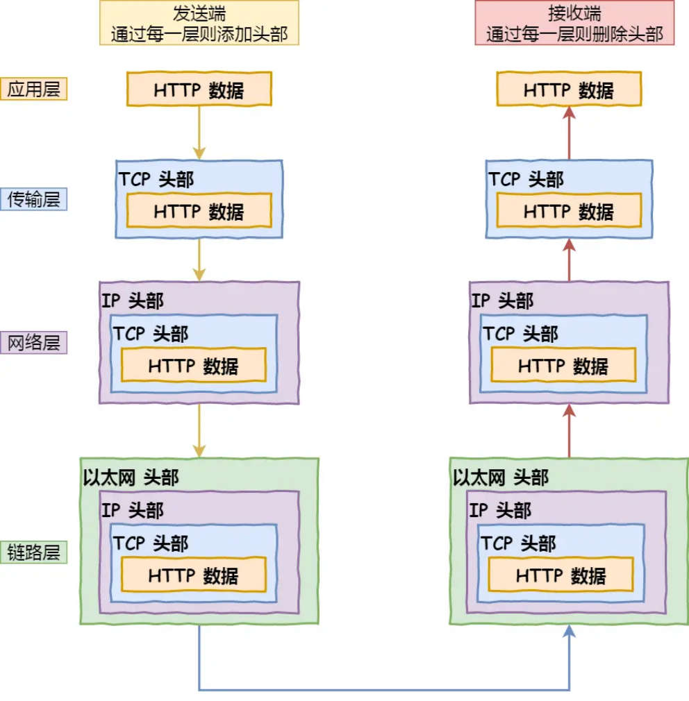
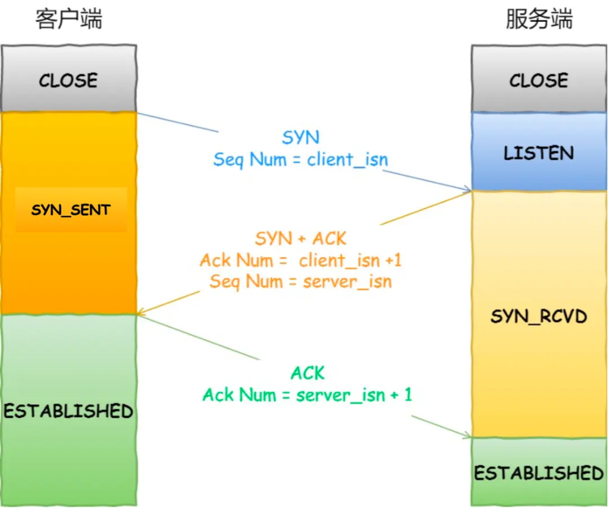
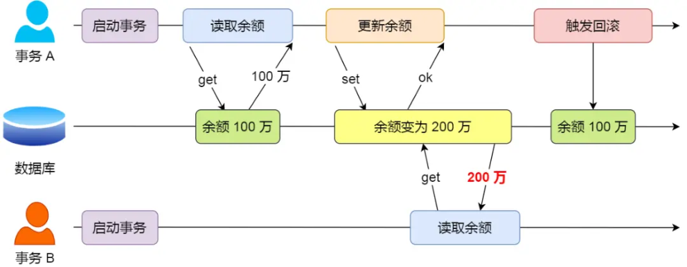
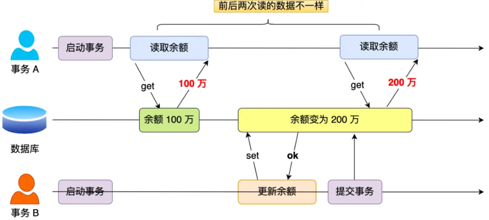
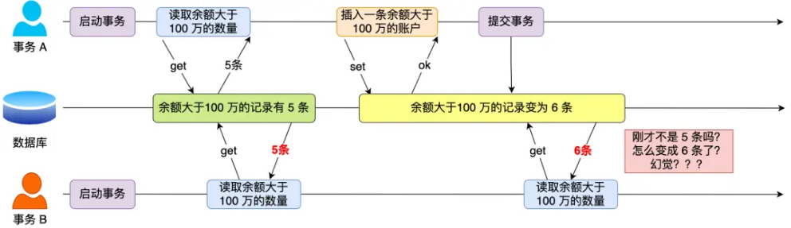
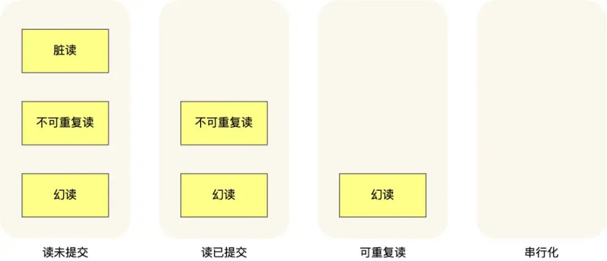

# **<u>阿里问的相当基础！</u>**

大家好，我是小林。

今天分享一篇一位同学暑期实习面试阿里Java后端岗位的一面的面经。

主要拷打了项目+Java 集合+Java并发+网络+mysql，一场面试大概问了 20 个题目，问的还是比较基础，不算太难。

## **<u>问题记录</u>**

### **自我介绍**

balabala（略）

### **简历上有两个项目，选一个你比较熟悉的介绍**

balabala（略）

### **项目用到了哪个线程实现类？**

用了ScheduledThreadPool这个线程实现类

### **为什么要使用这个线程类？**

这个实现类可以设置定期的执行任务，它支持定时或周期性执行任务，比如每隔 10 秒钟执行一次任务， 我通过这个实现类设置定期执行任务的策略。

### **你还了解别的线程实现类吗?**

除了这个之外，还有就是newSingleThreadExecuter，别的就不太熟悉了。

**小林补充：**

除了 ScheduledThreadPool 线程池之外，还有 4 种常见的线程池如下：

- FixedThreadPool：它的核心线程数和最大线程数是一样的，所以可以把它看作是固定线程数的线程池，它的特点是线程池中的线程数除了初始阶段需要从 0 开始增加外，之后的线程数量就是固定的，就算任务数超过线程数，线程池也不会再创建更多的线程来处理任务，而是会把超出线程处理能力的任务放到任务队列中进行等待。而且就算任务队列满了，到了本该继续增加线程数的时候， 由于它的最大线程数和核心线程数是一样的，所以也无法再增加新的线程了。
- CachedThreadPool：可以称作可缓存线程池，它的特点在于线程数是几乎可以无限增加的（实际最大可以达到 Integer.MAX_VALUE，为 2^31-1，这个数非常大，所以基本不可能达到），而当线程闲置时还可以对线程进行回收。也就是说该线程池的线程数量不是固定不变的，当然它也有一个用于存储提交任务的队列，但这个队列是 SynchronousQueue，队列的容量为0，实际不存储任何任务，它只负责对任务进行中转和传递，所以效率比较高。
- SingleThreadExecutor：它会使用唯一的线程去执行任务，原理和 FixedThreadPool 是一样的， 只不过这里线程只有一个，如果线程在执行任务的过程中发生异常，线程池也会重新创建一个线程来执行后续的任务。这种线程池由于只有一个线程，所以非常适合用于所有任务都需要按被提交的顺序依次执行的场景，而前几种线程池不一定能够保障任务的执行顺序等于被提交的顺序，因为它们是多线程并行执行的。
- SingleThreadScheduledExecutor：它实际和 ScheduledThreadPool 线程池非常相似，它只是

ScheduledThreadPool 的一个特例，内部只有一个线程。

### **看你项目上有用到雪花算法，你为什么要使用雪花算法？**

除了考虑使用主键自增保持主键的唯一性外，我就使用到了雪花算法，算出一个不会重复的数做为id， 保证主键唯一。

### **那你还了解别的生成主键的策略吗，你觉得他们能代替雪花算法吗**

除了主键自增和雪花算法，别的我暂时没了解的，但是只要是能保证主键唯一的主键生成策略都可以使用

**小林补充：**

- 除了雪花算法之外，还有很多优秀的互联网公司也提供了唯一 ID 生成的方案或框架，比如美团开源的 Leaf，百度开源的 UidGenerator 等等。
- UUID 虽然也可以保证唯一性，但是 UUID 的值是随机的，无序的，不太适合作为主键，因为随机插入，可能会引起页分裂的问题，从而影响查询性能。

### **List的实现类**

ArrayList、Vector、LinkedList

**小林补充：**

Java中的List接口有多个实现类，常用的包括：

1. ArrayList：基于动态数组实现，优势在于支持随机访问和快速插入/删除元素，适用于频繁读取和遍历的场景。
2. LinkedList：基于双向链表实现，优势在于支持快速插入/删除元素，适用于频繁插入/删除元素的场景。
3. Vector：和ArrayList类似，但由于其线程安全性，适用于多线程环境。
4. Stack：基于Vector实现，是一个后进先出（LIFO）的数据结构，适用于需要按照后进先出顺序处理元素的场景。

### **List和Set的区别**

List是有序的，Set是无序的
List可以存放相同的元素，Set不可以存放重复的元素

List是有序的，Set是无序的

List可以存放相同的元素，Set不可以存放重复的元素

##### **小林补充：**

1. 顺序：List是有序的集合，它可以按照元素插入的顺序进行存储和访问。而Set是无序的集合，元素在集合中的位置是不固定的。
2. 重复元素：List允许存储重复的元素，即可以有多个相同的对象。Set不允许存储重复的元素，即每个对象在集合中只能出现一次。
3. 实现类：List的常用实现类有ArrayList和LinkedList，分别使用数组和链表作为底层数据结构。Set 的常用实现类有HashSet、LinkedHashSet和TreeSet，分别基于哈希表、链表+哈希表和红黑树实现。
4. 性能：由于底层数据结构的差异，List和Set在增加、删除、查找等操作上的性能表现有所不同。例如，ArrayList在随机访问元素时性能较好，而LinkedList在插入和删除元素时性能较好。HashSet

在查找、添加和删除元素时性能较好，但不保证元素顺序。TreeSet在保持元素排序的同时，也能提供较好的查找性能。

### **针对你说的List和Set的性质，那你会用这两种结构解决哪些问题**

对于取消重复数据的场景，选择set，对于只是保存数据、或者需要按存储顺序进行访问的场景使用 List。

**小林补充：**

List（列表）适用于以下场景：

1. 有序数据：列表中的元素按照插入顺序存储，因此适用于需要保持元素顺序的场景。
2. 允许重复元素：列表允许存储重复的元素，因此适用于需要统计元素出现次数的场景。
3. 需要根据索引进行查找、插入和删除操作：列表允许通过索引值直接访问、插入或删除元素，适用于需要频繁进行这些操作的场景。

Set（集合）适用于以下场景：

1. 去重：集合中的元素不能重复，因此适用于去除数据中重复元素的场景。
2. 无需关心元素顺序：集合中的元素没有固定顺序，适用于元素顺序无关紧要的场景。
3. 快速判断元素是否存在：集合提供了高效率的查找算法，适用于需要快速判断某个元素是否存在于数据集中的场景。
4. 集合运算：集合支持交集、并集、差集等运算，适用于需要进行这些运算的场景。

### **常用的网络状态码有哪些**

100开头是表示协议执行的中间状态，一般不常用，400开头的表示协议执行失败，例如404是指服务端找不到页面的请求地址，500是协议的完成（这个没记住答错了，面试官提示了，说那200表示什么）。

**小林补充：**

常用的网络状态码分为五类，分别是：

- 1xx（信息）：表示接收到请求，需要继续处理。
   - 100 Continue：继续，客户端应继续其请求。
- 2xx（成功）：表示请求已成功被服务器接收、理解和接受。
   - 200 OK：请求成功，请求所希望的响应头或数据体将随此响应返回。
   - 201 Created：请求已成功，并因此创建了一个新的资源。
   - 204 No Content：无内容，服务器成功处理，但未返回内容。
- 3xx（重定向）：需要后续操作才能完成这一请求。
   - 301 Moved Permanently：永久重定向，请求的资源已被永久移动到新位置。
   - 302 Found：临时重定向，请求的资源临时从不同位置响应。
   - 304 Not Modified：资源未修改，使用缓存的资源。
- 4xx（客户端错误）：请求包含错误语法或无法完成。
   - 400 Bad Request：客户端请求的语法错误，服务器无法理解。
   - 401 Unauthorized：请求需要用户验证。

403 Forbidden：服务器理解请求客户端的请求，但是拒绝执行它。

404 Not Found：请求的资源无法在服务器上找到。

- 5xx（服务器错误）：服务器未能实现合法的请求。
   - 500 Internal Server Error：服务器内部错误，无法完成请求。
   - 501 Not Implemented：服务器不支持请求的功能。
   - 503 Service Unavailable：服务器暂不可用，可能是服务器过载或停机维护。

ps：《HTTP 常见面试题》完整详细讲解：https://xiaolincoding.com/network/2_http/http_inte <u>rview.html</u>

### **流量控制和拥塞控制的原理**

- 流量控制是服务端和客户端协议的窗口实现，在客户端发送数据的时候，服务端返回窗口的容量， 客户端通过容量来调整发送信息的大小
- 拥塞控制是通过滑动窗口实现，服务端只接收拥塞窗口大小内的数据，客服端发送的报文丢失后， 没有收到服务端的确认信息，就将没有收到确认信息的保温再发送。

##### **小林补充：**

TCP一种面向连接的、可靠的传输层协议。为了确保数据的有效传输，TCP 提供了两种重要的控制机制：流量控制和拥塞控制。

**流量控制（Flow Control）**

流量控制的主要目的是防止发送方向接收方发送过多数据，导致接收方处理不过来。TCP 使用滑动窗口机制来实现流量控制。在 TCP 连接中，接收方为每个连接分配一个接收缓冲区。接收方通过通知发送方自己的窗口大小，告知发送方可以发送的数据量。窗口大小表示接收方当前能接受的数据字节数。

滑动窗口的工作原理如下：

- 发送方根据接收方的窗口大小来确定发送的数据量。
- 当接收方收到数据后，发送确认报文，同时更新窗口大小。
- 发送方收到确认报文后，更新已发送但未确认的数据量，并根据新的窗口大小调整发送速率。

**拥塞控制（Congestion Control）**

拥塞控制的目的是防止过多的数据进入网络，导致网络拥塞。TCP 使用四种算法来实现拥塞控制：慢开始、拥塞避免、快速重传和快速恢复。

- 慢开始：发送方初始拥塞窗口设置为一个较小的值。随后，每收到一个确认报文，拥塞窗口大小加倍。这样，发送速率会以指数形式增长，直到达到一个阈值（ssthresh）。

（RTT）就增加1。这样，拥塞窗口的大小呈线性增长，避免了网络拥塞。

- 拥塞避免：当拥塞窗口到达阈值后，发送方转入拥塞避免阶段，窗口大小每经过一个往返时间
- （RTT）就增加1。这样，拥塞窗口的大小呈线性增长，避免了网络拥塞。
- 快速重传：当发送方连续收到三个重复的确认报文，表示可能有一个数据包丢失。此时，发送方立即重传丢失的数据包，而不是等待超时重传。
- 快速恢复：快速重传后，发送方降低拥塞窗口阈值，然后进入拥塞避免阶段。这样可以在丢包后尽快恢复传输速率。

通过这两种控制机制，TCP 能确保在各种网络条件下有效、可靠地传输数据。

ps：《TCP 重传、滑动窗口、流量控制、拥塞控制》完整详细讲解：https://xiaolincoding.com/n <u>etwork/3_tcp/tcp_feature.html</u>

### **一条url请求页面的执行过程**

（这块我答的不太好，忘了dns服务器的名字）浏览器先解析url地址，然后生成http消息，生成的消息需要知道ip地址才能发送，就先去浏览器的缓存中查询，没有的话查看操作系统的缓存，如果还是没有就在本地dns中查询，本地dns查询不到后会先访问根dns，根dns查询的是存放这个ip的二级dns服务器 （忘了名字），二级dns服务器会向对应的权威dns服务器查询，权威dns服务器会向本地返回ip地址， 然后本地通过这个ip地址和请求的服务端建立起tcp连接，服务端向本地发送请求的资源。

**小林补充：**

ps：《键入网址到网页显示，期间发生了什么？》完整详细讲解：https://xiaolincoding.com/net <u>work/1_base/what_happen_url.html</u>

### **TCP是如何建立连接的**

三次握手

- 1、客户端发送请求建立连接报文，报文的SYN=1
- 2、服务端收到后，发送连接报文，报文的SYN=1，并且发送一个序号字段
- 3、客户端收到后报文后，客户端到服务端的连接已经建立，客户端发送报文对上一个报文的序号端进行确认

##### **小林补充：**

TCP 是面向连接的协议，所以使用 TCP 前必须先建立连接，而 **建立连接是通过三次握手来进行的**。三次握手的过程如下图：

TCP 三次握手

- 一开始，客户端和服务端都处于 CLOSE 状态。先是服务端主动监听某个端口，处于 LISTEN 状态客户端会随机初始化序号（client_isn），将此序号置于 TCP 首部的「序号」字段中，同时把 SYN 标志位置为 1，表示 SYN 报文。接着把第一个 SYN 报文发送给服务端，表示向服务端发起
- 连接，该报文不包含应用层数据，之后客户端处于 SYN-SENT 状态。
- 服务端收到客户端的 SYN 报文后，首先服务端也随机初始化自己的序号（server_isn），将此序号填入 TCP 首部的「序号」字段中，其次把 TCP 首部的「确认应答号」字段填入 client_isn + 1 , 接着把 SYN 和 ACK 标志位置为 1。最后把该报文发给客户端，该报文也不包含应用层数
- 据，之后服务端处于 SYN-RCVD 状态。
- 客户端收到服务端报文后，还要向服务端回应最后一个应答报文，首先该应答报文 TCP 首部 ACK 标志位置为 1，其次「确认应答号」字段填入 server_isn + 1，最后把报文发送给服务端，这次报文可以携带客户到服务端的数据，之后客户端处于 ESTABLISHED 状态。
- 服务端收到客户端的应答报文后，也进入 ESTABLISHED 状态。

ps：《TCP 三次握手与四次挥手面试题》完整详细讲解：https://xiaolincoding.com/network/3_t <u>cp/tcp_interview.html</u>

### **http和https的区别**

- 1、https是需要通过CA申请才能获得，所以数量是比较少的
- 2、http发送的报文是明文，所以不安全，https在传输层之上加了ssl协议

##### **小林补充：**

- HTTP是一种用于传输超文本的协议，数据传输是明文的，不具备加密和安全性。HTTP使用的端口号是 80
- HTTPS是在HTTP的基础上加入了SSL/TLS协议进行加密和身份验证的安全版本。它使用加密的 SSL/TLS协议进行数据传输，保证了数据的机密性和完整性。HTTPS使用的端口号是443。

ps：《HTTP 常见面试题》完整详细讲解：https://xiaolincoding.com/network/2_http/http_inte <u>rview.html</u>

### **数据库的索引**

B+树索引，hash索引、全文索引

B+树索引的话是innodb采用的索引，索引的叶子结点上是数据，非叶子结点是索引信息

hash索引单个的查找效率很高

### **为什么采用B+树索引，它有什么优点**

这里我将B+树和B树、红黑树做了比较。

B+树相对于B树，只有叶子结点存储的是数据信息，非叶子结点都是索引信息，所以在查找时加载到内存中的数据少，B+树的增删相对于B树来说比较稳定，不会发生频繁的父子结点替换，B+树的叶子结点是连接的，所以很容易实现范围查询

B+树相对于红黑树，首先B+树的层高比较小，意味着读取数据时IO磁盘的次数比较少，红黑树增删结点时需要保持子树的稳定性，增删的效率很低，B+树更容易实现范围查询。

##### **小林补充：**

树的高度决定于磁盘 I/O 操作的次数，因为树是存储在磁盘中的，访问每个节点，都对应一次磁盘 I/O 操作，也就是说树的高度就等于每次查询数据时磁盘 IO 操作的次数，所以树的高度越高，就会影响查询性能。

B 树和 B+ 都是通过多叉树的方式，会将树的高度变矮，所以这两个数据结构非常适合检索存于磁盘中的数据。

但是 MySQL 默认的存储引擎 InnoDB 采用的是 B+ 作为索引的数据结构，原因有：

- B+ 树的非叶子节点不存放实际的记录数据，仅存放索引，因此数据量相同的情况下，相比存储即存索引又存记录的 B 树，B+树的非叶子节点可以存放更多的索引，因此 B+ 树可以比 B 树更「矮胖」，查询底层节点的磁盘 I/O次数会更少。
- B+ 树有大量的冗余节点（所有非叶子节点都是冗余索引），这些冗余索引让 B+ 树在插入、删除的效率都更高，比如删除根节点的时候，不会像 B 树那样会发生复杂的树的变化；
- B+ 树叶子节点之间用链表连接了起来，有利于范围查询，而 B 树要实现范围查询，因此只能通过树的遍历来完成范围查询，这会涉及多个节点的磁盘 I/O 操作，范围查询效率不如 B+ 树。

ps：《为什么 MySQL 采用 B+ 树作为索引？》完整详细讲解：https://xiaolincoding.com/mysql/ <u>index/why_index_chose_bpuls_tree.html</u>

### **数据库中事务可能带来的问题**

有脏读、不可重复读、幻读三个问题：

- 脏读：一个事务读取另一个事务没有提交的数据
- 不可重复读：一个事务重复读取一条数据时发现读取到的数据不相同
- 幻读：一个事务后读取的数据相比之前读取的数据中多了一些数据

##### **小林补充：**

MySQL 服务端是允许多个客户端连接的，这意味着 MySQL 会出现同时处理多个事务的情况。

那么在同时处理多个事务的时候，就可能出现脏读（dirty read）、不可重复读（non-repeatable read）、幻读（phantom read）的问题。

##### 1、 **脏读：如果一个事务「读到」了另一个「未提交事务修改过的数据」，就意味着发生了「脏读」现象。**

举个栗子，假设有 A 和 B 这两个事务同时在处理，事务 A 先开始从数据库中读取小林的余额数据，然后再执行更新操作，如果此时事务 A 还没有提交事务，而此时正好事务 B 也从数据库中读取小林的余额数据，那么事务 B 读取到的余额数据是刚才事务 A 更新后的数据，即使没有提交事务。

图片

因为事务 A 是还没提交事务的，也就是它随时可能发生回滚操作，如果在上面这种情况事务 A 发生了回滚，那么事务 B 刚才得到的数据就是过期的数据，这种现象就被称为脏读。

##### 2、 **不可重复读：在一个事务内多次读取同一个数据，如果出现前后两次读到的数据不一样的情况，就意味着发生了「不可重复读」现象。**

举个栗子，假设有 A 和 B 这两个事务同时在处理，事务 A 先开始从数据库中读取小林的余额数据，然后继续执行代码逻辑处理，在这过程中如果事务 B 更新了这条数据，并提交了事务，那么当事务 A 再次读取该数据时，就会发现前后两次读到的数据是不一致的，这种现象就被称为不可重复读。

图片

- 3、 **幻读：在一个事务内多次查询某个符合查询条件的「记录数量」，如果出现前后两次查询到的记录数量不一样的情况，就意味着发生了「幻读」现象**。

举个栗子，假设有 A 和 B 这两个事务同时在处理，事务 A 先开始从数据库查询账户余额大于 100 万的记录，发现共有 5 条，然后事务 B 也按相同的搜索条件也是查询出了 5 条记录。

图片

接下来，事务 A 插入了一条余额超过 100 万的账号，并提交了事务，此时数据库超过 100 万余额的账号个数就变为 6。然后事务 B 再次查询账户余额大于 100 万的记录，此时查询到的记录数量有 6 条，发现和前一次读到的记录数量不一样了，就感觉发生了幻觉一样，这种现象就被称为幻读。

ps：《事务隔离级别是怎么实现的？》完整详细讲解：https://xiaolincoding.com/mysql/transac <u>tion/mvcc.html</u>

### **通过什么隔离级别解决这些问题**

脏读：读写已提交

不可重复读：可重复读

幻读：串行化

##### **小林补充：**

针对不同的隔离级别，并发事务时可能发生的现象也会不同。

图片

也就是说：

- 在「读未提交」隔离级别下，可能发生脏读、不可重复读和幻读现象；
- 在「读提交」隔离级别下，可能发生不可重复读和幻读现象，但是不可能发生脏读现象；
- 在「可重复读」隔离级别下，可能发生幻读现象，但是不可能脏读和不可重复读现象；
- 在「串行化」隔离级别下，脏读、不可重复读和幻读现象都不可能会发生。

所以，要解决脏读现象，就要升级到「读提交」以上的隔离级别；要解决不可重复读现象，就要升级到 「可重复读」的隔离级别，要解决幻读现象不建议将隔离级别升级到「串行化」。

不同的数据库厂商对 SQL 标准中规定的 4 种隔离级别的支持不一样，有的数据库只实现了其中几种隔离级别， **我们讨论的 MySQL 虽然支持 4 种隔离级别，但是与SQL 标准中规定的各级隔离级别允许发生的现象却有些出入**。

MySQL 在「可重复读」隔离级别下，可以很大程度上避免幻读现象的发生（注意是很大程度避免，并不是彻底避免），所以 MySQL 并不会使用「串行化」隔离级别来避免幻读现象的发生，因为使用「串行化」隔离级别会影响性能。

- ps：《事务隔离级别是怎么实现的？》完整详细讲解：https://xiaolincoding.com/mysql/transac <u>tion/mvcc.html</u>

### **mysql的隔离级别是什么?mysql是如何实现的？**

不可重复读，但是很大程度上避免幻读

快照读（只读）：MVCC

当前读（更新操作）：记录锁+间隙锁

**小林补充：**

MySQL InnoDB 引擎的默认隔离级别虽然是「可重复读」，但是它很大程度上避免幻读现象（并不是完全解决了），解决的方案有两种：

- 针对 **快照读** （普通 select 语句），是 **通过 MVCC 方式解决了幻读**，因为可重复读隔离级别下，事务执行过程中看到的数据，一直跟这个事务启动时看到的数据是一致的，即使中途有其他事务插入了一条数据，是查询不出来这条数据的，所以就很好了避免幻读问题。
- 针对 **当前读** （select ... for update 等语句），是 **通过 next-key lock（记录锁+间隙锁）方式解决了幻读**，因为当执行 select ... for update 语句的时候，会加上 next-key lock，如果有其他事务在 next-key lock 锁范围内插入了一条记录，那么这个插入语句就会被阻塞，无法成功插入，所以就很好了避免幻读问题。

ps：《事务隔离级别是怎么实现的？》完整详细讲解：https://xiaolincoding.com/mysql/transac <u>tion/mvcc.html</u>

## **<u>算法</u>**

写一个数据库的多表联查问题

没写出来（平时写的少，只知道命令，不熟练），讲解下思路

## **<u>反问</u>**

- 1、咱们部门具体做什么
- 2、进来需要转语言吗

## **<u>面试总结</u>**

1. 一定要补足sql方面的知识，多写一写
2. 计网的知识回答的太模糊
3. 多看java并发相关的知识
4. 平时还是要积累，多问问为什么
