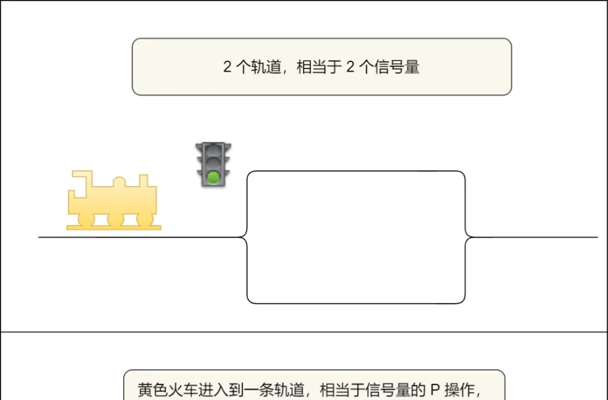
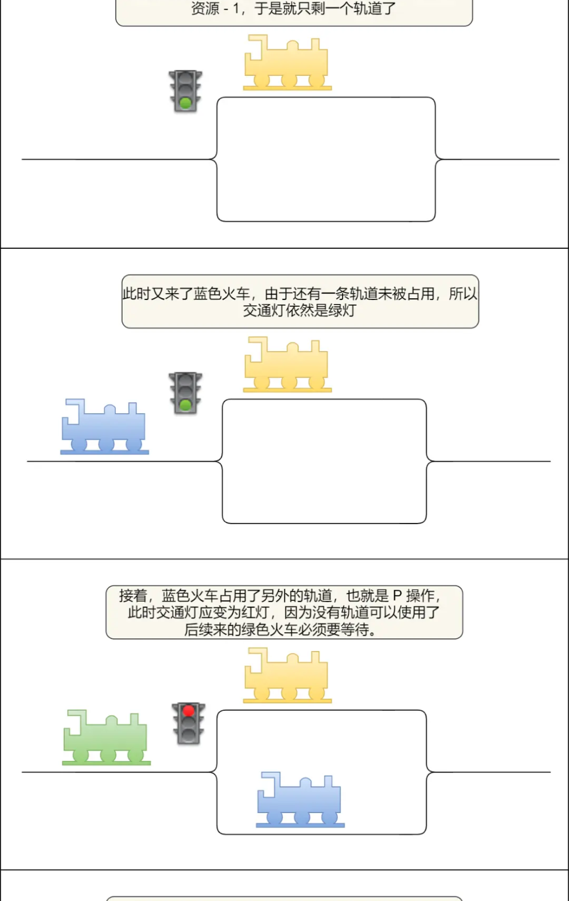
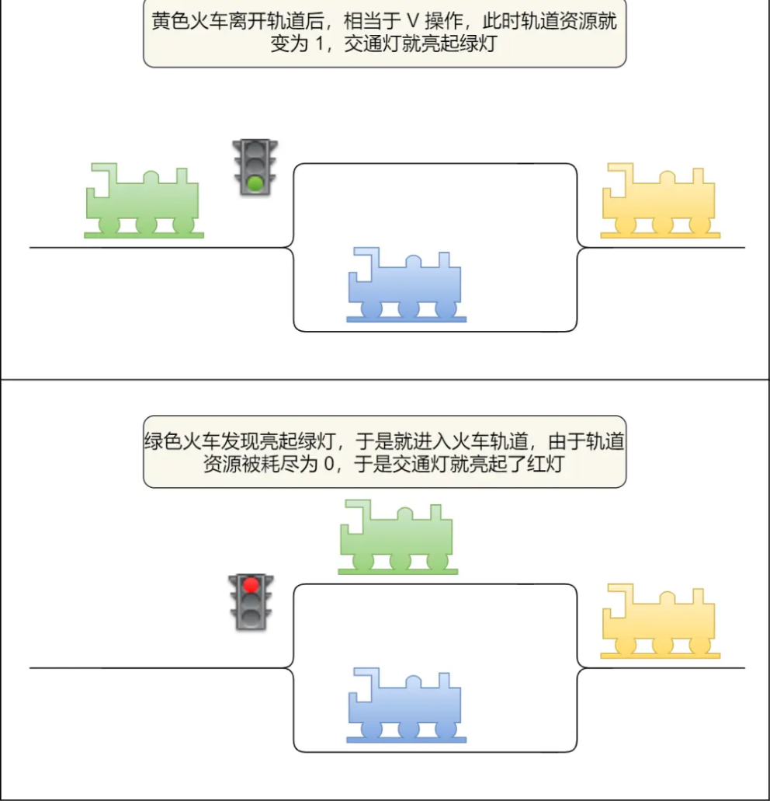
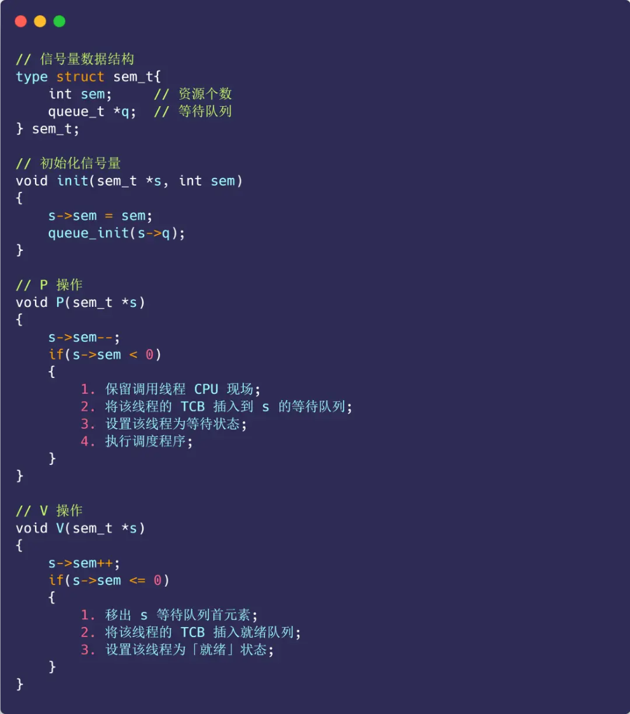

# **<u>腾讯测开，也不简单啊...</u>**

大家好，我是小林。

很多同学觉得后端岗位太卷，都会去投一下测开岗位，但是不知道如何准备测开。 其实测开的面试和后端差不多的，一样是八股文+项目+算法，所以直接按后端开发的方向准备就行了。 今天分享一位同学腾讯测开的面试，腾讯测开的部门是用 go 语言，面试者是 java 技术栈。

这场面试，最后还问了一个智力题，果然是腾讯的风格，目前只发现腾讯爱问这类题目，主要是考察面试者聪明不聪明。

## **<u>问题记录</u>**

### **自我介绍环节**

略

### **对go了解吗?部门主要是偏go语言的**

答：说了之前学过一段时间,但是太长时间没有接触了,如果给一个礼拜的话就可以将相关知识捡回来

**项目问答:说的是项目中写了用 Redis 提高了QPS,那么如果QPS提高了,用户客户端无限制地请求服务器,那么会导致Redis的连接打满吗?比如说能承载的QPS极限是10W,来了12W的请求,该怎么办呢?**

说了使用限流的思路,可以使用其他中间件,比如说使用令牌桶,每秒钟以一定的速率放入令牌,然后只有取到令牌的请求线程才能执行秒杀操作,否则的话就可以让这个线程暂停,或者是执行自动重试、退出。

面试官补充:可以设置一个队列,就是将获得令牌失败的线程放入到一个队列中,然后的等待令牌有空余的时候,这时候就唤醒线程去重新竞争令牌,同时要考虑队列是否会产生内存溢出问题

### **项目问答:Redis中有遇到并发竞争问题吗?**

答:说了秒杀优惠券的引发的并发竞争的问题,引出分布式锁,通过分布式锁来解决并发竞争问题,说了使用 Redission来实现这个分布式锁。

### **项目问答:分布式锁的实现是怎么样的?**

回答:

- 1.互斥,只有一个线程能够在一个时间段内操作这个线程,通过setnx实现。
- 2.可重入,可以通过一个设置一个 hash结构 ,这个哈希结构是这样设置的 {线程ID}=>{锁的重入次数} , 当线程到来的时候就判断有没有这个数据,如果有这个数据的话,那么就检查线程ID是否和自己的ID 一样,如果一样的话就锁重试次数++,当重入结束的时候,就让这个锁的重入次数--,当锁的重入次数 ==0的时候,删除这个键值对。
- 3.实现锁的自动续期,通过看门狗机制,这个点有点记不清了,于是凭着印象简单说了一下,就是开辟一个守护线程,然后这个守护线程定期去更新锁的过期时间,当业务没有结束的时候就一直更新这个锁的过期时间

4.实现锁的自动重试,当线程获取锁失败后,可以让线程自旋等待锁
5.防止死锁,设置锁的过期时间

- 4.实现锁的自动重试,当线程获取锁失败后,可以让线程自旋等待锁
- 5.防止死锁,设置锁的过期时间

### **项目问答:守护线程是什么意思?**

答:就是为了防止锁在业务没有执行完成后就释放掉了,开启一个线程来定期对这把锁进行延期操作

### **项目问答:假设这样一个场景,就是业务线程挂掉了,然后守护线程一直还在更新这把锁的延期时间,会怎么样?怎么办? (不会)**

答:猜的....从业务线程的角度回答,可以通过语言的特性,就是 try-catch-finally 的特性,来保证这把锁一定会释放,从守护线程的角度来看,可以通过统计这个业务的执行时长,定义一个最长的业务执行时间,如果在这个时间内一直还在更新这把锁的过期时间,那么就释放这个锁,然后上报业务层

##### **补充：**

业务线程挂了分情况。一种是整个程序被干掉了，比如掉线了。一个情况是程序出现 bug 了，导致业务线程在执行解锁逻辑之前被干掉了，或者说业务线程死循环了、忘记解锁了这类情况，都归属于 bug。

第一种情况，程序被干掉了，那么守护线程也没了，所以不会续期了，时间到了就释放锁，这个没问题。

第二种情况，根据看门狗机制，它就是会无线续期。相当于变成了一个死锁。这是由它的工作原理决定的，无解。但是可以自己魔改一下看门狗机制，比如设定为续期 1000 次后还要续期，就有可能出问题了，那就释放锁。但是这个方案，聊胜于无。还不如设置一个较长的过期时间。

我觉得这种情况不应该考虑怎么改进看门狗机制，而是应该考虑怎么监控它是否在正常运行。比如续期了 1000 次还在续期，就发个预警出来，人工看看啥情况，然后具体情况具体分析，是 bug 就修 bug， 是正常运行就先不管。人工一介入，就没有啥不能解决的。

### **信号量的工作原理是什么?**

答:从底层的数据结构来说,信号量包含两个字段,第一个字段是这个信号量代表的资源个数,当>0的时候,比如说是n,那么就代表说有n个资源可用,当<0,代表说有有n个线程因为这个资源被阻塞了,第二个字段是阻塞队列,当有线程释放资源的时候,就会唤醒这个阻塞队列中的线程。

##### **补充：**

信号量是操作系统提供的一种协调共享资源访问的方法。

通常 **信号量表示资源的数量**，对应的变量是一个整型（sem）变量。

另外，还有 **两个原子操作的系统调用函数来控制信号量的**，分别是：

- _P_ 操作：将 sem 减 1，相减后，如果 sem < 0，则进程/线程进入阻塞等待，否则继续，表明 P 操作可能会阻塞；
- _V_ 操作：将 sem 加 1，相加后，如果 sem <= 0，唤醒一个等待中的进程/线程，表明 V 操作不会阻塞；

很多人问，V 操作中 sem <= 0 的判断是不是写反了？

没写反，我举个例子，如果 sem = 1，有三个线程进行了 P 操作：

- 第一个线程 P 操作后，sem = 0；
- 第二个线程 P 操作后，sem = -1；
- 第三个线程 P 操作后，sem = -2；

这时，第一个线程执行 V 操作后， sem 是 -1，因为 sem <= 0，所以要唤醒第二或第三个线程。

- P 操作是用在进入临界区之前，V 操作是用在离开临界区之后，这两个操作是必须成对出现的。

举个类比，2 个资源的信号量，相当于 2 条火车轨道，PV 操作如下图过程：

信号量与火车轨道

操作系统是如何实现 PV 操作的呢？

信号量数据结构与 PV 操作的算法描述如下图：

PV 操作的算法描述

PV 操作的函数是由操作系统管理和实现的，所以操作系统已经使得执行 PV 函数时是具有原子性的。

### **为什么有HTTP协议了?还要用RPC?**

答:1.从项目实践的角度上来讲,使用HTTP协议规定的协议码对于RPC框架提供的异常信息返回的角度来说,HTTP所蕴含的信息不够丰富,不够直观,比如说通信双方的执行状态只能够通过状态码来描述,而RPC框架可以返回完整的异常信息

2.从编码的角度上来看,HTTP的编码比较冗余,也就是说需要通过定义一大堆的状态码来定义当前的状态, 对于不同的服务,这些编码可能还有不同的含义,不合适

3.HTTP通常来说前端和后端通信使用的,包含了大量的浏览器跳转状态定义,这些状态对于后端服务器之间的联调是没有意义的,因此在这样的情况下,而RPC自定义的协议,可以免去这些冗余的状态,更加定制化地是设定这个后端服务联调

##### **补充：**

- RPC 本质上不算是协议，而是一种调用方式，而像 gRPC 和 Thrift 这样的具体实现，才是协议，它们是实现了 RPC 调用的协议。目的是希望程序员能像调用本地方法那样去调用远端的服务方法。同时 RPC 有很多种实现方式，不一定非得基于 TCP 协议。
- 从发展历史来说，HTTP 主要用于 B/S 架构，而 RPC 更多用于 C/S 架构。但现在其实已经没分那么清了，B/S 和 C/S 在慢慢融合。很多软件同时支持多端，所以对外一般用 HTTP 协议，而内部集群的微服务之间则采用 RPC 协议进行通讯。
- RPC 其实比 HTTP 出现的要早，且比目前主流的 HTTP/1.1 性能要更好，所以大部分公司内部都还在使用 RPC。
- HTTP/2.0在 HTTP/1.1的基础上做了优化，性能可能比很多 RPC 协议都要好，但由于是这几年才出来的，所以也不太可能取代掉 RPC。

### **go的map底层原理是什么?**

答:不会...问面试官能不能说Java的HashMap,说可以。

HashMap的底层是基于数组+ 链表/红黑树来实现的,其中数组是 HashMap 的主体,而链表和红黑树是为了解决哈希冲突而实现的,哈希冲突指的是多个不同的key,通过hash()计算出来的index是一致的,为了解决这个问题,可以使用拉链法来实现,也就是发现通过key计算出来的位置有元素的时候,这时候就将 {value} 插入到这个下标上的链表或者红黑树,除此之外,还有再哈希法,开放寻址法等方法来解决这个问题

### **写代码中用到并发吗?**

答：说了项目中用到线程池

### **Git用过吗?Git上有敏感数据吗?比如说docker-compose或者是脚本文件中有敏感信息,你怎么来管理?**

答:说了通过本地配置文件,比如说 docker-compose 中配置密钥资源的时候,将敏感数据部署在物理机本地,然后在文件内部通过引用的方式来引用这个密钥,这样的话就可以避免密钥上传到git上,导致泄露,还有的话就是可以通过合理配置权限,具体来说就是在 docker-compose 的目录中配置一个 .ini 文件,然后将键值对,例如 MYSQL_PASSWORD=123456 填入到这个文件中,然后在 docker-compose 中通过

$MYSQL_PASSWORD 来引用这个数据,因此 docker-compose 这些要上git的数据就不会部署到git上了

### **知道测试开发是怎么做的吗?**

答:

- 1.写测试用例,设计测试用例
- 2.开发测试工具

### **Linux操作过吗?说一说常见的指令**

答:

1.文件相关(mv mkdir cd ls)
3.权限相关(chmod chown useradd groupadd)
4.网络相关(netstat ip addr)
5.测试相关(测试连通性:ping 测试端口连通性:telnet)

- 1.文件相关(mv mkdir cd ls)
- 2.docker相关(docker container ls docker ps -a )
- 3.权限相关(chmod chown useradd groupadd)
- 4.网络相关(netstat ip addr)
- 5.测试相关(测试连通性:ping 测试端口连通性:telnet)

### **智力题**

屋里四盏灯，屋外四个开关，一个开关仅控制一盏灯，屋外看不到屋里，怎样只进屋一次，就知道哪个开关控制哪盏

**chatgpt 4.0 的回答：**

为了找出哪个开关控制哪盏灯，你可以按照以下步骤操作：

1. 先打开第一个开关，等待几分钟。
2. 然后关闭第一个开关，打开第二个开关。
3. 进入屋内。

现在你会看到以下情况：

一盏灯亮着：这盏灯是由第二个开关控制的。

- 一盏灯熄灭，但灯泡发热：这盏灯是由第一个开关控制的，因为它之前亮着但现在已经关闭。 剩下两盏灯熄灭且不发热：分别由第三个和第四个开关控制。

为了确定第三个和第四个开关分别控制哪盏灯，只需在屋内尝试打开其中一个。如果这盏灯亮起，那么就知道它由当前打开的开关控制，另一盏灯则由未尝试的开关控制。这样就可以在进屋一次的情况下， 找出四个开关分别控制哪盏灯。

### **算法题**

10w个字的文章,都是小写字母,求其中出现次数最多的字母

答：统计词频+排序+输出

### **反问**

部门技术栈是什么?测开具体做啥?

## **<u>面试总结</u>**

感觉：

有些问题回答得不是很清晰,对项目还是不太熟

不足之处：

智力题没什么思路,应该还要继续看相关的题目
