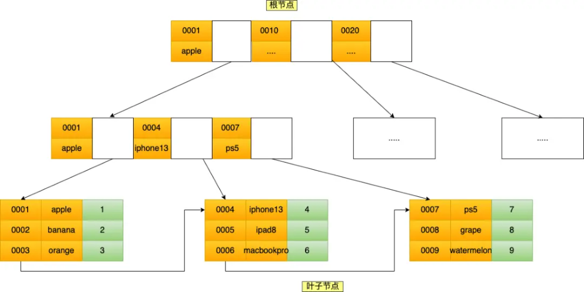
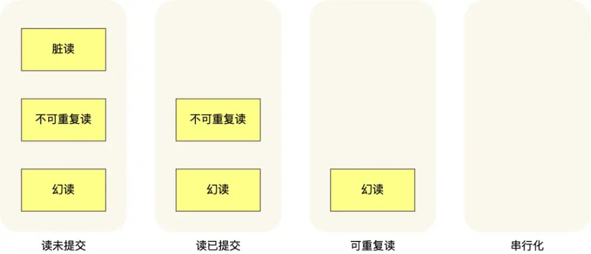
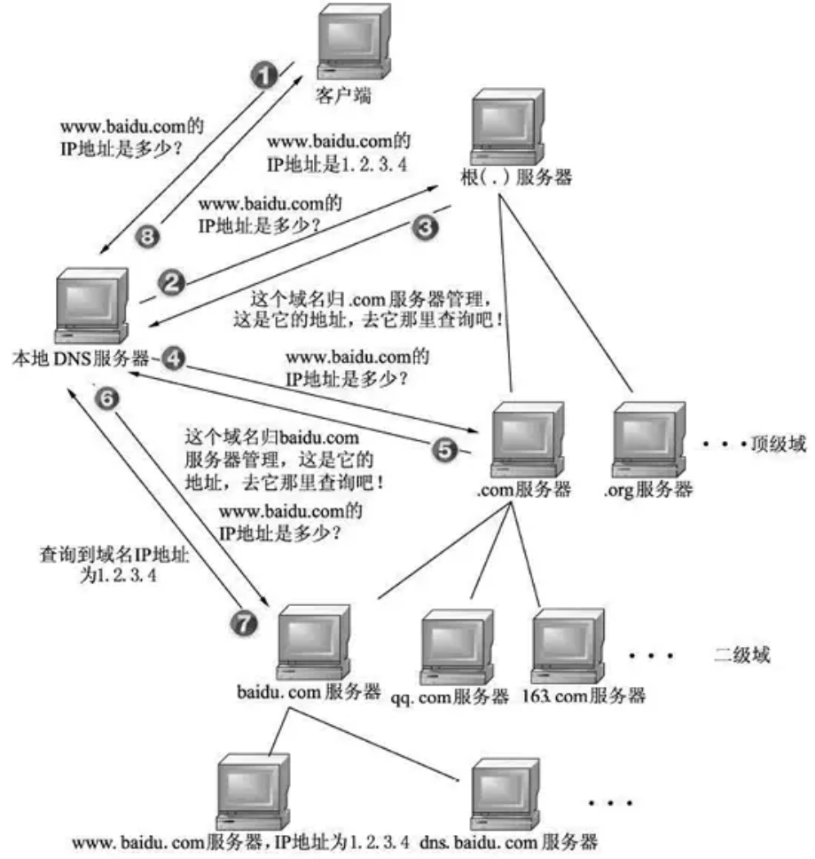

# **<u>米哈游稳住了！问的很基础！</u>**

大家好，我是小林。

五一收假了，又要卷起来了。

今天分享米哈游的春招实习面经，主要考察了java+操作系统+mysql+网络，这四个方面。

面试流程，共1小时，1min自我介绍，20min写题，剩下问题基础知识。

## **<u>Java</u>**

### **String，StringBuilder， StringBuffer区别？单线程大量操作字符串用哪个？**

回答：用StringBuilder

**补充：**

String、StringBuilder和StringBuffer都是Java中用于操作字符串的类。

String是不可变的字符序列，每次对String进行修改时都会创建一个新的String对象，因此在大量操作字符串时，使用String会频繁地创建对象，导致性能较低。

StringBuilder和StringBuffer都是可变的字符序列，可以对其进行多次修改而不创建新的对象。两者的区别在于线程安全性，StringBuffer是线程安全的，而StringBuilder是非线程安全的。因为StringBuffer 的所有共有方法都是同步的，所以在多线程环境下使用StringBuffer可以保证线程安全，但是会降低性能。而StringBuilder没有同步方法，所以在单线程环境下使用StringBuilder性能更高。

因此，在单线程环境下进行大量的字符串操作时，应该使用StringBuilder，可以获得更好的性能。在多线程环境下，使用StringBuffer可以保证线程安全，但是会牺牲一定的性能。

综上所述，单线程大量操作字符串时应该使用StringBuilder，而在多线程环境下应该使用 StringBuffer。

### **synchronized偏向锁直接升级为重量级锁吗？重量级锁怎么实现的？**

回答：扯了一下synchronized四种锁

##### **补充：**

偏向锁不会直接升级为重量级锁，而是会先升级为轻量级锁，如果轻量级锁竞争失败，则再升级为重量级锁。

重量级锁的实现一般是通过操作系统的互斥量（mutex）来实现的。当一个线程获取重量级锁时，会将该线程挂起，直到锁被释放。这种锁的性能比较低，因为每次加锁和释放锁都需要涉及到操作系统的系统调用，会有较大的开销。因此，在实际应用中，要尽量避免使用重量级锁。

### **Java中的异常**

回答：分类不大记得。讲了异常的捕获，from\to\target指针

##### **补充：**

当程序出现异常时，Java会抛出一个异常对象。Java中的异常可以分为三类：

1. Checked Exception（受检异常）：这种异常在编译时就可以被检测出来，必须要在代码中进行处理或者声明抛出，否则编译不通过。这类异常主要是由程序的外部环境引起的，例如文件不存在、 网络连接失败等。常见的Checked Exception包括IOException、SQLException等。
2. Unchecked Exception（非受检异常）：这种异常通常是由程序内部错误引起的，例如 NullPointerException、ArrayIndexOutOfBoundsException、IllegalArgumentException等。这类异常不需要在代码中声明抛出，也可以不进行处理，但是如果不进行处理，程序会崩溃。
3. Error：这种异常通常是由JVM或者硬件引起的，例如OutOfMemoryError、StackOverflowError 等。这类异常也不需要在代码中声明抛出，也可以不进行处理，但是如果不进行处理，程序也会崩溃。

在Java中，异常处理通常包括try-catch语句和throw语句。try-catch语句可以捕获异常并进行处理，而 throw语句可以手动抛出异常。

## **<u>操作系统</u>**

### **进程间的通信方式？管道模型的分类？**

最简单的方式就是 **管道**，管道分为「匿名管道」和「命名管道」。

- **匿名管道** 顾名思义，它没有名字标识，匿名管道是特殊文件只存在于内存，没有存在于文件系统中，shell 命令中的「|」竖线就是匿名管道，通信的数据是无格式的流并且大小受限，通信的方式是单向的，数据只能在一个方向上流动，如果要双向通信，需要创建两个管道，再来匿名管道是只能用于存在父子关系的进程间通信，匿名管道的生命周期随着进程创建而建立，随着进程终止而消失。
- **命名管道** 突破了匿名管道只能在亲缘关系进程间的通信限制，因为使用命名管道的前提，需要在文件系统创建一个类型为 p 的设备文件，那么毫无关系的进程就可以通过这个设备文件进行通信。另外，不管是匿名管道还是命名管道，进程写入的数据都是缓存在内核中，另一个进程读取数据时候自然也是从内核中获取，同时通信数据都遵循先进先出原则。

**消息队列** 克服了管道通信的数据是无格式的字节流的问题，消息队列实际上是保存在内核的「消息链表」，消息队列的消息体是可以用户自定义的数据类型，发送数据时，会被分成一个一个独立的消息体，当然接收数据时，也要与发送方发送的消息体的数据类型保持一致，这样才能保证读取的数据是正确的。消息队列通信的速度不是最及时的，毕竟每次数据的写入和读取都需要经过用户态与内核态之间的拷贝过程。

**共享内存** 可以解决消息队列通信中用户态与内核态之间数据拷贝过程带来的开销，它直接分配一个共享空间，每个进程都可以直接访问，就像访问进程自己的空间一样快捷方便，不需要陷入内核态或者系统调用，大大提高了通信的速度， **享有最快的进程间通信方式之名**。但是便捷高效的共享内存通信，带来新的问题，多进程竞争同个共享资源会造成数据的错乱。

那么，就需要 **信号量** 来保护共享资源，以确保任何时刻只能有一个进程访问共享资源，这种方式就是互斥访问。信号量不仅可以实现访问的互斥性，还可以实现进程间的同步，信号量其实是一个计数器，表示的是资源个数，其值可以通过两个原子操作来控制，分别是 P 操作和 V 操作。

与信号量名字很相似的叫 **信号**，它俩名字虽然相似，但功能一点儿都不一样。信号可以在应用进程和内核之间直接交互，内核也可以利用信号来通知用户空间的进程发生了哪些系统事件，信号事件的来源主要有硬件来源（如键盘 Cltr+C）和软件来源（如 kill 命令），一旦有信号发生，进程有三种方式响应信号 1. 执行默认操作、2. 捕捉信号、3. 忽略信号。有两个信号是应用进程无法捕捉和忽略的，即 SIGKILL 和 SIGSTOP，这是为了方便我们能在任何时候结束或停止某个进程。

前面说到的通信机制，都是工作于同一台主机，如果要与不同主机的进程间通信，那么就需要 **Socket 通信** 了。Socket 实际上不仅用于不同的主机进程间通信，还可以用于本地主机进程间通信，可根据创建 Socket 的类型不同，分为三种常见的通信方式，一个是基于 TCP 协议的通信方式，一个是基于 UDP 协议的通信方式，一个是本地进程间通信方式。

### **内核态和用户态区别？内核态的底层操作有什么？为什么要分两个不同的态？**

内核态和用户态是操作系统中的两种运行模式。它们的主要区别在于权限和可执行的操作：

1. 内核态（Kernel Mode）：在内核态下，CPU可以执行所有的指令和访问所有的硬件资源。这种模式下的操作具有更高的权限，主要用于操作系统内核的运行。
2. 用户态（User Mode）：在用户态下，CPU只能执行部分指令集，无法直接访问硬件资源。这种模式下的操作权限较低，主要用于运行用户程序。

内核态的底层操作主要包括：内存管理、进程管理、设备驱动程序控制、系统调用等。这些操作涉及到操作系统的核心功能，需要较高的权限来执行。

分为内核态和用户态的原因主要有以下几点：

1. 安全性：通过对权限的划分，用户程序无法直接访问硬件资源，从而避免了恶意程序对系统资源的破坏。
2. 稳定性：用户态程序出现问题时，不会影响到整个系统，避免了程序故障导致系统崩溃的风险。
3. 隔离性：内核态和用户态的划分使得操作系统内核与用户程序之间有了明确的边界，有利于系统的模块化和维护。

内核态和用户态的划分有助于保证操作系统的安全性、稳定性和易维护性。

## **<u>mysql</u>**

### **一条语句，问怎么加索引比较好？**

在MySQL中，创建索引可以提高查询性能。为了给某个列添加索引，我们可以使用以下语句：

CREATE INDEX index_name ON table_name(column_name);

在这里， index_name 是你为索引指定的名称， table_name 是你要添加索引的表名，而 column_name 是你要添加索引的列名。

在选择要添加索引的列时，请考虑以下几点：

1. 对于经常用于查询条件的列，添加索引可以提高查询速度。
2. 对于具有许多重复值的列，添加索引的性能提升可能不明显。
3. 尽量避免在非常大的表上创建过多索引，因为这会影响插入和更新操作的性能。

### **什么是联合索引？**

通过将多个字段组合成一个索引，该索引就被称为联合索引。

比如，将商品表中的 product_no 和 name 字段组合成联合索引 (product_no, name)，创建联合索引的方式如下：

CREATE INDEX index_product_no_name ON product(product_no, name);

联合索引 (product_no, name) 的 B+Tree 示意图如下（图中叶子节点之间我画了单向链表，但是实际上是双向链表，原图我找不到了，修改不了，偷个懒我不重画了，大家脑补成双向链表就行）。

联合索引

可以看到，联合索引的非叶子节点用两个字段的值作为 B+Tree 的 key 值。当在联合索引查询数据时， 先按 product_no 字段比较，在 product_no 相同的情况下再按 name 字段比较。

也就是说，联合索引查询的 B+Tree 是先按 product_no 进行排序，然后再 product_no 相同的情况再按 name 字段排序。

因此，使用联合索引时，存在 **最左匹配原则**，也就是按照最左优先的方式进行索引的匹配。在使用联合索引进行查询的时候，如果不遵循「最左匹配原则」，联合索引会失效，这样就无法利用到索引快速查询的特性了。

### **mysql的四种隔离级别？**

- **读未提交（read uncommitted）**，指一个事务还没提交时，它做的变更就能被其他事务看到； **读提交（read committed）**，指一个事务提交之后，它做的变更才能被其他事务看到； **可重复读（repeatable read）**，指一个事务执行过程中看到的数据，一直跟这个事务启动时看到的数据是一致的， **MySQL InnoDB 引擎的默认隔离级别**；

**串行化（serializable）**；会对记录加上读写锁，在多个事务对这条记录进行读写操作时，如果发生了读写冲突的时候，后访问的事务必须等前一个事务执行完成，才能继续执行；

针对不同的隔离级别，并发事务时可能发生的现象也会不同。

图片

也就是说：

- 在「读未提交」隔离级别下，可能发生脏读、不可重复读和幻读现象；
- 在「读提交」隔离级别下，可能发生不可重复读和幻读现象，但是不可能发生脏读现象；
- 在「可重复读」隔离级别下，可能发生幻读现象，但是不可能脏读和不可重复读现象； 在「串行化」隔离级别下，脏读、不可重复读和幻读现象都不可能会发生。

### **什么是脏读、幻读、不可重复读？**

- 脏读：如果一个事务「读到」了另一个「未提交事务修改过的数据」，就意味着发生了「脏读」现象。
- 不可重复读：在一个事务内多次读取同一个数据，如果出现前后两次读到的数据不一样的情况，就意味着发生了「不可重复读」现象。
- 幻读：在一个事务内多次查询某个符合查询条件的「记录数量」，如果出现前后两次查询到的记录数量不一样的情况，就意味着发生了「幻读」现象。

### **mysql的innodb如何避免不可重复读？**

mysql的默认隔离级别是可重复读，可重复读隔离级别在开启事务后，执行第一个selete 语句的时候， 会生成一个 Read View，后面整个事务期间的selete都在用这个 Read View，所以事务期间上读取的数据都是一致的，不会出现前后读取的数据不一致的问题，所以避免了不可重复读。

## **<u>网络</u>**

### **输入网址后发生了什么？**

回答：应用层DNS解析，传输层TCP连接，网络层IP，数据链路MAC，真实物理层，接收到之后再一层层扒皮。

### **DNS解析的具体过程**

DNS 域名解析，简单地说就是把域名翻译成 IP 地址。例如：把 <u>www.baidu.com</u> 这个域名翻译成对应 IP 220.181.38.251，这里只是举个例子。

域名解析流程

上图中分 8 个步骤介绍了域名解析的流程，但在此之前会先检查本机的缓存配置+ hosts 解析，然后才真正执行上图的流程：

- 首先，再进行dns服务器解析之前，会查缓存，总共有两次缓存的查询：
   - 浏览器缓存检查：浏览器会首先搜索浏览器自身的 DNS 缓存，缓存时间比较短，大概只有1分钟， 且只能容纳 1000 条缓存，看自身的缓存中是否有对应的条目，而且没有过期，如果有且没有过期

##### 则解析到此结束。

- 操作系统缓存检查 + hosts 解析：如果浏览器的缓存里没有找到对应的条目，操作系统也会有一个域名解析的过程，那么浏览器先搜索操作系统的 DNS 缓存中是否有这个域名对应的解析结果，如果找到且没有过期则停止搜索，解析到此结束。在 Linux 中可以通过 /etc/hosts 文件来设置，可以将任何域名解析到任何能够访问的IP 地址。如果在这里指定了一个域名对应的 IP 地址，那么浏览器会首先使用这个 IP地址。当解析到这个配置文件中的某个域名时，操作系统会在缓存中缓存这个解析结果，缓存的时间同样是受这个域名的失效时间和缓存的空间大小控制的。

##### 接着就进行dns解析：

- 第一步：客户端通过浏览器访问域名为 <u>www.baidu.com (http://www.baidu.com)</u> 的网站，发起查询该域名的 IP 地址的 DNS 请求。该请求发送到了本地 DNS 服务器上。本地 DNS 服务器会首先查询它的缓存记录，如果缓存中有此条记录，就可以直接返回结果。如果没有，本地 DNS 服务器还要向 DNS 根服务器进行查询。
- 第二步：本地 DNS 服务器向根服务器发送 DNS 请求，请求域名为 <u>www.baidu.com (http://www. baidu.com)</u> 的 IP 地址。
- 第三步：根服务器经过查询，没有记录该域名及 IP 地址的对应关系。但是会告诉本地 DNS 服务器，可以到域名服务器上继续查询，并给出域名服务器的地址(.com 服务器)。
- 第四步：本地 DNS 服务器向 .com 服务器发送 DNS 请求，请求域名 <u>www.baidu.com (http://ww w.baidu.com)</u> 的 IP 地址。
- 第五步：com 服务器收到请求后，不会直接返回域名和 IP 地址的对应关系，而是告诉本地DNS 服务器，该域名可以在 baidu.com 域名服务器上进行解析获取 IP 地址，并告诉 baidu.com 域名服务器的地址。
- 第六步：本地 DNS 服务器向 baidu.com 域名服务器发送 DNS 请求，请求域名 <u>www.baidu.com</u> ( <u>http://www.baidu.com)</u> 的 IP 地址。
- 第七步：baidu.com 服务器收到请求后，在自己的缓存表中发现了该域名和 IP 地址的对应关系， 并将 IP 地址返回给本地 DNS 服务器。
- 第八步：本地 DNS 服务器将获取到与域名对应的 IP 地址返回给客户端，并且将域名和 IP 地址的对应关系保存在缓存中，以备下次别的用户查询时使用。

##### 最后引用大佬的一张图做下总结：
